<div align="center">
  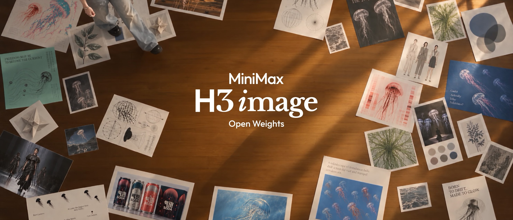
</div>

<p align="center">
  <a href="https://hailuoai.video" target="_blank"></a>
  <a href="https://platform.minimax.io" target="_blank"></a>
  <a href="https://www.minimax.io" target="_blank"></a>
  <a href="https://github.com/MiniMax-AI/MiniMax-H3-Image" target="_blank"></a>
  <a href="https://huggingface.co/MiniMaxAI/MiniMax-H3-Image" target="_blank"></a>
  <br>
  <a href="https://modelscope.cn/models/MiniMax/MiniMax-H3-Image" target="_blank" rel="noopener noreferrer"></a>
  <a href="https://platform.minimax.cn/docs/faq/contact-us" target="_blank"></a>
  <a href="https://discord.com/invite/dbMxutw7tP" target="_blank"></a>
  <a href="LICENSE"></a>
</p>

<p align="center">
  <a href="README.md">English</a> |
  <a href="README.zh-CN.md">简体中文</a> |
  <a href="README.ko.md">한국어</a> |
  <a href="README.ja.md"><strong>日本語</strong></a>
</p>

<h1 align="center">MiniMax-H3-Image</h1>

<p align="center"><b><i>One idea with open weights. A world of uses.</i></b></p>

<p align="center">
  <a href="#プロンプト作成スキル">プロンプト作成スキル</a> ·
  <a href="#オンラインで使う">オンラインで使う</a> ·
  <a href="#概要">概要</a> ·
  <a href="#ショーケース">ショーケース</a> ·
  <a href="#ローカルで実行">ローカルで実行</a> ·
  <a href="#プロンプトのコツ">プロンプトのコツ</a> ·
  <a href="#ライセンス">ライセンス</a>
</p>

## プロンプト作成スキル

MiniMax-H3-Image は、画像全体を詳しく記述した説明文を与えたときに最も良い結果を出します。`h3-image-prompt-writing` スキルを使うと、お使いのエージェントが短いアイデア、ブリーフ、既存のプロンプト、または参照画像のセットからその説明文を作成し、MiniMax API で画像を生成できるようになります。[skills CLI](https://github.com/vercel-labs/skills) でインストールします:

```bash
npx skills add https://github.com/MiniMax-AI/MiniMax-H3-Image --skill h3-image-prompt-writing
```

- **プロンプトを作成**：テキストからの画像生成用のプロンプトと、最大 16 枚の参照画像を使う画像編集用のプロンプトを、それぞれアスペクト比とあわせて作成します。
- **公式のコツとガイドに準拠**：公式の [プロンプトのコツ](#プロンプトのコツ) に加え、テキストからの画像生成用の [`t2i-en.txt`](skills/h3-image-prompt-writing/references/t2i-en.txt) と画像編集用の [`edit-en.txt`](skills/h3-image-prompt-writing/references/edit-en.txt) という 2 つの詳細なガイドに従います。
- **画像を生成**：[`scripts/generate.py`](skills/h3-image-prompt-writing/scripts/generate.py) でプロンプトを MiniMax API に送り、画像を生成します。このスクリプトは Python 標準ライブラリだけを使用します。
- **幅広いエージェントで動作**：Claude Code、Claude Agent SDK、Codex、Cursor、Windsurf、LangChain など、`SKILL.md` とローカルファイルを読み取れるあらゆるエージェントで動作します。画像の生成には、Python を実行でき、ネットワークにアクセスできるエージェントが必要です。同梱の `agents/openai.yaml` は、ChatGPT/Codex のスキル UI 向けに表示用のメタデータを追加するだけです。

インストールしたら、ふだんの言葉で依頼するだけです:

```text
h3-image-prompt-writing を使って、雨の夜市を描いた 3:4 のポスターを作ってください。
タイトルは「雨夜集市」にして、画像まで生成してください。
```

> [!TIP]
> 画像を生成するには `MINIMAX_API_KEY` を設定します（中国国内で使う場合は `MINIMAX_API_BASE=https://api.minimax.cn` も設定します）。テキストからの画像生成では、スクリプトが `disable_prompt_enhanced: true` で API 側のプロンプト拡張を無効にするため、画像はスキルが書いたプロンプトどおりに生成されます。画像編集のリクエストは常に拡張されます。自分の GPU で生成する場合は、[ローカルで実行](#ローカルで実行) で起動したサーバーに、[サイズ](#サイズ) の `size` とあわせてプロンプトを送ってください。すべてのスキルの一覧は [`skills/README.md`](skills/README.md) にあります。

## オンラインで使う

セットアップなしで MiniMax のアプリから MiniMax-H3-Image を使えるほか、MiniMax API からも呼び出せます。

| | グローバル | 中国 |
| --- | --- | --- |
| Web アプリ | [hailuoai.video](https://hailuoai.video/) | [hailuoai.com](https://hailuoai.com/) |
| デスクトップアプリ | [agent.minimax.io](https://agent.minimax.io/) | [agent.minimax.cn](https://agent.minimax.cn) |
| API プラットフォーム | [platform.minimax.io](https://platform.minimax.io/docs/guides/image-generation) | [platform.minimax.cn](https://platform.minimax.cn/docs/guides/image-generation) |
| API リファレンス | [テキストからの画像生成](https://platform.minimax.io/docs/api-reference/image-generation-h3-generations) · [画像編集](https://platform.minimax.io/docs/api-reference/image-generation-h3-edits) · [プロンプト拡張](https://platform.minimax.io/docs/api-reference/image-generation-h3-context-ir) | [テキストからの画像生成](https://platform.minimax.cn/docs/api-reference/image-generation-h3-generations) · [画像編集](https://platform.minimax.cn/docs/api-reference/image-generation-h3-edits) · [プロンプト拡張](https://platform.minimax.cn/docs/api-reference/image-generation-h3-context-ir) |

## 概要

**MiniMax-H3-Image は、画像生成・編集のための最先端のオープンソースモデルです。創作意図を深く理解する力と、豊かな視覚世界を構築する力を兼ね備えています。** 正確な指示追従によって、クリエイティブなコンセプトを完成度の高いキャラクター、シーン、視覚的な雰囲気へと仕上げます。生成と編集は 1 つの checkpoint に統合されており、クリエイターや開発者は柔軟かつ制御しやすい方法で画像を作成できます。

このモデルは [MiniMax H3](https://huggingface.co/MiniMaxAI/MiniMax-H3) ファミリーに属します。4096x4096（1:1）から 6272x2688（21:9）まで、どのアスペクト比でも約 16 MP（1,600 万画素）の画像を、アップスケーラーを使わずに直接生成します。checkpoint は classifier-free guidance を使わない 6 サンプリングステップ（6 NFE）に蒸留されています。拡散 Transformer（DiT）は H3 のアーキテクチャから音声層を除いたもので、テキストエンコーダーには MiniMax-H3 のものをそのまま使用します。

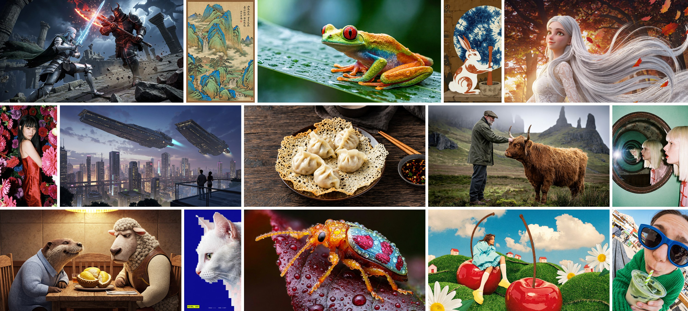

### 主な特長

<table>
<tr>
<td width="33%" valign="top">
<b>実用的なコストで 16 MP を生成</b><br><br>
現在一般的な 1〜4 MP の出力と比べて、16 MP（4096 × 4096）の画像ははるかに多くのディテールを持ちますが、通常は計算コストも大幅に高くなります。MiniMax-H3-Image はそのコストを扱いやすい範囲に抑え、16 MP の生成を日常的な創作で実用的なものにしています。
</td>
<td width="33%" valign="top">
<b>豊かなディテールと高いリアリティ</b><br><br>
MiniMax-H3-Image は見慣れた「AI っぽさ」を超えて、精緻なディテールと本物らしいリアリティを備えた画像を生成し、生成画像を現実の視覚世界が持つ豊かさや繊細さに近づけます。
</td>
<td width="33%" valign="top">
<b>より強い指示追従</b><br><br>
優れた画像生成は、クリエイターのアイデアを形にする手助けをします。MiniMax-H3-Image はオープンソースモデルの中で最も強い指示追従性能を持ち、最大 16 枚の参照画像をサポートするため、クリエイターは最終結果をより細かく制御できます。
</td>
</tr>
</table>

### 仕様

MiniMax API では、以下の仕様でこのモデルを提供しています。ローカルデプロイではプロンプトが拡張されないため、完全なプロンプトを送ってください（[ローカルデプロイ向けのプロンプト](#ローカルデプロイ向けのプロンプト) を参照）。ローカルデプロイでのサイズとリクエストのフィールドは [リクエストとサイズ](#リクエストとサイズ) にまとめています。

| パラメータ | 仕様 |
| --- | --- |
| モデル ID | `MiniMax-H3-Image` |
| タスク | テキストからの画像生成、画像編集 |
| 画像サイズ | `width` + `height`、または `area` + `aspect_ratio` で指定します。デフォルトは `auto` で、面積は 4K、アスペクト比は自動で決まります |
| 出力面積 | `1K`、`2K`、または **`4K`（最良の結果 👍）**。`width` × `height` を直接指定する場合は 655,360〜20,000,000 ピクセル |
| アスペクト比 | 1:3〜3:1 |
| プロンプト | 最大 32,000 文字。4,096 トークンを超える部分は切り捨てられます |
| 参照画像 | 最大 16 枚。1 枚あたり 64 MiB 以下で、辺の長さは 128〜8192 ピクセル、アスペクト比は 1:4〜4:1 |
| 参照画像の形式 | JPG、PNG、WebP、HEIC、HEIF。HTTP(S) URL、Base64、または MiniMax のファイル ID で送信します |
| 1 リクエストあたりの画像数 | 1〜10 |
| プロンプト拡張 | テキストからの画像生成ではデフォルトで有効で、無効にもできます。画像編集では常に有効です。拡張後のプロンプトを返すこともできます |
| 出力 | PNG（デフォルト）、JPEG、WebP。`output_compression` は 0〜100 で、URL（デフォルト）または Base64 で返されます |
| 現時点で未対応 | マスクを使ったインペインティング、透明背景、ユーザー指定の seed、プレビュー画像 |

### モデル一覧

| モデル | 役割 | 精度 | サイズ | Hugging Face |
| --- | --- | --- | --- | --- |
| **MiniMax-H3-Image** | テキストからの画像生成と画像編集 | BF16 (DiT) | 68.65 GB | [MiniMaxAI/MiniMax-H3-Image](https://huggingface.co/MiniMaxAI/MiniMax-H3-Image) |
| **MiniMax-H3-Image-PE**（任意） | テキストからの画像生成用のプロンプト拡張モデル | NVFP4 | 17.9 GB | [MiniMaxAI/MiniMax-H3-Image-PE](https://huggingface.co/MiniMaxAI/MiniMax-H3-Image-PE) |

### モデルアーキテクチャ

MiniMax-H3-Image は H3-Base の設計を踏襲し、音声ブランチを取り除いたものです。テキストプロンプトと参照画像は H3 テキストエンコーダーでエンコードされ、参照画像は画像 VAE でもエンコードされます。すべてのトークンは 1 つのパック済みシーケンスにまとめられてシングルストリーム Transformer に入力され、Transformer がターゲット画像の latent を予測します。VAE はその latent を画像にデコードします。

- **テキストエンコーダー**：MiniMax-H3 の Qwen3-VL テキストエンコーダー全体をそのまま使用します。DiT はその第 50 層の hidden states を読み取ります。
- **画像 VAE**：CNN エンコーダーと 2D ViT デコーダー（24 層）で構成され、空間方向に 16 倍のダウンサンプリングを行い、latent のチャネル数は 24 です。DiT は latent を 2x2 のパッチでパッチ化するため、Transformer の各トークンは 32x32 ピクセルに相当します。
- **拡散 Transformer**：パラメータ数 33.1B の dense なシングルストリーム Transformer で、50 層（hidden size 5376、attention head 数 56、FFN サイズ 14336）と 3D マルチモーダル RoPE を備えます。これは H3-Omni-Transformer と同じ構成です。重みは BF16 で、embedding 層、timestep 層、出力層は FP32 です。

## ショーケース

公式ユーザーガイドの作例を縮小して掲載しています。各画像の下にある **プロンプト** を開くと、その画像を生成したリクエストを確認できます。これはユーザーが書いたままのリクエストです。MiniMax API は生成前に H3-Image-Context-IR でこれらを拡張するため（テキストからの画像生成ではデフォルトで、編集では常に）、そのまま送信できます。ローカルデプロイの場合は、[完全なワークフロー](#完全なワークフロー) のように先に拡張してください。プロンプトの多くは元々中国語で書かれたものです。ここに掲載している英語版は公式の英語ユーザーガイドからの引用で、原文は [简体中文](README.zh-CN.md) 版で確認できます。

### オープンソースの先進的な能力

<p><b>複雑なアイデアを形に。</b> MiniMax-H3-Image は、プロンプトが求める知識、構造、見せ方を理解し、それらを整理してわかりやすい画像にまとめます。多数の参照画像を一度に使う編集から、図解、エンジニアリング図面、視覚的なパズルまで対応します。</p>

#### 最大 16 枚の参照画像

内容、スタイル、レイアウトにそれぞれ別の参照画像を割り当て、ばらばらの素材を 1 枚の画像にまとめられます。素材の配置や空間プランニングから製品パッケージまで、幅広く活用できます。

<p align="center">
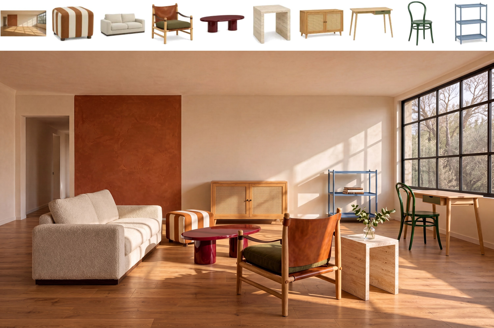
</p>
<p align="center"><em>画像編集（参照画像 10 枚）：空っぽの部屋と 9 点の家具（上）を 1 つのリビングルームに構成（下）</em></p>

<!-- BEGIN showcase-prompts -->
<details>
<summary>プロンプト</summary>

<blockquote>Photograph a living-room lifestyle scene for the spring furniture catalog for the brand “向阳家居” (Xiangyang Home). The first image shows the actual empty room, and the following nine images show the furniture currently on sale against white backgrounds. Retain the camera position, walls, doors, windows, and wooden floor of the empty room. Place each of the nine original furniture pieces in the room exactly once, creating a living room where two or three people can chat or read and write by the window. The lounge chair with leather-strap armrests is the featured product; show it from an angle that clearly reveals its wooden frame, leather-strap armrests, and cushion. Arrange the other furniture according to its actual size and function: tabletops should be accessible when seated, the desk chair should have room to pull out, and there should be an uninterrupted path from the doorway into the room.<br>
Preserve the color, material, structure, and proportions of every product. Let light from the right-hand window fall naturally on the fabric, leather, and wood, with convincing contact shadows beneath table and chair legs. A few books or a single sprig of greenery are allowed; keep the display uncluttered. Real interior photography, with no text.</blockquote>

</details>
<!-- END showcase-prompts -->

#### 教育・科学解説・推論

重要な知識を情報の階層が明確な図解やポスターにまとめ、推理問題は画像の中で解いてみせます。

<p align="center">

</p>
<p align="center"><em>中国語のレッサーパンダのインフォグラフィック（左）と、画像の中で正しく解いた中国語と英語の論理パズル 2 問（右）</em></p>

<!-- BEGIN showcase-prompts -->
<details>
<summary>プロンプト</summary>

<p><b>レッサーパンダの図解（左）</b></p>
<blockquote>Create a 2:3 portrait infographic in Chinese, with the exact Chinese title “读懂小熊猫” and subtitle “山地森林里的树栖生活家” (meaning “Understanding Red Pandas” and “Tree-Dwelling Specialists of Mountain Forests,” respectively). Use a dense animal field-guide style with flat vector illustrations, a pale lime background, dark pine-green text, terracotta-orange bodies, and creamy-white facial markings. Place a dark rounded title bar at the top, followed by a profile, scale bars, a distribution map, and behavioral icons. A central red panda should occupy about one quarter of the composition, standing sideways on a branch and looking back, with its ringed tail hanging naturally toward the lower right and accurate proportions. Arrange detail illustrations and annotations on both sides, with a continuous information strip along the bottom, keeping the entire panel visually consistent.<br>
Include all 14 knowledge groups below, each with a heading, 3–5 short facts, and illustrations:<br>
01 Identity: Class Mammalia, order Carnivora, family Ailuridae; use silhouettes to distinguish it from giant panda cubs and raccoons.<br>
02 Size: Head-and-body length approximately 56–62.5 cm, excluding the tail; tail length approximately 37–47 cm. Use two scale bars and note individual variation.<br>
03 Face: Round head, short muzzle, pointed ears, pale face with dark tear markings, and dark legs and belly; include close-up windows.<br>
04 Fur: Long guard hairs, dense underfur, and fur on the soles; compare its colors with a moss-and-lichen environment.<br>
05 Grip: Five toes on each foot and partially retractile claws; the false thumb is a specialized wrist bone that helps it grasp bamboo.<br>
06 Tail: Ringed pattern, balance, and wrapping around the body for warmth; it cannot coil around a branch to support body weight.<br>
07 Climbing: Rests and takes refuge in trees, grips trunks with its claws, and uses flexible ankles to descend headfirst.<br>
08 Diet: Mainly bamboo leaves and tender shoots, with fruit and insects as well; do not invent dietary percentages.<br>
09 Eating Bamboo: Forepaws hold the branch, the mouth selects tender leaves, and molars chew them; include a three-step diagram.<br>
10 Habitat: Suitable mountain regions in Nepal, India, Bhutan, China, and Myanmar; include a regional distribution map and illustrations of forests, bamboo thickets, and water sources.<br>
11 Activity: Active around dawn and dusk; rests in trees when hot, curls up when cold, and stretches out when warm. Do not invent an exact daily timetable.<br>
12 Communication: Mostly solitary; communicates through scent, calls, and posture.<br>
13 Development: Builds nests in secluded places; newborns have closed eyes, nurse from the mother, and gradually begin exploring. Include a four-stage diagram.<br>
14 Conservation: Forest loss and fragmentation, poaching and trade, and free-roaming dogs; pair these with habitat protection, patrols and monitoring, and community participation.<br>
Include at least 40 substantive facts and approximately 25 supporting illustrations. Keep forms and line weights consistent, organizing the content through numbering, alignment, and thin dividers. Avoid repetitive cards, large empty areas, and crossing leader lines. Maintain a clear Chinese text hierarchy with no garbled characters, repetitive filler, or invented data. Footer sources: Smithsonian National Zoo, San Diego Zoo Wildlife Alliance, Red Panda Network. Output a complete flat display panel, not a mockup.</blockquote>

<p><b>人員選抜の推理問題（右上）</b></p>
<blockquote>Solve the following personnel-selection reasoning problem and generate a visual explanation. Use 16:9 landscape format, a white background, and clear, standardized Chinese typography.<br>
An organization must select exactly three of six staff members—甲, 乙, 丙, 丁, 戊, and 己—for a research team. All of the following conditions must be met:<br>
If 甲 is selected, 乙 must also be selected.<br>
Exactly one of 丙 and 丁 must be selected.<br>
乙 and 戊 cannot both be selected.<br>
If 己 is selected, 丙 must also be selected.<br>
戊 has already been confirmed as selected.<br>
Determine the three-person team using all the conditions.<br>
Show the problem conditions at the top. Divide the lower section into “入选” (Selected) and “未入选” (Not Selected), placing each of the six staff cards in the correct area. Each card should contain a person icon and a prominent name label. Each person must appear exactly once, with no duplicates or omissions.<br>
At the bottom, use brief notes to show the key reasons for exclusion. The card placements, selected names, and notes must agree. Do not add extra conditions. Output only the finished solution image.</blockquote>

<p><em>右下の探偵推理ボードのプロンプトは掲載していません。</em></p>

</details>
<!-- END showcase-prompts -->

#### インダストリアルデザインとプロダクトデザイン

製品の形状、部品同士の関係、分解図を、参照画像をもとに描き起こします。

<p align="center">
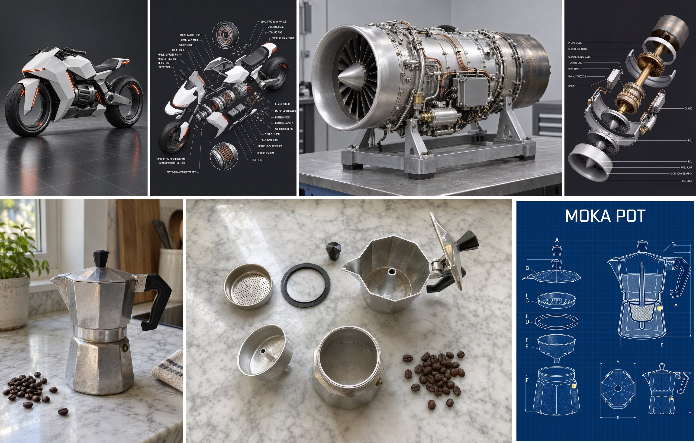
</p>
<p align="center"><em>画像編集：電動バイクとジェットエンジンを分解図に変換（上）、モカポットとその部品をエンジニアリング設計図に変換（下）</em></p>

<!-- BEGIN showcase-prompts -->
<details>
<summary>プロンプト</summary>

<p><b>電動バイクの分解図（上段左の2枚）</b></p>
<blockquote>Disassemble the concept electric motorcycle in image 1 into a highly detailed exploded parts diagram, keeping its form, white geometric bodywork, metallic-gray motor, hubless wheels, and orange-red light strips consistent with image 1.<br>
<br>
Disassembly layout: Use an isometric view centered on the motor unit, with all parts radiating outward along their respective assembly directions, clearly spaced and without overlap:<br>
- Front: Split the front fairing into upper and lower sections. Separate the headlight strip, windshield, front fork, hubless front rim, tire, annular bearing inside the rim, and brake disc.<br>
- Middle: Split the white geometric frame shell into multiple faceted panels on both sides, revealing the tubular main frame. Separate the motor housing, cooling fins, stator, rotor, and motor controller. Pull the battery pack out separately, placing the battery modules and wiring harness beside it.<br>
- Rear: Separate the seat assembly into cushion and base, followed by the rear swingarm, rear shock absorber, rear rim, tire, and taillight strip.<br>
- Small parts: Group bolts, washers, clips, bearings, and connectors beside their corresponding components according to their installation positions, with fine dashed lines leading back to the mounting points.<br>
- Add two circular magnified insets showing the bearing structure of the hubless rim and the stator windings inside the motor.<br>
<br>
Text annotations: Connect every major component to an ALL-CAPS English label using a thin white leader line with a small dot at its endpoint. Text must be legible and correctly spelled, with labels arranged neatly along the edges.<br>
<br>
Use a dark-gray background with faint isometric grid lines, soft even lighting, and clean highlights along the component edges. The composition should be full, clearly layered, and orderly, resembling a structural breakdown from a professional industrial design firm.</blockquote>

<p><b>ジェットエンジンの分解図（上段右の2枚）</b></p>
<blockquote>Turn the jet engine in image 1 into a high-precision exploded structural rendering. Use a solid dark-gray background and an oblique overhead isometric view, with components floating apart along a diagonal axis from the upper right to the lower left: intake cowling, compressor blade discs, combustion chamber, turbine discs, central shaft, and exhaust nozzle in sequence. Divide the engine casing into curved panels suspended around the main shaft; distribute the electronic control box, fuel pump, accessory gears, fuel lines, and copper-colored wiring harnesses on either side. Use cool gray, silver, and matte white for the outer shell and casing, with warm gold and bronze for the turbine core and shaft. Keep components aligned and evenly spaced, with soft studio lighting and realistic metallic reflections. Connect major components to both sides of the image with thin white leader lines and label them in Chinese: “进气罩,” “压气机叶片盘,” “燃烧室,” “涡轮盘,” “中心主轴,” “尾喷管,” “机匣外壳,” “电子控制单元,” “燃油泵,” “附件齿轮箱,” and “燃油管路” (intake cowling, compressor blade discs, combustion chamber, turbine discs, central shaft, exhaust nozzle, engine casing, electronic control unit, fuel pump, accessory gearbox, and fuel lines, respectively). Use small, simple white sans-serif text in two neat columns, with leader lines that neither cross nor obscure components. Portrait 2:3, with no branding.</blockquote>

<p><b>モカポットの設計図（下段）</b></p>
<blockquote>Turn the octagonal moka pot in image 1 into a classic engineering blueprint poster, using image 2 as the reference for its component structure. Use a dark-blue background with a light grid, and render all graphics as white line drawings with a slightly weathered grain. Center the uppercase title “MOKA POT” at the top. Arrange an exploded view of the components vertically on the left: lid with small Bakelite knob, upper chamber with handle, stainless-steel filter screen, rubber gasket, funnel filter basket, and lower chamber with safety pressure-release valve. Place a larger cross-section at the upper right showing the internal water path and coffee chamber, and smaller top and side views at the lower right. Include dimension lines, leader lines, and letter labels throughout. Portrait 3:4, with a technical-drawing layout.</blockquote>

</details>
<!-- END showcase-prompts -->

#### ロボティクスと身体性 AI

ロボットの構造、物体とのインタラクション、動作シナリオを、参照画像や文章での説明からエンジニアリングシートとして描きます。

<p align="center">
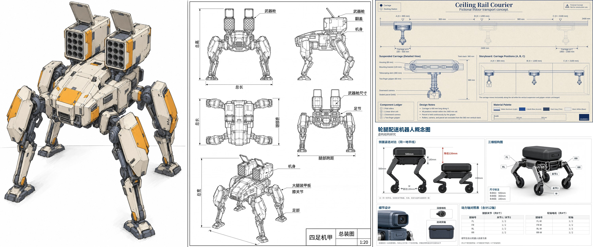
</p>
<p align="center"><em>画像編集：四脚メカを多視点の CAD 図面に変換（左）。テキストからの画像生成：天井レール配送機と車輪脚型配送ロボットのエンジニアリングシート（右）</em></p>

<!-- BEGIN showcase-prompts -->
<details>
<summary>プロンプト</summary>

<p><b>四脚メカの CAD 図面（左の2枚）</b></p>
<blockquote>Turn the quadruped mech in image 1 into a standardized CAD engineering drawing with multiple views. Use a white drawing-sheet background and fine black lines: solid lines for visible outlines, dashed lines for hidden structures, and dash-dot lines for axes of symmetry and joint centers.<br>
<br>
Include five neatly arranged views:<br>
- Upper left: Front view.<br>
- Upper right: Left-side view.<br>
- Middle left: Top view, clearly showing the launch-port arrays of both weapon pods and the spread angles of all four legs.<br>
- Middle right: Rear view.<br>
- Bottom: A larger isometric wireframe view showing the overall three-dimensional structure.<br>
<br>
Use the same scale across all views, keeping the shapes of the body, weapon pods, leg joints, and thigh armor plates consistent with image 1. Annotate the main dimensions: overall height, length, width, leg span, and weapon-pod dimensions. Use leader lines to label the key parts “武器舱,” “翻盖,” “机身,” “大腿装甲板,” “膝关节,” and “足部” (weapon pod, hatch, body, thigh armor plate, knee joint, and foot). Place a standard title block in the lower right reading “四足机甲 总装图 1:20” (Quadruped Mech — General Assembly — 1:20). Use clean, accurate lines and an orderly layout resembling a formal mechanical design drawing.</blockquote>

<p><b>天井レール配送機（右上）</b></p>
<blockquote>Create a 16:9 English engineering concept sheet titled "Ceiling Rail Courier," marked "Fictional indoor transport concept." Show a long side elevation across the upper half, a detailed suspended carriage at lower left, and a three-position storyboard at lower right. Use warm white paper and cobalt linework.<br>
A straight horizontal rail spans X = 0 to 2400 mm. Define three docking stations by carriage-center coordinates: A at X = 300, B at X = 1200, and C at X = 2100 mm. Adjacent station spacing is 900 mm. The carriage is 400 mm long along X, so its footprint at A is 100–500 mm and at C is 1900–2300 mm; all positions remain within the rail. The three storyboard panels show the same carriage at A, B, and C, not three simultaneous robots.<br>
At the illustrated extension, the vertical suspension comprises an 80 mm carriage housing, a 120 mm mounting bracket, a 300 mm telescoping stem, and a 60 mm gripper, measured as consecutive segments. Mark their total as 560 mm, measured from the housing top to the gripper bottom; rail, rollers and parcel are excluded from this dimension. The gripper holds one sealed parcel throughout all panels. Include two rail rollers, one linear drive unit, one downward camera, and one two-finger gripper in the component ledger. Maintain the same dimensions, parcel, roller count, and sensor position across all views. Clearly separate horizontal station dimensions from the vertical stack.</blockquote>

<p><b>車輪脚型配送ロボット（右下）</b></p>
<blockquote>Draw a 16:9 concept diagram in Chinese of a wheeled-legged delivery robot. Include side views of the same robot standing and crouching, a 3D view, and an actuator-axis table, labeled “虚构结构研究” (Fictional Structural Study). The body is 500 mm long, 360 mm wide, and 180 mm high. Each of its four corners has a two-joint leg ending in a powered wheel 120 mm in diameter. There are eight leg joints and four wheel-axis motors, for a total of 12 controlled rotary axes. Label the legs FL, FR, RL, and RR, with upper and lower joints numbered 1 and 2 and wheel axes labeled W. Left and right are from the robot's own perspective. The top of the body is 560 mm above the ground when standing and 440 mm when crouching. Use the same ground line to show the 120 mm reduction. Change only the joint angles between the two views; keep the body, wheel diameters, and link lengths identical. There is only one depth camera on the front panel and only one enclosed cargo box above the body; keep the box level in both poses. Use a comparison table to distinguish the eight leg joints from the four powered wheel axes, avoiding any depiction of 12 controlled axes as 12 legs or 12 wheels.</blockquote>

</details>
<!-- END showcase-prompts -->

#### 複雑な視覚的課題

反射、投影、空間推論など、物理的な整合性を保たなければならない表現です。

<p align="center">
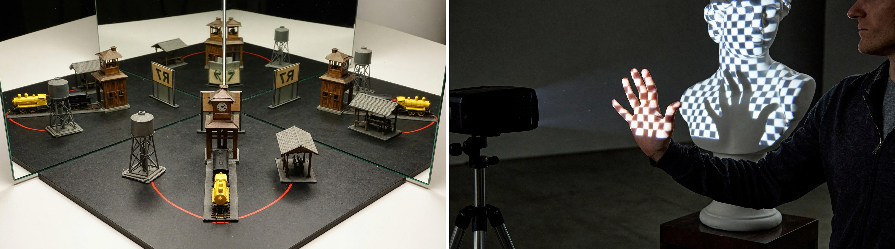
</p>
<p align="center"><em>直角に合わせた 2 枚の鏡の間に置いた駅の模型（左）と、石膏の胸像に投影した市松模様の光の中に差し入れた手（右）</em></p>

<!-- BEGIN showcase-prompts -->
<details>
<summary>プロンプト</summary>

<p><b>直角の合わせ鏡（左）</b></p>
<blockquote>Show a tabletop optics demonstration as a realistic photograph: two upright plane mirrors meet along their vertical edges at a right angle, with their reflective surfaces facing inward. Photograph from the open side, slightly off-center, including the entire physical object in front of the mirror corner and all three corresponding sets of mirror images. The object is a small station model with a central clock tower, a tall water tower on only one side, a low waiting shelter on the other, and a small vehicle in front with a yellow front and black rear. A curved red line connects the base of the water tower to the waiting shelter. In front of the model stands a sign facing the mirror corner, bearing the text “R7”; the real camera view shows the back of the sign. Each side mirror contains one singly reflected image, and a doubly reflected image appears deep in the mirror corner. The side reflections show mirror-written text, while “R7” is readable normally in the double reflection. The water tower, waiting shelter, vehicle front, and red line all change direction together according to the reflections, preserving their spatial relationships to the clock tower. Make the mirror seam and apparatus base clearly visible, with sufficient space between reflections to identify each model image.</blockquote>

<p><b>投影に差し入れた手（右）</b></p>
<blockquote>A realistic on-site photograph of a projection art installation: a projector casts a blue-and-white checkerboard onto a white plaster bust, with the grid deforming over the bridge of the nose, cheeks, and curved chest. An operator stands beside the projection area and extends one hand with all five fingers spread into the beam in front of the sculpture's chest, palm facing the projector. Part of the checkerboard falls onto the palm itself, while a dark hand-shaped shadow without the checkerboard appears on the sculpture's chest behind it. Bright squares are cut off at the shadow boundary, while projected light still passes through the gaps between the fingers. Photograph from a front-side angle so that the actual hand and its shadow on the chest are offset in the composition, showing the person's upper body, the sculpture, and the operating projector at the side.</blockquote>

</details>
<!-- END showcase-prompts -->

<p align="center">
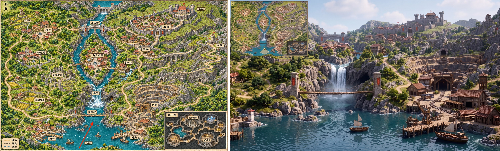
</p>
<p align="center"><em>画像編集（参照画像 1 枚）：ゲームマップ（左）を、赤い矢印の位置から見た一人称の 3D ゲーム画面に変換し、マップをミニマップとして配置（右）</em></p>

<!-- BEGIN showcase-prompts -->
<details>
<summary>プロンプト</summary>

<blockquote>Using the supplied game map as the sole spatial reference, generate a 16:9 in-game screenshot of an open-world game in a realistic 3D CG style.<br>
Camera Position and Direction<br>
Use the tail of the red arrow as the camera position and the direction of its tip as the viewing direction. The camera is approximately 1.7 meters above the lake in the southern part of the map, looking slightly east of north in first person with a field of view of about 70° and natural perspective. Do not show the player's body.<br>
Spatial Reconstruction<br>
Strictly reproduce the map's terrain elevations, building locations, river course, bridge connections, and road relationships.<br>
Determine the visible portions of the settlements on both banks, the mining area, the mountains, and the distant castle according to actual lines of sight. Preserve plausible occlusion and relative scale with distance. Do not move buildings, flatten the terrain, or widen the field of view merely to show every landmark.<br>
Visual Style<br>
Use high-quality, realistic game-engine rendering, with buildings and mountains at true scale, detailed rock, wood, vegetation, and water materials, natural daylight, global illumination, water reflections, and moderate atmospheric perspective. Convey the feeling of a player actually inhabiting this world. Avoid a hand-drawn map look, miniature diorama, isometric viewpoint, or bird's-eye composition.<br>
Upper-Left Minimap<br>
Add a clear game HUD minimap in the upper-left corner, approximately 15% of the image width. Use the surface map from the reference image as its thumbnail base, preserving the original proportions and north-up orientation. Retain major terrain and roads, and remove the underground inset.<br>
Mark the player's position with a small directional arrow at the location corresponding to the tail of the original red arrow. Its direction must exactly match the main camera view, with a pale fan-shaped area indicating the field of view. Use a simple thin border and keep the map legible.<br>
Output only one complete game screenshot. Do not include the original red arrow, place-name labels, elevation numbers, or map borders in the main scene. Add no interface elements other than the upper-left minimap.</blockquote>

</details>
<!-- END showcase-prompts -->

### クリエイティブな活用

<p><b>アイデアを世界に。</b> MiniMax-H3-Image はコンセプトアートを得意とし、クリエイティブなアイデアを、明確な構造、豊かなディテール、個性的なスタイルを備えたビジュアルコンセプトに仕上げます。ゲームや映画、ブランド広告、マーケティング素材に活用できます。</p>

#### ゲームの世界

壮大なファンタジー、SF、ポストアポカリプスといった方向性で、環境、キャラクター、世界観を描きます。

<p align="center">
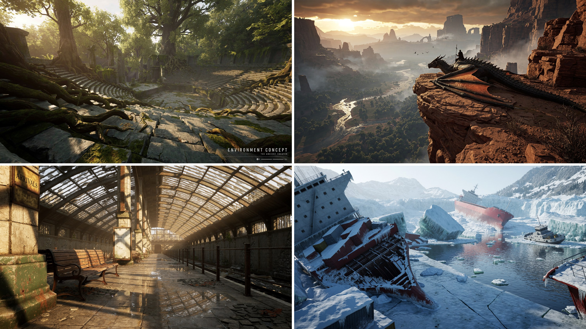
</p>
<p align="center"><em>環境コンセプトアート</em></p>

<!-- BEGIN showcase-prompts -->
<details>
<summary>プロンプト</summary>

<p><b>森の古代劇場（左上）</b></p>
<blockquote>Aspect ratio 16:9, 4K. Create a finished environment concept image for a AAA game, in which the terrain, landmarks, and function of the settlement are immediately legible before the viewer notices the finer details. Use a credible, realistic 3D space, architecture adapted to climate and terrain, and distinct foreground, midground, and background. Specific subject: an amphitheater swallowed by the forest, with tree roots entering the seating through cracks. Do not use names, characters, or brand logos from existing works, and do not add a watermark.</blockquote>

<p><b>廃駅（左下）</b></p>
<blockquote>Aspect ratio 16:9, 4K. Generate a photorealistic AAA image with a high-end real-time engine look. Emphasize indirect illumination, varied roughness, contact shadows and depth separation. Show only the rendered scene, without an editor or performance counters. Scene: Sunlight enters an abandoned station through a glass roof and reflects its steel frame in wet tiles. Use original identities and designs without existing franchise names, characters, brand marks or watermarks.</blockquote>

<p><b>凍った難破船（右下）</b></p>
<blockquote>Abandoned shipwrecks in an intensely cold, frozen bay, in a 2.2:1 ultra-wide panorama, with a 24 mm wide-angle lens looking slightly downward. On the left, a tilted wreck is covered in snow and icicles, with rusty containers scattered across its deck. Central cracks in broken ice lead to a blue channel, translucent teal ice walls, and drifting ice floes and debris. A white-gray tugboat is grounded on the right, while a red cargo ship lies capsized among glaciers in the distance. Snowy mountains, ice cliffs, and sparse conifers fade into cold mist. Use an ice-blue and teal-gray palette punctuated by dark-red hulls. Cold daylight creates a dark-near, bright-far hierarchy, with a silent, desolate mood. Cinematic realism, authentic ice, snow, and metal materials, water reflections, deep depth of field, volumetric fog, 8K, no people, text, or watermarks.</blockquote>

<p><em>右上のドラゴンライダーのプロンプトは掲載していません。</em></p>

</details>
<!-- END showcase-prompts -->

<p align="center">
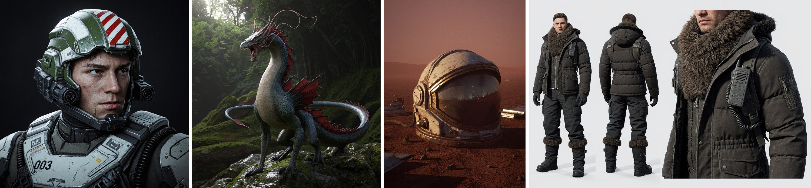
</p>
<p align="center"><em>キャラクター、クリーチャー、小道具</em></p>

<!-- BEGIN showcase-prompts -->
<details>
<summary>プロンプト</summary>

<p><b>戦闘パイロット</b></p>
<blockquote>Aspect ratio 1:1. A close half-body portrait of a realistic futuristic combat pilot. The young man has a stern face, eyes glancing slightly right, and small abrasions on his cheeks. His hair is hidden inside a complex open-face armored helmet. The helmet has an olive-green and aged-white industrial shell, a red-and-white striped insignia on top, sensors, black optical lenses, communication boxes, and hinged brackets along both sides of the face, and a protective neck frame beneath the jaw. Thick white-gray chest armor features dark straps, hoses, the number “003,” stickers, and small warning markings, with scratches, dust, and chipped edges. Keep the subject close to the camera against a pure-black background. Soft cool light from the upper left outlines his face and equipment, emphasizing complex mechanical assembly, realistic skin, and military hard-surface materials. Output one complete artwork with no website borders, artist signatures, or watermarks.</blockquote>

<p><b>森のドラゴン</b></p>
<blockquote>A realistic fantasy-film creature stands on a rock in a dim forest, in a square full-body composition. The subject is a dragon with a tall neck and slender body, fine gray-blue and dark-green scales, a beige-gray belly, and fan-shaped dark-red dorsal membranes rising from its shoulders to its tail. Its mouth is open in a roar, with many long pink tendrils and horn-like fleshy crests growing from its forehead and cheeks and curling backward, forming an elegant, complex silhouette. Its four limbs have a reptilian structure with sharp claws, its long tail curves around the body toward the left, and its feet rest on damp rocks and moss. Soft natural forest light shines through parts of the tendril crest. Fine, credible materials, with no text or watermark.</blockquote>

<p><b>赤い荒野の宇宙飛行士ヘルメット</b></p>
<blockquote>Aspect ratio 3:4, 4K. Create a portrait-format cover key visual for an original AAA game, using realistic 3D and dramatic but restrained cinematic lighting. Establish a clear focal point with one main character or central object. Keep approximately the top quarter quiet for later typography, and do not generate a title, logo, or text in the current image. Specific subject: a dust-covered astronaut helmet lying on a red wasteland, its visor reflecting a distant base. Do not use names, characters, or brand logos from existing works, and do not add a watermark.</blockquote>

<p><b>極地用コスチュームボード</b></p>
<blockquote>Aspect ratio 3:2, 4K. Create an original AAA costume board: full front view on the left, full rear view in the center and one construction close-up on the right, using the same adult model and outfit. Show realistic 3D drape, seams and fastening structures against pale gray without text. Scene: An insulated polar communicator outfit with fur collar, sealed cuffs and gaiters. Use original identities and designs without existing franchise names, characters, brand marks or watermarks.</blockquote>

</details>
<!-- END showcase-prompts -->

<p align="center">
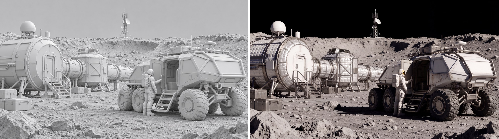
</p>
<p align="center"><em>画像編集（参照画像 1 枚）：テクスチャのない 3D レンダリング（左）を月面研究基地の映画のスチル（右）に変換</em></p>

<!-- BEGIN showcase-prompts -->
<details>
<summary>プロンプト</summary>

<blockquote>Render this untextured 3D model as a realistic cinematic lunar research scene. Add gray lunar soil, silvery-white thermal insulation, coated metal, glass, and wheel-mesh materials, with off-white spacesuits. Use strongly directional sunlight and limited ground bounce. Keep the distant sky pure black, with no blue sky, clouds, or Earth-like haze. Preserve the rover's six wheels and the arrangement of the people and modules. Keep shadow directions consistent and material detail visible in highlights. Preserve the original composition, camera angle, perspective, geometry, and the position and proportions of every subject. Output 4K in 16:9 landscape format, combining AAA photorealistic CG with cinematic live-action texture. Do not add text, brands, interface elements, or watermarks.</blockquote>

</details>
<!-- END showcase-prompts -->

#### 現実の世界

リアルな光と繊細な素材の質感によって、自然で説得力のある写真らしさを生み出します。

<p align="center">
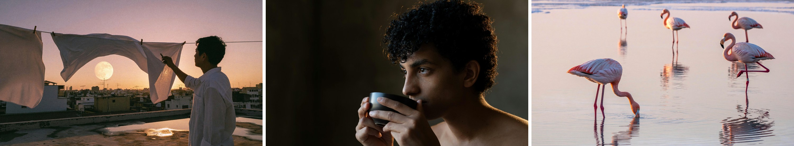
</p>
<p align="center"><em>フォトリアルな写真</em></p>

<!-- BEGIN showcase-prompts -->
<details>
<summary>プロンプト</summary>

<p><b>夕暮れの屋上</b></p>
<blockquote>An old city rooftop at dusk in late summer. Several clotheslines cross the foreground, with white sheets lifted by the wind into soft waves. Through the gaps, show dense distant rooftops, antennas, and a low pale-gold moon. On the right, a backlit person in a white shirt takes down laundry, visible as a clear profile silhouette. The concrete rooftop has warm-gray textures and shallow puddles. The sky transitions from rose pink to smoky purple, and sunset rim light passes through the fabric. Combine the authenticity of an everyday-life documentary with the poetic composition of a cinematic still. Use a 35 mm lens, natural wind, and slight film grain, without an excessive romantic filter.<br>
Real photographic and cinematic-still texture. Prioritize natural light and physically credible reflections, with a clear visual focal point and breathing room. Keep colors restrained with one or two narrative accents, finely realistic materials, and natural human gestures. Retain moderate 35 mm film grain, gentle highlight bloom, and realistic depth of field. The image should be refined, rewarding to look at, and capture a narrative moment. Avoid cheap-looking CG, plastic skin, excessive sharpening, HDR halos, randomly added objects, watermarks, borders, logos, or unnecessary text.</blockquote>

<p><b>お茶を飲む前のひととき</b></p>
<blockquote>Photograph a realistic portrait of a curly-haired person pausing before drinking tea. Include the head, shoulders, upper chest, and both hands holding a dark ceramic cup, with the face slightly turned. Warm light from the rear right grazes the hair against a darker interior wall. The edges of loose curls and a few flyaway strands glow translucently, with the dark background still visible between strands. Dense locks remain dark inside, and the bright rim breaks naturally where strands occlude one another. Very weak soft light from the camera's front left illuminates the face so the eyes, cheeks, and fingers remain visible. Only the edges of the ear and shoulder facing the rear light are lit. The ceramic cup has a broad, weak surface highlight, with contact shadows where its rim meets the fingers. Focus should cover the eyes, outer hair strands, and cup rim.</blockquote>

<p><b>夜明けのフラミンゴ</b></p>
<blockquote>In the shallows of a salt lake at dawn, five flamingos are spread across a broad, mirror-like water surface. The nearest bends its head to feed, the second stands on one leg, and three distant birds create a gentle rhythm of pink. The lake reflects a pale-pink sky and distant white salt crusts. Use an eye-level telephoto composition with water filling almost the entire frame and ample breathing room between the birds. Feather colors should have delicate gradations from grayish pink to coral pink. Water ripples, reflections, salt crusts, and bird legs must be realistic. Elegant nature photography, without crowded flocks or highly saturated cartoon colors.<br>
Real photographic and cinematic-still texture. Prioritize natural light and physically credible reflections, with a clear visual focal point and breathing room. Keep colors restrained with one or two narrative accents, finely realistic materials, and natural human gestures. Retain moderate 35 mm film grain, gentle highlight bloom, and realistic depth of field. The image should be refined, rewarding to look at, and capture a narrative moment. Avoid cheap-looking CG, plastic skin, excessive sharpening, HDR halos, randomly added objects, watermarks, borders, logos, or unnecessary text.</blockquote>

</details>
<!-- END showcase-prompts -->

#### シュールな世界

レトロな映画セット、遊び心のあるファッション、アヴァンギャルドな雑誌写真を、ひとつのクリエイティブなテーマに沿って表現します。

<p align="center">
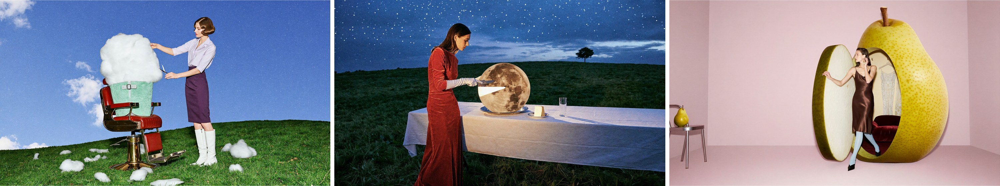
</p>
<p align="center"><em>シュールなエディトリアル写真</em></p>

<!-- BEGIN showcase-prompts -->
<details>
<summary>プロンプト</summary>

<p><b>理容椅子に座る雲</b></p>
<blockquote>A retro, playful, refined surreal fashion photograph. A cherry-red barber chair stands on a vivid green hill, with an enormous white cloud seated in it, its fluffy body wrapped in a mint-green barber cape. An adult female model in a pale-purple short-sleeved blouse, dark-purple pencil skirt, and white tall boots stands beside the chair, carefully trimming the cloud with silver scissors while lifting one corner of it with her other hand. Small cut-off tufts of cloud lie scattered on the lawn like freshly cut hair. The model has a neat retro short haircut and a focused expression. Use a low-angle wide shot with blue sky filling most of the frame, a simple set, and vivid colors. Give it the look of a live-action fashion editorial, with soft translucent cloud details, credible volumetric shadows, slight direct-flash fill, and film grain, without a cartoon feel. Landscape 16:9, no text.</blockquote>

<p><b>月を切り分ける</b></p>
<blockquote>A surreal fashion photograph with the texture of a retro film set. Beneath a cobalt-blue twilight sky, a long dining table covered with a white tablecloth stands on a green hill. An adult female model in a tomato-red velvet gown and long white gloves stands calmly at one side, using a silver dinner knife to cut a small wedge from an enormous full moon on a plate. The moon stands upright like a round cake, retaining realistic craters on its surface. The cut interior emits a soft milky-white glow, and the removed moon slice rests securely on a small porcelain plate beside it. Moonlight illuminates her gloves and jaw, while glasses on the table cast long, slender shadows. There is no second moon in the sky, only a lone small tree in the distance. Elegant, absurd, and subtly deadpan, with the photographic feel of real people and practical props, fine film grain, landscape 16:9, no text.</blockquote>

<p><b>洋梨の更衣室</b></p>
<blockquote>A surreal photograph for a 2000s avant-garde fashion magazine. In a pale-pink studio, a three-meter-tall yellow-green pear has been converted into a changing room. A small round-cornered doorway is cut into its skin, with the door retaining a thick cross-section of peel and milky-white flesh. An adult female model steps one foot out of the pear, wearing a chocolate-brown satin dress, pale-blue tights, and pointed shoes. One hand rests on the doorway while the other adjusts an earring, with a nonchalant expression. The interior is lined with burgundy velvet padding and contains two elegant hanging garments. A normal-sized pear rests on a small silver chair nearby, establishing a clear scale contrast. Use an off-center composition with clean empty space, soft studio light, and a slight frontal flash. Pear-skin pores, juicy flesh, velvet, and satin all have tactile, realistic textures, with the look of a carefully constructed physical set. Landscape 16:9, no text.</blockquote>

</details>
<!-- END showcase-prompts -->

#### アートの世界

古典的な油彩画、ルネサンス、装飾写本、東アジアの絵画などのスタイルを描き分けます。

<p align="center">
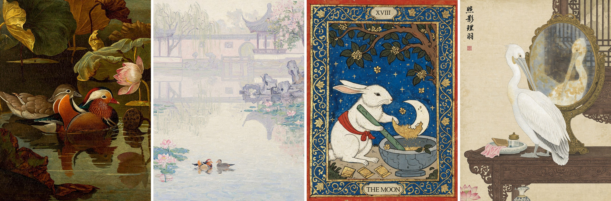
</p>
<p align="center"><em>絵画とイラストのスタイル</em></p>

<!-- BEGIN showcase-prompts -->
<details>
<summary>プロンプト</summary>

<p><b>オシドリ、オールドマスター風油彩</b></p>
<blockquote>An oil painting on canvas in the style of a 17th-century European Old Master, depicting Chinese mandarin ducks and a lotus pond. At the center, a pair of mandarin ducks swim close together on the dark pond: the male has brilliant plumage, orange-red sail-like feathers, a crest with purple-green metallic sheen, white eyebrow markings, and a red bill; the female is understated gray-brown with a white stripe behind the eye. Their heads and necks incline gently toward each other, with a quiet, affectionate air. Surround them with lotus leaves of late summer and early autumn, some full and dark green, others with scorched, curling edges. At the upper right, show a half-open pink-white lotus and a drooping seedpod. Use Rembrandt-like chiaroscuro, with a warm beam of side light from the upper left falling on the ducks while the rest recedes into deep olive-green and amber-brown shadows. The water is an ink-dark mirror reflecting the ducks and lotus flowers, disturbed by tiny ripples. Combine impasto with thin glazes: raised paint on feather highlights, clearly visible brushwork and canvas texture, and aged varnish lending a warm golden cast and fine craquelure. A stable composition with large dark areas of breathing room, poetic and serene, a museum-quality masterpiece.</blockquote>

<p><b>蘇州庭園、印象派油彩</b></p>
<blockquote>A physical French Impressionist oil painting on canvas, in portrait format, depicting mandarin ducks playing in the morning mist of a classical Suzhou garden. It should look as though Monet, late in life, painted beside a garden pond in Suzhou with thick oils and coarse hog-bristle brushes, working directly from the morning fog. Evoke the original paintings Impression, Sunrise, Water Lilies, and the morning-mist works in the Rouen Cathedral series: forms dissolve in light and fog, yet every inch of the painting has visible brushwork and pigment. This is Western oil painting, with no ink wash, gongbi outlines, inscriptions, or seals.<br>
<br>
[Scene Content]<br>
Water occupies roughly the lower 60% of the painting. Slightly left of center in the lower middle, a pair of mandarin ducks play facing each other, suggested with only a few strokes. The male's thick orange-red strokes are the painting's only rich, warm accent, like the red sun in Impression, Sunrise; the female is a soft gray-brown mark. Loose pink and blue-green patches of water lilies and lotus leaves float around them.<br>
On the right of the midground, a zigzag stone bridge and lakeside Taihu rocks become a few pale violet-gray strokes.<br>
In the distance, occupying roughly the upper 40%, a whitewashed wall, a circular moon gate, and a pavilion with upturned eaves dissolve into ghostly pale-lavender and creamy shapes in the mist. Only the wall's undulating top, the curved eaves, and a faint circle remain barely recognizable. At the upper left, weeping willows become descending green-purple strokes; at the upper right, a flowering tree becomes clusters of pink marks. All architectural reflections dissolve and tremble on the water.<br>
<br>
[Atmospheric Softness]<br>
Dense, moist morning fog fills the entire image. The air itself is light blending pink-purple, pale gold, and gray-blue. There are no outlines and almost no boundaries between water, air, and the far bank; forms emerge only through slight differences in color temperature. Keep the whole image soft and high-key, with colors at similar values. Shadows contain only pale purple and pale blue, with no black.<br>
<br>
[Brushwork — Most Important]<br>
The atmospheric softness must come entirely from interlocking brushstrokes of similar value, never from blur. There must be no soft focus, airbrushed gradients, smooth transitions, or digital blur anywhere. Even the fog itself consists of individually countable strokes of paint.<br>
Fill the canvas with clearly visible, free, varied-size brushstrokes: comma-shaped marks, short dashes, and broken strokes, about a finger's width. Each must show its beginning, end, and the fine grooves left by hog bristles.<br>
Vary stroke direction with the subject: layers of short horizontal marks across the water; trembling vertical strokes for reflections; long, descending curved strokes swept rapidly through the willows; loosely woven diagonal strokes for sky and fog; and short curved strokes circling the ducks like spreading ripples.<br>
Give the paint real thickness. Lit areas, water lilies, and the male duck's orange-red accents use obvious impasto, with raised paint and small ridges at the edges that appear sculptural in side light. In darker areas, dry-brush strokes reveal underlying colors and the weave of coarse canvas.<br>
Juxtapose unmixed pure colors between brushstrokes: pink-purple beside pale gold, gray-blue beside pale rose. Work wet-on-wet, allowing some local dragging and mixing by the next stroke, but never smoothing the surface flat.<br>
<br>
Up close, the work is all expressive brushstrokes and pigment; only from a distance do they coalesce into a garden in the mist. A museum-quality Impressionist masterpiece with the material presence of a work in the Musée d'Orsay collection.</blockquote>

<p><b>玉兎、中世の装飾写本</b></p>
<blockquote>A medieval illuminated manuscript illustration with gold leaf and a wide border of curling vines. Beneath an old osmanthus tree, the Jade Rabbit of Chinese folklore stands beside a blue-grey stone mortar. Wearing a simple red cloth sash, it grips a long jade pestle and carefully grinds a single ivory crescent moon into fine golden powder. Part of the crescent remains intact inside the mortar. Small osmanthus blossoms fall onto the stone rim, and several folded medicine packets lie nearby. The rabbit works with the solemn concentration of an old apothecary. The deep blue sky contains a few stars but no second moon.<br>
Flat perspective, dark ink outlines, opaque tempera on aged parchment. Rich red, ultramarine blue and antique gold. A broad blue border filled with curling gold lotus vines, small blossoms and Chinese cloud motifs. Worn gold leaf and slightly irregular hand-painted forms. A small numeral XVIII above, and THE MOON in a parchment cartouche below.</blockquote>

<p><b>鏡の前のペリカン、工筆画</b></p>
<blockquote>Chinese gongbi painting in color on silk. A round bronze mirror stands on a dressing table in an ancient woman's chamber. A white pelican stands before it, lowering its head to groom its chest feathers with its long bill. The slightly yellowed, somewhat hazy mirror reflects the pelican's face and the carved wooden window behind it. Include a vertical inscription and a red seal in the upper-left corner.</blockquote>

</details>
<!-- END showcase-prompts -->

## ローカルで実行

MiniMax-H3-Image を自分の GPU で動かすには、チェックポイントをダウンロードし、SGLang または vLLM-Omni でサーバーを起動して、以下のパラメータとサイズでリクエストを送ります。[完全なワークフロー](#完全なワークフロー) では、これらの手順とプロンプト拡張を組み合わせて、MiniMax API の画像をローカルで再現します。

### モデルファイル

| コンポーネント | 内容 | サイズ |
| --- | --- | --- |
| `transformer/` | DiT。BF16 で、embedding 層、timestep 層、出力層は FP32。 | 66.28 GB |
| `pdd_fused_heads.safetensors`、`pdd_config.json` | Transformer の出力層を置き換えるステップごとの出力ヘッドと、サンプリングスケジュール。 | 12 MB |
| `vae/` | 画像 VAE、FP32。 | 2.34 GB |
| `tokenizer/`、`processor/` | Qwen3-VL の tokenizer と processor。MiniMax-H3 と同一です。 | 23 MB |
| テキストエンコーダー | 元の checkpoint には含まれません。`model_index.json` が [`MiniMaxAI/MiniMax-H3`](https://huggingface.co/MiniMaxAI/MiniMax-H3) の `text_encoder/` フォルダから読み込みます。MiniMax-H3 をすでにダウンロードしている場合、再度ダウンロードされることはありません。 | 66.7 GB |

```text
MiniMax-H3-Image/
├── model_index.json
├── pdd_config.json
├── pdd_fused_heads.safetensors
├── processor/
├── tokenizer/
├── transformer/
└── vae/
```

Hugging Face リポジトリでは、この元の checkpoint と diffusers 形式を並行して提供しており、合計で約 204 GB あります。使用するフレームワークに必要な範囲だけをダウンロードしてください。SGLang と vLLM-Omni は元の checkpoint と MiniMax-H3 のテキストエンコーダーを読み込み、合わせて約 135 GB です:

```bash
# Original checkpoint (SGLang, vLLM-Omni)
hf download MiniMaxAI/MiniMax-H3-Image model_index.json "pdd_*" "processor/*" "tokenizer/*" "transformer/*" "vae/*"
hf download MiniMaxAI/MiniMax-H3 --include "text_encoder/*"
# optional prompt expander
hf download MiniMaxAI/MiniMax-H3-Image-PE
```

diffusers ユーザーは手動でダウンロードする必要はありません。`ModularPipeline.from_pretrained("MiniMaxAI/MiniMax-H3-Image")` が `modular_model_index.json` を読み込み、diffusers 形式のフォルダ（`transformer_diffusers/`、`vae_diffusers/`、およびリポジトリ内にある `text_encoder/` のコピー）を取得します。読み込みとオフロードの方法については [diffusers のドキュメント](https://huggingface.co/docs/diffusers/main/en/api/pipelines/minimax_h3_image) を参照してください。

### デプロイ

モデルのサービングには以下の推論フレームワークを推奨します:

- [SGLang](https://docs.sglang.io/) - [cookbook](https://docs.sglang.io/cookbook/diffusion/MiniMax/MiniMax-H3-Image) を参照
- [vLLM-Omni](https://github.com/vllm-project/vllm-omni) - [vllm-omni recipe](https://recipes.vllm.ai/MiniMaxAI/MiniMax-H3-Image) を参照
- [diffusers](https://github.com/huggingface/diffusers) - [diffusers docs](https://huggingface.co/docs/diffusers/main/en/api/pipelines/minimax_h3_image) を参照
- [ComfyUI](https://github.com/Comfy-Org/ComfyUI) - [Comfy tutorial](https://docs.comfy.org/tutorials/image/minimax/minimax-h3-image) を参照。テンプレートは [T2I template](https://github.com/Comfy-Org/workflow_templates/blob/main/templates/image_minimax_h3_image_t2i.json) / [Edit template](https://github.com/Comfy-Org/workflow_templates/blob/main/templates/image_minimax_h3_image_edit.json) を使用します

#### SGLang

以下の [完全なワークフロー](#完全なワークフロー) では SGLang を使います。main ブランチから SGLang を拡散モデル用の依存関係とともにインストールします（[拡散モデルのインストールガイド](https://docs.sglang.io/docs/sglang-diffusion/installation) を参照）:

```bash
git clone https://github.com/sgl-project/sglang.git
cd sglang
python3 -m pip install -e 'python[diffusion]'
```

1 枚の GPU でサーバーを起動します:

```bash
sglang serve --model-path MiniMaxAI/MiniMax-H3-Image --host 0.0.0.0 --port 30000 --warmup-mode off
```

メモリの少ない GPU でも同じコマンドで動きます。GPU の空きメモリが 130 GiB 未満の場合、SGLang はモデルの一部のコンポーネントをオフロードしてメモリに収めます。Hugging Face のキャッシュではなく、ローカルにある MiniMax-H3 の `text_encoder/` フォルダのコピーを使う場合は、`--text-encoder-path <path to text_encoder>` を追加します。

レイテンシを下げるには、シーケンス並列（Ulysses）で各リクエストを複数の GPU に分割します。たとえば 4 枚の GPU を使う場合は次のとおりです:

```bash
sglang serve --model-path MiniMaxAI/MiniMax-H3-Image --host 0.0.0.0 --port 30000 --warmup-mode off \
  --num-gpus 4 --ulysses-degree 4
```

[SGLang cookbook](https://docs.sglang.io/cookbook/diffusion/MiniMax/MiniMax-H3-Image) には、B300 から 24 GB のカードまで、GPU クラスごとのレシピと実測レイテンシがあります。

#### vLLM-Omni

vLLM 0.33.0 をインストールし、vLLM-Omni をソースからインストールします:

```bash
uv venv --python 3.12 --seed && source .venv/bin/activate
uv pip install vllm==0.33.0 --torch-backend=cu130
git clone https://github.com/vllm-project/vllm-omni.git && cd vllm-omni && uv pip install -e .
```

デフォルトの構成では、シーケンス並列（Ulysses）で各リクエストを 4 枚の GPU に分割します（H200 で実測）:

```bash
vllm serve MiniMaxAI/MiniMax-H3-Image --omni --host 0.0.0.0 --port 8000 \
  --num-gpus 4 --usp 4 --text-encoder-tp-size 4
```

1 枚の GPU にモデル全体を載せるには、約 135 GiB のメモリが必要です（B200、B300）:

```bash
vllm serve MiniMaxAI/MiniMax-H3-Image --omni --host 0.0.0.0 --port 8000 --num-gpus 1
```

1 枚の H200 では、テキストエンコーダーをオフロードします:

```bash
vllm serve MiniMaxAI/MiniMax-H3-Image --omni --host 0.0.0.0 --port 8000 --num-gpus 1 \
  --diffusion-offload-config '{"mode":"layer","components":["text_encoder"]}'
```

AMD Instinct MI325X と MI350X では、`vllm/vllm-omni:minimax-h3-image-rocm` イメージを使い、デフォルトのコマンドに `--no-enable-cuda-graph-decode` を追加します。H100、RTX PRO 6000 などほかの GPU 向けの構成と実測レイテンシは [vLLM-Omni recipe](https://recipes.vllm.ai/MiniMaxAI/MiniMax-H3-Image) にあります。

### リクエストとサイズ

#### リクエストパラメータ

SGLang では、テキストからの画像生成のリクエストは JSON として `/v1/images/generations` に送信します。画像編集のリクエストは、参照画像を multipart form data として `/v1/images/edits` に送信します。その順序がプロンプト内の `<Picture 1>`、`<Picture 2>` などに対応します。どちらも `data[0].b64_json` に PNG を返します。実行可能な例は [完全なワークフロー](#完全なワークフロー) にあります。vLLM-Omni ではフィールドが少し異なり、たとえば `min_generation_area` は `extra_args` の中に指定します。詳しくは [vLLM-Omni recipe](https://recipes.vllm.ai/MiniMaxAI/MiniMax-H3-Image) を参照してください。

| フィールド | テキストからの画像生成 | 画像編集 | 備考 |
| --- | --- | --- | --- |
| `prompt` | 必須 | 必須 | そのまま使用され、4096 トークンで切り詰められます。[完全なワークフロー](#完全なワークフロー) を参照 |
| `size` | 必須 | 必須 | `WIDTHxHEIGHT`。返される画像はちょうどこのサイズになります。[サイズ](#サイズ) を参照 |
| `image` | — | 1 つ以上のファイル | アップロード順に、プロンプト内の `<Picture 1>`、`<Picture 2>`、... になります |
| `seed` | 推奨 | 推奨 | 整数 |
| `generator_device` | `cpu` を推奨 | `cpu` を推奨 | 同じ seed なら、どのマシンでも同じ初期ノイズになります |
| `response_format` | `b64_json` | `b64_json` | |
| `min_generation_area` | 任意 | 任意 | 生成する最小面積（ピクセル数）。1024-16777216、デフォルトは 4194304（2048x2048）。これより小さい `size` は、同じアスペクト比のより大きなキャンバスで生成してから LANCZOS で元のサイズに縮小します。この動作を無効にするには 1024 を指定します。下の表のサイズはすべてデフォルトより大きくなっています |
| `num_inference_steps` | 省略または 6 | 省略または 6 | それ以外の値は HTTP 400 を返します |
| `guidance_scale` | 省略または 1 | 省略または 1 | それ以外の値は HTTP 400 を返します |
| `negative_prompt` | 非対応 | 非対応 | 拒否されます |

#### サイズ

> [!TIP]
> MiniMax-H3-Image が有効に動作する範囲はおよそ 4 MP から 20 MP で、一般に MiniMax API の `4K` の面積にあたる 16 MP 前後で最も良い結果が得られます。

よく使われる 16 MP のサイズは以下のとおりです:

| アスペクト比 | サイズ（幅 x 高さ） |
| --- | --- |
| 1:1 | 4096x4096 |
| 4:3 / 3:4 | 4736x3552 / 3552x4736 |
| 3:2 / 2:3 | 5024x3360 / 3360x5024 |
| 16:9 / 9:16 | 5472x3072 / 3072x5472 |
| 21:9 | 6272x2688 |

ほかのアスペクト比では、約 16 MP を保ち、幅と高さをどちらも 32 の倍数にします。[`examples/context_ir.py`](examples/context_ir.py) の `size_for()` でサイズを計算できます:

```bash
cd examples
python3 -c "from context_ir import size_for; print(size_for('5:4'))"   # 4576x3648
```

### 完全なワークフロー

MiniMax-H3-Image は、画像全体を詳しく記述した英語の説明文を入力として想定しています。MiniMax API は生成前に **H3-Image-Context-IR** を使い、任意の言語で書かれた短いプロンプトをこのような説明文に変換します。また、ローカルにデプロイできる [MiniMax-H3-Image-PE](https://huggingface.co/MiniMaxAI/MiniMax-H3-Image-PE) も提供しています。

このセクションでは、ローカルにデプロイした SGLang サーバーを使って、MiniMax API で直接生成した画像と同等の品質を再現します。スクリプトは [`examples/`](examples) にあり、Python 標準ライブラリだけを使用します。このリポジトリをクローンし、そのフォルダで実行してください:

```bash
git clone https://github.com/MiniMax-AI/MiniMax-H3-Image.git
cd MiniMax-H3-Image/examples
```

`t2i.py` と `edit.py` は、上で起動した SGLang サーバー `http://127.0.0.1:30000` にリクエストを送ります。別のアドレスを使う場合は `--url` を指定してください。

例を実行する前に、H3-Image-Context-IR API とリファレンス用スクリプトを使うため、MiniMax API のエンドポイントとキーを設定してください。スクリプトはこれらを環境変数から読み取ります:

```bash
# MiniMax API endpoint (choose one)
# CN
export MINIMAX_API_BASE="https://api.minimax.cn"
# Global
# export MINIMAX_API_BASE="https://api.minimax.io"

# API key obtained from the MiniMax platform
export MINIMAX_API_KEY="<api-key>"
```

API ドキュメント:
- H3-Image-Context-IR: /v1/h3_image_context_ir を使用 [EN-docs](https://platform.minimax.io/docs/api-reference/image-generation-h3-context-ir), [CN-docs](https://platform.minimax.cn/docs/api-reference/image-generation-h3-context-ir)
- テキストからの画像生成: /v1/images/generations を使用 [EN-docs](https://platform.minimax.io/docs/api-reference/image-generation-h3-generations), [CN-docs](https://platform.minimax.cn/docs/api-reference/image-generation-h3-generations)
- 画像編集: /v1/images/edits を使用 [EN-docs](https://platform.minimax.io/docs/api-reference/image-generation-h3-edits), [CN-docs](https://platform.minimax.cn/docs/api-reference/image-generation-h3-edits)

#### case-T2I

[`instruction.t2i.txt`](examples/instruction.t2i.txt) を使用します。

<table>
<thead>
<tr><th colspan="2">段階</th><th>リクエスト</th><th>結果</th></tr>
</thead>
<tbody>
<tr><td rowspan="3">プロンプト強化</td><td>H3-Image-Context-IR (MiniMax API)</td><td><code>python3 context_ir.py t2i</code>（<a href="examples/context_ir.py">スクリプト</a>）</td><td><code>revised_prompt.txt</code>、<code>revised_size.txt</code>。こちらで実行した結果：<a href="examples/revised_prompt.t2i.txt"><code>revised_prompt.t2i.txt</code></a>、<a href="examples/revised_size.t2i.txt"><code>revised_size.t2i.txt</code></a>（4736x3552）</td></tr>
<tr><td>ローカルでの代替手段：<a href="https://huggingface.co/MiniMaxAI/MiniMax-H3-Image-PE">MiniMax-H3-Image-PE</a></td><td>PE リポジトリの <code>scripts/expand_prompt.py</code></td><td><code>expanded_caption</code> を <code>revised_prompt.txt</code> として保存し、<code>aspect_ratio</code> に対応するサイズを <code>revised_size.txt</code> として保存</td></tr>
<tr><td>エージェントによる代替手段：<a href="#プロンプト作成スキル">h3-image-prompt-writing</a></td><td>エージェントに、スキルを使って <code>instruction.t2i.txt</code> のプロンプトとアスペクト比を書くよう依頼</td><td>プロンプトを <code>revised_prompt.txt</code> として保存し、そのアスペクト比に対応する<a href="#サイズ">サイズ</a>を <code>revised_size.txt</code> として保存</td></tr>
<tr><td colspan="2">MiniMax-H3-Image による生成：ローカル SGLang</td><td><code>python3 t2i.py --prompt revised_prompt.txt --size $(cat revised_size.txt)</code>（<a href="examples/t2i.py">スクリプト</a>）</td><td><code>t2i.png</code></td></tr>
<tr><td colspan="2">E2E API リファレンス：MiniMax API を直接呼び出したテキストからの画像生成</td><td><code>python3 api_generate.py t2i</code>（<a href="examples/api_generate.py">スクリプト</a>）</td><td><code>api_t2i.png</code></td></tr>
</tbody>
</table>

<p align="center">

</p>
<p align="center"><em>ローカル SGLang による t2i.png（左）と MiniMax API による api_t2i.png（右）、4736x3552（H3-Image-Context-IR が 4:3 を選択）</em></p>

#### case-Edit

[`instruction.edit.txt`](examples/instruction.edit.txt) と、`<Picture 1>` として参照画像 [`reference1.png`](examples/reference1.png) を使用します。

| 段階 | リクエスト | 結果 |
| --- | --- | --- |
| プロンプト強化：H3-Image-Context-IR (MiniMax API) | `python3 context_ir.py edit`（[スクリプト](examples/context_ir.py)） | `revised_prompt.txt`、`revised_size.txt`。こちらで実行した結果：[`revised_prompt.edit.txt`](examples/revised_prompt.edit.txt)、[`revised_size.edit.txt`](examples/revised_size.edit.txt)（4096x4096） |
| プロンプト強化、エージェントによる代替手段：[h3-image-prompt-writing](#プロンプト作成スキル) | エージェントに、スキルを使って `reference1.png` 向けに `instruction.edit.txt` を書き直すよう依頼 | プロンプトを `revised_prompt.txt` として、`4096x4096` を `revised_size.txt` として保存 |
| MiniMax-H3-Image による生成：ローカル SGLang | `python3 edit.py --prompt revised_prompt.txt --size $(cat revised_size.txt)`（[スクリプト](examples/edit.py)） | `edit.png` |
| E2E API リファレンス：MiniMax API を直接呼び出した画像編集 | `python3 api_generate.py edit`（[スクリプト](examples/api_generate.py)） | `api_edit.png` |

<p align="center">
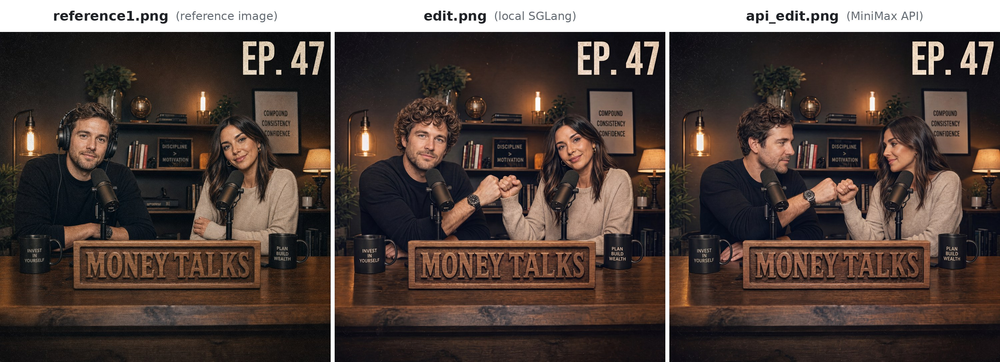
</p>
<p align="center"><em>参照画像 reference1.png（左）、ローカル SGLang による edit.png（中央）、MiniMax API による api_edit.png（右）、4096x4096（H3-Image-Context-IR が 1:1 を選択）</em></p>

## プロンプトのコツ

これらのコツは MiniMax-H3-Image の公式ユーザーガイドに基づいています。MiniMax API に送る短いリクエストにも、独自のデプロイに送る完全なプロンプトにも当てはまります。[プロンプト作成スキル](#プロンプト作成スキル) を使えば、これらのコツが自動的に適用されます。

### 基本的な記述

- **スタイルより先にタスクを書く。** まず目的、画像の用途、主な人物や物体、その状態や動作を説明し、そのあとでスタイルの要件を加えます。
- **細部より先に全体のレイアウトを決める。** 被写体の数と配置、視点、余白を指定します。内容が多い場合は、まず全体の区分を説明し、次に各部分とその関係を記述します。例：「上部にタイトル、その下の左に画像、右にテキスト」。
- **スタイルは目に見えるディテールで表現する。** 色、素材、光、質感で求める効果を説明します。「高級感」のような曖昧な表現ではなく、「柔らかなサイドライト、金属の反射、すっきりした余白」のように書きます。重要なディテールを優先し、互いに矛盾する要件を詰め込まないようにします。

### テキストと情報

- **表示するテキストは正確に全文を書く。** 表示したいテキストを全文引用符で囲み、その位置、階層、改行を指定します。文面をモデルに考えさせたい場合は、そのことを明示します。
- **テキストが不要な場合はそう書く。** 「画像内に文字、アルファベット、数字を入れない」と書くと、モデルが独自にタイトル、ラベル、装飾文字を加えるのを防げます。
- **正確な知識とデータを示し、関係を明確にする。** グラフ、学術図版、教育コンテンツでは、正確な情報、数値、単位、およびそれらの関係を示します。時間の経過による変化を描く場合は期間を指定します。例示用のデータはそのことを明記し、実際のデータと混同されないようにします。

### 参照画像と編集

- **参照画像ごとに役割を割り当てる。** 各画像が何を提供するのか、何を一貫させるべきか、何を自由に変えてよいかを説明します。例：「画像 1 の製品はそのまま残し、画像 2 は配色、画像 3 はレイアウトの参考にする」。色だけを借りる場合は、その画像の形や素材は使わないことも明記します。
- **変える部分と残す部分を区別する。** 編集対象を位置や特徴で特定し、何に変えるか、変更の範囲、残すべき点を説明します。例：「左側のカップを青にする。形、素材、位置、サイズは変えない」。
- **最終的な結果を完全に指定する。** 移動、コピー、置き換え、削除を区別します。削除する場合は、元の領域をどう埋めるかを説明します。テキストやデータを変更する場合は、置き換え後の内容をすべて示し、元のレイアウト、グラフの構造、その他の情報を残すかどうかを明記します。
- **編集の各ラウンドで目標を明確にする。** 今回のラウンドでどの画像を使うか、何を変えるか、何を残すかを書きます。「前のラウンドのあれ」や「前と同じ」のような曖昧な指示は避けます。
- **グリッドやパネルは行と列で指定する。** 9 分割グリッド、絵コンテ、コラージュでは、「2×3」とだけ書くと行と列が入れ替わることがあるため、「2 行 3 列」や「3×3（行×列）」のように書きます。不規則な配置は「上に 3 枚、下に 2 枚」のように直接記述します。1 つのパネルを編集する場合は「2 行目の 1 列目」のように指定します。

### ローカルデプロイ向けのプロンプト

ローカルデプロイでは、プロンプトは与えられたとおりに最大 4096 トークンまで使用され、画像全体を詳しく記述した長い英語の説明文で最も良い結果が得られます。このようなプロンプトでは、参照画像をアップロード順に `<Picture 1>`、`<Picture 2>`、... と呼びます。[プロンプト作成スキル](#プロンプト作成スキル) に同梱されているガイド [`t2i-en.txt`](skills/h3-image-prompt-writing/references/t2i-en.txt) と [`edit-en.txt`](skills/h3-image-prompt-writing/references/edit-en.txt) で、この形式を詳しく説明しています。[`examples/`](examples) には、[テキストからの画像生成](examples/revised_prompt.t2i.txt) と [画像編集](examples/revised_prompt.edit.txt) の実際の拡張済みプロンプトがあります。

## ライセンス

- MiniMax-H3-Image は [MiniMax-H3-Image Community License Agreement](LICENSE) の下で公開されています。
- T2I PE モデル（[MiniMax-H3-Image-PE](https://huggingface.co/MiniMaxAI/MiniMax-H3-Image-PE)）は MiniMax-H3-Image の一部であり、同様に [MiniMax-H3-Image Community License Agreement](LICENSE) の対象となります。
- ライセンス第 IV 条に記載されている個別の書面による許諾は、[申請フォーム](https://platform.minimax.io/console/license) から申請してください。

## お問い合わせ

お問い合わせは [model@minimax.io](mailto:model@minimax.io) までお願いします。
