<div align="center">
  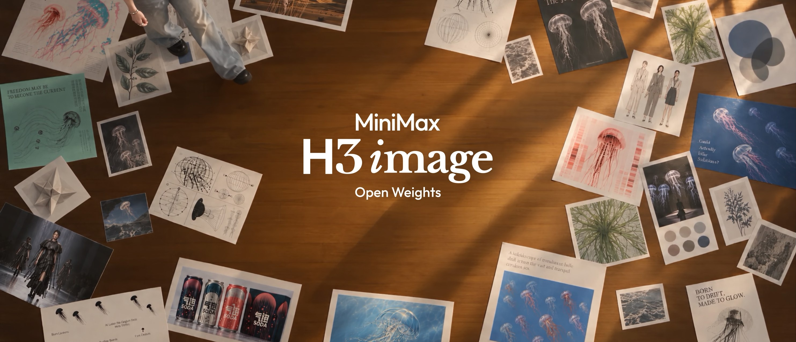
</div>

<p align="center">
  <a href="https://hailuoai.video" target="_blank"></a>
  <a href="https://platform.minimax.io" target="_blank"></a>
  <a href="https://www.minimax.io" target="_blank"></a>
  <a href="https://github.com/MiniMax-AI/MiniMax-H3-Image" target="_blank"></a>
  <a href="https://huggingface.co/MiniMaxAI/MiniMax-H3-Image" target="_blank"></a>
  <br>
  <a href="https://modelscope.cn/models/MiniMax/MiniMax-H3-Image" target="_blank" rel="noopener noreferrer"></a>
  <a href="https://platform.minimax.cn/docs/faq/contact-us" target="_blank"></a>
  <a href="https://discord.com/invite/dbMxutw7tP" target="_blank"></a>
  <a href="LICENSE"></a>
</p>

<p align="center">
  <a href="README.md">English</a> |
  <a href="README.zh-CN.md">简体中文</a> |
  <a href="README.ko.md"><strong>한국어</strong></a> |
  <a href="README.ja.md">日本語</a>
</p>

# MiniMax-H3-Image

## 프롬프트 작성 스킬

MiniMax-H3-Image는 이미지 전체를 영어로 자세히 묘사한 설명을 입력할 때 가장 좋은 결과를 냅니다. `h3-image-prompt-writing` 스킬을 사용하면 짧은 아이디어, 브리프, 기존 프롬프트 또는 여러 장의 참조 이미지로부터 사용 중인 에이전트가 이런 설명을 작성할 수 있습니다. [skills CLI](https://github.com/vercel-labs/skills)로 설치합니다:

```bash
npx skills add https://github.com/MiniMax-AI/MiniMax-H3-Image --skill h3-image-prompt-writing
```

이 스킬은 [`skills/h3-image-prompt-writing/references/`](skills/h3-image-prompt-writing/references/) 아래에 두 개의 프롬프트 가이드를 제공합니다. [`t2i-en.txt`](skills/h3-image-prompt-writing/references/t2i-en.txt)는 텍스트-이미지 생성용이고, [`edit-en.txt`](skills/h3-image-prompt-writing/references/edit-en.txt)는 참조 이미지를 한 장 이상 사용하는 이미지 편집용입니다.

**에이전트 호환성:** `h3-image-prompt-writing`은 외부 API 호출이 없는 순수 Markdown + 참조 파일 스킬이므로 Claude Code, Claude Agent SDK, Cursor, Windsurf, OpenAI 기반 에이전트/Codex, LangChain 등 `SKILL.md`와 로컬 파일을 읽을 수 있는 모든 환경에서 동작합니다. 함께 제공되는 `skills/h3-image-prompt-writing/agents/openai.yaml`은 ChatGPT/Codex 스킬 UI를 위한 선택적 UI 메타데이터(표시 이름, 설명, 기본 프롬프트)만 추가할 뿐, 이 스킬을 OpenAI 에이전트로 제한하지 않습니다.

이 스킬은 프롬프트만 작성하며 이미지를 생성하지는 않습니다. 스킬의 출력을 `prompt`로 직접 배포한 모델에 전달하세요([빠른 시작](#빠른-시작) 참고). MiniMax 텍스트-이미지 API를 사용할 때는 `disable_prompt_enhanced: true`와 스킬이 제시한 `aspect_ratio`도 함께 지정하세요. 그렇지 않으면 API가 프롬프트를 한 번 더 확장합니다. 이미지 편집 요청은 항상 확장됩니다. 프롬프트를 직접 작성하려면 [프롬프트 작성 팁](#프롬프트-작성-팁)을 참고하세요. 모든 스킬에 대한 설명은 [`skills/README.md`](skills/README.md)에 있습니다.

## 온라인 API

API를 통해 MiniMax-H3-Image를 직접 사용할 수 있습니다.

- Global: [platform.minimax.io](https://platform.minimax.io/docs/guides/image-generation) | CN: [platform.minimax.cn](https://platform.minimax.cn/docs/guides/image-generation)

API 문서:
- 텍스트-이미지 생성: [EN-docs](https://platform.minimax.io/docs/api-reference/image-generation-h3-generations), [CN-docs](https://platform.minimax.cn/docs/api-reference/image-generation-h3-generations)
- 이미지 편집: [EN-docs](https://platform.minimax.io/docs/api-reference/image-generation-h3-edits), [CN-docs](https://platform.minimax.cn/docs/api-reference/image-generation-h3-edits)
- 프롬프트 확장: [EN-docs](https://platform.minimax.io/docs/api-reference/image-generation-h3-context-ir), [CN-docs](https://platform.minimax.cn/docs/api-reference/image-generation-h3-context-ir)

## 온라인 앱

앱을 통해 MiniMax-H3-Image를 직접 사용할 수 있습니다.

- WebApp Global: [hailuoai.video](https://hailuoai.video/) | CN: [hailuoai.com](https://hailuoai.com/)
- Desktop Global: [agent.minimax.io](https://agent.minimax.io/) | CN: [agent.minimax.cn](https://agent.minimax.cn)

## 소개

MiniMax-H3-Image는 [MiniMax H3](https://huggingface.co/MiniMaxAI/MiniMax-H3) 계열에 속하는 최고 수준의 오픈소스 이미지 생성 및 편집 모델입니다. 창작 의도를 이해하는 능력과 시각적 세계를 구축하는 능력을 함께 갖추고 있어, 정확한 지시 이행을 바탕으로 창작 콘셉트를 구체적인 캐릭터, 장면, 분위기로 풀어냅니다. 생성과 편집이 하나의 checkpoint에 통합되어 있어 텍스트로 이미지를 생성하고(텍스트-이미지 생성) 한 장 이상의 참조 이미지를 편집할 수 있으며(이미지 편집), 창작자와 개발자에게 유연하고 제어 가능한 이미지 제작 방법을 제공합니다.

4096x4096(1:1)부터 6272x2688(21:9)까지 모든 화면비에서 약 1,600만 화소(16 MP) 이미지를 업스케일러 없이 직접 생성합니다([이미지 크기](#이미지-크기) 참고). checkpoint는 classifier-free guidance 없이 6 샘플링 스텝(6 NFE)으로 증류되었습니다. diffusion transformer(DiT)는 오디오 레이어를 제외한 H3 아키텍처를 사용하며, MiniMax-H3 텍스트 인코더를 변경 없이 그대로 사용합니다.


**주요 특징**

MiniMax-H3-Image는 속도, 이미지 품질, 지시 이행이라는 세 가지 핵심 강점을 함께 갖추고 있습니다.

1. **실용적인 연산 비용으로 생성하는 1,600만 화소 이미지.** 현재 흔히 쓰이는 1–4 MP 출력과 비교하면 16 MP(4096 × 4096) 이미지는 훨씬 많은 디테일을 담을 수 있지만, 일반적으로 훨씬 많은 연산이 필요합니다. MiniMax-H3-Image는 이 연산 비용을 감당할 수 있는 수준으로 유지하여 일상적인 창작에서도 16 MP 생성을 실용적으로 쓸 수 있게 합니다.
2. **풍부한 디테일과 높은 사실감.** MiniMax-H3-Image는 흔히 보는 “AI 느낌”에서 벗어나 섬세한 디테일과 실제 같은 사실감을 갖춘 이미지를 생성하므로 창작과 전문 작업에서 활용할 수 있는 범위가 넓어집니다. 생성 이미지를 실제 시각 세계의 풍부함과 미묘한 느낌에 더 가깝게 만듭니다.
3. **더 강력한 지시 이행.** 창작 결과를 더 세밀하게 제어할 수 있습니다. 좋은 이미지 생성은 보기 좋은 그림을 넘어 창작자가 아이디어를 실제로 구현하도록 돕는 것입니다. MiniMax-H3-Image는 오픈소스 모델 가운데 가장 강력한 지시 이행 능력을 갖추고 최대 16장의 참조 이미지를 지원하므로, 창작자가 최종 결과를 더 잘 제어할 수 있습니다.

## 쇼케이스

텍스트-이미지 생성 및 이미지 편집 결과이며, 축소해서 표시했습니다. 이미지 아래의 **프롬프트**를 펼치면 해당 이미지를 만들 때 입력한 내용을 볼 수 있습니다. 이는 모델이 실제로 받는 확장된 프롬프트가 아니라 사용자가 작성한 그대로의 요청입니다. MiniMax API는 생성 전에 H3-Image-Context-IR로 요청을 확장하므로(텍스트-이미지 생성에서는 기본적으로, 편집에서는 항상) 그대로 보내면 됩니다. 로컬 배포에서는 [전체 워크플로](#전체-워크플로)처럼 먼저 프롬프트를 확장하세요. 대부분의 프롬프트는 원래 중국어로 작성되었습니다. 여기에 표시된 영어 버전은 공식 영어 사용자 가이드에서 가져온 것이며, 원문은 [중국어 README](README.zh-CN.md)에서 볼 수 있습니다.

<p align="center">
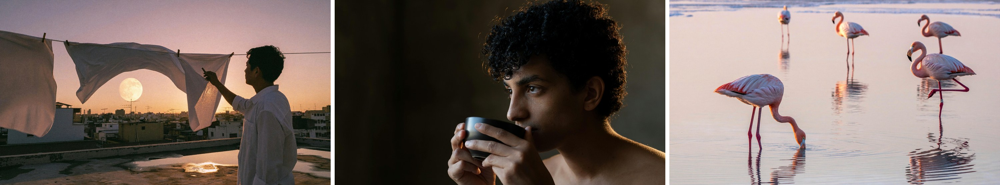
</p>
<p align="center"><em>사실적인 사진</em></p>

<!-- BEGIN showcase-prompts -->
<details>
<summary>프롬프트</summary>

<p><b>해 질 녘 옥상</b></p>
<blockquote>An old city rooftop at dusk in late summer. Several clotheslines cross the foreground, with white sheets lifted by the wind into soft waves. Through the gaps, show dense distant rooftops, antennas, and a low pale-gold moon. On the right, a backlit person in a white shirt takes down laundry, visible as a clear profile silhouette. The concrete rooftop has warm-gray textures and shallow puddles. The sky transitions from rose pink to smoky purple, and sunset rim light passes through the fabric. Combine the authenticity of an everyday-life documentary with the poetic composition of a cinematic still. Use a 35 mm lens, natural wind, and slight film grain, without an excessive romantic filter.<br>
Real photographic and cinematic-still texture. Prioritize natural light and physically credible reflections, with a clear visual focal point and breathing room. Keep colors restrained with one or two narrative accents, finely realistic materials, and natural human gestures. Retain moderate 35 mm film grain, gentle highlight bloom, and realistic depth of field. The image should be refined, rewarding to look at, and capture a narrative moment. Avoid cheap-looking CG, plastic skin, excessive sharpening, HDR halos, randomly added objects, watermarks, borders, logos, or unnecessary text.</blockquote>

<p><b>차를 마시기 전의 멈춤</b></p>
<blockquote>Photograph a realistic portrait of a curly-haired person pausing before drinking tea. Include the head, shoulders, upper chest, and both hands holding a dark ceramic cup, with the face slightly turned. Warm light from the rear right grazes the hair against a darker interior wall. The edges of loose curls and a few flyaway strands glow translucently, with the dark background still visible between strands. Dense locks remain dark inside, and the bright rim breaks naturally where strands occlude one another. Very weak soft light from the camera's front left illuminates the face so the eyes, cheeks, and fingers remain visible. Only the edges of the ear and shoulder facing the rear light are lit. The ceramic cup has a broad, weak surface highlight, with contact shadows where its rim meets the fingers. Focus should cover the eyes, outer hair strands, and cup rim.</blockquote>

<p><b>새벽의 플라밍고</b></p>
<blockquote>In the shallows of a salt lake at dawn, five flamingos are spread across a broad, mirror-like water surface. The nearest bends its head to feed, the second stands on one leg, and three distant birds create a gentle rhythm of pink. The lake reflects a pale-pink sky and distant white salt crusts. Use an eye-level telephoto composition with water filling almost the entire frame and ample breathing room between the birds. Feather colors should have delicate gradations from grayish pink to coral pink. Water ripples, reflections, salt crusts, and bird legs must be realistic. Elegant nature photography, without crowded flocks or highly saturated cartoon colors.<br>
Real photographic and cinematic-still texture. Prioritize natural light and physically credible reflections, with a clear visual focal point and breathing room. Keep colors restrained with one or two narrative accents, finely realistic materials, and natural human gestures. Retain moderate 35 mm film grain, gentle highlight bloom, and realistic depth of field. The image should be refined, rewarding to look at, and capture a narrative moment. Avoid cheap-looking CG, plastic skin, excessive sharpening, HDR halos, randomly added objects, watermarks, borders, logos, or unnecessary text.</blockquote>

</details>
<!-- END showcase-prompts -->


<p align="center">
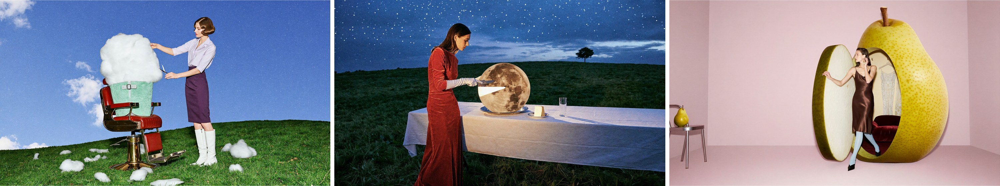
</p>
<p align="center"><em>초현실적인 에디토리얼 사진</em></p>

<!-- BEGIN showcase-prompts -->
<details>
<summary>프롬프트</summary>

<p><b>이발 의자에 앉은 구름</b></p>
<blockquote>A retro, playful, refined surreal fashion photograph. A cherry-red barber chair stands on a vivid green hill, with an enormous white cloud seated in it, its fluffy body wrapped in a mint-green barber cape. An adult female model in a pale-purple short-sleeved blouse, dark-purple pencil skirt, and white tall boots stands beside the chair, carefully trimming the cloud with silver scissors while lifting one corner of it with her other hand. Small cut-off tufts of cloud lie scattered on the lawn like freshly cut hair. The model has a neat retro short haircut and a focused expression. Use a low-angle wide shot with blue sky filling most of the frame, a simple set, and vivid colors. Give it the look of a live-action fashion editorial, with soft translucent cloud details, credible volumetric shadows, slight direct-flash fill, and film grain, without a cartoon feel. Landscape 16:9, no text.</blockquote>

<p><b>달 자르기</b></p>
<blockquote>A surreal fashion photograph with the texture of a retro film set. Beneath a cobalt-blue twilight sky, a long dining table covered with a white tablecloth stands on a green hill. An adult female model in a tomato-red velvet gown and long white gloves stands calmly at one side, using a silver dinner knife to cut a small wedge from an enormous full moon on a plate. The moon stands upright like a round cake, retaining realistic craters on its surface. The cut interior emits a soft milky-white glow, and the removed moon slice rests securely on a small porcelain plate beside it. Moonlight illuminates her gloves and jaw, while glasses on the table cast long, slender shadows. There is no second moon in the sky, only a lone small tree in the distance. Elegant, absurd, and subtly deadpan, with the photographic feel of real people and practical props, fine film grain, landscape 16:9, no text.</blockquote>

<p><b>배 모양 탈의실</b></p>
<blockquote>A surreal photograph for a 2000s avant-garde fashion magazine. In a pale-pink studio, a three-meter-tall yellow-green pear has been converted into a changing room. A small round-cornered doorway is cut into its skin, with the door retaining a thick cross-section of peel and milky-white flesh. An adult female model steps one foot out of the pear, wearing a chocolate-brown satin dress, pale-blue tights, and pointed shoes. One hand rests on the doorway while the other adjusts an earring, with a nonchalant expression. The interior is lined with burgundy velvet padding and contains two elegant hanging garments. A normal-sized pear rests on a small silver chair nearby, establishing a clear scale contrast. Use an off-center composition with clean empty space, soft studio light, and a slight frontal flash. Pear-skin pores, juicy flesh, velvet, and satin all have tactile, realistic textures, with the look of a carefully constructed physical set. Landscape 16:9, no text.</blockquote>

</details>
<!-- END showcase-prompts -->


<p align="center">
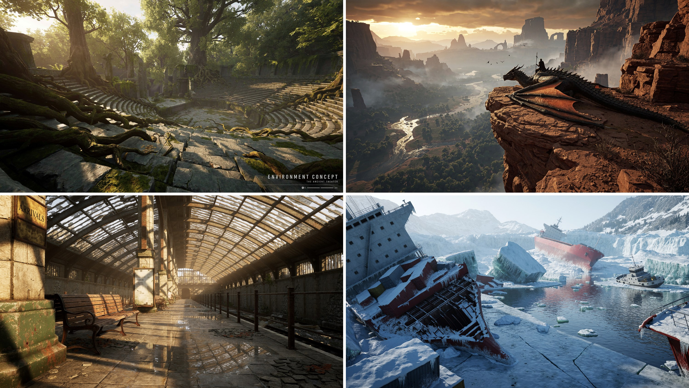
</p>
<p align="center"><em>환경 콘셉트 아트</em></p>

<!-- BEGIN showcase-prompts -->
<details>
<summary>프롬프트</summary>

<p><b>숲속 원형 극장 (왼쪽 위)</b></p>
<blockquote>Aspect ratio 16:9, 4K. Create a finished environment concept image for a AAA game, in which the terrain, landmarks, and function of the settlement are immediately legible before the viewer notices the finer details. Use a credible, realistic 3D space, architecture adapted to climate and terrain, and distinct foreground, midground, and background. Specific subject: an amphitheater swallowed by the forest, with tree roots entering the seating through cracks. Do not use names, characters, or brand logos from existing works, and do not add a watermark.</blockquote>

<p><b>버려진 역 (왼쪽 아래)</b></p>
<blockquote>Aspect ratio 16:9, 4K. Generate a photorealistic AAA image with a high-end real-time engine look. Emphasize indirect illumination, varied roughness, contact shadows and depth separation. Show only the rendered scene, without an editor or performance counters. Scene: Sunlight enters an abandoned station through a glass roof and reflects its steel frame in wet tiles. Use original identities and designs without existing franchise names, characters, brand marks or watermarks.</blockquote>

<p><b>얼어붙은 난파선 (오른쪽 아래)</b></p>
<blockquote>Abandoned shipwrecks in an intensely cold, frozen bay, in a 2.2:1 ultra-wide panorama, with a 24 mm wide-angle lens looking slightly downward. On the left, a tilted wreck is covered in snow and icicles, with rusty containers scattered across its deck. Central cracks in broken ice lead to a blue channel, translucent teal ice walls, and drifting ice floes and debris. A white-gray tugboat is grounded on the right, while a red cargo ship lies capsized among glaciers in the distance. Snowy mountains, ice cliffs, and sparse conifers fade into cold mist. Use an ice-blue and teal-gray palette punctuated by dark-red hulls. Cold daylight creates a dark-near, bright-far hierarchy, with a silent, desolate mood. Cinematic realism, authentic ice, snow, and metal materials, water reflections, deep depth of field, volumetric fog, 8K, no people, text, or watermarks.</blockquote>

<p><em>오른쪽 위 드래곤 라이더의 프롬프트는 싣지 않았습니다.</em></p>

</details>
<!-- END showcase-prompts -->


<p align="center">
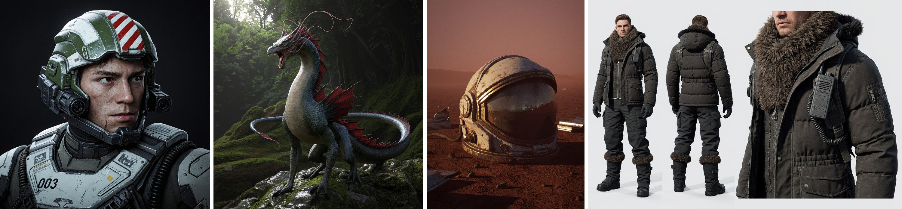
</p>
<p align="center"><em>캐릭터, 크리처, 소품</em></p>

<!-- BEGIN showcase-prompts -->
<details>
<summary>프롬프트</summary>

<p><b>전투 조종사</b></p>
<blockquote>Aspect ratio 1:1. A close half-body portrait of a realistic futuristic combat pilot. The young man has a stern face, eyes glancing slightly right, and small abrasions on his cheeks. His hair is hidden inside a complex open-face armored helmet. The helmet has an olive-green and aged-white industrial shell, a red-and-white striped insignia on top, sensors, black optical lenses, communication boxes, and hinged brackets along both sides of the face, and a protective neck frame beneath the jaw. Thick white-gray chest armor features dark straps, hoses, the number “003,” stickers, and small warning markings, with scratches, dust, and chipped edges. Keep the subject close to the camera against a pure-black background. Soft cool light from the upper left outlines his face and equipment, emphasizing complex mechanical assembly, realistic skin, and military hard-surface materials. Output one complete artwork with no website borders, artist signatures, or watermarks.</blockquote>

<p><b>숲속의 용</b></p>
<blockquote>A realistic fantasy-film creature stands on a rock in a dim forest, in a square full-body composition. The subject is a dragon with a tall neck and slender body, fine gray-blue and dark-green scales, a beige-gray belly, and fan-shaped dark-red dorsal membranes rising from its shoulders to its tail. Its mouth is open in a roar, with many long pink tendrils and horn-like fleshy crests growing from its forehead and cheeks and curling backward, forming an elegant, complex silhouette. Its four limbs have a reptilian structure with sharp claws, its long tail curves around the body toward the left, and its feet rest on damp rocks and moss. Soft natural forest light shines through parts of the tendril crest. Fine, credible materials, with no text or watermark.</blockquote>

<p><b>붉은 황무지 위의 우주비행사 헬멧</b></p>
<blockquote>Aspect ratio 3:4, 4K. Create a portrait-format cover key visual for an original AAA game, using realistic 3D and dramatic but restrained cinematic lighting. Establish a clear focal point with one main character or central object. Keep approximately the top quarter quiet for later typography, and do not generate a title, logo, or text in the current image. Specific subject: a dust-covered astronaut helmet lying on a red wasteland, its visor reflecting a distant base. Do not use names, characters, or brand logos from existing works, and do not add a watermark.</blockquote>

<p><b>극지 의상 보드</b></p>
<blockquote>Aspect ratio 3:2, 4K. Create an original AAA costume board: full front view on the left, full rear view in the center and one construction close-up on the right, using the same adult model and outfit. Show realistic 3D drape, seams and fastening structures against pale gray without text. Scene: An insulated polar communicator outfit with fur collar, sealed cuffs and gaiters. Use original identities and designs without existing franchise names, characters, brand marks or watermarks.</blockquote>

</details>
<!-- END showcase-prompts -->


<p align="center">
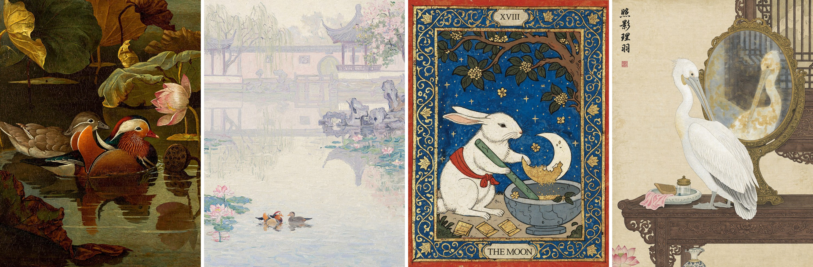
</p>
<p align="center"><em>회화 및 일러스트 스타일</em></p>

<!-- BEGIN showcase-prompts -->
<details>
<summary>프롬프트</summary>

<p><b>원앙, 고전 거장풍 유화</b></p>
<blockquote>An oil painting on canvas in the style of a 17th-century European Old Master, depicting Chinese mandarin ducks and a lotus pond. At the center, a pair of mandarin ducks swim close together on the dark pond: the male has brilliant plumage, orange-red sail-like feathers, a crest with purple-green metallic sheen, white eyebrow markings, and a red bill; the female is understated gray-brown with a white stripe behind the eye. Their heads and necks incline gently toward each other, with a quiet, affectionate air. Surround them with lotus leaves of late summer and early autumn, some full and dark green, others with scorched, curling edges. At the upper right, show a half-open pink-white lotus and a drooping seedpod. Use Rembrandt-like chiaroscuro, with a warm beam of side light from the upper left falling on the ducks while the rest recedes into deep olive-green and amber-brown shadows. The water is an ink-dark mirror reflecting the ducks and lotus flowers, disturbed by tiny ripples. Combine impasto with thin glazes: raised paint on feather highlights, clearly visible brushwork and canvas texture, and aged varnish lending a warm golden cast and fine craquelure. A stable composition with large dark areas of breathing room, poetic and serene, a museum-quality masterpiece.</blockquote>

<p><b>쑤저우 정원, 인상파 유화</b></p>
<blockquote>A physical French Impressionist oil painting on canvas, in portrait format, depicting mandarin ducks playing in the morning mist of a classical Suzhou garden. It should look as though Monet, late in life, painted beside a garden pond in Suzhou with thick oils and coarse hog-bristle brushes, working directly from the morning fog. Evoke the original paintings Impression, Sunrise, Water Lilies, and the morning-mist works in the Rouen Cathedral series: forms dissolve in light and fog, yet every inch of the painting has visible brushwork and pigment. This is Western oil painting, with no ink wash, gongbi outlines, inscriptions, or seals.<br>
<br>
[Scene Content]<br>
Water occupies roughly the lower 60% of the painting. Slightly left of center in the lower middle, a pair of mandarin ducks play facing each other, suggested with only a few strokes. The male's thick orange-red strokes are the painting's only rich, warm accent, like the red sun in Impression, Sunrise; the female is a soft gray-brown mark. Loose pink and blue-green patches of water lilies and lotus leaves float around them.<br>
On the right of the midground, a zigzag stone bridge and lakeside Taihu rocks become a few pale violet-gray strokes.<br>
In the distance, occupying roughly the upper 40%, a whitewashed wall, a circular moon gate, and a pavilion with upturned eaves dissolve into ghostly pale-lavender and creamy shapes in the mist. Only the wall's undulating top, the curved eaves, and a faint circle remain barely recognizable. At the upper left, weeping willows become descending green-purple strokes; at the upper right, a flowering tree becomes clusters of pink marks. All architectural reflections dissolve and tremble on the water.<br>
<br>
[Atmospheric Softness]<br>
Dense, moist morning fog fills the entire image. The air itself is light blending pink-purple, pale gold, and gray-blue. There are no outlines and almost no boundaries between water, air, and the far bank; forms emerge only through slight differences in color temperature. Keep the whole image soft and high-key, with colors at similar values. Shadows contain only pale purple and pale blue, with no black.<br>
<br>
[Brushwork — Most Important]<br>
The atmospheric softness must come entirely from interlocking brushstrokes of similar value, never from blur. There must be no soft focus, airbrushed gradients, smooth transitions, or digital blur anywhere. Even the fog itself consists of individually countable strokes of paint.<br>
Fill the canvas with clearly visible, free, varied-size brushstrokes: comma-shaped marks, short dashes, and broken strokes, about a finger's width. Each must show its beginning, end, and the fine grooves left by hog bristles.<br>
Vary stroke direction with the subject: layers of short horizontal marks across the water; trembling vertical strokes for reflections; long, descending curved strokes swept rapidly through the willows; loosely woven diagonal strokes for sky and fog; and short curved strokes circling the ducks like spreading ripples.<br>
Give the paint real thickness. Lit areas, water lilies, and the male duck's orange-red accents use obvious impasto, with raised paint and small ridges at the edges that appear sculptural in side light. In darker areas, dry-brush strokes reveal underlying colors and the weave of coarse canvas.<br>
Juxtapose unmixed pure colors between brushstrokes: pink-purple beside pale gold, gray-blue beside pale rose. Work wet-on-wet, allowing some local dragging and mixing by the next stroke, but never smoothing the surface flat.<br>
<br>
Up close, the work is all expressive brushstrokes and pigment; only from a distance do they coalesce into a garden in the mist. A museum-quality Impressionist masterpiece with the material presence of a work in the Musée d'Orsay collection.</blockquote>

<p><b>옥토끼, 중세 채식 필사본</b></p>
<blockquote>A medieval illuminated manuscript illustration with gold leaf and a wide border of curling vines. Beneath an old osmanthus tree, the Jade Rabbit of Chinese folklore stands beside a blue-grey stone mortar. Wearing a simple red cloth sash, it grips a long jade pestle and carefully grinds a single ivory crescent moon into fine golden powder. Part of the crescent remains intact inside the mortar. Small osmanthus blossoms fall onto the stone rim, and several folded medicine packets lie nearby. The rabbit works with the solemn concentration of an old apothecary. The deep blue sky contains a few stars but no second moon.<br>
Flat perspective, dark ink outlines, opaque tempera on aged parchment. Rich red, ultramarine blue and antique gold. A broad blue border filled with curling gold lotus vines, small blossoms and Chinese cloud motifs. Worn gold leaf and slightly irregular hand-painted forms. A small numeral XVIII above, and THE MOON in a parchment cartouche below.</blockquote>

<p><b>거울 앞의 펠리컨, 공필화</b></p>
<blockquote>Chinese gongbi painting in color on silk. A round bronze mirror stands on a dressing table in an ancient woman's chamber. A white pelican stands before it, lowering its head to groom its chest feathers with its long bill. The slightly yellowed, somewhat hazy mirror reflects the pelican's face and the carved wooden window behind it. Include a vertical inscription and a red seal in the upper-left corner.</blockquote>

</details>
<!-- END showcase-prompts -->


<p align="center">
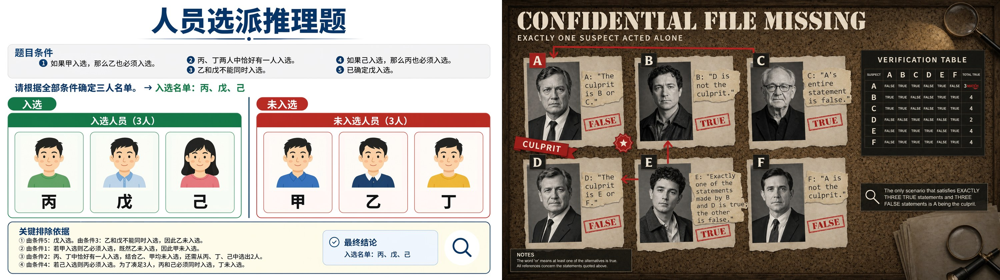
</p>
<p align="center"><em>추론이 필요한 텍스트 렌더링: 중국어와 영어 논리 퍼즐을 보드 위에서 올바르게 풀어낸 결과</em></p>

<!-- BEGIN showcase-prompts -->
<details>
<summary>프롬프트</summary>

<p><b>인원 선발 추리 문제 (왼쪽)</b></p>
<blockquote>Solve the following personnel-selection reasoning problem and generate a visual explanation. Use 16:9 landscape format, a white background, and clear, standardized Chinese typography.<br>
An organization must select exactly three of six staff members—甲, 乙, 丙, 丁, 戊, and 己—for a research team. All of the following conditions must be met:<br>
If 甲 is selected, 乙 must also be selected.<br>
Exactly one of 丙 and 丁 must be selected.<br>
乙 and 戊 cannot both be selected.<br>
If 己 is selected, 丙 must also be selected.<br>
戊 has already been confirmed as selected.<br>
Determine the three-person team using all the conditions.<br>
Show the problem conditions at the top. Divide the lower section into “入选” (Selected) and “未入选” (Not Selected), placing each of the six staff cards in the correct area. Each card should contain a person icon and a prominent name label. Each person must appear exactly once, with no duplicates or omissions.<br>
At the bottom, use brief notes to show the key reasons for exclusion. The card placements, selected names, and notes must agree. Do not add extra conditions. Output only the finished solution image.</blockquote>

<p><em>오른쪽 탐정 추리 보드의 프롬프트는 싣지 않았습니다.</em></p>

</details>
<!-- END showcase-prompts -->


<p align="center">
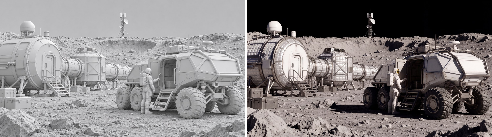
</p>
<p align="center"><em>이미지 편집, 참조 이미지 1장: 텍스처 없는 3D 렌더링(왼쪽)을 달 연구 기지의 영화 스틸(오른쪽)로 변환</em></p>

<!-- BEGIN showcase-prompts -->
<details>
<summary>프롬프트</summary>

<blockquote>Render this untextured 3D model as a realistic cinematic lunar research scene. Add gray lunar soil, silvery-white thermal insulation, coated metal, glass, and wheel-mesh materials, with off-white spacesuits. Use strongly directional sunlight and limited ground bounce. Keep the distant sky pure black, with no blue sky, clouds, or Earth-like haze. Preserve the rover's six wheels and the arrangement of the people and modules. Keep shadow directions consistent and material detail visible in highlights. Preserve the original composition, camera angle, perspective, geometry, and the position and proportions of every subject. Output 4K in 16:9 landscape format, combining AAA photorealistic CG with cinematic live-action texture. Do not add text, brands, interface elements, or watermarks.</blockquote>

</details>
<!-- END showcase-prompts -->


<p align="center">
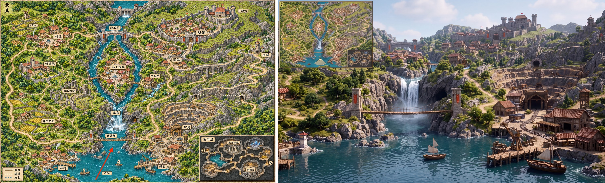
</p>
<p align="center"><em>이미지 편집, 참조 이미지 1장: 게임 지도(왼쪽)를 빨간 화살표 위치에서 바라본 1인칭 3D 게임 화면으로 변환하고 지도를 미니맵으로 배치(오른쪽)</em></p>

<!-- BEGIN showcase-prompts -->
<details>
<summary>프롬프트</summary>

<blockquote>Using the supplied game map as the sole spatial reference, generate a 16:9 in-game screenshot of an open-world game in a realistic 3D CG style.<br>
Camera Position and Direction<br>
Use the tail of the red arrow as the camera position and the direction of its tip as the viewing direction. The camera is approximately 1.7 meters above the lake in the southern part of the map, looking slightly east of north in first person with a field of view of about 70° and natural perspective. Do not show the player's body.<br>
Spatial Reconstruction<br>
Strictly reproduce the map's terrain elevations, building locations, river course, bridge connections, and road relationships.<br>
Determine the visible portions of the settlements on both banks, the mining area, the mountains, and the distant castle according to actual lines of sight. Preserve plausible occlusion and relative scale with distance. Do not move buildings, flatten the terrain, or widen the field of view merely to show every landmark.<br>
Visual Style<br>
Use high-quality, realistic game-engine rendering, with buildings and mountains at true scale, detailed rock, wood, vegetation, and water materials, natural daylight, global illumination, water reflections, and moderate atmospheric perspective. Convey the feeling of a player actually inhabiting this world. Avoid a hand-drawn map look, miniature diorama, isometric viewpoint, or bird's-eye composition.<br>
Upper-Left Minimap<br>
Add a clear game HUD minimap in the upper-left corner, approximately 15% of the image width. Use the surface map from the reference image as its thumbnail base, preserving the original proportions and north-up orientation. Retain major terrain and roads, and remove the underground inset.<br>
Mark the player's position with a small directional arrow at the location corresponding to the tail of the original red arrow. Its direction must exactly match the main camera view, with a pale fan-shaped area indicating the field of view. Use a simple thin border and keep the map legible.<br>
Output only one complete game screenshot. Do not include the original red arrow, place-name labels, elevation numbers, or map borders in the main scene. Add no interface elements other than the upper-left minimap.</blockquote>

</details>
<!-- END showcase-prompts -->


<p align="center">
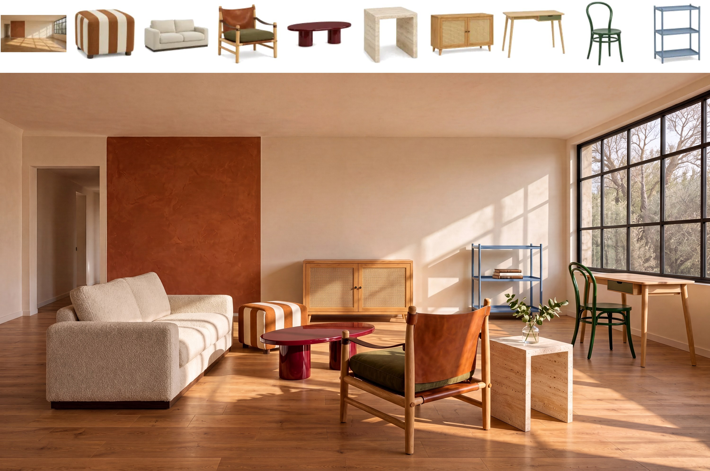
</p>
<p align="center"><em>이미지 편집, 참조 이미지 10장: 빈방과 가구 아홉 점(위)을 하나의 거실로 구성(아래)</em></p>

<!-- BEGIN showcase-prompts -->
<details>
<summary>프롬프트</summary>

<blockquote>Photograph a living-room lifestyle scene for the spring furniture catalog for the brand “向阳家居” (Xiangyang Home). The first image shows the actual empty room, and the following nine images show the furniture currently on sale against white backgrounds. Retain the camera position, walls, doors, windows, and wooden floor of the empty room. Place each of the nine original furniture pieces in the room exactly once, creating a living room where two or three people can chat or read and write by the window. The lounge chair with leather-strap armrests is the featured product; show it from an angle that clearly reveals its wooden frame, leather-strap armrests, and cushion. Arrange the other furniture according to its actual size and function: tabletops should be accessible when seated, the desk chair should have room to pull out, and there should be an uninterrupted path from the doorway into the room.<br>
Preserve the color, material, structure, and proportions of every product. Let light from the right-hand window fall naturally on the fabric, leather, and wood, with convincing contact shadows beneath table and chair legs. A few books or a single sprig of greenery are allowed; keep the display uncluttered. Real interior photography, with no text.</blockquote>

</details>
<!-- END showcase-prompts -->


## 프롬프트 작성 팁

아래 팁은 공식 MiniMax-H3-Image 사용자 가이드에서 가져왔습니다. MiniMax API로 보내는 짧은 요청과 직접 배포한 모델에 보내는 완전한 프롬프트 모두에 적용됩니다.

**기본 설명**

- **스타일보다 작업을 먼저 설명합니다.** 먼저 목표, 이미지의 용도, 주요 인물이나 사물, 그리고 그 상태나 동작을 설명한 다음 스타일 요구 사항을 추가합니다.
- **전체 레이아웃을 먼저 정한 뒤 세부 사항을 추가합니다.** 주체의 수와 배치, 시점, 여백을 지정합니다. 내용이 많을 때는 전체 구역을 먼저 설명한 다음 각 부분과 그 관계를 설명합니다. 예: "상단에 제목, 그 아래 왼쪽에는 이미지, 오른쪽에는 텍스트."
- **눈에 보이는 디테일로 스타일을 표현합니다.** 원하는 효과를 색상, 재질, 조명, 질감으로 설명합니다. "고급스러운 느낌" 같은 모호한 표현 대신 "부드러운 측광, 금속 반사, 깔끔한 여백"처럼 씁니다. 핵심 디테일을 우선하고, 서로 모순되는 요구 사항을 쌓지 않도록 합니다.

**텍스트와 정보**

- **표시할 텍스트를 정확하고 완전하게 제공합니다.** 이미지에 표시할 전체 텍스트를 따옴표로 묶고, 위치, 위계, 줄바꿈을 지정합니다. 모델이 문구를 직접 쓰기를 원하면 그렇다고 명시합니다.
- **텍스트가 필요 없으면 그렇게 적습니다.** "이미지에 텍스트, 문자, 숫자를 넣지 않음"이라고 쓰면 모델이 제목, 라벨, 장식용 글자를 임의로 추가하지 않도록 할 수 있습니다.
- **정확한 지식과 데이터를 제공하고 관계를 명확히 합니다.** 차트, 학술 그림, 교육용 콘텐츠에는 정확한 정보, 수치, 단위와 그 관계를 제공합니다. 시간에 따른 변화를 표현할 때는 기간을 지정합니다. 예시 데이터는 실제 데이터와 혼동되지 않도록 예시임을 분명히 밝힙니다.

**참조 이미지와 편집**

- **참조 이미지마다 역할을 지정합니다.** 각 이미지가 무엇을 제공하는지, 무엇을 일관되게 유지해야 하는지, 무엇은 자유롭게 바뀌어도 되는지 설명합니다. 예: "이미지 1의 제품은 유지하고, 이미지 2는 색상, 이미지 3은 레이아웃 참고용으로 사용." 색상만 가져올 때는 해당 이미지의 형태나 재질은 사용하지 않는다고 명시합니다.
- **바뀌는 것과 유지되는 것을 구분합니다.** 편집할 대상을 위치나 특징으로 지정하고, 무엇으로 바꿀지, 변경 범위가 어디까지인지, 무엇을 유지해야 하는지 설명합니다. 예: "왼쪽 컵을 파란색으로 바꾸고, 모양, 재질, 위치, 크기는 그대로 유지."
- **원하는 최종 결과를 빠짐없이 지정합니다.** 이동, 복사, 교체, 삭제를 구분합니다. 무언가를 삭제할 때는 원래 영역을 어떻게 채울지 설명합니다. 텍스트나 데이터를 바꿀 때는 교체할 내용을 전부 제공하고, 원래 레이아웃, 차트 구조, 기타 정보를 유지할지 명시합니다.
- **편집 라운드마다 목표를 분명히 정합니다.** 이번 라운드에서 어떤 이미지를 사용할지, 무엇을 바꾸고 무엇을 유지할지 적습니다. "지난 라운드의 그것", "아까와 같게" 같은 모호한 지칭은 피합니다.
- **그리드와 패널은 행과 열로 지정합니다.** 9칸 그리드, 스토리보드, 콜라주는 "2×3"이라고만 쓰면 행과 열이 뒤바뀔 수 있으므로 "2행 3열" 또는 "3×3(행 × 열)"처럼 씁니다. 불규칙한 배치는 "위에 3칸, 아래에 2칸"처럼 직접 설명합니다. 패널 하나를 편집할 때는 "2행 1열"처럼 위치를 지정합니다.

로컬 배포에서는 프롬프트를 최대 4096 토큰까지 입력된 그대로 사용하며, 이미지 전체를 영어로 길게 설명한 프롬프트에서 가장 좋은 결과를 냅니다. 이런 프롬프트에서는 참조 이미지를 업로드 순서대로 `<Picture 1>`, `<Picture 2>`, ...로 지칭합니다. [프롬프트 작성 스킬](#프롬프트-작성-스킬)에 포함된 가이드인 [`t2i-en.txt`](skills/h3-image-prompt-writing/references/t2i-en.txt)와 [`edit-en.txt`](skills/h3-image-prompt-writing/references/edit-en.txt)에 이 형식이 자세히 설명되어 있습니다. [`examples/`](examples)에는 [텍스트-이미지 생성](examples/revised_prompt.t2i.txt)과 [편집](examples/revised_prompt.edit.txt)에 실제로 사용한 확장 프롬프트가 들어 있습니다.

## 모델 목록

| 모델 | 역할 | 정밀도 | 크기 | Hugging Face |
| --- | --- | --- | --- | --- |
| **MiniMax-H3-Image** | 텍스트-이미지 생성 및 이미지 편집 | BF16 (DiT) | 68.65 GB | [MiniMaxAI/MiniMax-H3-Image](https://huggingface.co/MiniMaxAI/MiniMax-H3-Image) |
| **MiniMax-H3-Image-PE** (선택 사항) | 텍스트-이미지 생성용 프롬프트 확장 모델 | NVFP4 | 17.9 GB | [MiniMaxAI/MiniMax-H3-Image-PE](https://huggingface.co/MiniMaxAI/MiniMax-H3-Image-PE) |

## 모델 아키텍처

MiniMax-H3-Image는 H3-Base 설계에서 오디오 브랜치를 제거한 구조를 따릅니다. 텍스트 프롬프트와 참조 이미지는 H3 텍스트 인코더로 인코딩되며, 참조 이미지는 이미지 VAE로도 인코딩됩니다. 모든 토큰은 하나의 패킹된 시퀀스를 이루어 단일 스트림 Transformer에 입력되고, Transformer는 목표 이미지의 latent를 예측합니다. VAE는 이 latent를 디코딩해 이미지를 만듭니다.

- **텍스트 인코더**: MiniMax-H3의 Qwen3-VL 텍스트 인코더 전체를 변경 없이 사용합니다. DiT는 이 인코더의 50번째 레이어 hidden state를 읽습니다.
- **이미지 VAE**: CNN 인코더와 2D ViT 디코더(24개 레이어)로 구성되며, 공간 다운샘플링 계수는 16x, latent 채널은 24개입니다. DiT는 2x2 패치로 latent를 patchify하므로 Transformer 토큰 하나가 32x32 픽셀에 해당합니다.
- **Diffusion transformer**: 33.1B 파라미터의 dense 단일 스트림 Transformer로, 50개 레이어(hidden size 5376, 어텐션 헤드 56개, FFN 크기 14336)와 3D 멀티모달 RoPE를 사용하며 H3-Omni-Transformer와 같은 구조입니다. 가중치는 BF16이고, 임베딩 레이어, timestep 레이어, 출력 레이어는 FP32입니다.

## 빠른 시작

### 다운로드

| 구성 요소 | 내용 | 크기 |
| --- | --- | --- |
| `transformer/` | DiT: BF16이며, 임베딩 레이어, timestep 레이어, 출력 레이어는 FP32입니다. | 66.28 GB |
| `pdd_fused_heads.safetensors`, `pdd_config.json` | Transformer의 출력 레이어를 대체하는 스텝별 출력 헤드와 샘플링 스케줄입니다. | 12 MB |
| `vae/` | 이미지 VAE, FP32. | 2.34 GB |
| `tokenizer/`, `processor/` | MiniMax-H3와 동일한 Qwen3-VL tokenizer 및 processor입니다. | 23 MB |
| 텍스트 인코더 | 원본 checkpoint에는 포함되어 있지 않습니다. `model_index.json`이 [`MiniMaxAI/MiniMax-H3`](https://huggingface.co/MiniMaxAI/MiniMax-H3)의 `text_encoder/` 폴더에서 불러옵니다. MiniMax-H3를 이미 받아 두었다면 다시 다운로드하지 않습니다. | 66.7 GB |

```text
MiniMax-H3-Image/
├── model_index.json
├── pdd_config.json
├── pdd_fused_heads.safetensors
├── processor/
├── tokenizer/
├── transformer/
└── vae/
```

Hugging Face 저장소에는 이 원본 checkpoint와 diffusers 형식이 함께 올라가 있어 전체 용량이 약 204 GB이므로, 사용하는 프레임워크에 필요한 범위만 다운로드하세요. SGLang과 vLLM-Omni는 원본 checkpoint와 MiniMax-H3 텍스트 인코더를 불러오며, 둘을 합치면 약 135 GB입니다:

```bash
# Original checkpoint (SGLang, vLLM-Omni)
hf download MiniMaxAI/MiniMax-H3-Image model_index.json "pdd_*" "processor/*" "tokenizer/*" "transformer/*" "vae/*"
hf download MiniMaxAI/MiniMax-H3 --include "text_encoder/*"
# optional prompt expander
hf download MiniMaxAI/MiniMax-H3-Image-PE
```

diffusers 사용자는 수동 다운로드가 필요하지 않습니다. `ModularPipeline.from_pretrained("MiniMaxAI/MiniMax-H3-Image")`가 `modular_model_index.json`을 읽고 diffusers 형식 폴더(`transformer_diffusers/`, `vae_diffusers/`, 그리고 이 저장소에 포함된 `text_encoder/` 사본)를 가져옵니다. 로딩 및 오프로딩 방법은 [diffusers 문서](https://huggingface.co/docs/diffusers/main/en/api/pipelines/minimax_h3_image)를 참고하세요.

### 로컬 배포

모델 서빙에는 다음 추론 프레임워크를 권장합니다:

- [SGLang](https://docs.sglang.io/) - [cookbook](https://docs.sglang.io/cookbook/diffusion/MiniMax/MiniMax-H3-Image) 참고
- [vLLM-Omni](https://github.com/vllm-project/vllm-omni) - [vllm-omni 레시피](https://recipes.vllm.ai/MiniMaxAI/MiniMax-H3-Image) 참고
- [diffusers](https://github.com/huggingface/diffusers) - [diffusers 문서](https://huggingface.co/docs/diffusers/main/en/api/pipelines/minimax_h3_image) 참고
- [ComfyUI](https://github.com/Comfy-Org/ComfyUI) - [Comfy 튜토리얼](https://docs.comfy.org/tutorials/image/minimax/minimax-h3-image) 참고, [T2I 템플릿](https://github.com/Comfy-Org/workflow_templates/blob/main/templates/image_minimax_h3_image_t2i.json) / [Edit 템플릿](https://github.com/Comfy-Org/workflow_templates/blob/main/templates/image_minimax_h3_image_edit.json) 사용

#### SGLang 배포

아래 [전체 워크플로](#전체-워크플로)는 SGLang을 사용합니다. main 브랜치에서 SGLang과 diffusion 의존성을 설치하세요([diffusion 설치 가이드](https://docs.sglang.io/docs/sglang-diffusion/installation) 참고):

```bash
git clone https://github.com/sgl-project/sglang.git
cd sglang
python3 -m pip install -e 'python[diffusion]'
```

GPU 1개에서 서버를 시작합니다:

```bash
sglang serve --model-path MiniMaxAI/MiniMax-H3-Image --host 0.0.0.0 --port 30000 --warmup-mode off
```

메모리가 더 작은 GPU에서도 같은 명령을 사용합니다. GPU의 가용 메모리가 130 GiB 미만이면 SGLang이 일부 모델 구성 요소를 오프로드해 메모리에 맞춥니다. Hugging Face 캐시 대신 로컬에 있는 MiniMax-H3 `text_encoder/` 폴더를 사용하려면 `--text-encoder-path <path to text_encoder>`를 추가하세요.

지연 시간을 줄이려면 시퀀스 병렬화(Ulysses)로 각 요청을 여러 GPU에 나누어 처리합니다. 예를 들어 GPU 4개를 사용하는 경우:

```bash
sglang serve --model-path MiniMaxAI/MiniMax-H3-Image --host 0.0.0.0 --port 30000 --warmup-mode off \
  --num-gpus 4 --ulysses-degree 4
```

[SGLang cookbook](https://docs.sglang.io/cookbook/diffusion/MiniMax/MiniMax-H3-Image)에는 B300부터 24 GB 카드까지 GPU 등급별 레시피와 측정된 지연 시간이 있습니다.

#### vLLM-Omni 배포

vLLM 0.33.0을 설치하고 vLLM-Omni를 소스에서 설치합니다:

```bash
uv venv --python 3.12 --seed && source .venv/bin/activate
uv pip install vllm==0.33.0 --torch-backend=cu130
git clone https://github.com/vllm-project/vllm-omni.git && cd vllm-omni && uv pip install -e .
```

기본 구성은 시퀀스 병렬화(Ulysses)로 각 요청을 GPU 4개에 나누어 처리하며, H200에서 측정했습니다:

```bash
vllm serve MiniMaxAI/MiniMax-H3-Image --omni --host 0.0.0.0 --port 8000 \
  --num-gpus 4 --usp 4 --text-encoder-tp-size 4
```

GPU 1개에 모델 전체를 올리려면 약 135 GiB의 메모리가 필요합니다(B200, B300):

```bash
vllm serve MiniMaxAI/MiniMax-H3-Image --omni --host 0.0.0.0 --port 8000 --num-gpus 1
```

H200 1개에서는 텍스트 인코더를 오프로드합니다:

```bash
vllm serve MiniMaxAI/MiniMax-H3-Image --omni --host 0.0.0.0 --port 8000 --num-gpus 1 \
  --diffusion-offload-config '{"mode":"layer","components":["text_encoder"]}'
```

AMD Instinct MI325X와 MI350X에서는 `vllm/vllm-omni:minimax-h3-image-rocm` 이미지를 사용하고 기본 명령에 `--no-enable-cuda-graph-decode`를 추가하세요. H100, RTX PRO 6000 등 다른 GPU의 구성과 측정된 지연 시간은 [vLLM-Omni 레시피](https://recipes.vllm.ai/MiniMaxAI/MiniMax-H3-Image)를 참고하세요.

#### 요청 파라미터

SGLang에서 텍스트-이미지 생성 요청은 `/v1/images/generations`로 보내는 JSON입니다. 이미지 편집 요청은 참조 이미지를 multipart form data로 `/v1/images/edits`에 보내며, 이미지의 순서에 따라 프롬프트의 `<Picture 1>`, `<Picture 2>` 등이 정해집니다. 두 요청 모두 `data[0].b64_json`으로 PNG를 반환합니다. 실행 가능한 예시는 [전체 워크플로](#전체-워크플로)에 있습니다. vLLM-Omni는 필드가 조금 다릅니다. 예를 들어 `min_generation_area`를 `extra_args` 안에 넣습니다. 자세한 내용은 [vLLM-Omni 레시피](https://recipes.vllm.ai/MiniMaxAI/MiniMax-H3-Image)를 참고하세요.

| 필드 | 텍스트-이미지 생성 | 이미지 편집 | 비고 |
| --- | --- | --- | --- |
| `prompt` | 필수 | 필수 | 입력 그대로 사용하며 4096 토큰을 넘으면 잘립니다. [전체 워크플로](#전체-워크플로) 참고 |
| `size` | 필수 | 필수 | `WIDTHxHEIGHT`. 반환되는 이미지는 정확히 이 크기입니다. [이미지 크기](#이미지-크기) 참고 |
| `image` | — | 파일 1개 이상 | 업로드 순서대로 프롬프트의 `<Picture 1>`, `<Picture 2>`, ...가 됩니다 |
| `seed` | 권장 | 권장 | 정수 |
| `generator_device` | `cpu` 권장 | `cpu` 권장 | 어느 머신에서든 같은 seed로 같은 초기 노이즈를 얻습니다 |
| `response_format` | `b64_json` | `b64_json` | |
| `min_generation_area` | 선택 | 선택 | 최소 생성 면적(픽셀 단위), 1024-16777216, 기본값 4194304(2048x2048). 이보다 작은 `size`는 같은 화면비의 더 큰 캔버스에서 생성한 뒤 LANCZOS로 원래 크기로 줄입니다. 이 동작을 끄려면 1024를 전달합니다. 아래 표의 모든 크기는 기본값보다 큽니다 |
| `num_inference_steps` | 생략 또는 6 | 생략 또는 6 | 다른 값은 HTTP 400을 반환합니다 |
| `guidance_scale` | 생략 또는 1 | 생략 또는 1 | 다른 값은 HTTP 400을 반환합니다 |
| `negative_prompt` | 지원하지 않음 | 지원하지 않음 | 요청이 거부됩니다 |

#### 이미지 크기

MiniMax-H3-Image가 실제로 잘 동작하는 범위는 약 4 MP에서 20 MP이며, 대체로 16 MP 전후에서 가장 좋은 결과를 냅니다. 자주 쓰는 16 MP 크기는 다음과 같습니다:

| 화면비 | 크기(너비 x 높이) |
| --- | --- |
| 1:1 | 4096x4096 |
| 4:3 / 3:4 | 4736x3552 / 3552x4736 |
| 3:2 / 2:3 | 5024x3360 / 3360x5024 |
| 16:9 / 9:16 | 5472x3072 / 3072x5472 |
| 21:9 | 6272x2688 |

다른 화면비에서는 약 16 MP를 유지하고 가로와 세로를 모두 32의 배수로 맞추세요. [`examples/context_ir.py`](examples/context_ir.py)의 `size_for()`로 크기를 계산할 수 있습니다:

```bash
cd examples
python3 -c "from context_ir import size_for; print(size_for('5:4'))"   # 4576x3648
```

### 전체 워크플로

MiniMax-H3-Image는 이미지 전체를 영어로 자세히 설명한 입력을 전제로 합니다. MiniMax API는 생성 전에 **H3-Image-Context-IR**로 어떤 언어로 쓴 짧은 프롬프트든 이런 설명으로 바꿉니다. 로컬에 배포할 수 있는 [MiniMax-H3-Image-PE](https://huggingface.co/MiniMaxAI/MiniMax-H3-Image-PE)도 제공합니다.

이 섹션에서는 로컬에 배포한 SGLang 서버로 MiniMax API에서 직접 생성한 이미지 품질을 재현합니다. 스크립트는 [`examples/`](examples)에 있으며 Python 표준 라이브러리만 사용합니다. 이 저장소를 클론한 뒤 해당 폴더에서 실행하세요:

```bash
git clone https://github.com/MiniMax-AI/MiniMax-H3-Image.git
cd MiniMax-H3-Image/examples
```

`t2i.py`와 `edit.py`는 위에서 시작한 SGLang 서버 `http://127.0.0.1:30000`으로 요청을 보냅니다. 다른 주소를 쓰려면 `--url`을 지정하세요.

예시를 실행하기 전에 H3-Image-Context-IR API와 API 참조 스크립트를 사용할 수 있도록 MiniMax API 엔드포인트와 키를 설정합니다. 스크립트는 환경 변수에서 이 값을 읽습니다:

```bash
# MiniMax API endpoint (choose one)
# CN
export MINIMAX_API_BASE="https://api.minimax.cn"
# Global
# export MINIMAX_API_BASE="https://api.minimax.io"

# API key obtained from the MiniMax platform
export MINIMAX_API_KEY="<api-key>"
```

API 문서:
- H3-Image-Context-IR: /v1/h3_image_context_ir 사용 [EN-docs](https://platform.minimax.io/docs/api-reference/image-generation-h3-context-ir), [CN-docs](https://platform.minimax.cn/docs/api-reference/image-generation-h3-context-ir)
- 텍스트-이미지 생성: /v1/images/generations 사용 [EN-docs](https://platform.minimax.io/docs/api-reference/image-generation-h3-generations), [CN-docs](https://platform.minimax.cn/docs/api-reference/image-generation-h3-generations)
- 이미지 편집: /v1/images/edits 사용 [EN-docs](https://platform.minimax.io/docs/api-reference/image-generation-h3-edits), [CN-docs](https://platform.minimax.cn/docs/api-reference/image-generation-h3-edits)

#### case-T2I

[`instruction.t2i.txt`](examples/instruction.t2i.txt)를 사용합니다.

<table>
<thead>
<tr><th colspan="2">단계</th><th>요청</th><th>결과</th></tr>
</thead>
<tbody>
<tr><td rowspan="3">프롬프트 향상</td><td>H3-Image-Context-IR (MiniMax API)</td><td><code>python3 context_ir.py t2i</code> (<a href="examples/context_ir.py">스크립트</a>)</td><td><code>revised_prompt.txt</code>, <code>revised_size.txt</code>; 예시 실행 결과: <a href="examples/revised_prompt.t2i.txt"><code>revised_prompt.t2i.txt</code></a>, <a href="examples/revised_size.t2i.txt"><code>revised_size.t2i.txt</code></a> (4736x3552)</td></tr>
<tr><td>로컬 대안: <a href="https://huggingface.co/MiniMaxAI/MiniMax-H3-Image-PE">MiniMax-H3-Image-PE</a></td><td>PE 저장소의 <code>scripts/expand_prompt.py</code></td><td><code>expanded_caption</code>을 <code>revised_prompt.txt</code>로, <code>aspect_ratio</code>에 해당하는 크기를 <code>revised_size.txt</code>로 저장</td></tr>
<tr><td>에이전트 대안: <a href="#프롬프트-작성-스킬">h3-image-prompt-writing</a></td><td>스킬을 사용해 <code>instruction.t2i.txt</code>에 대한 프롬프트와 화면비를 작성하도록 에이전트에게 요청</td><td>프롬프트를 <code>revised_prompt.txt</code>로, 해당 화면비의 <a href="#이미지-크기">크기</a>를 <code>revised_size.txt</code>로 저장</td></tr>
<tr><td colspan="2">MiniMax-H3-Image 생성: 로컬 SGLang</td><td><code>python3 t2i.py --prompt revised_prompt.txt --size $(cat revised_size.txt)</code> (<a href="examples/t2i.py">스크립트</a>)</td><td><code>t2i.png</code></td></tr>
<tr><td colspan="2">E2E API 참조: MiniMax API 직접 호출로 수행한 텍스트-이미지 생성</td><td><code>python3 api_generate.py t2i</code> (<a href="examples/api_generate.py">스크립트</a>)</td><td><code>api_t2i.png</code></td></tr>
</tbody>
</table>

<p align="center">
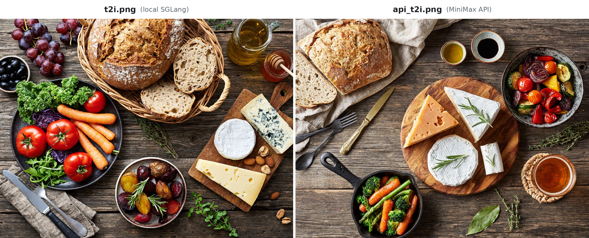
</p>
<p align="center"><em>로컬 SGLang에서 생성한 t2i.png(왼쪽)와 MiniMax API에서 생성한 api_t2i.png(오른쪽), 4736x3552(H3-Image-Context-IR이 선택한 4:3)</em></p>

#### case-Edit

[`instruction.edit.txt`](examples/instruction.edit.txt)를 사용하며,
참조 이미지 [`reference1.png`](examples/reference1.png)를
`<Picture 1>`로 지정합니다.

| 단계 | 요청 | 결과 |
| --- | --- | --- |
| 프롬프트 향상: H3-Image-Context-IR (MiniMax API) | `python3 context_ir.py edit` ([스크립트](examples/context_ir.py)) | `revised_prompt.txt`, `revised_size.txt`; 예시 실행 결과: [`revised_prompt.edit.txt`](examples/revised_prompt.edit.txt), [`revised_size.edit.txt`](examples/revised_size.edit.txt) (4096x4096) |
| 프롬프트 향상, 에이전트 대안: [h3-image-prompt-writing](#프롬프트-작성-스킬) | 스킬을 사용해 `reference1.png`에 맞게 `instruction.edit.txt`를 다시 쓰도록 에이전트에게 요청 | 프롬프트를 `revised_prompt.txt`로, `4096x4096`을 `revised_size.txt`로 저장 |
| MiniMax-H3-Image 생성: 로컬 SGLang | `python3 edit.py --prompt revised_prompt.txt --size $(cat revised_size.txt)` ([스크립트](examples/edit.py)) | `edit.png` |
| E2E API 참조: MiniMax API 직접 호출로 수행한 이미지 편집 | `python3 api_generate.py edit` ([스크립트](examples/api_generate.py)) | `api_edit.png` |

<p align="center">
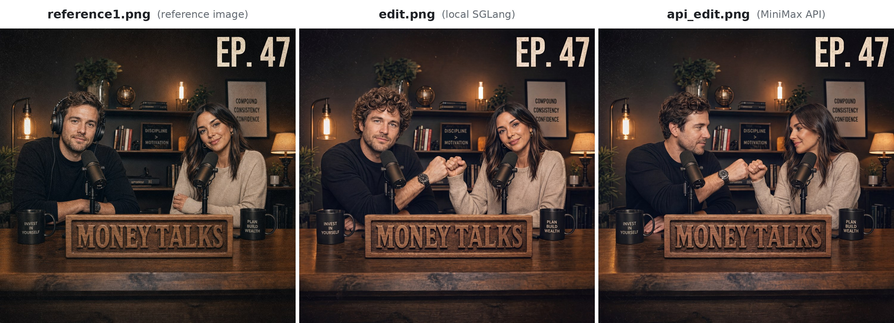
</p>
<p align="center"><em>참조 이미지 reference1.png(왼쪽), 로컬 SGLang에서 생성한 edit.png(가운데), MiniMax API에서 생성한 api_edit.png(오른쪽), 4096x4096(H3-Image-Context-IR이 선택한 1:1)</em></p>

## 라이선스

- MiniMax-H3-Image는 [MiniMax-H3-Image Community License Agreement](LICENSE)에 따라 배포됩니다.
- T2I PE 모델([MiniMax-H3-Image-PE](https://huggingface.co/MiniMaxAI/MiniMax-H3-Image-PE))은 MiniMax-H3-Image의 일부이므로 마찬가지로 [MiniMax-H3-Image Community License Agreement](LICENSE)가 적용됩니다.
- 라이선스 Section IV에 명시된 별도의 서면 승인은 [신청서](https://platform.minimax.io/console/license)를 통해 요청합니다.

## 문의

[model@minimax.io](mailto:model@minimax.io)로 문의해 주세요.
