<div align="center">
  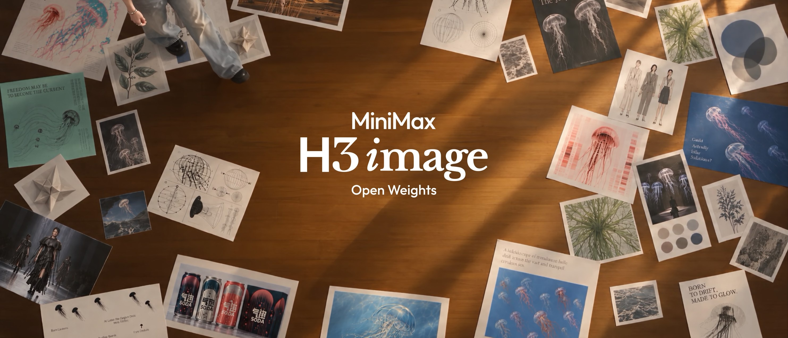
</div>

<p align="center">
  <a href="https://hailuoai.video" target="_blank"></a>
  <a href="https://platform.minimax.io" target="_blank"></a>
  <a href="https://www.minimax.io" target="_blank"></a>
  <a href="https://github.com/MiniMax-AI/MiniMax-H3-Image" target="_blank"></a>
  <a href="https://huggingface.co/MiniMaxAI/MiniMax-H3-Image" target="_blank"></a>
  <br>
  <a href="https://modelscope.cn/models/MiniMax/MiniMax-H3-Image" target="_blank" rel="noopener noreferrer"></a>
  <a href="https://platform.minimax.cn/docs/faq/contact-us" target="_blank"></a>
  <a href="https://discord.com/invite/dbMxutw7tP" target="_blank"></a>
  <a href="LICENSE"></a>
</p>

<p align="center">
  <a href="README.md"><strong>English</strong></a> |
  <a href="README.zh-CN.md">简体中文</a> |
  <a href="README.ko.md">한국어</a> |
  <a href="README.ja.md">日本語</a>
</p>

# MiniMax-H3-Image

## Prompt Writing Skill

MiniMax-H3-Image works best with a detailed English description of the whole image. The
`h3-image-prompt-writing` skill lets your own agent write that description from a short idea,
a brief, an existing prompt or a set of reference images. Install it with the
[skills CLI](https://github.com/vercel-labs/skills):

```bash
npx skills add https://github.com/MiniMax-AI/MiniMax-H3-Image --skill h3-image-prompt-writing
```

It ships with two prompt guides under
[`skills/h3-image-prompt-writing/references/`](skills/h3-image-prompt-writing/references/):
[`t2i-en.txt`](skills/h3-image-prompt-writing/references/t2i-en.txt) for text-to-image and
[`edit-en.txt`](skills/h3-image-prompt-writing/references/edit-en.txt) for image editing with
one or more reference images.

**Agent compatibility:** `h3-image-prompt-writing` is a plain Markdown + reference-file skill
with no external API calls, so it works in Claude Code, the Claude Agent SDK, Cursor, Windsurf,
OpenAI-based agents/Codex, LangChain, or any other harness that can read a `SKILL.md` and local
files. The bundled `skills/h3-image-prompt-writing/agents/openai.yaml` only adds optional UI
metadata (display name, description, default prompt) for the ChatGPT/Codex skills UI; it does not
limit the skill to OpenAI agents.

The skill writes prompts only; it does not generate images. Send its output as `prompt` to your
own deployment (see [Run Locally](#run-locally)). With the MiniMax text-to-image API, also set
`disable_prompt_enhanced: true` and the `aspect_ratio` the skill gives, otherwise the API expands
the prompt again; image editing requests are always expanded. To write prompts by hand, see
[Prompting Tips](#prompting-tips). All skills are described in [`skills/README.md`](skills/README.md).

## Use Online

Use MiniMax-H3-Image without any setup in the MiniMax apps, or call it through the MiniMax API.

### App

- WebApp Global: [hailuoai.video](https://hailuoai.video/) | CN: [hailuoai.com](https://hailuoai.com/)
- Desktop Global: [agent.minimax.io](https://agent.minimax.io/) | CN: [agent.minimax.cn](https://agent.minimax.cn)

### API

- Global: [platform.minimax.io](https://platform.minimax.io/docs/guides/image-generation) | CN: [platform.minimax.cn](https://platform.minimax.cn/docs/guides/image-generation)

API docs:
- Text-to-image: [EN-docs](https://platform.minimax.io/docs/api-reference/image-generation-h3-generations), [CN-docs](https://platform.minimax.cn/docs/api-reference/image-generation-h3-generations)
- Image editing: [EN-docs](https://platform.minimax.io/docs/api-reference/image-generation-h3-edits), [CN-docs](https://platform.minimax.cn/docs/api-reference/image-generation-h3-edits)
- Prompt expansion: [EN-docs](https://platform.minimax.io/docs/api-reference/image-generation-h3-context-ir), [CN-docs](https://platform.minimax.cn/docs/api-reference/image-generation-h3-context-ir)

## Overview

MiniMax-H3-Image is a state-of-the-art open-source model for image generation and editing from
the [MiniMax H3](https://huggingface.co/MiniMaxAI/MiniMax-H3) family. It combines intelligent
understanding of creative intent with the ability to build visual worlds: with precise
instruction following, it develops a creative concept into concrete characters, scenes and
atmosphere. Generation and editing are unified in one checkpoint, which generates images from
text (text-to-image) and edits one or more reference images (image editing), giving creators
and developers a flexible and controllable way to create images.

It generates images of about 16 megapixels at every aspect ratio, from 4096x4096 (1:1) to
6272x2688 (21:9), directly and without an upscaler (see [Sizes](#sizes)). The checkpoint is
distilled to 6 sampling steps (6 NFEs) with no classifier-free guidance. Its diffusion
transformer (DiT) has the H3 architecture without the audio layers, and it uses the
MiniMax-H3 text encoder unchanged.


### Highlights

MiniMax-H3-Image brings together three core strengths: speed, image quality, and instruction
following.

1. **16-megapixel images at a practical computational cost.** Compared with the 1–4 MP outputs
   common today, 16 MP (4096 × 4096) images offer far more detail but typically require
   substantially more computation. MiniMax-H3-Image keeps that computational cost manageable,
   making 16 MP generation practical for everyday creation.
2. **Rich detail. Remarkable realism.** MiniMax-H3-Image goes beyond the familiar “AI look” to
   produce images with intricate detail and lifelike realism, opening up more possibilities for
   creative and professional use. It brings generated imagery closer to the richness and nuance
   of the real visual world.
3. **Stronger instruction following.** Greater creative control. Great image generation goes
   beyond beautiful pictures—it helps creators bring their ideas to life. MiniMax-H3-Image
   delivers the strongest instruction following among open-source models and supports up to 16
   reference images, giving creators more control over the final result.

### Model Zoo

| Model | Role | Precision | Size | Hugging Face |
| --- | --- | --- | --- | --- |
| **MiniMax-H3-Image** | Text-to-image and image editing | BF16 (DiT) | 68.65 GB | [MiniMaxAI/MiniMax-H3-Image](https://huggingface.co/MiniMaxAI/MiniMax-H3-Image) |
| **MiniMax-H3-Image-PE** (optional) | Prompt expander for text-to-image | NVFP4 | 17.9 GB | [MiniMaxAI/MiniMax-H3-Image-PE](https://huggingface.co/MiniMaxAI/MiniMax-H3-Image-PE) |

### Model Architecture

MiniMax-H3-Image follows the H3-Base design with the audio branch removed. The text
prompt and the reference images are encoded by the H3 text encoder; the reference images are
also encoded by the image VAE. All tokens form one packed sequence for a single-stream
transformer, which predicts the latent of the target image. The VAE decodes that latent
into the image.

- **Text encoder**: the full Qwen3-VL text encoder of MiniMax-H3, unchanged. The DiT reads
  the hidden states of its 50th layer.
- **Image VAE**: a CNN encoder and a 2D ViT decoder (24 layers), with 16x spatial
  downsampling and 24 latent channels. The DiT patchifies the latent with a 2x2 patch, so each
  transformer token covers 32x32 pixels.
- **Diffusion transformer**: 33.1B parameters, a dense single-stream transformer with 50
  layers (hidden size 5376, 56 attention heads, FFN size 14336) and 3D multimodal RoPE, the same
  as the H3-Omni-Transformer. The weights are BF16; the embedding, timestep and output layers
  are FP32.

## Showcase

Text-to-image and image editing results, shown downscaled. Open **Prompts** under an image to
see what was typed for it. These are requests as a user writes them, not the expanded prompts
the model receives: the MiniMax API expands them with H3-Image-Context-IR before generation (by
default for text-to-image, always for editing), so you can send them as they are. For a local deployment, expand them first as in
[Full Workflow](#full-workflow). Most prompts were written in Chinese; the English versions come
from the official English user guide, and [简体中文](README.zh-CN.md) shows the originals.

### Text-to-Image

<p align="center">
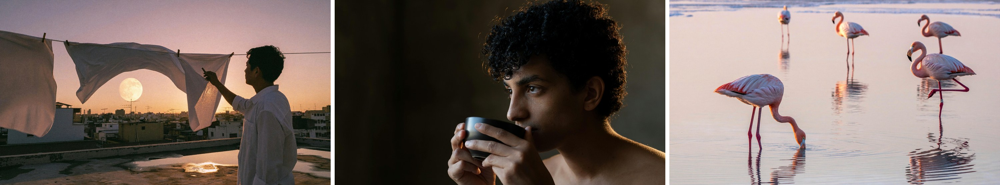
</p>
<p align="center"><em>Photorealistic photography</em></p>

<!-- BEGIN showcase-prompts -->
<details>
<summary>Prompts</summary>

<p><b>Rooftop at dusk</b></p>
<blockquote>An old city rooftop at dusk in late summer. Several clotheslines cross the foreground, with white sheets lifted by the wind into soft waves. Through the gaps, show dense distant rooftops, antennas, and a low pale-gold moon. On the right, a backlit person in a white shirt takes down laundry, visible as a clear profile silhouette. The concrete rooftop has warm-gray textures and shallow puddles. The sky transitions from rose pink to smoky purple, and sunset rim light passes through the fabric. Combine the authenticity of an everyday-life documentary with the poetic composition of a cinematic still. Use a 35 mm lens, natural wind, and slight film grain, without an excessive romantic filter.<br>
Real photographic and cinematic-still texture. Prioritize natural light and physically credible reflections, with a clear visual focal point and breathing room. Keep colors restrained with one or two narrative accents, finely realistic materials, and natural human gestures. Retain moderate 35 mm film grain, gentle highlight bloom, and realistic depth of field. The image should be refined, rewarding to look at, and capture a narrative moment. Avoid cheap-looking CG, plastic skin, excessive sharpening, HDR halos, randomly added objects, watermarks, borders, logos, or unnecessary text.</blockquote>

<p><b>A pause before tea</b></p>
<blockquote>Photograph a realistic portrait of a curly-haired person pausing before drinking tea. Include the head, shoulders, upper chest, and both hands holding a dark ceramic cup, with the face slightly turned. Warm light from the rear right grazes the hair against a darker interior wall. The edges of loose curls and a few flyaway strands glow translucently, with the dark background still visible between strands. Dense locks remain dark inside, and the bright rim breaks naturally where strands occlude one another. Very weak soft light from the camera's front left illuminates the face so the eyes, cheeks, and fingers remain visible. Only the edges of the ear and shoulder facing the rear light are lit. The ceramic cup has a broad, weak surface highlight, with contact shadows where its rim meets the fingers. Focus should cover the eyes, outer hair strands, and cup rim.</blockquote>

<p><b>Flamingos at dawn</b></p>
<blockquote>In the shallows of a salt lake at dawn, five flamingos are spread across a broad, mirror-like water surface. The nearest bends its head to feed, the second stands on one leg, and three distant birds create a gentle rhythm of pink. The lake reflects a pale-pink sky and distant white salt crusts. Use an eye-level telephoto composition with water filling almost the entire frame and ample breathing room between the birds. Feather colors should have delicate gradations from grayish pink to coral pink. Water ripples, reflections, salt crusts, and bird legs must be realistic. Elegant nature photography, without crowded flocks or highly saturated cartoon colors.<br>
Real photographic and cinematic-still texture. Prioritize natural light and physically credible reflections, with a clear visual focal point and breathing room. Keep colors restrained with one or two narrative accents, finely realistic materials, and natural human gestures. Retain moderate 35 mm film grain, gentle highlight bloom, and realistic depth of field. The image should be refined, rewarding to look at, and capture a narrative moment. Avoid cheap-looking CG, plastic skin, excessive sharpening, HDR halos, randomly added objects, watermarks, borders, logos, or unnecessary text.</blockquote>

</details>
<!-- END showcase-prompts -->

<p align="center">
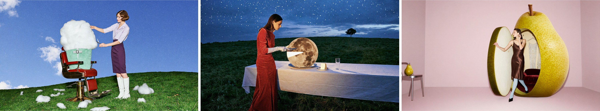
</p>
<p align="center"><em>Surreal editorial photography</em></p>

<!-- BEGIN showcase-prompts -->
<details>
<summary>Prompts</summary>

<p><b>A cloud in a barber chair</b></p>
<blockquote>A retro, playful, refined surreal fashion photograph. A cherry-red barber chair stands on a vivid green hill, with an enormous white cloud seated in it, its fluffy body wrapped in a mint-green barber cape. An adult female model in a pale-purple short-sleeved blouse, dark-purple pencil skirt, and white tall boots stands beside the chair, carefully trimming the cloud with silver scissors while lifting one corner of it with her other hand. Small cut-off tufts of cloud lie scattered on the lawn like freshly cut hair. The model has a neat retro short haircut and a focused expression. Use a low-angle wide shot with blue sky filling most of the frame, a simple set, and vivid colors. Give it the look of a live-action fashion editorial, with soft translucent cloud details, credible volumetric shadows, slight direct-flash fill, and film grain, without a cartoon feel. Landscape 16:9, no text.</blockquote>

<p><b>Slicing the moon</b></p>
<blockquote>A surreal fashion photograph with the texture of a retro film set. Beneath a cobalt-blue twilight sky, a long dining table covered with a white tablecloth stands on a green hill. An adult female model in a tomato-red velvet gown and long white gloves stands calmly at one side, using a silver dinner knife to cut a small wedge from an enormous full moon on a plate. The moon stands upright like a round cake, retaining realistic craters on its surface. The cut interior emits a soft milky-white glow, and the removed moon slice rests securely on a small porcelain plate beside it. Moonlight illuminates her gloves and jaw, while glasses on the table cast long, slender shadows. There is no second moon in the sky, only a lone small tree in the distance. Elegant, absurd, and subtly deadpan, with the photographic feel of real people and practical props, fine film grain, landscape 16:9, no text.</blockquote>

<p><b>A pear as a dressing room</b></p>
<blockquote>A surreal photograph for a 2000s avant-garde fashion magazine. In a pale-pink studio, a three-meter-tall yellow-green pear has been converted into a changing room. A small round-cornered doorway is cut into its skin, with the door retaining a thick cross-section of peel and milky-white flesh. An adult female model steps one foot out of the pear, wearing a chocolate-brown satin dress, pale-blue tights, and pointed shoes. One hand rests on the doorway while the other adjusts an earring, with a nonchalant expression. The interior is lined with burgundy velvet padding and contains two elegant hanging garments. A normal-sized pear rests on a small silver chair nearby, establishing a clear scale contrast. Use an off-center composition with clean empty space, soft studio light, and a slight frontal flash. Pear-skin pores, juicy flesh, velvet, and satin all have tactile, realistic textures, with the look of a carefully constructed physical set. Landscape 16:9, no text.</blockquote>

</details>
<!-- END showcase-prompts -->

<p align="center">
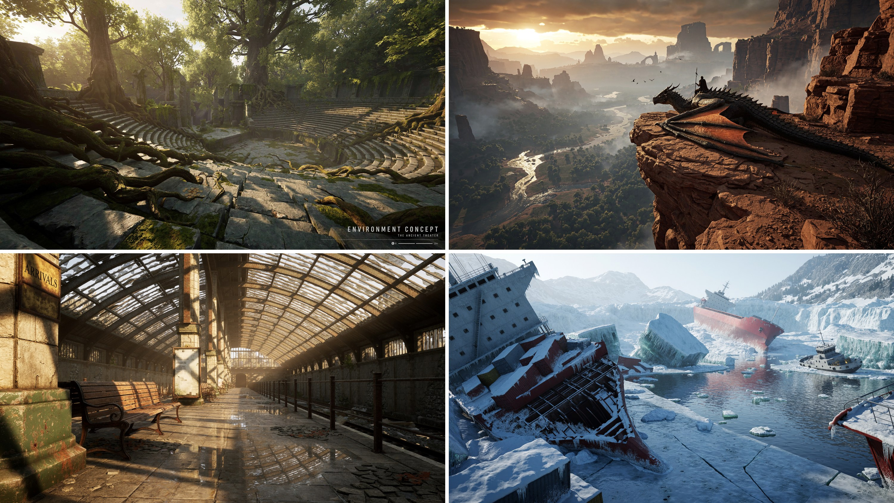
</p>
<p align="center"><em>Environment concepts</em></p>

<!-- BEGIN showcase-prompts -->
<details>
<summary>Prompts</summary>

<p><b>Forest amphitheater (top left)</b></p>
<blockquote>Aspect ratio 16:9, 4K. Create a finished environment concept image for a AAA game, in which the terrain, landmarks, and function of the settlement are immediately legible before the viewer notices the finer details. Use a credible, realistic 3D space, architecture adapted to climate and terrain, and distinct foreground, midground, and background. Specific subject: an amphitheater swallowed by the forest, with tree roots entering the seating through cracks. Do not use names, characters, or brand logos from existing works, and do not add a watermark.</blockquote>

<p><b>Abandoned station (bottom left)</b></p>
<blockquote>Aspect ratio 16:9, 4K. Generate a photorealistic AAA image with a high-end real-time engine look. Emphasize indirect illumination, varied roughness, contact shadows and depth separation. Show only the rendered scene, without an editor or performance counters. Scene: Sunlight enters an abandoned station through a glass roof and reflects its steel frame in wet tiles. Use original identities and designs without existing franchise names, characters, brand marks or watermarks.</blockquote>

<p><b>Frozen shipwrecks (bottom right)</b></p>
<blockquote>Abandoned shipwrecks in an intensely cold, frozen bay, in a 2.2:1 ultra-wide panorama, with a 24 mm wide-angle lens looking slightly downward. On the left, a tilted wreck is covered in snow and icicles, with rusty containers scattered across its deck. Central cracks in broken ice lead to a blue channel, translucent teal ice walls, and drifting ice floes and debris. A white-gray tugboat is grounded on the right, while a red cargo ship lies capsized among glaciers in the distance. Snowy mountains, ice cliffs, and sparse conifers fade into cold mist. Use an ice-blue and teal-gray palette punctuated by dark-red hulls. Cold daylight creates a dark-near, bright-far hierarchy, with a silent, desolate mood. Cinematic realism, authentic ice, snow, and metal materials, water reflections, deep depth of field, volumetric fog, 8K, no people, text, or watermarks.</blockquote>

<p><em>The prompt for the dragon rider (top right) is not included.</em></p>

</details>
<!-- END showcase-prompts -->

<p align="center">
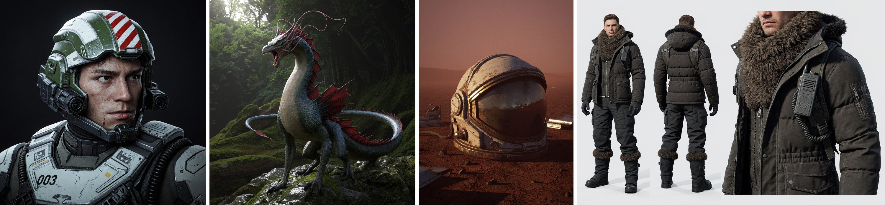
</p>
<p align="center"><em>Characters, creatures and props</em></p>

<!-- BEGIN showcase-prompts -->
<details>
<summary>Prompts</summary>

<p><b>Combat pilot</b></p>
<blockquote>Aspect ratio 1:1. A close half-body portrait of a realistic futuristic combat pilot. The young man has a stern face, eyes glancing slightly right, and small abrasions on his cheeks. His hair is hidden inside a complex open-face armored helmet. The helmet has an olive-green and aged-white industrial shell, a red-and-white striped insignia on top, sensors, black optical lenses, communication boxes, and hinged brackets along both sides of the face, and a protective neck frame beneath the jaw. Thick white-gray chest armor features dark straps, hoses, the number “003,” stickers, and small warning markings, with scratches, dust, and chipped edges. Keep the subject close to the camera against a pure-black background. Soft cool light from the upper left outlines his face and equipment, emphasizing complex mechanical assembly, realistic skin, and military hard-surface materials. Output one complete artwork with no website borders, artist signatures, or watermarks.</blockquote>

<p><b>Forest dragon</b></p>
<blockquote>A realistic fantasy-film creature stands on a rock in a dim forest, in a square full-body composition. The subject is a dragon with a tall neck and slender body, fine gray-blue and dark-green scales, a beige-gray belly, and fan-shaped dark-red dorsal membranes rising from its shoulders to its tail. Its mouth is open in a roar, with many long pink tendrils and horn-like fleshy crests growing from its forehead and cheeks and curling backward, forming an elegant, complex silhouette. Its four limbs have a reptilian structure with sharp claws, its long tail curves around the body toward the left, and its feet rest on damp rocks and moss. Soft natural forest light shines through parts of the tendril crest. Fine, credible materials, with no text or watermark.</blockquote>

<p><b>Astronaut helmet on a red wasteland</b></p>
<blockquote>Aspect ratio 3:4, 4K. Create a portrait-format cover key visual for an original AAA game, using realistic 3D and dramatic but restrained cinematic lighting. Establish a clear focal point with one main character or central object. Keep approximately the top quarter quiet for later typography, and do not generate a title, logo, or text in the current image. Specific subject: a dust-covered astronaut helmet lying on a red wasteland, its visor reflecting a distant base. Do not use names, characters, or brand logos from existing works, and do not add a watermark.</blockquote>

<p><b>Polar costume board</b></p>
<blockquote>Aspect ratio 3:2, 4K. Create an original AAA costume board: full front view on the left, full rear view in the center and one construction close-up on the right, using the same adult model and outfit. Show realistic 3D drape, seams and fastening structures against pale gray without text. Scene: An insulated polar communicator outfit with fur collar, sealed cuffs and gaiters. Use original identities and designs without existing franchise names, characters, brand marks or watermarks.</blockquote>

</details>
<!-- END showcase-prompts -->

<p align="center">
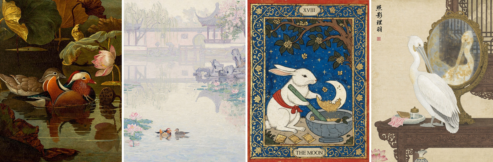
</p>
<p align="center"><em>Painting and illustration styles</em></p>

<!-- BEGIN showcase-prompts -->
<details>
<summary>Prompts</summary>

<p><b>Mandarin ducks, Old Master oil painting</b></p>
<blockquote>An oil painting on canvas in the style of a 17th-century European Old Master, depicting Chinese mandarin ducks and a lotus pond. At the center, a pair of mandarin ducks swim close together on the dark pond: the male has brilliant plumage, orange-red sail-like feathers, a crest with purple-green metallic sheen, white eyebrow markings, and a red bill; the female is understated gray-brown with a white stripe behind the eye. Their heads and necks incline gently toward each other, with a quiet, affectionate air. Surround them with lotus leaves of late summer and early autumn, some full and dark green, others with scorched, curling edges. At the upper right, show a half-open pink-white lotus and a drooping seedpod. Use Rembrandt-like chiaroscuro, with a warm beam of side light from the upper left falling on the ducks while the rest recedes into deep olive-green and amber-brown shadows. The water is an ink-dark mirror reflecting the ducks and lotus flowers, disturbed by tiny ripples. Combine impasto with thin glazes: raised paint on feather highlights, clearly visible brushwork and canvas texture, and aged varnish lending a warm golden cast and fine craquelure. A stable composition with large dark areas of breathing room, poetic and serene, a museum-quality masterpiece.</blockquote>

<p><b>Suzhou garden, Impressionist oil painting</b></p>
<blockquote>A physical French Impressionist oil painting on canvas, in portrait format, depicting mandarin ducks playing in the morning mist of a classical Suzhou garden. It should look as though Monet, late in life, painted beside a garden pond in Suzhou with thick oils and coarse hog-bristle brushes, working directly from the morning fog. Evoke the original paintings Impression, Sunrise, Water Lilies, and the morning-mist works in the Rouen Cathedral series: forms dissolve in light and fog, yet every inch of the painting has visible brushwork and pigment. This is Western oil painting, with no ink wash, gongbi outlines, inscriptions, or seals.<br>
<br>
[Scene Content]<br>
Water occupies roughly the lower 60% of the painting. Slightly left of center in the lower middle, a pair of mandarin ducks play facing each other, suggested with only a few strokes. The male's thick orange-red strokes are the painting's only rich, warm accent, like the red sun in Impression, Sunrise; the female is a soft gray-brown mark. Loose pink and blue-green patches of water lilies and lotus leaves float around them.<br>
On the right of the midground, a zigzag stone bridge and lakeside Taihu rocks become a few pale violet-gray strokes.<br>
In the distance, occupying roughly the upper 40%, a whitewashed wall, a circular moon gate, and a pavilion with upturned eaves dissolve into ghostly pale-lavender and creamy shapes in the mist. Only the wall's undulating top, the curved eaves, and a faint circle remain barely recognizable. At the upper left, weeping willows become descending green-purple strokes; at the upper right, a flowering tree becomes clusters of pink marks. All architectural reflections dissolve and tremble on the water.<br>
<br>
[Atmospheric Softness]<br>
Dense, moist morning fog fills the entire image. The air itself is light blending pink-purple, pale gold, and gray-blue. There are no outlines and almost no boundaries between water, air, and the far bank; forms emerge only through slight differences in color temperature. Keep the whole image soft and high-key, with colors at similar values. Shadows contain only pale purple and pale blue, with no black.<br>
<br>
[Brushwork — Most Important]<br>
The atmospheric softness must come entirely from interlocking brushstrokes of similar value, never from blur. There must be no soft focus, airbrushed gradients, smooth transitions, or digital blur anywhere. Even the fog itself consists of individually countable strokes of paint.<br>
Fill the canvas with clearly visible, free, varied-size brushstrokes: comma-shaped marks, short dashes, and broken strokes, about a finger's width. Each must show its beginning, end, and the fine grooves left by hog bristles.<br>
Vary stroke direction with the subject: layers of short horizontal marks across the water; trembling vertical strokes for reflections; long, descending curved strokes swept rapidly through the willows; loosely woven diagonal strokes for sky and fog; and short curved strokes circling the ducks like spreading ripples.<br>
Give the paint real thickness. Lit areas, water lilies, and the male duck's orange-red accents use obvious impasto, with raised paint and small ridges at the edges that appear sculptural in side light. In darker areas, dry-brush strokes reveal underlying colors and the weave of coarse canvas.<br>
Juxtapose unmixed pure colors between brushstrokes: pink-purple beside pale gold, gray-blue beside pale rose. Work wet-on-wet, allowing some local dragging and mixing by the next stroke, but never smoothing the surface flat.<br>
<br>
Up close, the work is all expressive brushstrokes and pigment; only from a distance do they coalesce into a garden in the mist. A museum-quality Impressionist masterpiece with the material presence of a work in the Musée d'Orsay collection.</blockquote>

<p><b>The Jade Rabbit, illuminated manuscript</b></p>
<blockquote>A medieval illuminated manuscript illustration with gold leaf and a wide border of curling vines. Beneath an old osmanthus tree, the Jade Rabbit of Chinese folklore stands beside a blue-grey stone mortar. Wearing a simple red cloth sash, it grips a long jade pestle and carefully grinds a single ivory crescent moon into fine golden powder. Part of the crescent remains intact inside the mortar. Small osmanthus blossoms fall onto the stone rim, and several folded medicine packets lie nearby. The rabbit works with the solemn concentration of an old apothecary. The deep blue sky contains a few stars but no second moon.<br>
Flat perspective, dark ink outlines, opaque tempera on aged parchment. Rich red, ultramarine blue and antique gold. A broad blue border filled with curling gold lotus vines, small blossoms and Chinese cloud motifs. Worn gold leaf and slightly irregular hand-painted forms. A small numeral XVIII above, and THE MOON in a parchment cartouche below.</blockquote>

<p><b>Pelican at a mirror, gongbi painting</b></p>
<blockquote>Chinese gongbi painting in color on silk. A round bronze mirror stands on a dressing table in an ancient woman's chamber. A white pelican stands before it, lowering its head to groom its chest feathers with its long bill. The slightly yellowed, somewhat hazy mirror reflects the pelican's face and the carved wooden window behind it. Include a vertical inscription and a red seal in the upper-left corner.</blockquote>

</details>
<!-- END showcase-prompts -->

<p align="center">

</p>
<p align="center"><em>Text rendering with reasoning: logic puzzles in Chinese and English, solved correctly on the board</em></p>

<!-- BEGIN showcase-prompts -->
<details>
<summary>Prompt</summary>

<p><b>Staff-selection puzzle (left)</b></p>
<blockquote>Solve the following personnel-selection reasoning problem and generate a visual explanation. Use 16:9 landscape format, a white background, and clear, standardized Chinese typography.<br>
An organization must select exactly three of six staff members—甲, 乙, 丙, 丁, 戊, and 己—for a research team. All of the following conditions must be met:<br>
If 甲 is selected, 乙 must also be selected.<br>
Exactly one of 丙 and 丁 must be selected.<br>
乙 and 戊 cannot both be selected.<br>
If 己 is selected, 丙 must also be selected.<br>
戊 has already been confirmed as selected.<br>
Determine the three-person team using all the conditions.<br>
Show the problem conditions at the top. Divide the lower section into “入选” (Selected) and “未入选” (Not Selected), placing each of the six staff cards in the correct area. Each card should contain a person icon and a prominent name label. Each person must appear exactly once, with no duplicates or omissions.<br>
At the bottom, use brief notes to show the key reasons for exclusion. The card placements, selected names, and notes must agree. Do not add extra conditions. Output only the finished solution image.</blockquote>

<p><em>The prompt for the detective board (right) is not included.</em></p>

</details>
<!-- END showcase-prompts -->

### Image Editing

<p align="center">
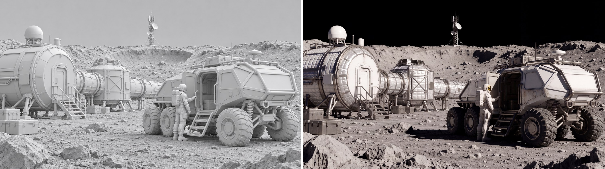
</p>
<p align="center"><em>Image editing, one reference: an untextured 3D render (left) turned into a film still of a lunar research base (right)</em></p>

<!-- BEGIN showcase-prompts -->
<details>
<summary>Prompt</summary>

<blockquote>Render this untextured 3D model as a realistic cinematic lunar research scene. Add gray lunar soil, silvery-white thermal insulation, coated metal, glass, and wheel-mesh materials, with off-white spacesuits. Use strongly directional sunlight and limited ground bounce. Keep the distant sky pure black, with no blue sky, clouds, or Earth-like haze. Preserve the rover's six wheels and the arrangement of the people and modules. Keep shadow directions consistent and material detail visible in highlights. Preserve the original composition, camera angle, perspective, geometry, and the position and proportions of every subject. Output 4K in 16:9 landscape format, combining AAA photorealistic CG with cinematic live-action texture. Do not add text, brands, interface elements, or watermarks.</blockquote>

</details>
<!-- END showcase-prompts -->

<p align="center">
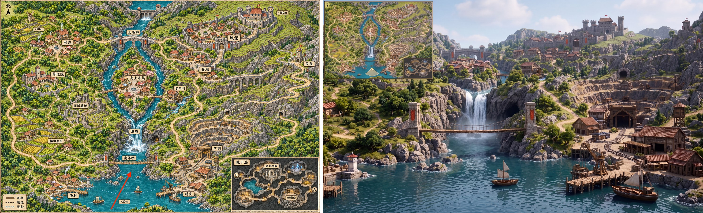
</p>
<p align="center"><em>Image editing, one reference: a game map (left) turned into a first-person 3D game view from the red arrow's position, with the map as a minimap (right)</em></p>

<!-- BEGIN showcase-prompts -->
<details>
<summary>Prompt</summary>

<blockquote>Using the supplied game map as the sole spatial reference, generate a 16:9 in-game screenshot of an open-world game in a realistic 3D CG style.<br>
Camera Position and Direction<br>
Use the tail of the red arrow as the camera position and the direction of its tip as the viewing direction. The camera is approximately 1.7 meters above the lake in the southern part of the map, looking slightly east of north in first person with a field of view of about 70° and natural perspective. Do not show the player's body.<br>
Spatial Reconstruction<br>
Strictly reproduce the map's terrain elevations, building locations, river course, bridge connections, and road relationships.<br>
Determine the visible portions of the settlements on both banks, the mining area, the mountains, and the distant castle according to actual lines of sight. Preserve plausible occlusion and relative scale with distance. Do not move buildings, flatten the terrain, or widen the field of view merely to show every landmark.<br>
Visual Style<br>
Use high-quality, realistic game-engine rendering, with buildings and mountains at true scale, detailed rock, wood, vegetation, and water materials, natural daylight, global illumination, water reflections, and moderate atmospheric perspective. Convey the feeling of a player actually inhabiting this world. Avoid a hand-drawn map look, miniature diorama, isometric viewpoint, or bird's-eye composition.<br>
Upper-Left Minimap<br>
Add a clear game HUD minimap in the upper-left corner, approximately 15% of the image width. Use the surface map from the reference image as its thumbnail base, preserving the original proportions and north-up orientation. Retain major terrain and roads, and remove the underground inset.<br>
Mark the player's position with a small directional arrow at the location corresponding to the tail of the original red arrow. Its direction must exactly match the main camera view, with a pale fan-shaped area indicating the field of view. Use a simple thin border and keep the map legible.<br>
Output only one complete game screenshot. Do not include the original red arrow, place-name labels, elevation numbers, or map borders in the main scene. Add no interface elements other than the upper-left minimap.</blockquote>

</details>
<!-- END showcase-prompts -->

<p align="center">
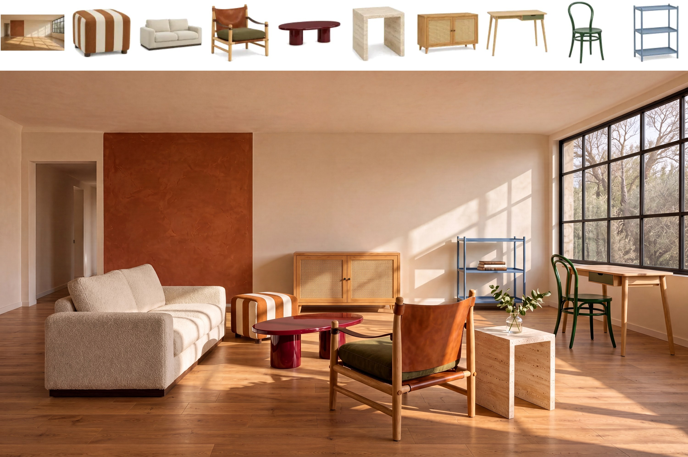
</p>
<p align="center"><em>Image editing, ten references: an empty room and nine pieces of furniture (top) composed into one living room (bottom)</em></p>

<!-- BEGIN showcase-prompts -->
<details>
<summary>Prompt</summary>

<blockquote>Photograph a living-room lifestyle scene for the spring furniture catalog for the brand “向阳家居” (Xiangyang Home). The first image shows the actual empty room, and the following nine images show the furniture currently on sale against white backgrounds. Retain the camera position, walls, doors, windows, and wooden floor of the empty room. Place each of the nine original furniture pieces in the room exactly once, creating a living room where two or three people can chat or read and write by the window. The lounge chair with leather-strap armrests is the featured product; show it from an angle that clearly reveals its wooden frame, leather-strap armrests, and cushion. Arrange the other furniture according to its actual size and function: tabletops should be accessible when seated, the desk chair should have room to pull out, and there should be an uninterrupted path from the doorway into the room.<br>
Preserve the color, material, structure, and proportions of every product. Let light from the right-hand window fall naturally on the fabric, leather, and wood, with convincing contact shadows beneath table and chair legs. A few books or a single sprig of greenery are allowed; keep the display uncluttered. Real interior photography, with no text.</blockquote>

</details>
<!-- END showcase-prompts -->

## Run Locally

To run MiniMax-H3-Image on your own GPUs, download the checkpoint, start a server with SGLang or
vLLM-Omni, and send requests with the parameters and sizes below. [Full Workflow](#full-workflow)
combines these steps with prompt expansion to reproduce the images of the MiniMax API.

### Model Files

| Component | Content | Size |
| --- | --- | --- |
| `transformer/` | DiT: BF16, with the embedding, timestep and output layers in FP32. | 66.28 GB |
| `pdd_fused_heads.safetensors`, `pdd_config.json` | The per-step output heads that replace the transformer's output layer, and the sampling schedule. | 12 MB |
| `vae/` | Image VAE, FP32. | 2.34 GB |
| `tokenizer/`, `processor/` | Qwen3-VL tokenizer and processor, identical to MiniMax-H3. | 23 MB |
| Text encoder | Not part of the original checkpoint. `model_index.json` loads it from [`MiniMaxAI/MiniMax-H3`](https://huggingface.co/MiniMaxAI/MiniMax-H3), folder `text_encoder/`. If you already have MiniMax-H3, it is not downloaded again. | 66.7 GB |

```text
MiniMax-H3-Image/
├── model_index.json
├── pdd_config.json
├── pdd_fused_heads.safetensors
├── processor/
├── tokenizer/
├── transformer/
└── vae/
```

The Hugging Face repository hosts this original checkpoint and the diffusers format side by side,
about 204 GB in total, so scope the download to what your framework needs. SGLang and vLLM-Omni
load the original checkpoint and the MiniMax-H3 text encoder, about 135 GB together:

```bash
# Original checkpoint (SGLang, vLLM-Omni)
hf download MiniMaxAI/MiniMax-H3-Image model_index.json "pdd_*" "processor/*" "tokenizer/*" "transformer/*" "vae/*"
hf download MiniMaxAI/MiniMax-H3 --include "text_encoder/*"
# optional prompt expander
hf download MiniMaxAI/MiniMax-H3-Image-PE
```

diffusers users do not need a manual download:
`ModularPipeline.from_pretrained("MiniMaxAI/MiniMax-H3-Image")` reads `modular_model_index.json`
and fetches the diffusers-format folders (`transformer_diffusers/`, `vae_diffusers/`, and the
repository's own copy of `text_encoder/`). See the
[diffusers documentation](https://huggingface.co/docs/diffusers/main/en/api/pipelines/minimax_h3_image)
for loading and offloading recipes.

### Deployment

We recommend the following inference frameworks to serve the model:

- [SGLang](https://docs.sglang.io/) - see [cookbook](https://docs.sglang.io/cookbook/diffusion/MiniMax/MiniMax-H3-Image)
- [vLLM-Omni](https://github.com/vllm-project/vllm-omni) - see [vllm-omni recipe](https://recipes.vllm.ai/MiniMaxAI/MiniMax-H3-Image)
- [diffusers](https://github.com/huggingface/diffusers) - see [diffusers docs](https://huggingface.co/docs/diffusers/main/en/api/pipelines/minimax_h3_image)
- [ComfyUI](https://github.com/Comfy-Org/ComfyUI) - see [Comfy tutorial](https://docs.comfy.org/tutorials/image/minimax/minimax-h3-image); use [T2I template](https://github.com/Comfy-Org/workflow_templates/blob/main/templates/image_minimax_h3_image_t2i.json) / [Edit template](https://github.com/Comfy-Org/workflow_templates/blob/main/templates/image_minimax_h3_image_edit.json)

#### SGLang

The [Full Workflow](#full-workflow) below uses SGLang. Install it from the main branch with its
diffusion dependencies (see the
[diffusion installation guide](https://docs.sglang.io/docs/sglang-diffusion/installation)):

```bash
git clone https://github.com/sgl-project/sglang.git
cd sglang
python3 -m pip install -e 'python[diffusion]'
```

Start the server on one GPU:

```bash
sglang serve --model-path MiniMaxAI/MiniMax-H3-Image --host 0.0.0.0 --port 30000 --warmup-mode off
```

The same command works on GPUs with less memory: when a GPU has less than 130 GiB free, SGLang
offloads model components to fit. To use a local copy of the MiniMax-H3 `text_encoder/` folder
instead of the Hugging Face cache, add `--text-encoder-path <path to text_encoder>`.

For lower latency, split each request over several GPUs with sequence parallelism
(Ulysses), for example on 4 GPUs:

```bash
sglang serve --model-path MiniMaxAI/MiniMax-H3-Image --host 0.0.0.0 --port 30000 --warmup-mode off \
  --num-gpus 4 --ulysses-degree 4
```

The [SGLang cookbook](https://docs.sglang.io/cookbook/diffusion/MiniMax/MiniMax-H3-Image) has
recipes for each GPU class, from B300 to 24 GB cards, with measured latency.

#### vLLM-Omni

Install vLLM 0.33.0 and vLLM-Omni from source:

```bash
uv venv --python 3.12 --seed && source .venv/bin/activate
uv pip install vllm==0.33.0 --torch-backend=cu130
git clone https://github.com/vllm-project/vllm-omni.git && cd vllm-omni && uv pip install -e .
```

The default layout splits each request over 4 GPUs with sequence parallelism (Ulysses), measured
on H200:

```bash
vllm serve MiniMaxAI/MiniMax-H3-Image --omni --host 0.0.0.0 --port 8000 \
  --num-gpus 4 --usp 4 --text-encoder-tp-size 4
```

On one GPU, keeping the whole model in memory needs about 135 GiB (B200, B300):

```bash
vllm serve MiniMaxAI/MiniMax-H3-Image --omni --host 0.0.0.0 --port 8000 --num-gpus 1
```

On one H200, offload the text encoder:

```bash
vllm serve MiniMaxAI/MiniMax-H3-Image --omni --host 0.0.0.0 --port 8000 --num-gpus 1 \
  --diffusion-offload-config '{"mode":"layer","components":["text_encoder"]}'
```

On AMD Instinct MI325X and MI350X, use the `vllm/vllm-omni:minimax-h3-image-rocm` image and add
`--no-enable-cuda-graph-decode` to the default command. The
[vLLM-Omni recipe](https://recipes.vllm.ai/MiniMaxAI/MiniMax-H3-Image) lists layouts for H100,
RTX PRO 6000 and other GPUs, with measured latency.

### Requests and Sizes

#### Request Parameters

With SGLang, text-to-image requests are JSON sent to `/v1/images/generations`. Image editing
requests send the reference images as multipart form data to `/v1/images/edits`; their order
defines `<Picture 1>`, `<Picture 2>`, and so on in the prompt. Both return the PNG in
`data[0].b64_json`. Runnable examples are in [Full Workflow](#full-workflow). vLLM-Omni takes
slightly different fields, for example `min_generation_area` inside `extra_args`; see the
[vLLM-Omni recipe](https://recipes.vllm.ai/MiniMaxAI/MiniMax-H3-Image).

| Field | Text-to-image | Image editing | Notes |
| --- | --- | --- | --- |
| `prompt` | Required | Required | Used as given, truncated to 4096 tokens. See [Full Workflow](#full-workflow) |
| `size` | Required | Required | `WIDTHxHEIGHT`. The returned image has exactly this size; see [Sizes](#sizes) |
| `image` | — | One or more files | In upload order they are `<Picture 1>`, `<Picture 2>`, ... in the prompt |
| `seed` | Recommended | Recommended | Integer |
| `generator_device` | `cpu` recommended | `cpu` recommended | Same seed, same initial noise on every machine |
| `response_format` | `b64_json` | `b64_json` | |
| `min_generation_area` | Optional | Optional | Minimum generated area in pixels, 1024-16777216, default 4194304 (2048x2048). A smaller `size` is generated at the same aspect ratio on a larger canvas and resized back with LANCZOS; pass 1024 to turn this off. All sizes in the table below are above the default |
| `num_inference_steps` | Omit or 6 | Omit or 6 | Other values return HTTP 400 |
| `guidance_scale` | Omit or 1 | Omit or 1 | Other values return HTTP 400 |
| `negative_prompt` | Not supported | Not supported | Rejected |

#### Sizes

The effective working range of MiniMax-H3-Image is about 4 MP to 20 MP, and it generally gives
the best results at around 16 MP. Common 16 MP sizes are listed below:

| Aspect ratio | Size (width x height) |
| --- | --- |
| 1:1 | 4096x4096 |
| 4:3 / 3:4 | 4736x3552 / 3552x4736 |
| 3:2 / 2:3 | 5024x3360 / 3360x5024 |
| 16:9 / 9:16 | 5472x3072 / 3072x5472 |
| 21:9 | 6272x2688 |

For another aspect ratio, keep about 16 MP with both sides a multiple of 32.
`size_for()` in [`examples/context_ir.py`](examples/context_ir.py) computes it:

```bash
cd examples
python3 -c "from context_ir import size_for; print(size_for('5:4'))"   # 4576x3648
```

### Full Workflow

MiniMax-H3-Image expects a detailed English description of the whole image. The MiniMax API
turns a short prompt in any language into such a description with **H3-Image-Context-IR** before
generation. We also provide
[MiniMax-H3-Image-PE](https://huggingface.co/MiniMaxAI/MiniMax-H3-Image-PE), which can be
deployed locally.

This section reproduces the quality of images generated directly by the MiniMax API with a
locally deployed SGLang server. The scripts are in
[`examples/`](examples) and use only
the Python standard library; clone this repository and run them in that folder:

```bash
git clone https://github.com/MiniMax-AI/MiniMax-H3-Image.git
cd MiniMax-H3-Image/examples
```

`t2i.py` and `edit.py` send requests to the SGLang server above at `http://127.0.0.1:30000`;
pass `--url` to use another address.

Before running examples, set your MiniMax API endpoint and key to use the H3-Image-Context-IR API
and the reference scripts. The scripts read them from the environment:

```bash
# MiniMax API endpoint (choose one)
# CN
export MINIMAX_API_BASE="https://api.minimax.cn"
# Global
# export MINIMAX_API_BASE="https://api.minimax.io"

# API key obtained from the MiniMax platform
export MINIMAX_API_KEY="<api-key>"
```

API docs:
- H3-Image-Context-IR: use /v1/h3_image_context_ir [EN-docs](https://platform.minimax.io/docs/api-reference/image-generation-h3-context-ir), [CN-docs](https://platform.minimax.cn/docs/api-reference/image-generation-h3-context-ir)
- Text-to-image: use /v1/images/generations [EN-docs](https://platform.minimax.io/docs/api-reference/image-generation-h3-generations), [CN-docs](https://platform.minimax.cn/docs/api-reference/image-generation-h3-generations)
- Image editing: use /v1/images/edits [EN-docs](https://platform.minimax.io/docs/api-reference/image-generation-h3-edits), [CN-docs](https://platform.minimax.cn/docs/api-reference/image-generation-h3-edits)

#### case-T2I

[`instruction.t2i.txt`](examples/instruction.t2i.txt).

<table>
<thead>
<tr><th colspan="2">Stage</th><th>Request</th><th>Result</th></tr>
</thead>
<tbody>
<tr><td rowspan="3">Prompt Enhancement</td><td>H3-Image-Context-IR (MiniMax API)</td><td><code>python3 context_ir.py t2i</code> (<a href="examples/context_ir.py">script</a>)</td><td><code>revised_prompt.txt</code>, <code>revised_size.txt</code>; our run: <a href="examples/revised_prompt.t2i.txt"><code>revised_prompt.t2i.txt</code></a>, <a href="examples/revised_size.t2i.txt"><code>revised_size.t2i.txt</code></a> (4736x3552)</td></tr>
<tr><td>local alternative: <a href="https://huggingface.co/MiniMaxAI/MiniMax-H3-Image-PE">MiniMax-H3-Image-PE</a></td><td><code>scripts/expand_prompt.py</code> in the PE repository</td><td>Save <code>expanded_caption</code> as <code>revised_prompt.txt</code> and the size for <code>aspect_ratio</code> as <code>revised_size.txt</code></td></tr>
<tr><td>agent alternative: <a href="#prompt-writing-skill">h3-image-prompt-writing</a></td><td>Ask your agent to write a prompt and an aspect ratio for <code>instruction.t2i.txt</code> with the skill</td><td>Save the prompt as <code>revised_prompt.txt</code> and the <a href="#sizes">size</a> for that aspect ratio as <code>revised_size.txt</code></td></tr>
<tr><td colspan="2">MiniMax-H3-Image generation: local SGLang</td><td><code>python3 t2i.py --prompt revised_prompt.txt --size $(cat revised_size.txt)</code> (<a href="examples/t2i.py">script</a>)</td><td><code>t2i.png</code></td></tr>
<tr><td colspan="2">E2E API Reference: text-to-image by directly calling the MiniMax API</td><td><code>python3 api_generate.py t2i</code> (<a href="examples/api_generate.py">script</a>)</td><td><code>api_t2i.png</code></td></tr>
</tbody>
</table>

<p align="center">
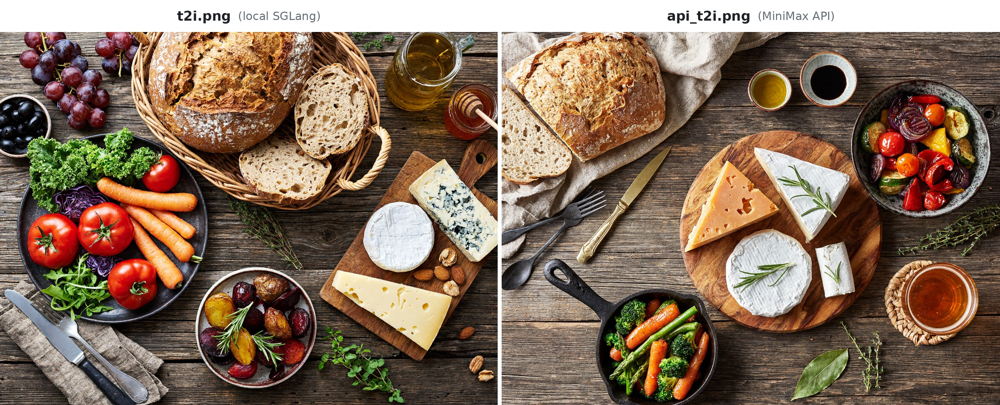
</p>
<p align="center"><em>t2i.png from local SGLang (left) and api_t2i.png from the MiniMax API (right), 4736x3552 (4:3 picked by H3-Image-Context-IR)</em></p>

#### case-Edit

[`instruction.edit.txt`](examples/instruction.edit.txt)
with the reference image [`reference1.png`](examples/reference1.png)
as `<Picture 1>`.

| Stage | Request | Result |
| --- | --- | --- |
| Prompt Enhancement: H3-Image-Context-IR (MiniMax API) | `python3 context_ir.py edit` ([script](examples/context_ir.py)) | `revised_prompt.txt`, `revised_size.txt`; our run: [`revised_prompt.edit.txt`](examples/revised_prompt.edit.txt), [`revised_size.edit.txt`](examples/revised_size.edit.txt) (4096x4096) |
| Prompt Enhancement, agent alternative: [h3-image-prompt-writing](#prompt-writing-skill) | Ask your agent to rewrite `instruction.edit.txt` for `reference1.png` with the skill | Save the prompt as `revised_prompt.txt` and `4096x4096` as `revised_size.txt` |
| MiniMax-H3-Image generation: local SGLang | `python3 edit.py --prompt revised_prompt.txt --size $(cat revised_size.txt)` ([script](examples/edit.py)) | `edit.png` |
| E2E API Reference: image editing by directly calling the MiniMax API | `python3 api_generate.py edit` ([script](examples/api_generate.py)) | `api_edit.png` |

<p align="center">
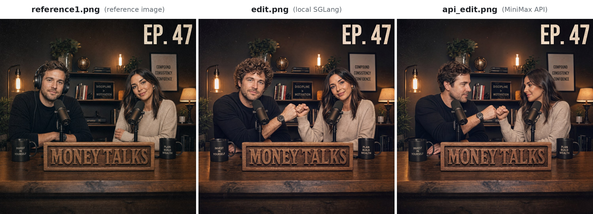
</p>
<p align="center"><em>Reference image reference1.png (left), edit.png from local SGLang (middle) and api_edit.png from the MiniMax API (right), 4096x4096 (1:1 picked by H3-Image-Context-IR)</em></p>

## Prompting Tips

These tips come from the official MiniMax-H3-Image user guide. They hold both for a short request
sent to the MiniMax API and for a full prompt sent to your own deployment.

### Basic Descriptions

- **Describe the task before the style.** First explain the goal, the image's intended use, the
  main people or objects, and their state or actions; then add stylistic requirements.
- **Set the overall layout before adding local details.** Specify the number and placement of
  subjects, viewing angle, and whitespace. For dense content, describe the overall sections first,
  then each part and its relationships, for example "Title at the top; image on the left and text
  on the right below."
- **Express style through visible details.** Describe the desired effect through color, material,
  lighting, and texture. Use "soft side light, metallic reflections, and clean whitespace" instead
  of a vague phrase like "premium feel." Prioritize key details and avoid piling up contradictory
  requirements.

### Text and Information

- **Provide the exact text in full.** Put the complete text to be displayed in quotation marks, and
  specify its position, hierarchy, and line breaks. If you want the model to write the copy, say so
  explicitly.
- **Say so when you want no text.** Write "no text, letters or numbers in the image" to keep the
  model from adding its own titles, labels or decorative lettering.
- **Provide accurate knowledge and data, and clarify relationships.** For charts, academic figures,
  and educational content, provide accurate information, values, units, and their relationships.
  When depicting changes over time, specify the time range. Clearly identify example data to avoid
  confusion with real data.

### Reference Images and Editing

- **Assign each reference image a role.** Explain what each image contributes, what must remain
  consistent, and what may vary freely, for example "Keep the product from image 1, use image 2 for
  color, and image 3 for layout." When borrowing only color, also specify that its shape or
  material should not be used.
- **Distinguish what changes from what stays.** Identify the object to edit by location or
  features, explain what it should become, define the scope of the change, and state what must be
  preserved, for example "Change the cup on the left to blue, keeping its shape, material,
  position, and size the same."
- **Specify the complete desired result.** Distinguish moving, copying, replacing, and deleting.
  When deleting something, explain how its original area should be filled. When changing text or
  data, provide the complete replacement content and state whether the original layout, chart
  structure, and other information should remain.
- **Set a clear goal for every editing round.** State which image to use in the current round, what
  to change, and what to keep. Avoid vague references such as "that one from the last round" or
  "the same as before."
- **Give grids and panels as rows and columns.** For nine-panel grids, storyboards, and collages,
  write "2 rows and 3 columns" or "3×3 (rows × columns)" instead of just "2×3," which can swap rows
  and columns. Describe irregular arrangements directly, such as "3 panels on top and 2 below." When
  editing one panel, identify it as "row 2, column 1."

### Prompts for a Local Deployment

A local deployment uses the prompt exactly as given, up to 4096 tokens, and works best with a long
English description of the whole image. In such a prompt, refer to the reference images as
`<Picture 1>`, `<Picture 2>`, ... in upload order. The guides bundled with the
[Prompt Writing Skill](#prompt-writing-skill),
[`t2i-en.txt`](skills/h3-image-prompt-writing/references/t2i-en.txt) and
[`edit-en.txt`](skills/h3-image-prompt-writing/references/edit-en.txt), describe that format in
detail; [`examples/`](examples) has real expanded prompts for
[text-to-image](examples/revised_prompt.t2i.txt) and [editing](examples/revised_prompt.edit.txt).

## License

- MiniMax-H3-Image is released under the [MiniMax-H3-Image Community License Agreement](LICENSE).
- The T2I PE Model ([MiniMax-H3-Image-PE](https://huggingface.co/MiniMaxAI/MiniMax-H3-Image-PE)) is part of MiniMax-H3-Image and is accordingly subject to [MiniMax-H3-Image Community License Agreement](LICENSE).
- The separate written authorization described in Section IV of the license is requested through [Application form](https://platform.minimax.io/console/license)

## Contact Us

Contact us at [model@minimax.io](mailto:model@minimax.io).
