<div align="center">
  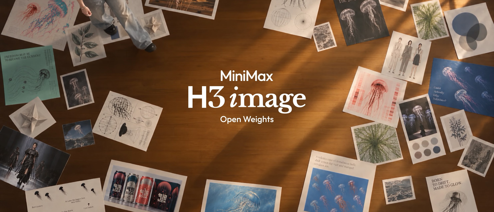
</div>

<p align="center">
  <a href="https://hailuoai.video" target="_blank"></a>
  <a href="https://platform.minimax.io" target="_blank"></a>
  <a href="https://www.minimax.io" target="_blank"></a>
  <a href="https://github.com/MiniMax-AI/MiniMax-H3-Image" target="_blank"></a>
  <a href="https://huggingface.co/MiniMaxAI/MiniMax-H3-Image" target="_blank"></a>
  <br>
  <a href="https://modelscope.cn/models/MiniMax/MiniMax-H3-Image" target="_blank" rel="noopener noreferrer"></a>
  <a href="https://platform.minimax.cn/docs/faq/contact-us" target="_blank"></a>
  <a href="https://discord.com/invite/dbMxutw7tP" target="_blank"></a>
  <a href="LICENSE"></a>
</p>

<p align="center">
  <a href="README.md">English</a> |
  <a href="README.zh-CN.md"><strong>简体中文</strong></a> |
  <a href="README.ko.md">한국어</a> |
  <a href="README.ja.md">日本語</a>
</p>

<h1 align="center">MiniMax-H3-Image</h1>

<p align="center"><b><i>One idea with open weights. A world of uses.</i></b></p>

<p align="center">
  <a href="#提示词编写技能">提示词编写技能</a> ·
  <a href="#效果展示">效果展示</a> ·
  <a href="#在线使用">在线使用</a> ·
  <a href="#概览">概览</a> ·
  <a href="#本地运行">本地运行</a> ·
  <a href="#提示词技巧">提示词技巧</a> ·
  <a href="#许可证">许可证</a>
</p>

## 提示词编写技能

`h3-image-prompt-writing` 技能能把一个简短的想法、一份需求说明或一组参考图写成完整的 MiniMax-H3-Image 提示词，并可以通过 MiniMax API 出图。它适用于任何能读取 `SKILL.md` 的智能体，例如 Claude Code、Codex 和 Cursor。使用 [skills CLI](https://github.com/vercel-labs/skills) 安装：

```bash
npx skills add https://github.com/MiniMax-AI/MiniMax-H3-Image --skill h3-image-prompt-writing
```

然后向智能体提出需求，例如：

```text
用 h3-image-prompt-writing 做一张 3:4 的雨中夜市海报，标题是“雨夜集市”，然后出图。
```

出图需要设置 `MINIMAX_API_KEY`，国内平台还要设置 `MINIMAX_API_BASE=https://api.minimax.cn`。详细说明见 [`skills/README.md`](skills/README.md)。

## 效果展示

<!-- BEGIN showcase-grid -->
<table>
<tr><th colspan="4" align="left">开源高智能</th></tr>
<tr>
<td align="center" valign="top" width="25%"><a href="showcase/multi-reference.zh-CN.md#16-人群像6-种场景">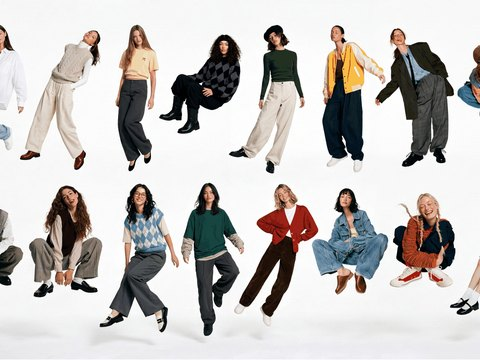</a><br><sub><a href="showcase/multi-reference.zh-CN.md#16-人群像6-种场景">16 人群像，6 种场景</a></sub></td>
<td align="center" valign="top" width="25%"><a href="showcase/multi-reference.zh-CN.md#多图服饰配色">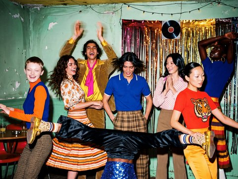</a><br><sub><a href="showcase/multi-reference.zh-CN.md#多图服饰配色">多图服饰配色</a></sub></td>
<td align="center" valign="top" width="25%"><a href="showcase/multi-reference.zh-CN.md#十张参考图组合成客厅">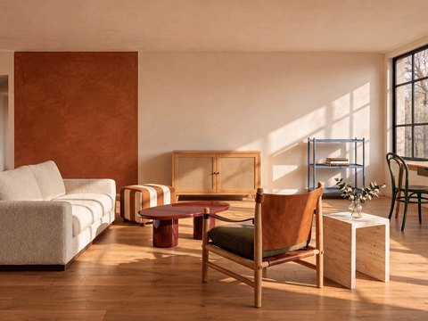</a><br><sub><a href="showcase/multi-reference.zh-CN.md#十张参考图组合成客厅">十张参考图组合成客厅</a></sub></td>
<td align="center" valign="top" width="25%"><a href="showcase/instruction-following.zh-CN.md#论文页生成生物学科研配图">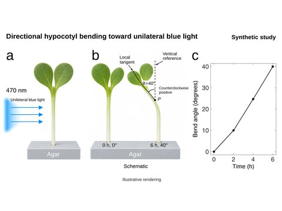</a><br><sub><a href="showcase/instruction-following.zh-CN.md#论文页生成生物学科研配图">论文页生成生物学科研配图</a></sub></td>
</tr>
<tr>
<td align="center" valign="top" width="25%"><a href="showcase/instruction-following.zh-CN.md#小熊猫科普图">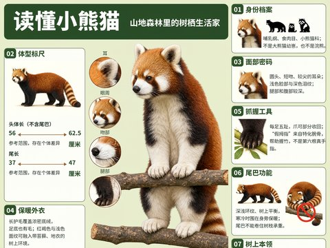</a><br><sub><a href="showcase/instruction-following.zh-CN.md#小熊猫科普图">小熊猫科普图</a></sub></td>
<td align="center" valign="top" width="25%"><a href="showcase/instruction-following.zh-CN.md#人员选派推理题">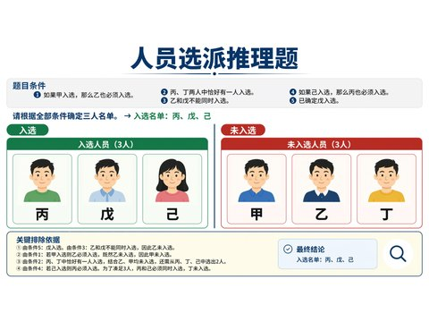</a><br><sub><a href="showcase/instruction-following.zh-CN.md#人员选派推理题">人员选派推理题</a></sub></td>
<td align="center" valign="top" width="25%"><a href="showcase/instruction-following.zh-CN.md#电动摩托爆炸图">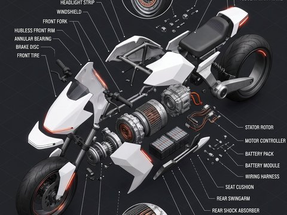</a><br><sub><a href="showcase/instruction-following.zh-CN.md#电动摩托爆炸图">电动摩托爆炸图</a></sub></td>
<td align="center" valign="top" width="25%"><a href="showcase/instruction-following.zh-CN.md#喷气发动机爆炸图">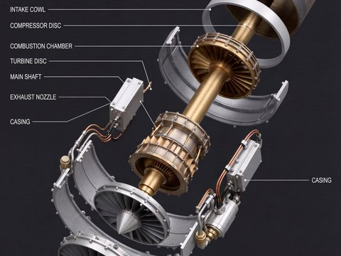</a><br><sub><a href="showcase/instruction-following.zh-CN.md#喷气发动机爆炸图">喷气发动机爆炸图</a></sub></td>
</tr>
<tr>
<td align="center" valign="top" width="25%"><a href="showcase/instruction-following.zh-CN.md#摩卡壶工程蓝图">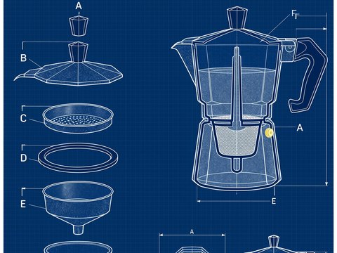</a><br><sub><a href="showcase/instruction-following.zh-CN.md#摩卡壶工程蓝图">摩卡壶工程蓝图</a></sub></td>
<td align="center" valign="top" width="25%"><a href="showcase/instruction-following.zh-CN.md#蚂蚁六足机甲线稿">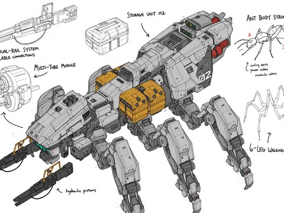</a><br><sub><a href="showcase/instruction-following.zh-CN.md#蚂蚁六足机甲线稿">蚂蚁六足机甲线稿</a></sub></td>
<td align="center" valign="top" width="25%"><a href="showcase/instruction-following.zh-CN.md#四足机甲-cad-图纸">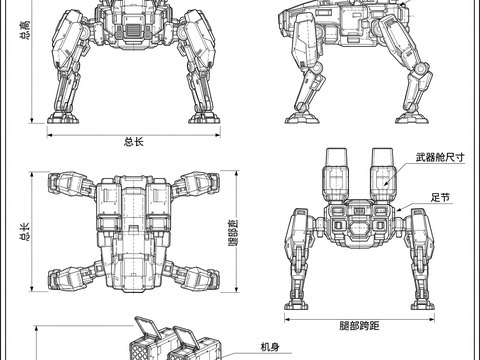</a><br><sub><a href="showcase/instruction-following.zh-CN.md#四足机甲-cad-图纸">四足机甲 CAD 图纸</a></sub></td>
<td align="center" valign="top" width="25%"><a href="showcase/instruction-following.zh-CN.md#机甲巨兽爆炸-cad-图">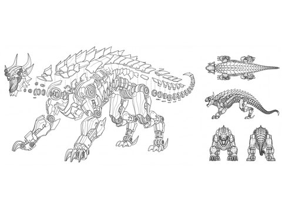</a><br><sub><a href="showcase/instruction-following.zh-CN.md#机甲巨兽爆炸-cad-图">机甲巨兽爆炸 CAD 图</a></sub></td>
</tr>
<tr>
<td align="center" valign="top" width="25%"><a href="showcase/instruction-following.zh-CN.md#吊轨配送机">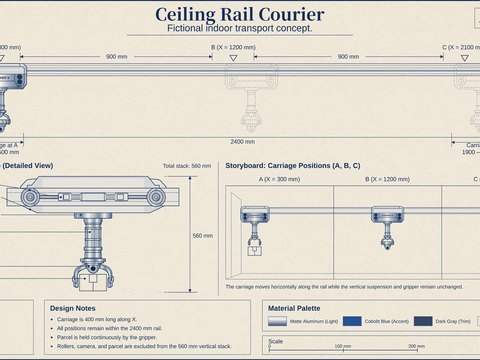</a><br><sub><a href="showcase/instruction-following.zh-CN.md#吊轨配送机">吊轨配送机</a></sub></td>
<td align="center" valign="top" width="25%"><a href="showcase/instruction-following.zh-CN.md#轮腿配送机器人">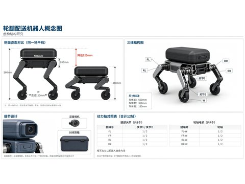</a><br><sub><a href="showcase/instruction-following.zh-CN.md#轮腿配送机器人">轮腿配送机器人</a></sub></td>
<td align="center" valign="top" width="25%"><a href="showcase/visual-challenges.zh-CN.md#直角镜面">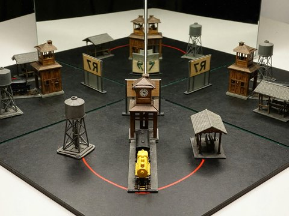</a><br><sub><a href="showcase/visual-challenges.zh-CN.md#直角镜面">直角镜面</a></sub></td>
<td align="center" valign="top" width="25%"><a href="showcase/visual-challenges.zh-CN.md#伸进投影的手">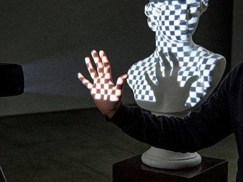</a><br><sub><a href="showcase/visual-challenges.zh-CN.md#伸进投影的手">伸进投影的手</a></sub></td>
</tr>
<tr>
<td align="center" valign="top" width="25%"><a href="showcase/visual-challenges.zh-CN.md#游戏地图变-3d-游戏画面">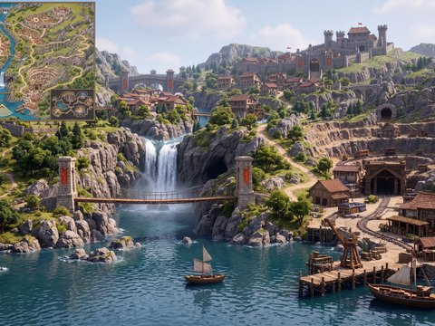</a><br><sub><a href="showcase/visual-challenges.zh-CN.md#游戏地图变-3d-游戏画面">游戏地图变 3D 游戏画面</a></sub></td>
<td align="center" valign="top" width="25%"><a href="showcase/visual-challenges.zh-CN.md#鹈鹕毕业叠罗汉"></a><br><sub><a href="showcase/visual-challenges.zh-CN.md#鹈鹕毕业叠罗汉">鹈鹕毕业叠罗汉</a></sub></td>
<td align="center" valign="top" width="25%"><a href="showcase/visual-challenges.zh-CN.md#鹈鹕圣诞树">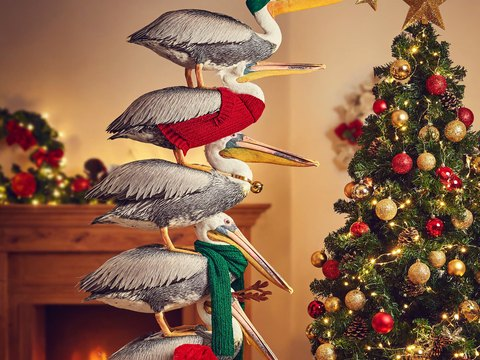</a><br><sub><a href="showcase/visual-challenges.zh-CN.md#鹈鹕圣诞树">鹈鹕圣诞树</a></sub></td>
<td align="center" valign="top" width="25%"><a href="showcase/visual-challenges.zh-CN.md#鹈鹕平衡挑战">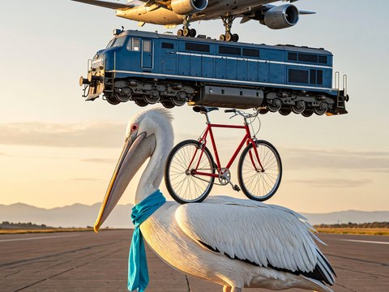</a><br><sub><a href="showcase/visual-challenges.zh-CN.md#鹈鹕平衡挑战">鹈鹕平衡挑战</a></sub></td>
</tr>
<tr><th colspan="4" align="left">创意生产</th></tr>
<tr>
<td align="center" valign="top" width="25%"><a href="showcase/game-worlds.zh-CN.md#边境骑手">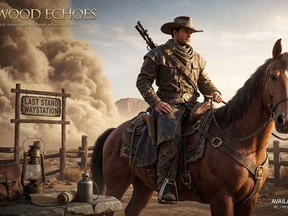</a><br><sub><a href="showcase/game-worlds.zh-CN.md#边境骑手">边境骑手</a></sub></td>
<td align="center" valign="top" width="25%"><a href="showcase/game-worlds.zh-CN.md#荒漠大集会">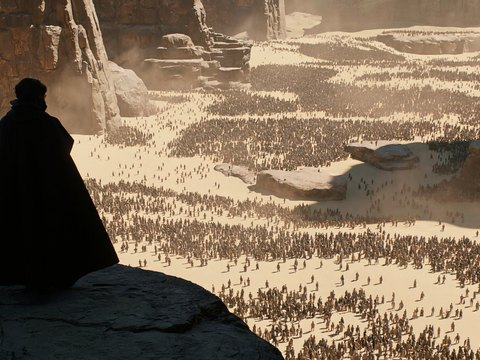</a><br><sub><a href="showcase/game-worlds.zh-CN.md#荒漠大集会">荒漠大集会</a></sub></td>
<td align="center" valign="top" width="25%"><a href="showcase/game-worlds.zh-CN.md#冷色矿物荒原航拍">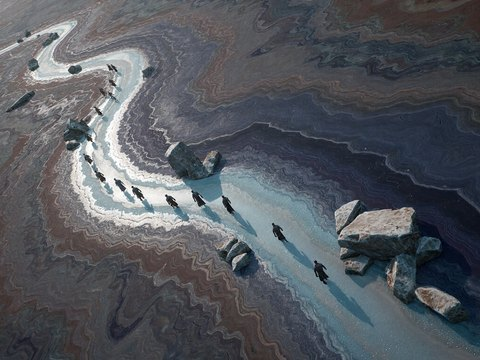</a><br><sub><a href="showcase/game-worlds.zh-CN.md#冷色矿物荒原航拍">冷色矿物荒原航拍</a></sub></td>
<td align="center" valign="top" width="25%"><a href="showcase/game-worlds.zh-CN.md#红褐矿物荒原航拍">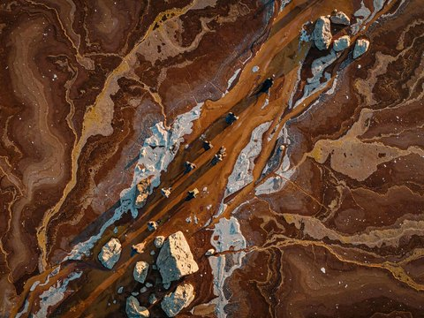</a><br><sub><a href="showcase/game-worlds.zh-CN.md#红褐矿物荒原航拍">红褐矿物荒原航拍</a></sub></td>
</tr>
<tr>
<td align="center" valign="top" width="25%"><a href="showcase/game-worlds.zh-CN.md#森林中的古剧场">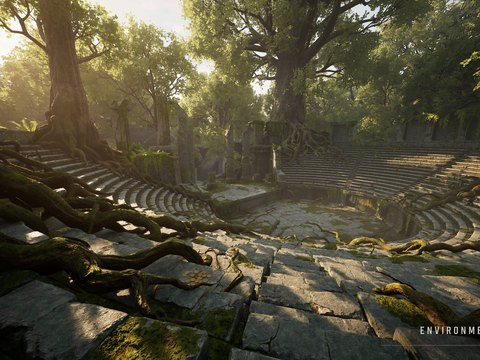</a><br><sub><a href="showcase/game-worlds.zh-CN.md#森林中的古剧场">森林中的古剧场</a></sub></td>
<td align="center" valign="top" width="25%"><a href="showcase/game-worlds.zh-CN.md#云海仙山宫阙"></a><br><sub><a href="showcase/game-worlds.zh-CN.md#云海仙山宫阙">云海仙山宫阙</a></sub></td>
<td align="center" valign="top" width="25%"><a href="showcase/game-worlds.zh-CN.md#巫师释放扇形火焰">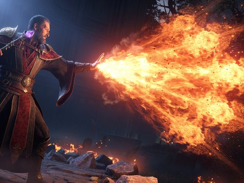</a><br><sub><a href="showcase/game-worlds.zh-CN.md#巫师释放扇形火焰">巫师释放扇形火焰</a></sub></td>
<td align="center" valign="top" width="25%"><a href="showcase/game-worlds.zh-CN.md#爆炸的两个阶段">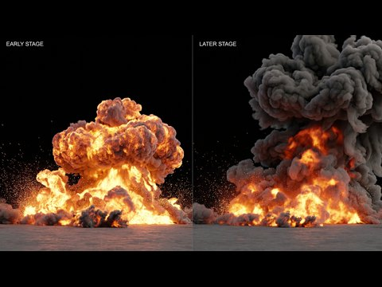</a><br><sub><a href="showcase/game-worlds.zh-CN.md#爆炸的两个阶段">爆炸的两个阶段</a></sub></td>
</tr>
<tr>
<td align="center" valign="top" width="25%"><a href="showcase/game-worlds.zh-CN.md#重甲骑士角色设定">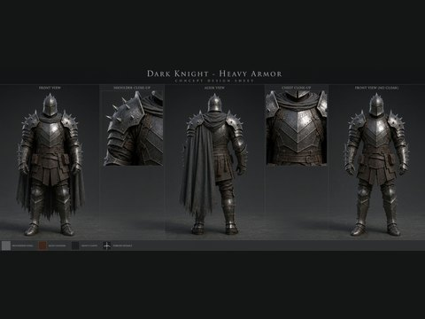</a><br><sub><a href="showcase/game-worlds.zh-CN.md#重甲骑士角色设定">重甲骑士角色设定</a></sub></td>
<td align="center" valign="top" width="25%"><a href="showcase/game-worlds.zh-CN.md#狮王面部特写">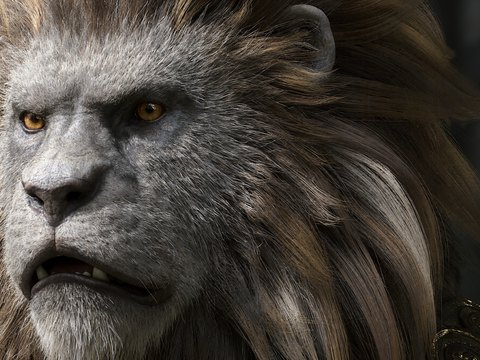</a><br><sub><a href="showcase/game-worlds.zh-CN.md#狮王面部特写">狮王面部特写</a></sub></td>
<td align="center" valign="top" width="25%"><a href="showcase/game-worlds.zh-CN.md#森林中的龙">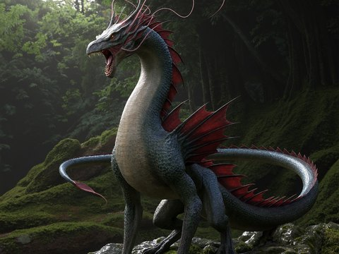</a><br><sub><a href="showcase/game-worlds.zh-CN.md#森林中的龙">森林中的龙</a></sub></td>
<td align="center" valign="top" width="25%"><a href="showcase/game-worlds.zh-CN.md#第一人称射击场景">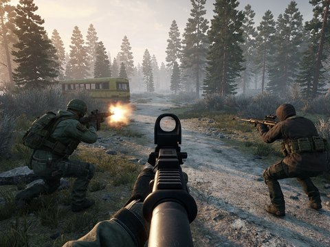</a><br><sub><a href="showcase/game-worlds.zh-CN.md#第一人称射击场景">第一人称射击场景</a></sub></td>
</tr>
<tr>
<td align="center" valign="top" width="25%"><a href="showcase/game-worlds.zh-CN.md#白模渲染图变电影剧照">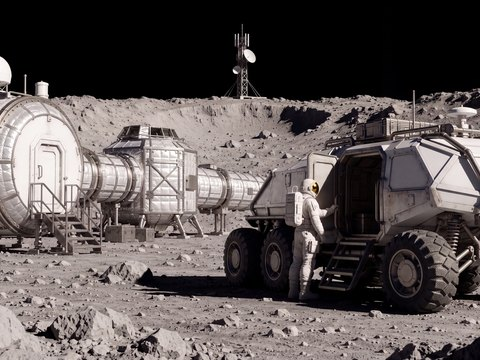</a><br><sub><a href="showcase/game-worlds.zh-CN.md#白模渲染图变电影剧照">白模渲染图变电影剧照</a></sub></td>
<td align="center" valign="top" width="25%"><a href="showcase/game-worlds.zh-CN.md#峡谷水电站绘景">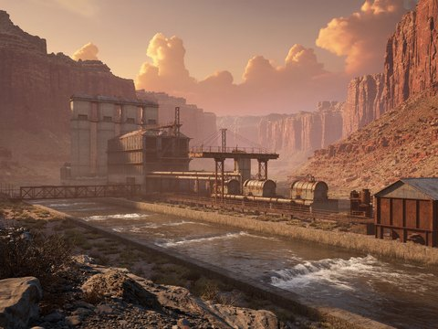</a><br><sub><a href="showcase/game-worlds.zh-CN.md#峡谷水电站绘景">峡谷水电站绘景</a></sub></td>
<td align="center" valign="top" width="25%"><a href="showcase/game-worlds.zh-CN.md#废弃车站">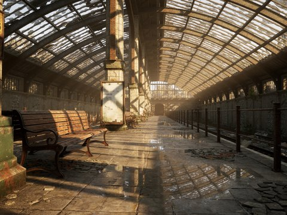</a><br><sub><a href="showcase/game-worlds.zh-CN.md#废弃车站">废弃车站</a></sub></td>
<td align="center" valign="top" width="25%"><a href="showcase/game-worlds.zh-CN.md#末世工业厂区">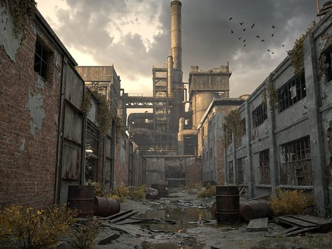</a><br><sub><a href="showcase/game-worlds.zh-CN.md#末世工业厂区">末世工业厂区</a></sub></td>
</tr>
<tr>
<td align="center" valign="top" width="25%"><a href="showcase/game-worlds.zh-CN.md#冰封海湾中的沉船">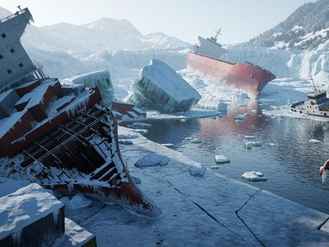</a><br><sub><a href="showcase/game-worlds.zh-CN.md#冰封海湾中的沉船">冰封海湾中的沉船</a></sub></td>
<td align="center" valign="top" width="25%"><a href="showcase/game-worlds.zh-CN.md#战斗驾驶员">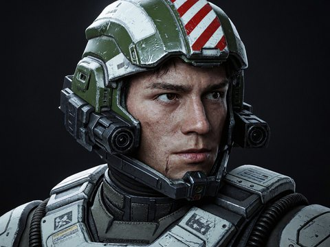</a><br><sub><a href="showcase/game-worlds.zh-CN.md#战斗驾驶员">战斗驾驶员</a></sub></td>
<td align="center" valign="top" width="25%"><a href="showcase/game-worlds.zh-CN.md#极地服装设定">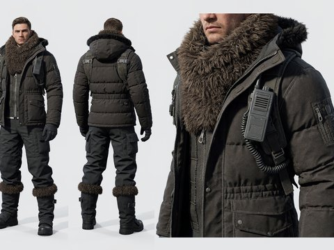</a><br><sub><a href="showcase/game-worlds.zh-CN.md#极地服装设定">极地服装设定</a></sub></td>
<td align="center" valign="top" width="25%"><a href="showcase/game-worlds.zh-CN.md#红色荒原上的头盔">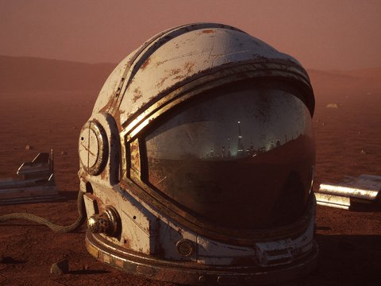</a><br><sub><a href="showcase/game-worlds.zh-CN.md#红色荒原上的头盔">红色荒原上的头盔</a></sub></td>
</tr>
<tr>
<td align="center" valign="top" width="25%"><a href="showcase/game-worlds.zh-CN.md#科幻战斗机">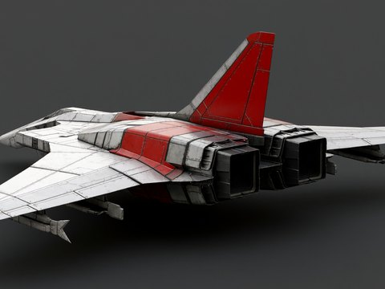</a><br><sub><a href="showcase/game-worlds.zh-CN.md#科幻战斗机">科幻战斗机</a></sub></td>
<td align="center" valign="top" width="25%"><a href="showcase/game-worlds.zh-CN.md#科幻改装肌肉车">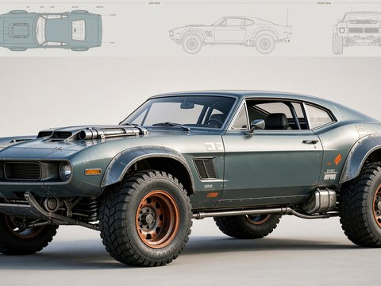</a><br><sub><a href="showcase/game-worlds.zh-CN.md#科幻改装肌肉车">科幻改装肌肉车</a></sub></td>
<td align="center" valign="top" width="25%"><a href="showcase/real-world.zh-CN.md#雾中农场纪实胶片">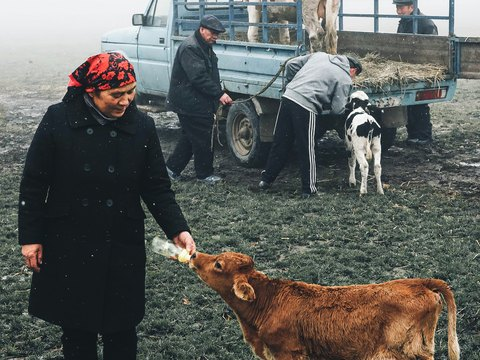</a><br><sub><a href="showcase/real-world.zh-CN.md#雾中农场纪实胶片">雾中农场，纪实胶片</a></sub></td>
<td align="center" valign="top" width="25%"><a href="showcase/real-world.zh-CN.md#胶片质感野餐">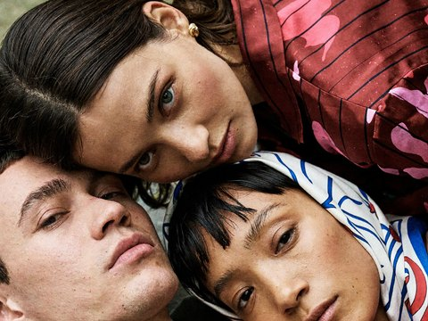</a><br><sub><a href="showcase/real-world.zh-CN.md#胶片质感野餐">胶片质感野餐</a></sub></td>
</tr>
<tr>
<td align="center" valign="top" width="25%"><a href="showcase/real-world.zh-CN.md#胶片人像特写">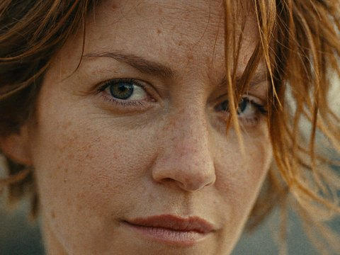</a><br><sub><a href="showcase/real-world.zh-CN.md#胶片人像特写">胶片人像特写</a></sub></td>
<td align="center" valign="top" width="25%"><a href="showcase/real-world.zh-CN.md#老手机随手拍">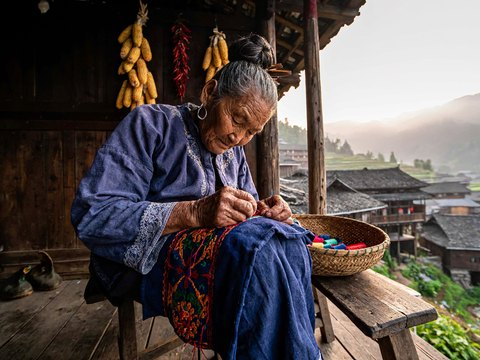</a><br><sub><a href="showcase/real-world.zh-CN.md#老手机随手拍">老手机随手拍</a></sub></td>
<td align="center" valign="top" width="25%"><a href="showcase/real-world.zh-CN.md#直闪胶片人像">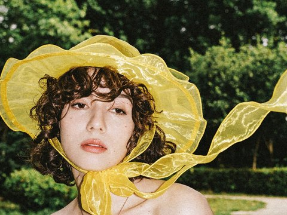</a><br><sub><a href="showcase/real-world.zh-CN.md#直闪胶片人像">直闪胶片人像</a></sub></td>
<td align="center" valign="top" width="25%"><a href="showcase/real-world.zh-CN.md#奶奶的生日家用-dv">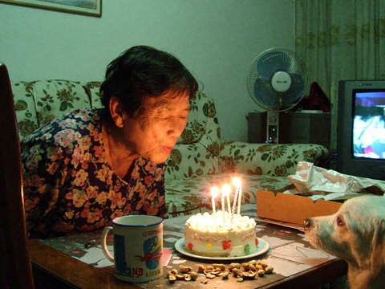</a><br><sub><a href="showcase/real-world.zh-CN.md#奶奶的生日家用-dv">奶奶的生日，家用 DV</a></sub></td>
</tr>
<tr>
<td align="center" valign="top" width="25%"><a href="showcase/real-world.zh-CN.md#黄昏屋顶">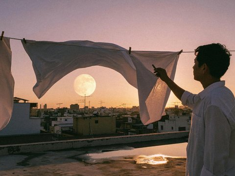</a><br><sub><a href="showcase/real-world.zh-CN.md#黄昏屋顶">黄昏屋顶</a></sub></td>
<td align="center" valign="top" width="25%"><a href="showcase/real-world.zh-CN.md#喝茶前的停顿"></a><br><sub><a href="showcase/real-world.zh-CN.md#喝茶前的停顿">喝茶前的停顿</a></sub></td>
<td align="center" valign="top" width="25%"><a href="showcase/real-world.zh-CN.md#清晨火烈鸟">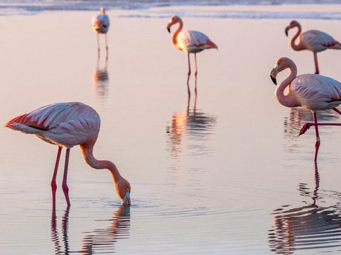</a><br><sub><a href="showcase/real-world.zh-CN.md#清晨火烈鸟">清晨火烈鸟</a></sub></td>
<td align="center" valign="top" width="25%"><a href="showcase/surreal-worlds.zh-CN.md#理发椅上的云">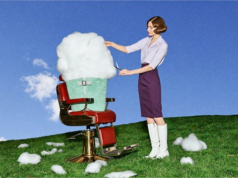</a><br><sub><a href="showcase/surreal-worlds.zh-CN.md#理发椅上的云">理发椅上的云</a></sub></td>
</tr>
<tr>
<td align="center" valign="top" width="25%"><a href="showcase/surreal-worlds.zh-CN.md#切月亮"></a><br><sub><a href="showcase/surreal-worlds.zh-CN.md#切月亮">切月亮</a></sub></td>
<td align="center" valign="top" width="25%"><a href="showcase/surreal-worlds.zh-CN.md#梨子更衣室"></a><br><sub><a href="showcase/surreal-worlds.zh-CN.md#梨子更衣室">梨子更衣室</a></sub></td>
<td align="center" valign="top" width="25%"><a href="showcase/surreal-worlds.zh-CN.md#剪纸拼贴"></a><br><sub><a href="showcase/surreal-worlds.zh-CN.md#剪纸拼贴">剪纸拼贴</a></sub></td>
<td align="center" valign="top" width="25%"><a href="showcase/surreal-worlds.zh-CN.md#贴纸残迹字体海报"></a><br><sub><a href="showcase/surreal-worlds.zh-CN.md#贴纸残迹字体海报">贴纸残迹字体海报</a></sub></td>
</tr>
<tr>
<td align="center" valign="top" width="25%"><a href="showcase/surreal-worlds.zh-CN.md#像素白猫海报"></a><br><sub><a href="showcase/surreal-worlds.zh-CN.md#像素白猫海报">像素白猫海报</a></sub></td>
<td align="center" valign="top" width="25%"><a href="showcase/artistic-worlds.zh-CN.md#鸳鸯古典大师油画"></a><br><sub><a href="showcase/artistic-worlds.zh-CN.md#鸳鸯古典大师油画">鸳鸯，古典大师油画</a></sub></td>
<td align="center" valign="top" width="25%"><a href="showcase/artistic-worlds.zh-CN.md#渔夫与鹈鹕卡拉瓦乔风格"></a><br><sub><a href="showcase/artistic-worlds.zh-CN.md#渔夫与鹈鹕卡拉瓦乔风格">渔夫与鹈鹕，卡拉瓦乔风格</a></sub></td>
<td align="center" valign="top" width="25%"><a href="showcase/artistic-worlds.zh-CN.md#乒乓球赛卡拉瓦乔风格"></a><br><sub><a href="showcase/artistic-worlds.zh-CN.md#乒乓球赛卡拉瓦乔风格">乒乓球赛，卡拉瓦乔风格</a></sub></td>
</tr>
<tr>
<td align="center" valign="top" width="25%"><a href="showcase/artistic-worlds.zh-CN.md#苏州园林鸳鸯印象派油画"></a><br><sub><a href="showcase/artistic-worlds.zh-CN.md#苏州园林鸳鸯印象派油画">苏州园林鸳鸯，印象派油画</a></sub></td>
<td align="center" valign="top" width="25%"><a href="showcase/artistic-worlds.zh-CN.md#太阳中世纪泥金手抄本"></a><br><sub><a href="showcase/artistic-worlds.zh-CN.md#太阳中世纪泥金手抄本">太阳，中世纪泥金手抄本</a></sub></td>
<td align="center" valign="top" width="25%"><a href="showcase/artistic-worlds.zh-CN.md#玉兔中世纪泥金手抄本"></a><br><sub><a href="showcase/artistic-worlds.zh-CN.md#玉兔中世纪泥金手抄本">玉兔，中世纪泥金手抄本</a></sub></td>
<td align="center" valign="top" width="25%"><a href="showcase/artistic-worlds.zh-CN.md#空间站维修敦煌壁画"></a><br><sub><a href="showcase/artistic-worlds.zh-CN.md#空间站维修敦煌壁画">空间站维修，敦煌壁画</a></sub></td>
</tr>
<tr>
<td align="center" valign="top" width="25%"><a href="showcase/artistic-worlds.zh-CN.md#鹈鹕皮影戏"></a><br><sub><a href="showcase/artistic-worlds.zh-CN.md#鹈鹕皮影戏">鹈鹕皮影戏</a></sub></td>
<td align="center" valign="top" width="25%"><a href="showcase/artistic-worlds.zh-CN.md#电路与花工笔织物纹样"></a><br><sub><a href="showcase/artistic-worlds.zh-CN.md#电路与花工笔织物纹样">电路与花，工笔织物纹样</a></sub></td>
<td align="center" valign="top" width="25%"><a href="showcase/artistic-worlds.zh-CN.md#照镜子的鹈鹕工笔画"></a><br><sub><a href="showcase/artistic-worlds.zh-CN.md#照镜子的鹈鹕工笔画">照镜子的鹈鹕，工笔画</a></sub></td>
<td align="center" valign="top" width="25%"><a href="showcase/artistic-worlds.zh-CN.md#金色烈焰东方幻想插画"></a><br><sub><a href="showcase/artistic-worlds.zh-CN.md#金色烈焰东方幻想插画">金色烈焰，东方幻想插画</a></sub></td>
</tr>
</table>

点击图片查看大图和提示词，也可以[按小节浏览](showcase/README.zh-CN.md)。
<!-- END showcase-grid -->

## 在线使用

| | 国际版 | 国内版 |
| --- | --- | --- |
| 网页版 | [hailuoai.video](https://hailuoai.video/) | [hailuoai.com](https://hailuoai.com/) |
| 桌面端 | [agent.minimax.io](https://agent.minimax.io/) | [agent.minimax.cn](https://agent.minimax.cn) |
| API 开放平台 | [platform.minimax.io](https://platform.minimax.io/docs/guides/image-generation) | [platform.minimax.cn](https://platform.minimax.cn/docs/guides/image-generation) |
| API 文档 | [文生图](https://platform.minimax.io/docs/api-reference/image-generation-h3-generations) · [图像编辑](https://platform.minimax.io/docs/api-reference/image-generation-h3-edits) · [提示词扩写](https://platform.minimax.io/docs/api-reference/image-generation-h3-context-ir) | [文生图](https://platform.minimax.cn/docs/api-reference/image-generation-h3-generations) · [图像编辑](https://platform.minimax.cn/docs/api-reference/image-generation-h3-edits) · [提示词扩写](https://platform.minimax.cn/docs/api-reference/image-generation-h3-context-ir) |

## 概览

MiniMax-H3-Image 是 [MiniMax H3](https://huggingface.co/MiniMaxAI/MiniMax-H3) 系列的开源 SOTA 图像生成与编辑模型，文生图和多图编辑集于同一个 checkpoint。

- **成本可控的 1600 万像素**：在各种宽高比下直接生成约 1600 万像素的图像，无需超分模型，只需 6 个采样步。
- **细节丰富，真实感出众**：摆脱常见的“AI 感”。
- **开源模型中最强的指令遵循**：最多支持 16 张参考图。

### 模型参数

下表是 MiniMax API 的参数；本地服务的请求字段见[请求参数](#请求参数)。

| 参数 | 规格 |
| --- | --- |
| 模型 ID | `MiniMax-H3-Image` |
| 支持任务 | 文生图、图像编辑 |
| 尺寸设置 | `width` + `height`，或 `area` + `aspect_ratio`；默认 `auto`（4K 面积，比例自动） |
| 输出面积 | 支持 `1K` / `2K` / **`4K`（官方效果最佳👍）**；自定义宽高对应面积范围：655,360–20,000,000 像素 |
| 输出宽高比 | 1:3–3:1 |
| 提示词 | 最多 32,000 字符；超过 4,096 个 token 的内容会被截断 |
| 参考图限制 | 最多 16 张；单图 ≤64 MiB；各边长 128–8192 px；宽高比 1:4–4:1 |
| 参考图格式 | JPG / PNG / WebP / HEIC / HEIF，可通过 HTTP(S) URL / Base64 / 开放平台文件 ID 传入 |
| 单次生成数量 | 1–10 张 |
| 提示词扩写 | 文生图默认开启，可关闭；图像编辑强制开启；支持返回扩写结果 |
| 输出 | PNG（默认）/ JPEG / WebP，`output_compression` 范围 0–100；以 URL（默认）或 Base64 返回 |
| 暂不支持 | 蒙版局部重绘、透明背景、指定随机种子、预览图 |

### 模型列表

| 模型 | 用途 | 精度 | 大小 | Hugging Face |
| --- | --- | --- | --- | --- |
| **MiniMax-H3-Image** | 文生图和图像编辑 | BF16 (DiT) | 68.65 GB | [MiniMaxAI/MiniMax-H3-Image](https://huggingface.co/MiniMaxAI/MiniMax-H3-Image) |
| **MiniMax-H3-Image-PE**（可选） | 文生图提示词扩写模型 | NVFP4 | 17.9 GB | [MiniMaxAI/MiniMax-H3-Image-PE](https://huggingface.co/MiniMaxAI/MiniMax-H3-Image-PE) |

### 模型架构

MiniMax-H3-Image 沿用 H3-Base 的设计，但去掉了音频分支。文本提示词和参考图由 H3 文本编码器编码；参考图还会经过图像 VAE 编码。所有 token 组成一个打包序列，输入单流 Transformer，由它预测目标图像的 latent。VAE 再把这个 latent 解码成图像。

- **文本编码器**：MiniMax-H3 的完整 Qwen3-VL 文本编码器，未做改动。DiT 读取它第 50 层的隐藏状态。
- **图像 VAE**：一个 CNN 编码器加一个 2D ViT 解码器（24 层），空间下采样 16 倍，latent 通道数为 24。DiT 以 2x2 的 patch 对 latent 做 patchify，因此每个 Transformer token 覆盖 32x32 像素。
- **扩散 Transformer**：33.1B 参数的稠密单流 Transformer，共 50 层（隐藏维度 5376，56 个注意力头，FFN 维度 14336），使用 3D 多模态 RoPE，与 H3-Omni-Transformer 相同。权重为 BF16；embedding 层、timestep 层和输出层为 FP32。

## 本地运行

### 下载

| 组件 | 内容 | 大小 |
| --- | --- | --- |
| `transformer/` | DiT 权重。 | 66.28 GB |
| `pdd_fused_heads.safetensors`、`pdd_config.json` | 每个采样步专用的输出头（替代 Transformer 原有的输出层），以及采样调度。 | 12 MB |
| `vae/` | 图像 VAE，FP32。 | 2.34 GB |
| `tokenizer/`、`processor/` | Qwen3-VL 的 tokenizer 和 processor，与 MiniMax-H3 相同。 | 23 MB |
| 文本编码器 | 不包含在原始 checkpoint 中。`model_index.json` 会从 [`MiniMaxAI/MiniMax-H3`](https://huggingface.co/MiniMaxAI/MiniMax-H3) 的 `text_encoder/` 文件夹加载它。如果你已经有 MiniMax-H3，就不会再次下载。 | 66.7 GB |

Hugging Face 仓库同时托管这份原始 checkpoint 和 diffusers 格式，共约 204 GB。SGLang 和 vLLM-Omni 只需要原始 checkpoint 和 MiniMax-H3 文本编码器，合计约 135 GB：

```bash
hf download MiniMaxAI/MiniMax-H3-Image model_index.json "pdd_*" "processor/*" "tokenizer/*" \
  "transformer/*" "vae/*"
hf download MiniMaxAI/MiniMax-H3 --include "text_encoder/*"
# optional prompt expander
hf download MiniMaxAI/MiniMax-H3-Image-PE
```

diffusers 用 `ModularPipeline.from_pretrained("MiniMaxAI/MiniMax-H3-Image")` 自行拉取所需文件。

### 部署

我们推荐使用以下推理框架部署模型：

- [SGLang](https://docs.sglang.io/)：参见 [cookbook](https://docs.sglang.io/cookbook/diffusion/MiniMax/MiniMax-H3-Image)
- [vLLM-Omni](https://github.com/vllm-project/vllm-omni)：参见 [vllm-omni recipe](https://recipes.vllm.ai/MiniMaxAI/MiniMax-H3-Image)
- [diffusers](https://github.com/huggingface/diffusers)：参见 [diffusers 文档](https://huggingface.co/docs/diffusers/main/en/api/pipelines/minimax_h3_image)
- [ComfyUI](https://github.com/Comfy-Org/ComfyUI)：参见 [Comfy 教程](https://docs.comfy.org/tutorials/image/minimax/minimax-h3-image)；使用 [T2I 模板](https://github.com/Comfy-Org/workflow_templates/blob/main/templates/image_minimax_h3_image_t2i.json) / [Edit 模板](https://github.com/Comfy-Org/workflow_templates/blob/main/templates/image_minimax_h3_image_edit.json)

#### SGLang

从 main 分支安装 SGLang 及其扩散模型依赖（参见[安装指南](https://docs.sglang.io/docs/sglang-diffusion/installation)）：

```bash
git clone https://github.com/sgl-project/sglang.git
cd sglang
python3 -m pip install -e 'python[diffusion]'
```

可以在单张 GPU 上启动服务（可用显存不足 130 GiB 时，SGLang 会自动卸载部分模型组件），也可以用序列并行（Ulysses）把每个请求拆到多张 GPU 上，降低延迟：

```bash
sglang serve --model-path MiniMaxAI/MiniMax-H3-Image --host 0.0.0.0 --port 30000 --warmup-mode off
# 4 GPUs
sglang serve --model-path MiniMaxAI/MiniMax-H3-Image --host 0.0.0.0 --port 30000 --warmup-mode off \
  --num-gpus 4 --ulysses-degree 4
```

如需使用本地的 MiniMax-H3 文本编码器，添加 `--text-encoder-path <path to text_encoder>`。[SGLang cookbook](https://docs.sglang.io/cookbook/diffusion/MiniMax/MiniMax-H3-Image) 给出了其他 GPU 的部署方案，从 B300 到 12 GB 显卡。

#### vLLM-Omni

先安装 vLLM 0.33.0，再从源码安装 vLLM-Omni：

```bash
uv venv --python 3.12 --seed && source .venv/bin/activate
uv pip install vllm==0.33.0 --torch-backend=cu130
git clone https://github.com/vllm-project/vllm-omni.git && cd vllm-omni && uv pip install -e .
```

可以用序列并行（Ulysses）在 4 张 GPU 上部署，也可以单卡部署：B200、B300 用约 135 GiB 显存放下整个模型，单张 H200 需要卸载文本编码器：

```bash
vllm serve MiniMaxAI/MiniMax-H3-Image --omni --host 0.0.0.0 --port 8000 \
  --num-gpus 4 --usp 4 --text-encoder-tp-size 4
# one B200 or B300
vllm serve MiniMaxAI/MiniMax-H3-Image --omni --host 0.0.0.0 --port 8000 --num-gpus 1
# one H200: offload the text encoder
vllm serve MiniMaxAI/MiniMax-H3-Image --omni --host 0.0.0.0 --port 8000 --num-gpus 1 \
  --diffusion-offload-config '{"mode":"layer","components":["text_encoder"]}'
```

AMD Instinct 等其他 GPU 的配置见 [vLLM-Omni recipe](https://recipes.vllm.ai/MiniMaxAI/MiniMax-H3-Image)。

### 请求参数

SGLang 的文生图请求以 JSON 格式发送到 `/v1/images/generations`，图像编辑请求以 multipart 表单数据发送到 `/v1/images/edits`，两种请求都在 `data[0].b64_json` 中返回 PNG。vLLM-Omni 的字段略有不同，参见其 [recipe](https://recipes.vllm.ai/MiniMaxAI/MiniMax-H3-Image)。

| 字段 | 文生图 | 图像编辑 | 说明 |
| --- | --- | --- | --- |
| `prompt` | 必填 | 必填 | 按原样使用，超过 4096 个 token 的部分会被截断 |
| `size` | 必填 | 必填 | `WIDTHxHEIGHT`。返回图像的尺寸与它完全一致；参见[尺寸](#尺寸) |
| `image` | — | 一个或多个文件 | 按上传顺序，在提示词中依次对应 `<Picture 1>`、`<Picture 2>` 等 |
| `seed` | 推荐 | 推荐 | 整数 |
| `generator_device` | 推荐 `cpu` | 推荐 `cpu` | 相同的 seed 在任何机器上都得到相同的初始噪声 |
| `response_format` | `b64_json` | `b64_json` | |
| `min_generation_area` | 可选 | 可选 | 最小生成面积（像素），取值 1024-16777216，默认 4194304（2048x2048）。较小的 `size` 会先在同宽高比的更大画布上生成，再用 LANCZOS 缩放回原尺寸；传入 1024 可关闭这一行为。下表中的所有尺寸都大于默认值 |
| `num_inference_steps` | 不填或填 6 | 不填或填 6 | 其他值返回 HTTP 400 |
| `guidance_scale` | 不填或填 1 | 不填或填 1 | 其他值返回 HTTP 400 |
| `negative_prompt` | 不支持 | 不支持 | 会被拒绝 |

### 尺寸

模型的有效工作范围约为 400 万到 2000 万像素，一般在 1600 万像素左右效果最好。常用的 1600 万像素尺寸：

| 宽高比 | 尺寸（宽 x 高） |
| --- | --- |
| 1:1 | 4096x4096 |
| 4:3 / 3:4 | 4736x3552 / 3552x4736 |
| 3:2 / 2:3 | 5024x3360 / 3360x5024 |
| 16:9 / 9:16 | 5472x3072 / 3072x5472 |
| 21:9 | 6272x2688 |

其他宽高比保持约 1600 万像素、宽高都取 32 的倍数即可，[`examples/context_ir.py`](examples/context_ir.py) 里的 `size_for()` 可以直接算出：

```bash
cd MiniMax-H3-Image/examples
python3 -c "from context_ir import size_for; print(size_for('5:4'))"   # 4576x3648
```

### 完整工作流

MiniMax API 会在生成前用 **H3-Image-Context-IR** 把任意语言的简短提示词扩写成一段详细描述整张图像的英文文字。本地服务会原样使用提示词，所以要先扩写，做法见下面的示例。[`examples/`](examples) 中的脚本用上面的 SGLang 服务复现 API 的出图效果，只依赖 Python 标准库：

```bash
git clone https://github.com/MiniMax-AI/MiniMax-H3-Image.git
cd MiniMax-H3-Image/examples
export MINIMAX_API_BASE="https://api.minimax.cn"   # Global: https://api.minimax.io
export MINIMAX_API_KEY="<api-key>"
```

`t2i.py` 和 `edit.py` 把请求发到 `http://127.0.0.1:30000`；用 `--url` 可以换成其他地址。

#### case-T2I

[`instruction.t2i.txt`](examples/instruction.t2i.txt)。

<table>
<thead>
<tr><th colspan="2">阶段</th><th>请求</th><th>结果</th></tr>
</thead>
<tbody>
<tr><td rowspan="3">提示词增强</td><td>H3-Image-Context-IR（MiniMax API）</td><td><code>python3 context_ir.py t2i</code>（<a href="examples/context_ir.py">脚本</a>）</td><td><code>revised_prompt.txt</code>、<code>revised_size.txt</code>；我们的运行结果：<a href="examples/revised_prompt.t2i.txt"><code>revised_prompt.t2i.txt</code></a>、<a href="examples/revised_size.t2i.txt"><code>revised_size.t2i.txt</code></a>（4736x3552）</td></tr>
<tr><td>本地替代方案：<a href="https://huggingface.co/MiniMaxAI/MiniMax-H3-Image-PE">MiniMax-H3-Image-PE</a></td><td>PE 仓库中的 <code>scripts/expand_prompt.py</code></td><td>将 <code>expanded_caption</code> 保存为 <code>revised_prompt.txt</code>，将 <code>aspect_ratio</code> 对应的尺寸保存为 <code>revised_size.txt</code></td></tr>
<tr><td>智能体替代方案：<a href="#提示词编写技能">h3-image-prompt-writing</a></td><td>让你的智能体使用该技能，为 <code>instruction.t2i.txt</code> 写一条提示词和宽高比</td><td>将提示词保存为 <code>revised_prompt.txt</code>，将该宽高比对应的<a href="#尺寸">尺寸</a>保存为 <code>revised_size.txt</code></td></tr>
<tr><td colspan="2">MiniMax-H3-Image 生成：本地 SGLang</td><td><code>python3 t2i.py --prompt revised_prompt.txt --size $(cat revised_size.txt)</code>（<a href="examples/t2i.py">脚本</a>）</td><td><code>t2i.png</code></td></tr>
<tr><td colspan="2">端到端 API 参考：直接调用 MiniMax API 进行文生图</td><td><code>python3 api_generate.py t2i</code>（<a href="examples/api_generate.py">脚本</a>）</td><td><code>api_t2i.png</code></td></tr>
</tbody>
</table>

<p align="center">

</p>
<p align="center"><em>本地 SGLang 生成的 t2i.png（左）和 MiniMax API 生成的 api_t2i.png（右），4736x3552（宽高比 4:3 由 H3-Image-Context-IR 选定）</em></p>

#### case-Edit

[`instruction.edit.txt`](examples/instruction.edit.txt)，参考图为 [`reference1.png`](examples/reference1.png)，作为 `<Picture 1>`。

| 阶段 | 请求 | 结果 |
| --- | --- | --- |
| 提示词增强：H3-Image-Context-IR（MiniMax API） | `python3 context_ir.py edit`（[脚本](examples/context_ir.py)） | `revised_prompt.txt`、`revised_size.txt`；我们的运行结果：[`revised_prompt.edit.txt`](examples/revised_prompt.edit.txt)、[`revised_size.edit.txt`](examples/revised_size.edit.txt)（4096x4096） |
| 提示词增强，智能体替代方案：[h3-image-prompt-writing](#提示词编写技能) | 让你的智能体使用该技能，针对 `reference1.png` 改写 `instruction.edit.txt` | 将提示词保存为 `revised_prompt.txt`，将 `4096x4096` 保存为 `revised_size.txt` |
| MiniMax-H3-Image 生成：本地 SGLang | `python3 edit.py --prompt revised_prompt.txt --size $(cat revised_size.txt)`（[脚本](examples/edit.py)） | `edit.png` |
| 端到端 API 参考：直接调用 MiniMax API 进行图像编辑 | `python3 api_generate.py edit`（[脚本](examples/api_generate.py)） | `api_edit.png` |

<p align="center">

</p>
<p align="center"><em>参考图 reference1.png（左）、本地 SGLang 生成的 edit.png（中）和 MiniMax API 生成的 api_edit.png（右），4096x4096（宽高比 1:1 由 H3-Image-Context-IR 选定）</em></p>

## 提示词技巧

以下技巧来自官方使用手册，对 MiniMax API 和本地服务同样适用；[提示词编写技能](#提示词编写技能)会按这些技巧来写提示词。

- **先写任务再写风格，先定布局再补细节**：先说明图片用途和画面内容，再写布局，最后用色彩、材质、光线等可见细节表达风格，不用“高级感”这类笼统的词。
- **要显示的文字逐字写进引号**，并说明位置和分行；不需要文字时，写明“画面中不添加任何文字、字母或数字”。
- **图表和科普内容给准数据**，写清单位和时间范围，示例数据要注明。
- **多图参考先分工**，并写清哪些变、哪些保留，例如：“左侧杯身改为蓝色，形状、材质、位置和大小保持一致。”
- **网格写清几行几列**，例如“2行3列”，不要只写“2×3”。

## 许可证

- MiniMax-H3-Image 基于 [MiniMax-H3-Image Community License Agreement](LICENSE) 发布。
- 文生图 PE 模型（[MiniMax-H3-Image-PE](https://huggingface.co/MiniMaxAI/MiniMax-H3-Image-PE)）是 MiniMax-H3-Image 的一部分，因此同样受 [MiniMax-H3-Image Community License Agreement](LICENSE) 约束。
- 许可证第 IV 节所述的单独书面授权，请通过[申请表](https://platform.minimax.io/console/license)申请。

## 联系我们

请通过 [model@minimax.io](mailto:model@minimax.io) 联系我们。
