

  <a href="SHOWCASE.md"><strong>English</strong></a> |
  <a href="SHOWCASE.zh-CN.md">简体中文</a> |
  <a href="SHOWCASE.ko.md">한국어</a> |
  <a href="SHOWCASE.ja.md">日本語</a>

# MiniMax-H3-Image Showcase

Results from the official user guide, with the prompts it gives. The MiniMax API expands these prompts before generating; for a local deployment, expand them first as in [Full Workflow](README.md#full-workflow). Most prompts were written in Chinese, and [简体中文](SHOWCASE.zh-CN.md) shows the originals.

## Advanced Open-Source Capabilities

### Up to 16 Reference Images

#### Sixteen people, six scenes

Sixteen photos of people as references; the same sixteen people in six scenes.

#### Outfit color coordination

Eight models and eight color swatches as references; six group shots with the colors combined differently.

#### Living room from 10 references

<table><tr><td width="30%" valign="top"> Input</td><td width="70%" valign="top"> Output</td></tr></table>

<blockquote>Photograph a living-room lifestyle scene for the spring furniture catalog for the brand “向阳家居” (Xiangyang Home). The first image shows the actual empty room, and the following nine images show the furniture currently on sale against white backgrounds. Retain the camera position, walls, doors, windows, and wooden floor of the empty room. Place each of the nine original furniture pieces in the room exactly once, creating a living room where two or three people can chat or read and write by the window. The lounge chair with leather-strap armrests is the featured product; show it from an angle that clearly reveals its wooden frame, leather-strap armrests, and cushion. Arrange the other furniture according to its actual size and function: tabletops should be accessible when seated, the desk chair should have room to pull out, and there should be an uninterrupted path from the doorway into the room. 
Preserve the color, material, structure, and proportions of every product. Let light from the right-hand window fall naturally on the fabric, leather, and wood, with convincing contact shadows beneath table and chair legs. A few books or a single sprig of greenery are allowed; keep the display uncluttered. Real interior photography, with no text.</blockquote>

### Education, Science Communication and Reasoning

#### Biology figure from a paper page

<table><tr><td width="28%" valign="top"> Input</td><td width="72%" valign="top"> Output</td></tr></table>

<blockquote>Based on the uploaded text page from an English-language paper, generate a publication-quality biological research figure in 16:9 landscape format at 4K. Organize it into three logically connected panels: the lighting experiment setup; a comparison of the seedlings' initial and final states with the angle definition; and a plot of time versus bending angle. Use simple, credible scientific renderings or academic schematics for the seedlings and growth apparatus, and keep the data plot accurate, clear, and restrained. Read the viewing direction, light-source position, morphological changes, angle definition, and data from the source text yourself, and keep them consistent across all panels. Use a white background, consistent typography, short English labels, and panel labels a–c, with the hierarchy and whitespace of a formal academic figure. Retain the label “synthetic study” and identify the visuals as schematics or renderings. Do not add control groups, molecular mechanism diagrams, error bars, or statistical conclusions absent from the original text.</blockquote>

#### Red panda infographic

<blockquote>Create a 2:3 portrait infographic in Chinese, with the exact Chinese title “读懂小熊猫” and subtitle “山地森林里的树栖生活家” (meaning “Understanding Red Pandas” and “Tree-Dwelling Specialists of Mountain Forests,” respectively). Use a dense animal field-guide style with flat vector illustrations, a pale lime background, dark pine-green text, terracotta-orange bodies, and creamy-white facial markings. Place a dark rounded title bar at the top, followed by a profile, scale bars, a distribution map, and behavioral icons. A central red panda should occupy about one quarter of the composition, standing sideways on a branch and looking back, with its ringed tail hanging naturally toward the lower right and accurate proportions. Arrange detail illustrations and annotations on both sides, with a continuous information strip along the bottom, keeping the entire panel visually consistent. 
Include all 14 knowledge groups below, each with a heading, 3–5 short facts, and illustrations: 
01 Identity: Class Mammalia, order Carnivora, family Ailuridae; use silhouettes to distinguish it from giant panda cubs and raccoons. 
02 Size: Head-and-body length approximately 56–62.5 cm, excluding the tail; tail length approximately 37–47 cm. Use two scale bars and note individual variation. 
03 Face: Round head, short muzzle, pointed ears, pale face with dark tear markings, and dark legs and belly; include close-up windows. 
04 Fur: Long guard hairs, dense underfur, and fur on the soles; compare its colors with a moss-and-lichen environment. 
05 Grip: Five toes on each foot and partially retractile claws; the false thumb is a specialized wrist bone that helps it grasp bamboo. 
06 Tail: Ringed pattern, balance, and wrapping around the body for warmth; it cannot coil around a branch to support body weight. 
07 Climbing: Rests and takes refuge in trees, grips trunks with its claws, and uses flexible ankles to descend headfirst. 
08 Diet: Mainly bamboo leaves and tender shoots, with fruit and insects as well; do not invent dietary percentages. 
09 Eating Bamboo: Forepaws hold the branch, the mouth selects tender leaves, and molars chew them; include a three-step diagram. 
10 Habitat: Suitable mountain regions in Nepal, India, Bhutan, China, and Myanmar; include a regional distribution map and illustrations of forests, bamboo thickets, and water sources. 
11 Activity: Active around dawn and dusk; rests in trees when hot, curls up when cold, and stretches out when warm. Do not invent an exact daily timetable. 
12 Communication: Mostly solitary; communicates through scent, calls, and posture. 
13 Development: Builds nests in secluded places; newborns have closed eyes, nurse from the mother, and gradually begin exploring. Include a four-stage diagram. 
14 Conservation: Forest loss and fragmentation, poaching and trade, and free-roaming dogs; pair these with habitat protection, patrols and monitoring, and community participation. 
Include at least 40 substantive facts and approximately 25 supporting illustrations. Keep forms and line weights consistent, organizing the content through numbering, alignment, and thin dividers. Avoid repetitive cards, large empty areas, and crossing leader lines. Maintain a clear Chinese text hierarchy with no garbled characters, repetitive filler, or invented data. Footer sources: Smithsonian National Zoo, San Diego Zoo Wildlife Alliance, Red Panda Network. Output a complete flat display panel, not a mockup.</blockquote>

#### Staff-selection puzzle

<blockquote>Solve the following personnel-selection reasoning problem and generate a visual explanation. Use 16:9 landscape format, a white background, and clear, standardized Chinese typography. 
An organization must select exactly three of six staff members—甲, 乙, 丙, 丁, 戊, and 己—for a research team. All of the following conditions must be met: 
If 甲 is selected, 乙 must also be selected. 
Exactly one of 丙 and 丁 must be selected. 
乙 and 戊 cannot both be selected. 
If 己 is selected, 丙 must also be selected. 
戊 has already been confirmed as selected. 
Determine the three-person team using all the conditions. 
Show the problem conditions at the top. Divide the lower section into “入选” (Selected) and “未入选” (Not Selected), placing each of the six staff cards in the correct area. Each card should contain a person icon and a prominent name label. Each person must appear exactly once, with no duplicates or omissions. 
At the bottom, use brief notes to show the key reasons for exclusion. The card placements, selected names, and notes must agree. Do not add extra conditions. Output only the finished solution image.</blockquote>

### Industrial and Product Design

#### Electric motorcycle, exploded view

<table><tr><td width="50%" valign="top">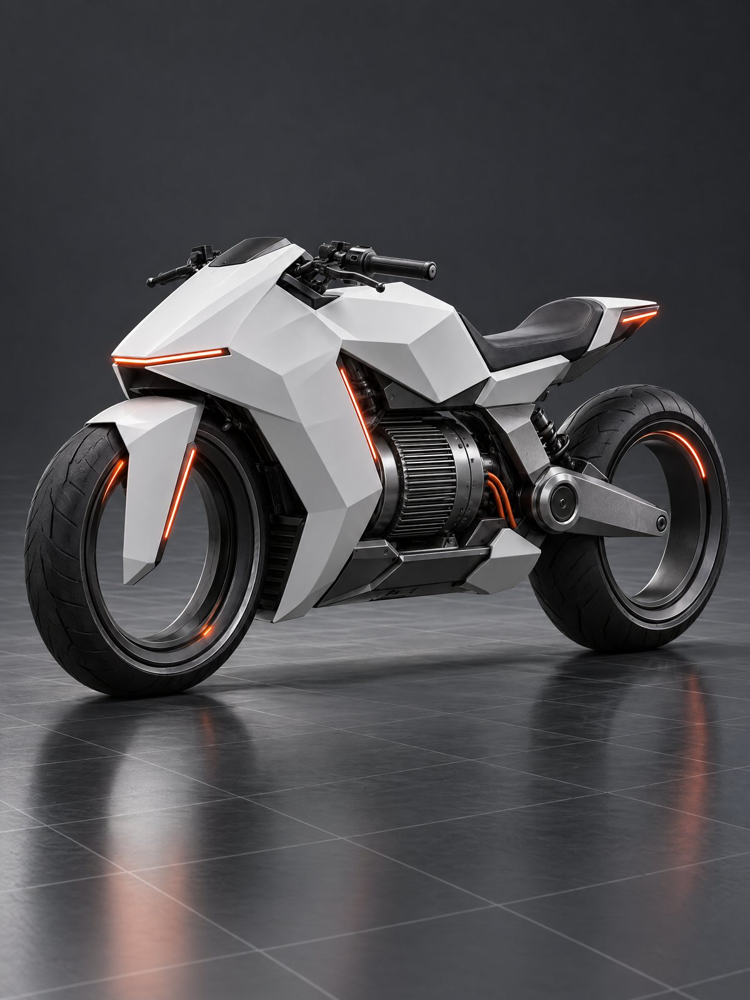 Input</td><td width="50%" valign="top">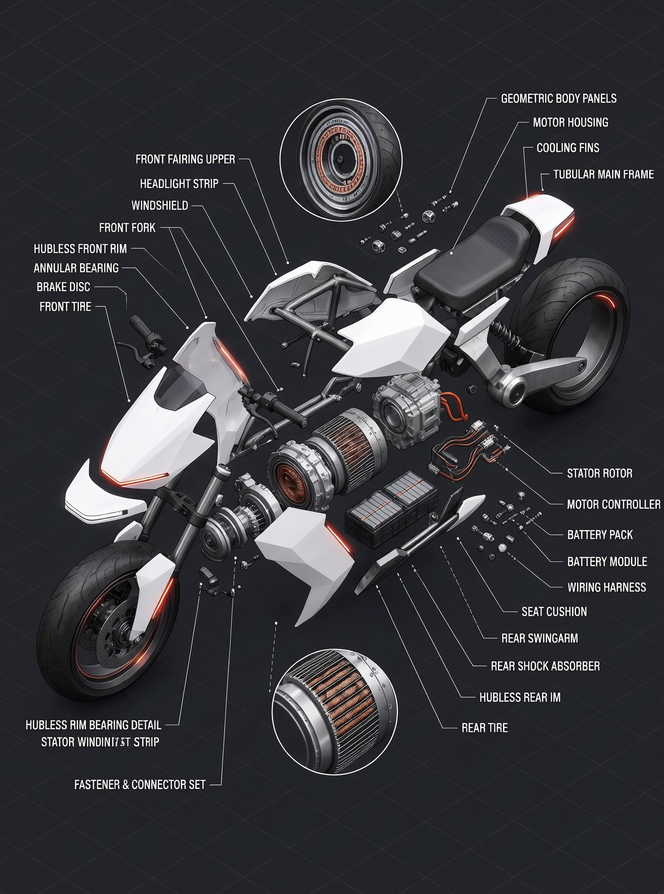 Output</td></tr></table>

<blockquote>Disassemble the concept electric motorcycle in image 1 into a highly detailed exploded parts diagram, keeping its form, white geometric bodywork, metallic-gray motor, hubless wheels, and orange-red light strips consistent with image 1. 
 
Disassembly layout: Use an isometric view centered on the motor unit, with all parts radiating outward along their respective assembly directions, clearly spaced and without overlap: 
- Front: Split the front fairing into upper and lower sections. Separate the headlight strip, windshield, front fork, hubless front rim, tire, annular bearing inside the rim, and brake disc. 
- Middle: Split the white geometric frame shell into multiple faceted panels on both sides, revealing the tubular main frame. Separate the motor housing, cooling fins, stator, rotor, and motor controller. Pull the battery pack out separately, placing the battery modules and wiring harness beside it. 
- Rear: Separate the seat assembly into cushion and base, followed by the rear swingarm, rear shock absorber, rear rim, tire, and taillight strip. 
- Small parts: Group bolts, washers, clips, bearings, and connectors beside their corresponding components according to their installation positions, with fine dashed lines leading back to the mounting points. 
- Add two circular magnified insets showing the bearing structure of the hubless rim and the stator windings inside the motor. 
 
Text annotations: Connect every major component to an ALL-CAPS English label using a thin white leader line with a small dot at its endpoint. Text must be legible and correctly spelled, with labels arranged neatly along the edges. 
 
Use a dark-gray background with faint isometric grid lines, soft even lighting, and clean highlights along the component edges. The composition should be full, clearly layered, and orderly, resembling a structural breakdown from a professional industrial design firm.</blockquote>

#### Jet engine, exploded view

<table><tr><td width="50%" valign="top">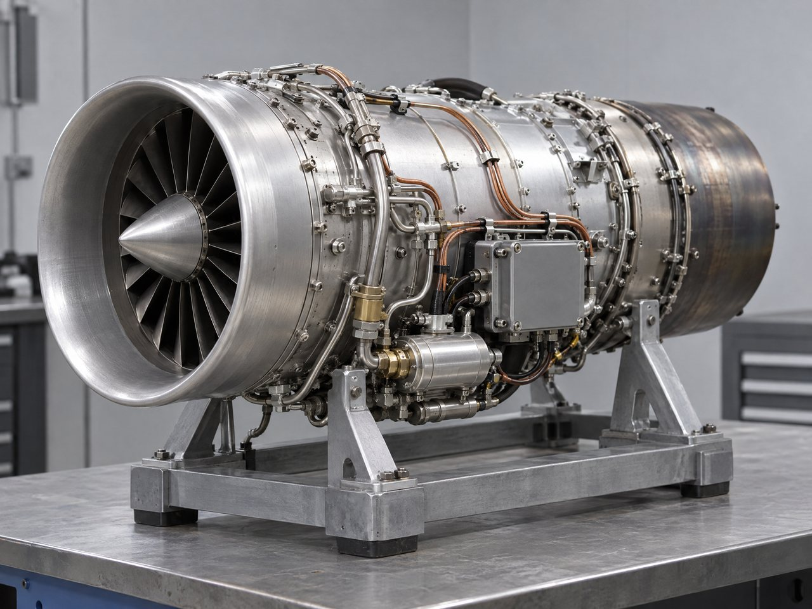 Input</td><td width="50%" valign="top">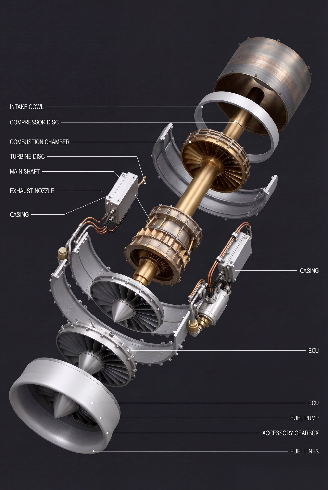 Output</td></tr></table>

<blockquote>Turn the jet engine in image 1 into a high-precision exploded structural rendering. Use a solid dark-gray background and an oblique overhead isometric view, with components floating apart along a diagonal axis from the upper right to the lower left: intake cowling, compressor blade discs, combustion chamber, turbine discs, central shaft, and exhaust nozzle in sequence. Divide the engine casing into curved panels suspended around the main shaft; distribute the electronic control box, fuel pump, accessory gears, fuel lines, and copper-colored wiring harnesses on either side. Use cool gray, silver, and matte white for the outer shell and casing, with warm gold and bronze for the turbine core and shaft. Keep components aligned and evenly spaced, with soft studio lighting and realistic metallic reflections. Connect major components to both sides of the image with thin white leader lines and label them in Chinese: “进气罩,” “压气机叶片盘,” “燃烧室,” “涡轮盘,” “中心主轴,” “尾喷管,” “机匣外壳,” “电子控制单元,” “燃油泵,” “附件齿轮箱,” and “燃油管路” (intake cowling, compressor blade discs, combustion chamber, turbine discs, central shaft, exhaust nozzle, engine casing, electronic control unit, fuel pump, accessory gearbox, and fuel lines, respectively). Use small, simple white sans-serif text in two neat columns, with leader lines that neither cross nor obscure components. Portrait 2:3, with no branding.</blockquote>

#### Moka pot blueprint

<table><tr><td width="39%" valign="top">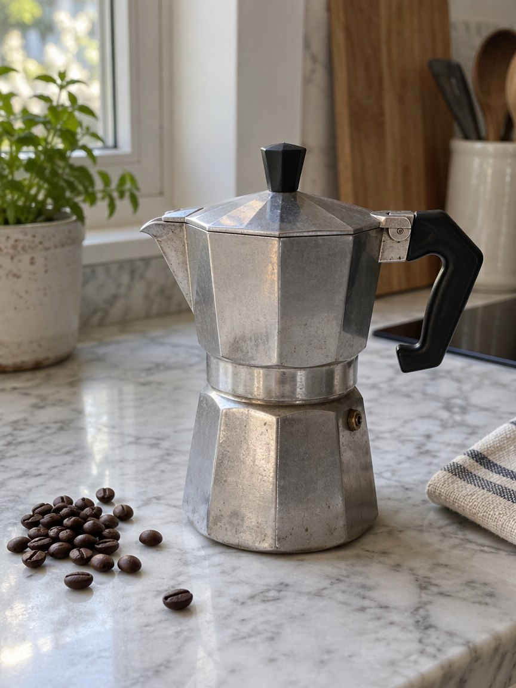 Image 1 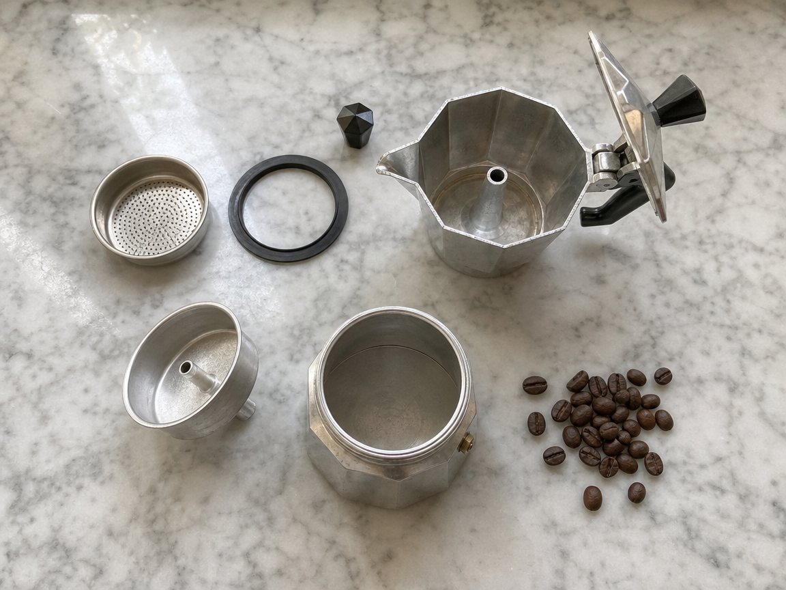 Image 2</td><td width="61%" valign="top">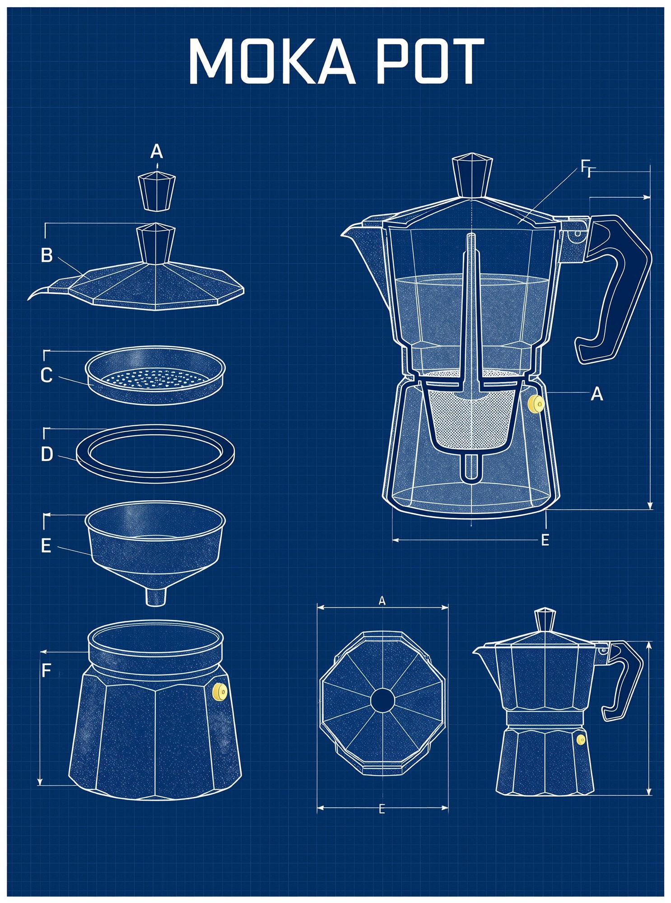 Output</td></tr></table>

<blockquote>Turn the octagonal moka pot in image 1 into a classic engineering blueprint poster, using image 2 as the reference for its component structure. Use a dark-blue background with a light grid, and render all graphics as white line drawings with a slightly weathered grain. Center the uppercase title “MOKA POT” at the top. Arrange an exploded view of the components vertically on the left: lid with small Bakelite knob, upper chamber with handle, stainless-steel filter screen, rubber gasket, funnel filter basket, and lower chamber with safety pressure-release valve. Place a larger cross-section at the upper right showing the internal water path and coffee chamber, and smaller top and side views at the lower right. Include dimension lines, leader lines, and letter labels throughout. Portrait 3:4, with a technical-drawing layout.</blockquote>

#### Ant-inspired hexapod mech, line art

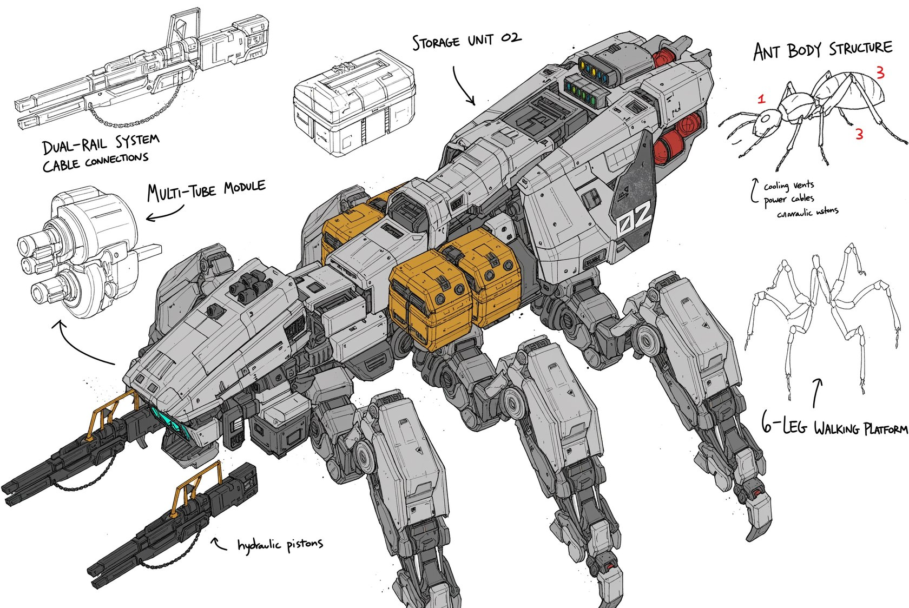

<blockquote>A hand-drawn line-art industrial concept design board for a sci-fi biomimetic six-legged heavy mech, in a wide landscape composition on a pure white background. The subject is a giant mechanical walking platform designed after the body structure of an ant, seen in a front-left three-quarter view from slightly above. The mech's head points to the lower left, while its torso and tall rear pod extend to the back right; its six mechanical legs spread out to both sides in a stable, imposing stance. The subject occupies the lower middle of the image; the blank space at the top and around it holds separate component line drawings, biomimetic structure sketches, handwritten notes, and curved pointer arrows, forming the complete layout of a game mech design sheet. 
 
The silhouette clearly separates three masses: a low head, a connecting thorax, and a heavy abdomen. The head is flat, wedge-shaped armor with a narrow blue-cyan optical viewport at the front and small sensors and round mechanical ports on both sides; the back is covered by two mustard-yellow module boxes with reinforcing ribs, latches, segmented cover plates, and dark-gray mounting frames. Below and in front of the head hang two long, slender fictional sci-fi devices side by side, with dark-gray bodies and exposed orange-yellow brackets, pointing diagonally to the lower left; curved, segmented metal chain belts hang from the boxes above and connect to the components below, forming clear layers of arcs. The midsection narrows slightly, leaving visible space for black hoses, load-bearing frames, and internal linkages. 
 
The six mechanical legs have insect-like multi-segment joints and thick industrial armor: the heavy upper limbs stretch out diagonally, the slender lower limbs support the ground, and each ends in a low, wide, segmented mechanical foot. Every leg includes large round pivots, layered guard plates, hydraulic rods, pistons, joint stops, and exposed wiring; the legs in the foreground are larger, and those in the background are partly hidden by the body, with clear perspective and depth. The abdominal pod at the upper right of the body is tall and heavy, built from slanted polygonal armor plates, with a worn white number "02" on its side, rectangular maintenance hatches, cooling vents, bolts, and two small red cylindrical canisters; the underside of the abdomen is dense with mechanical framework and connecting pipes. 
 
Several fictional equipment modules are mounted on top of the abdomen: a horizontal group of rectangular box components with four dark-red round end caps lined up at the left end; next to it, a disc-shaped detector, a thin antenna, pairs of small upright sensor rods, teal indicator lights, and clusters of short tubular parts set at an angle. A short, thick, horizontal cylindrical sensor extends from the front of the top, its front end made of several square, colored optical lenses. All attached equipment keeps a unified military-green industrial look, with varied joints and bracket shapes, but serves only as a sci-fi exterior design display; show no firing, explosions, or combat. 
 
At the upper left, lay out horizontally a very long, thin black-and-white line drawing of a twin-rail sci-fi device, with a complex box, cables, and cylindrical modules at its right end and a straight, narrow rail extending to the left. In the upper middle of the left side, place a perspective line drawing of a short, thick multi-barrel component, and in the upper center a separate line drawing of a rectangular storage box, with freely curving black arrows pointing to the matching places on the subject. In the upper right corner, draw a side-view sketch of an ant, summarizing the head, thorax, and abdomen with simple black lines and labeled with the light-red numbers "1, 2, 3"; right of center at the bottom, keep a loose black sketch of a biomimetic six-legged structure, showing the link between the mech and the insect form. A few small handwritten notes serve as supporting design annotations, avoiding large areas of text that would distract from the subject. 
 
The whole piece is a pure hand-drawn line-art design sheet: all structures are outlined in thin, slightly shaky black ink lines of varying density, keeping a few doubled lines, broken lines, and exploratory strokes that do not fully close. Apart from tiny spots of pale color, use no thick painted textures, do no realistic rendering, and show no specular highlights, light flares, gradient volume, or photographic texture. The main mech uses line art with very light flat gray tones: most armor surfaces are left white, and only the shaded sides and structural gaps use light-gray and mid-gray blocks with occasional pure-black shadows to describe the turns, while armor seams, bolts, hydraulic rods, pistons, exposed wiring, cable bundles, and other internal mechanical details are all drawn precisely with fine lines. The mustard-yellow module boxes, the orange-yellow exposed brackets, the two small red cylindrical canisters, and the teal indicator lights are suggested only by tiny spots of pale color, never by large color fills. A few short broken lines and dry-brush strokes along the armor edges suggest wear, without painted material textures. Almost no shadow is drawn under the body; only two or three very faint gray lines show where the feet meet the ground, and the edges of the canvas stay clean. 
 
The twin-rail device drawing at the upper left, the multi-barrel component perspective drawing on the left, the rectangular storage box drawing in the upper middle, and the biomimetic six-legged structure sketch at the lower right are all uncolored pure line art, in the same line language as the subject. The ant side-view sketch in the upper right corner also outlines the head, thorax, and abdomen in fine black lines, with light red used only for the labels "1, 2, 3". The curved pointer arrows and handwritten notes are casually sketched black lines, free and slightly irregular. A few small handwritten notes serve as supporting design annotations, avoiding large areas of text that would distract from the subject. 
 
Parameters: aspect ratio about 3:2, ultra-high definition, extremely crisp line art, clearly varied line weight, very low color saturation, medium-high black-and-white contrast, no cast shadows, no material rendering, no environment, no people, no extra decorative border.</blockquote>

### Robotics and Embodied Intelligence

#### Quadruped mech, CAD drawing

<table><tr><td width="50%" valign="top"> Input</td><td width="50%" valign="top"> Output</td></tr></table>

<blockquote>Turn the quadruped mech in image 1 into a standardized CAD engineering drawing with multiple views. Use a white drawing-sheet background and fine black lines: solid lines for visible outlines, dashed lines for hidden structures, and dash-dot lines for axes of symmetry and joint centers. 
 
Include five neatly arranged views: 
- Upper left: Front view. 
- Upper right: Left-side view. 
- Middle left: Top view, clearly showing the launch-port arrays of both weapon pods and the spread angles of all four legs. 
- Middle right: Rear view. 
- Bottom: A larger isometric wireframe view showing the overall three-dimensional structure. 
 
Use the same scale across all views, keeping the shapes of the body, weapon pods, leg joints, and thigh armor plates consistent with image 1. Annotate the main dimensions: overall height, length, width, leg span, and weapon-pod dimensions. Use leader lines to label the key parts “武器舱,” “翻盖,” “机身,” “大腿装甲板,” “膝关节,” and “足部” (weapon pod, hatch, body, thigh armor plate, knee joint, and foot). Place a standard title block in the lower right reading “四足机甲 总装图 1:20” (Quadruped Mech — General Assembly — 1:20). Use clean, accurate lines and an orderly layout resembling a formal mechanical design drawing.</blockquote>

#### Mech beast, exploded CAD view

<table><tr><td width="43%" valign="top"> Input</td><td width="57%" valign="top"> Output</td></tr></table>

<blockquote>[Left Side Exploded View: Widely Spread, Fully Separated] 
 
The left side shows a fully spread mechanical assembly exploded view. Only the continuous internal load-bearing skeleton stays in the center; the head shell, chest and back armor, limb guard plates, joint end caps, back spikes, and tail scales move far from their mounting positions, forming a wide, orderly array of parts around the skeleton. 
 
The central skeleton takes up only about 45% of the width and 40% of the height of the left area; the complete group of exploded components covers about 90% of the width and 85% of the height of the left area. Leave enough space for the removed parts to show each part's full outline, thickness, inner reinforcing ribs, and mounting holes. 
 
[Clear Separation Distances] 
 
At least 80% of the external armor is completely detached from the skeleton. Each large armor piece moves away from its original mounting position by about 1 to 1.5 times its own width. Clearly visible white gaps separate the main parts; avoid guard plates that still touch the body with only a thin seam showing. 
 
Use three levels of separation distance: 
 
The outer armor moves farthest, forming the outer ring of parts; the middle-layer connecting brackets sit between the armor and the skeleton; internal bearings, connecting rings, washers, and fasteners spread out in order along their axes. Leave clear empty space between the layers so the assembly order can be read at a glance. 
 
[Separation Direction by Region] 
 
The head components spread toward the upper left: the forehead plate, the twin horn mounting modules, the cheek guards on both sides, the sensor module, and the jaw assembly each move away from the skull along their own assembly direction. Leave a large enough gap between the head shell and the internal frame to fully reveal the structure hidden inside the skull. 
 
The chest and back armor spread upward: the back spikes and scale armor, in their original front-to-back order, form two to three staggered layers of floating component bands above the skeleton. Each armor piece has its own outline, with white gaps between the pieces. The inner sides of the armor face the viewer, clearly showing reinforcing ribs, mounting seats, and screw holes. 
 
The chest side plates spread left and right: the outer armor moves to the outer ring, the rib-like brackets stay in the middle layer, and the central power module and mechanical spine stay at the center of the skeleton. Pipes and cables stay with the components they belong to, and the separated connectors are clearly visible. 
 
The limb components spread outward and downward: the front-limb armor is laid out in the lower left and the rear-limb armor in the lower right; guard plates, brackets, and joint assemblies each have their own space, avoiding dense stacks around the legs. 
 
The round joints are pulled out into long rows along their axes: end caps, locking rings, washers, bearings, and connecting flanges are arranged in order, with gaps of about 0.3 to 0.6 times the joint diameter between adjacent main parts; all rings are strictly coaxial, clearly showing each layer's thickness and the assembly order. 
 
The tail components spread toward the upper right: the central vertebra chain stays continuous, while the outer scale armor moves up and to the sides in groups, forming component bands parallel to the tail. The hooked blade at the tip of the tail is clearly detached from its mount, keeping a clear assembly axis. 
 
[Assembly Relationships and Readability] 
 
All removed parts keep their original proportions and mounting orientation and are connected to their positions by thin, clear dashed lines. Even with the larger separation distances, it should remain clear which body part each armor piece belongs to and how each joint group goes back together. 
 
Avoid main parts hiding each other, and keep the assembly guide lines as parallel as possible with few crossings. Screws and small fasteners are grouped near the components they belong to and do not fill the white space between the main parts. 
 
The final image should clearly show a bare mechanical beast skeleton in the center, surrounded by widely displaced, multi-layered armor and mechanical components, with wide, distinct, continuous white gaps between the parts. Keep the pure white background, the precise black CAD line art, and the assembled four views on the right.</blockquote>

#### Ceiling rail courier

<blockquote>Create a 16:9 English engineering concept sheet titled "Ceiling Rail Courier," marked "Fictional indoor transport concept." Show a long side elevation across the upper half, a detailed suspended carriage at lower left, and a three-position storyboard at lower right. Use warm white paper and cobalt linework. 
A straight horizontal rail spans X = 0 to 2400 mm. Define three docking stations by carriage-center coordinates: A at X = 300, B at X = 1200, and C at X = 2100 mm. Adjacent station spacing is 900 mm. The carriage is 400 mm long along X, so its footprint at A is 100–500 mm and at C is 1900–2300 mm; all positions remain within the rail. The three storyboard panels show the same carriage at A, B, and C, not three simultaneous robots. 
At the illustrated extension, the vertical suspension comprises an 80 mm carriage housing, a 120 mm mounting bracket, a 300 mm telescoping stem, and a 60 mm gripper, measured as consecutive segments. Mark their total as 560 mm, measured from the housing top to the gripper bottom; rail, rollers and parcel are excluded from this dimension. The gripper holds one sealed parcel throughout all panels. Include two rail rollers, one linear drive unit, one downward camera, and one two-finger gripper in the component ledger. Maintain the same dimensions, parcel, roller count, and sensor position across all views. Clearly separate horizontal station dimensions from the vertical stack.</blockquote>

#### Wheel-legged delivery robot

<blockquote>Draw a 16:9 concept diagram in Chinese of a wheeled-legged delivery robot. Include side views of the same robot standing and crouching, a 3D view, and an actuator-axis table, labeled “虚构结构研究” (Fictional Structural Study). The body is 500 mm long, 360 mm wide, and 180 mm high. Each of its four corners has a two-joint leg ending in a powered wheel 120 mm in diameter. There are eight leg joints and four wheel-axis motors, for a total of 12 controlled rotary axes. Label the legs FL, FR, RL, and RR, with upper and lower joints numbered 1 and 2 and wheel axes labeled W. Left and right are from the robot's own perspective. The top of the body is 560 mm above the ground when standing and 440 mm when crouching. Use the same ground line to show the 120 mm reduction. Change only the joint angles between the two views; keep the body, wheel diameters, and link lengths identical. There is only one depth camera on the front panel and only one enclosed cargo box above the body; keep the box level in both poses. Use a comparison table to distinguish the eight leg joints from the four powered wheel axes, avoiding any depiction of 12 controlled axes as 12 legs or 12 wheels.</blockquote>

### Complex Visual Challenges

#### Corner mirrors

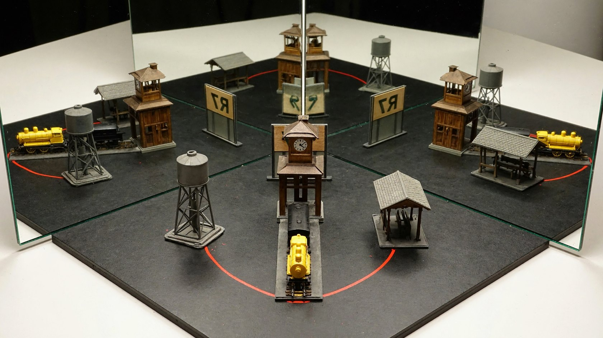

<blockquote>Show a tabletop optics demonstration as a realistic photograph: two upright plane mirrors meet along their vertical edges at a right angle, with their reflective surfaces facing inward. Photograph from the open side, slightly off-center, including the entire physical object in front of the mirror corner and all three corresponding sets of mirror images. The object is a small station model with a central clock tower, a tall water tower on only one side, a low waiting shelter on the other, and a small vehicle in front with a yellow front and black rear. A curved red line connects the base of the water tower to the waiting shelter. In front of the model stands a sign facing the mirror corner, bearing the text “R7”; the real camera view shows the back of the sign. Each side mirror contains one singly reflected image, and a doubly reflected image appears deep in the mirror corner. The side reflections show mirror-written text, while “R7” is readable normally in the double reflection. The water tower, waiting shelter, vehicle front, and red line all change direction together according to the reflections, preserving their spatial relationships to the clock tower. Make the mirror seam and apparatus base clearly visible, with sufficient space between reflections to identify each model image.</blockquote>

#### A hand in the projection

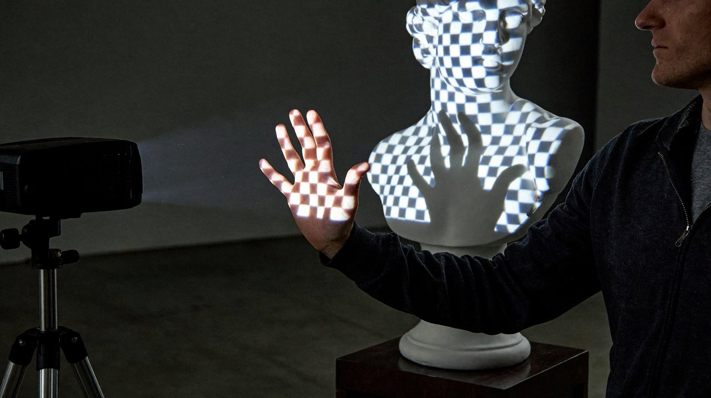

<blockquote>A realistic on-site photograph of a projection art installation: a projector casts a blue-and-white checkerboard onto a white plaster bust, with the grid deforming over the bridge of the nose, cheeks, and curved chest. An operator stands beside the projection area and extends one hand with all five fingers spread into the beam in front of the sculpture's chest, palm facing the projector. Part of the checkerboard falls onto the palm itself, while a dark hand-shaped shadow without the checkerboard appears on the sculpture's chest behind it. Bright squares are cut off at the shadow boundary, while projected light still passes through the gaps between the fingers. Photograph from a front-side angle so that the actual hand and its shadow on the chest are offset in the composition, showing the person's upper body, the sculpture, and the operating projector at the side.</blockquote>

#### Game map to 3D game view

<table><tr><td width="46%" valign="top">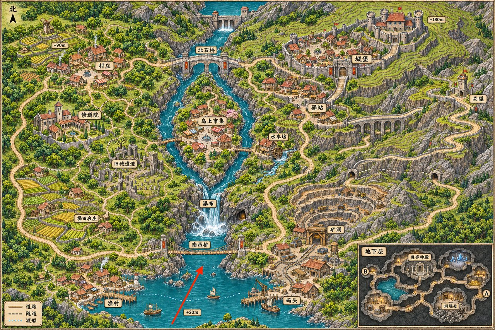 Input</td><td width="54%" valign="top">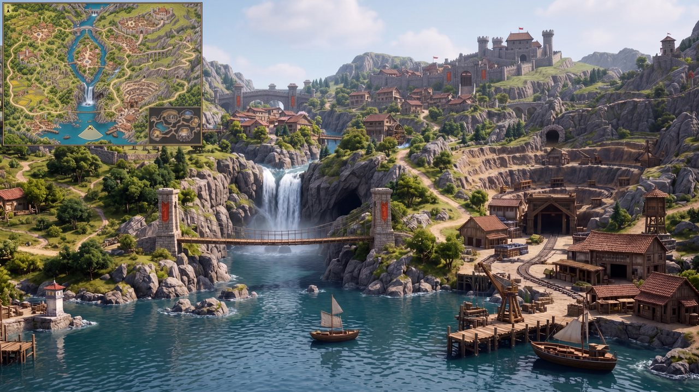 Output</td></tr></table>

<blockquote>Using the supplied game map as the sole spatial reference, generate a 16:9 in-game screenshot of an open-world game in a realistic 3D CG style. 
Camera Position and Direction 
Use the tail of the red arrow as the camera position and the direction of its tip as the viewing direction. The camera is approximately 1.7 meters above the lake in the southern part of the map, looking slightly east of north in first person with a field of view of about 70° and natural perspective. Do not show the player's body. 
Spatial Reconstruction 
Strictly reproduce the map's terrain elevations, building locations, river course, bridge connections, and road relationships. 
Determine the visible portions of the settlements on both banks, the mining area, the mountains, and the distant castle according to actual lines of sight. Preserve plausible occlusion and relative scale with distance. Do not move buildings, flatten the terrain, or widen the field of view merely to show every landmark. 
Visual Style 
Use high-quality, realistic game-engine rendering, with buildings and mountains at true scale, detailed rock, wood, vegetation, and water materials, natural daylight, global illumination, water reflections, and moderate atmospheric perspective. Convey the feeling of a player actually inhabiting this world. Avoid a hand-drawn map look, miniature diorama, isometric viewpoint, or bird's-eye composition. 
Upper-Left Minimap 
Add a clear game HUD minimap in the upper-left corner, approximately 15% of the image width. Use the surface map from the reference image as its thumbnail base, preserving the original proportions and north-up orientation. Retain major terrain and roads, and remove the underground inset. 
Mark the player's position with a small directional arrow at the location corresponding to the tail of the original red arrow. Its direction must exactly match the main camera view, with a pale fan-shaped area indicating the field of view. Use a simple thin border and keep the map legible. 
Output only one complete game screenshot. Do not include the original red arrow, place-name labels, elevation numbers, or map borders in the main scene. Add no interface elements other than the upper-left minimap.</blockquote>

#### Pelican graduation pyramid

#### Pelican Christmas tree

#### Pelican balancing act

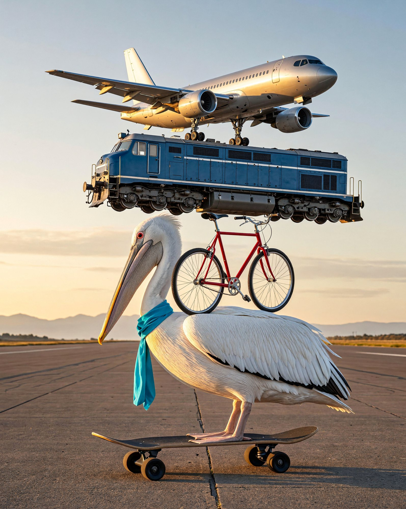

## Creative Applications

### Game Worlds

#### Frontier rider

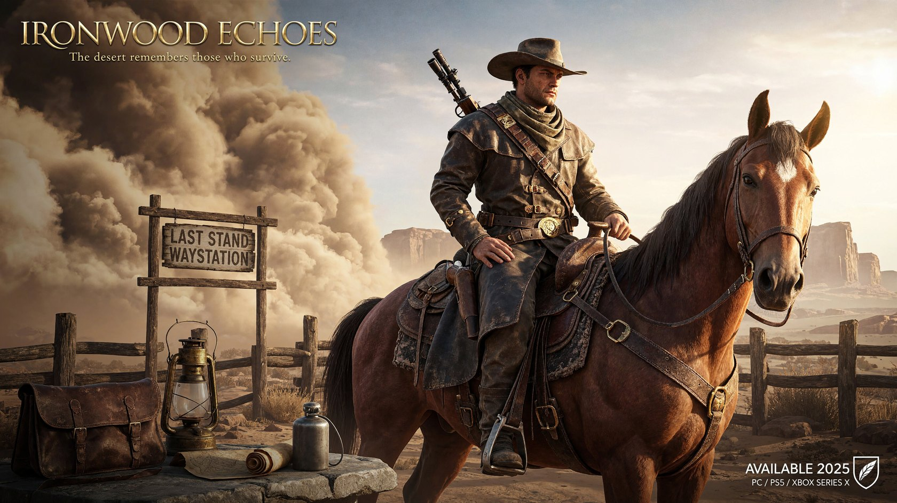

<blockquote>Aspect ratio 16:9, 4K. Create original game key art that evokes the genre atmosphere of a major AAA production through mood, gameplay motifs and composition. Use realistic 3D materials and cinematic lighting, with original identities, costumes and symbols. Scene: An adult frontier rider waits at a waystation as a sandstorm approaches and the horse turns its head. Use original identities and designs without existing franchise names, characters, brand marks or watermarks.</blockquote>

#### Gathering in the desert

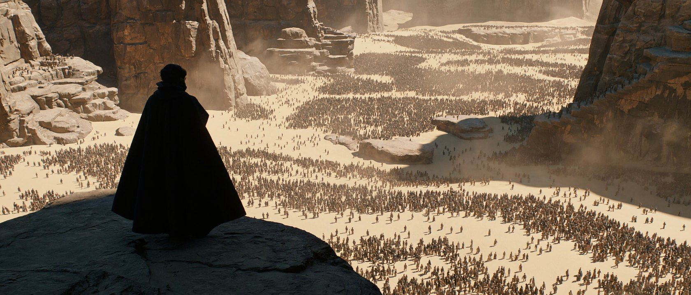

<blockquote>Aspect ratio 21:9. An epic, realistic cinematic scene looking down on a vast desert gathering from a high rock ledge behind a figure. A person in a long dark cloak stands slightly left of center in the foreground, back to the camera, their outline almost a black silhouette. Below, a dense crowd fills a broad sandy area and a natural amphitheater enclosed by rocks. Tiny figures extend into the distance in imperfect rows, merging into a fine, orderly texture. Brown rock walls, rough steps, and raised ledges on both sides define the space, with a slight dusty haze in the warm beige air. Natural daylight from above illuminates the gathering while the foreground remains in deep shadow, emphasizing the contrast in scale between the isolated nearby figure and the immense crowd. Realistic cinematic color grading.</blockquote>

#### Cold mineral plain, aerial view

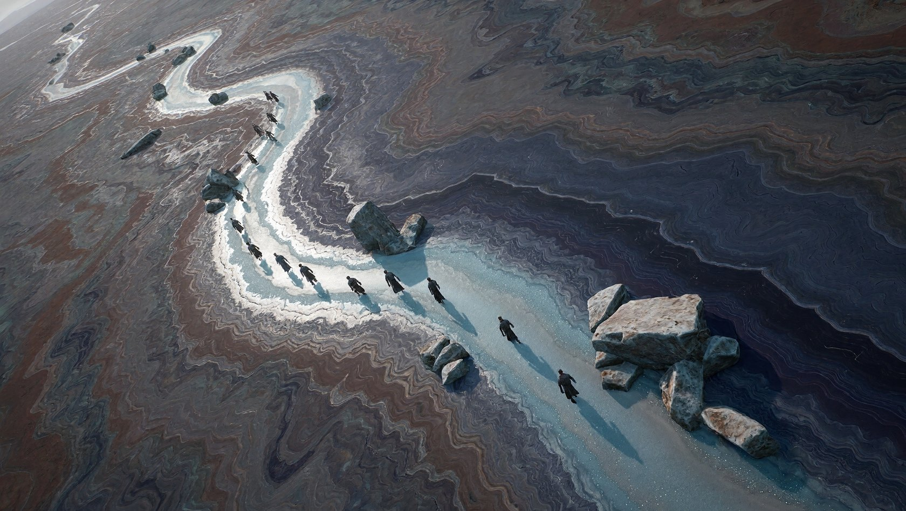

<blockquote>An ultra-wide aerial image in a game-CG style, showing an expansive mineral wasteland from a slightly oblique high-altitude viewpoint. Shift the overall palette from warm reddish-browns to deep indigo, cool gray, teal, and silvery white. The surface spreads like a natural agate cross-section, with layered mineral bands intertwining into irregular rings of sediment and winding branches. No sky or horizon is visible; all visual information is concentrated in the ground textures, creating an unfamiliar, silent, and magnificent alien landscape. 
 
A brighter, narrow gray-teal passage enters from the lower right, bends toward the center-left, then follows a gentle S-curve into the upper-left distance. This replaces a straight diagonal layout and serves as the main visual guide into the image. Keep the passage mostly on the left, leaving a large expanse of deep-indigo mineral deposits on the right for an asymmetrical composition with varied density. Silvery-white and cool-gray mineral crusts and narrow channels line the passage, their naturally winding edges resembling pale traces of a dried-up water system. Broad dark-teal sedimentary areas have fine wavy strata, interspersed with pale blue-green lines that curve, converge, and branch with the terrain. 
 
About ten tiny travelers in dark-gray and black-brown long garments walk loosely spaced along the passage. They occupy only a very small portion of the image, with clear human silhouettes but no emphasis on facial detail. The group extends from the lower right toward the center-left bend, then gradually disappears into the narrow passage at the upper left. Spacing is uneven; some travelers pass near white rocks, while others cross exposed gray-teal ground. Place the group's visual center near the left-third line to balance the vast empty terrain on the right. The stark contrast between the travelers' scale and the immense landforms conveys a lonely journey and an epic narrative. 
 
Gray-white rocks of varied sizes lie scattered along the passage. Larger rugged boulders cluster near the lower-right entrance, with scattered stones and a few prominent pale boulders at the center-left bend and in the upper-left distance, creating depth from near to far. The rocks have weathered, powdery, granular surfaces and irregular edges. Lit faces glow cool white, while unlit faces sink into deep blue-gray shadow. The ground combines dry mineral crust, fine sand, and a few tiny reflective particles, rendered with the rich material detail of high-fidelity game-environment assets without excessive sharpening. 
 
Low-angle, cool-white sunlight enters from the upper left, casting extremely long diagonal shadows from travelers and rocks toward the lower right. These narrow shadows overlap along the S-shaped passage, contrasting with the winding ground patterns. Use low-key exposure overall, darker terrain on the right and a slightly brighter passage on the left, retaining natural vignetting. Silvery highlights, muted teal midtones, and deep-indigo shadows form a restrained cool palette, with a slight dusty haze and refined cinematic post-processing. 
 
Style and parameters: High-quality game CG, realistic 3D terrain rendering, cinematic game cutscene, physically based materials, global illumination, cinematic aerial composition, oblique high-altitude view, extreme long shot, S-shaped leading line, asymmetrical layout, widescreen ratio approximately 2.5:1, high-definition detail, deep depth of field, clear ground textures, low-light cool illumination, high dynamic range, moderately muted colors, soft highlights, dark shadows, no text, logos, or borders.</blockquote>

#### Red mineral plain, aerial view

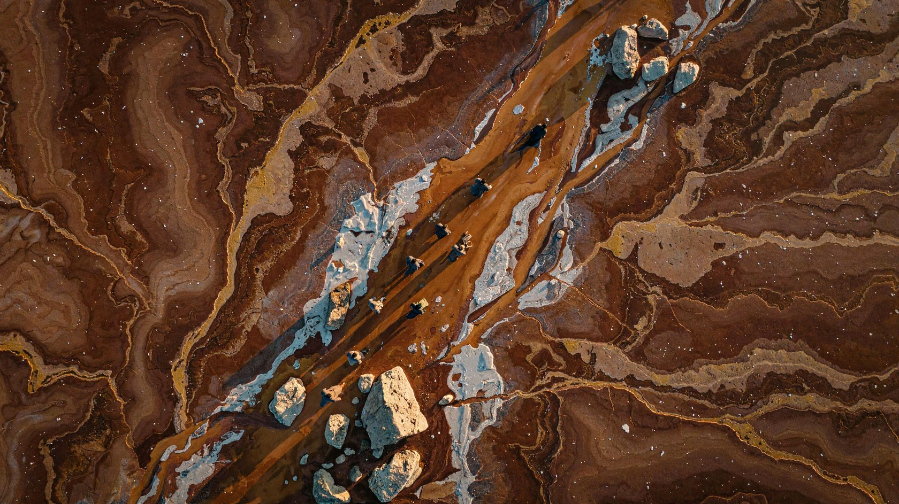

<blockquote>A cinematic ultra-wide aerial view, looking almost vertically down on a vast reddish-brown mineral wasteland, 2.5:1 widescreen, with no sky or horizon. The terrain resembles a natural agate cross-section, with interwoven layers of rust red, deep ocher, caramel orange, and dark brown forming irregular sedimentary rings, wavy strata, and winding branches, with occasional fine gold lines. The landscape feels unfamiliar, silent, and magnificent. 
A bright, narrow orange-brown passage extends from the lower left to the upper right, forming the composition's diagonal backbone. Creamy-white mineral crusts, gray-white rocks, and narrow channels line its sides like a dried-up water system. About ten tiny travelers in dark-gray and black-brown long garments follow the winding passage at uneven intervals, some close to white rocks. Do not emphasize faces. Their tiny scale contrasts with the immense landscape, evoking a lonely journey and an epic narrative. 
Rocks of varied sizes punctuate the route, with rough, weathered surfaces and irregular edges. The ground blends dry mineral crust, fine sand, and a few reflective particles. Low-angle warm sunlight enters from the upper left, stretching the travelers' and rocks' shadows toward the lower right, where narrow shadows intersect curved ground patterns. Keep exposure low-key, darker at the edges and slightly brighter in the center, with restrained layers of warm-orange highlights and deep reddish-brown shadows. 
Realistic landscape photography, extreme long shot, deep depth of field, high-definition textures, high dynamic range, moderately muted colors, soft highlights and natural vignetting, slight dusty haze and fine film grain, no excessive sharpening, no text, logos, or borders.</blockquote>

#### Forest amphitheater

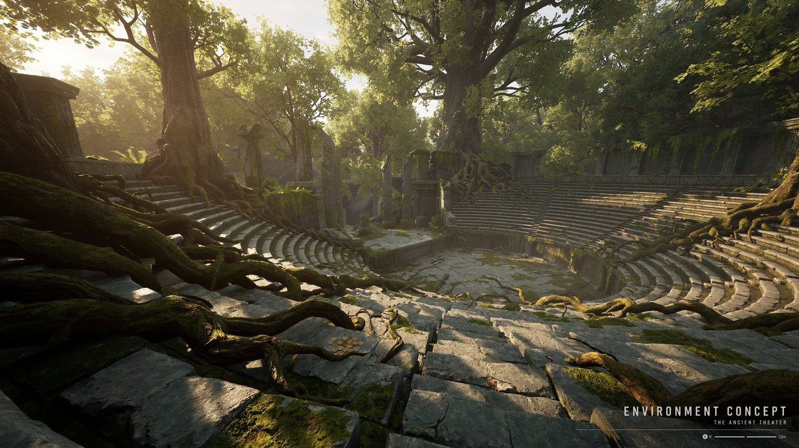

<blockquote>Aspect ratio 16:9, 4K. Create a finished environment concept image for a AAA game, in which the terrain, landmarks, and function of the settlement are immediately legible before the viewer notices the finer details. Use a credible, realistic 3D space, architecture adapted to climate and terrain, and distinct foreground, midground, and background. Specific subject: an amphitheater swallowed by the forest, with tree roots entering the seating through cracks. Do not use names, characters, or brand logos from existing works, and do not add a watermark.</blockquote>

#### Palace above a sea of clouds

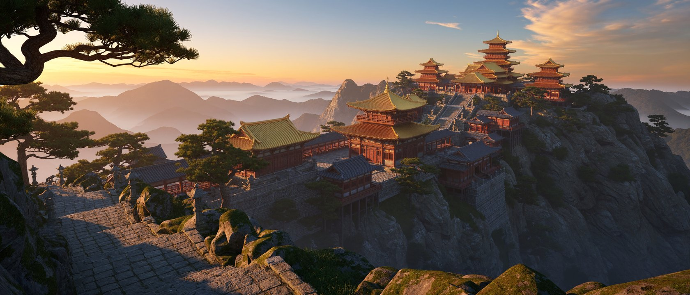

<blockquote>Aspect ratio 21:9, 4K. Create a cinematic, photorealistic digital matte painting suitable for extending a distant view in a AAA cutscene. Keep the foreground clear, the midground structured, and the background progressively softened by atmospheric perspective. Unify the horizon, lighting, and scale, and integrate buildings naturally with the terrain without collage seams. Specific subject: a mountain monastery complex extending along a ridge, its roofs illuminated layer by layer by golden morning light. Do not use names, characters, or brand logos from existing works, and do not add a watermark.</blockquote>

#### Wizard casting a fan of fire

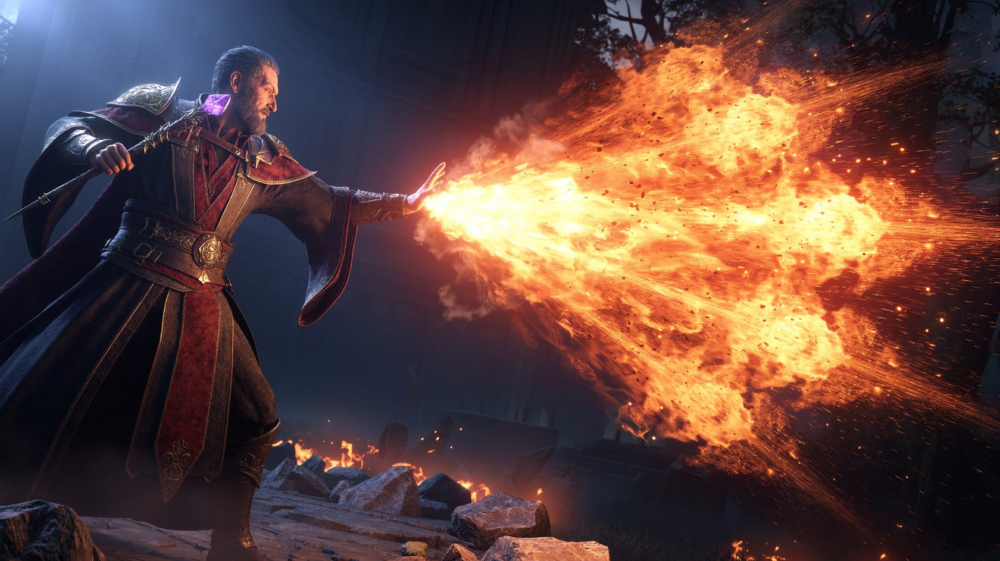

<blockquote>Aspect ratio 16:9, 4K. Render a realistic AAA game effect at its peak, keeping the character or device and ground readable. Clearly distinguish origin, direction and area of influence, with layered particle density and environmental light interaction, without damage numbers, UI or text. Scene: An adult mage releases a fan of fire from the palm with flame tails bending downwind. Use original identities and designs without existing franchise names, characters, brand marks or watermarks.</blockquote>

#### Explosion in two stages

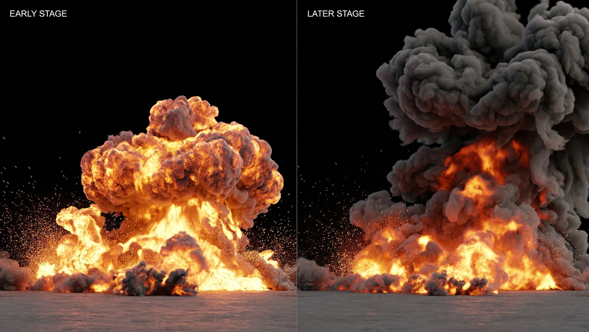

<blockquote>A two-stage comparison image of a cinematic VFX explosion simulation, against a pure-black background, with a gray untextured horizontal ground plane beneath each view. Two side-by-side panels use identical camera positions and scale: the left shows an early explosion stage, with a rolling bright orange-yellow fireball and densely packed tongues of flame forming cauliflower-like details; the right shows a slightly later stage, with orange flames still at the base and a large mass of dense dark-gray smoke curling toward the upper right. The volumetric fire and smoke have realistic translucency, density, turbulence, and layering. Use a fast shutter speed to freeze the instant, emphasizing the shapes of fire and smoke and their mutual occlusion. Output one complete image, preserving this composition and number of views. Do not add webpage borders, artist signatures, or watermarks.</blockquote>

#### Armored knight, character sheet

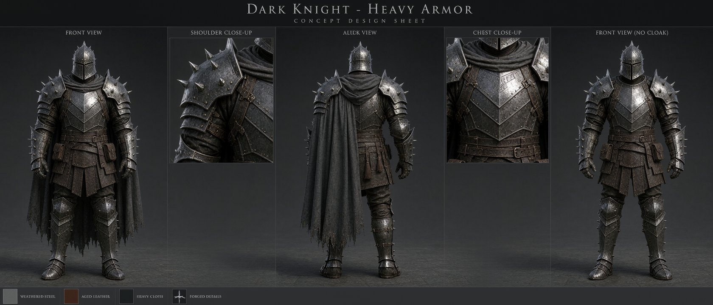

<blockquote>A dark-fantasy game character design sheet against a dark-gray gradient studio background. Show the same tall male knight in heavy armor in three side-by-side full-body views: front, back, and front with the shoulder cloak removed. Keep pose and proportions consistent. His face is fully concealed inside an angular closed helmet. The dark-steel plate armor has pointed pauldrons, segmented chest plates, arm guards, knee guards, and greaves. A worn gray-black cloth mantle wraps his neck and shoulders, and layered dark-brown leather skirt armor and straps hang at his waist. Place small isolated close-ups of the shoulder and chest armor between the views. Realistic game concept art, with clear metal wear, leather roughness, and fabric folds, a cool-gray palette, and soft top-side lighting. Show the feet and full silhouette. Output one complete image, preserving this composition and number of views. Do not add webpage borders, artist signatures, or watermarks.</blockquote>

#### Beast king with a lion's mane, close-up

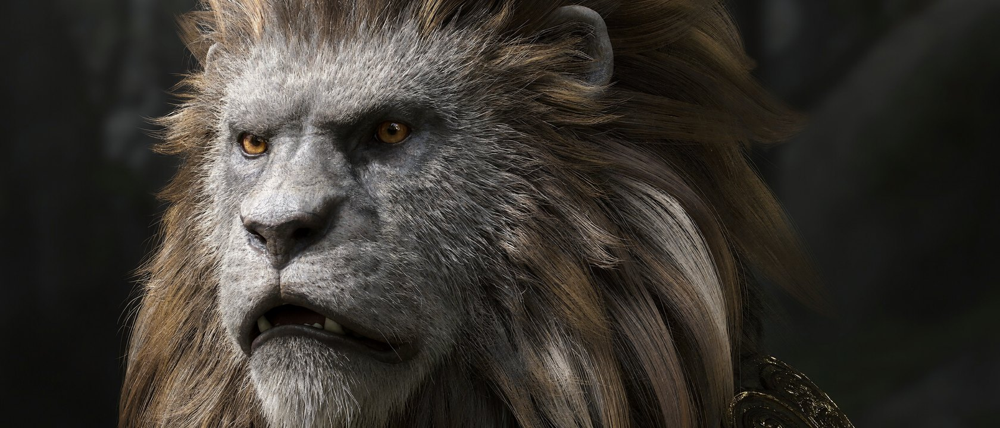

<blockquote>Aspect ratio 21:9. A realistic fantasy-creature facial close-up: a beast king combining a lion's mane with an ape-like facial structure faces the camera, angled slightly left. Clearly show its broad gray nose bridge, deep-set eye sockets, and amber eyes. Its lips are slightly parted, revealing a few small ivory-colored teeth. Short, dense gray-white fur covers its face, surrounded by an enormous brown and silvery-white mane spreading toward the right and bottom of the frame. The fur has natural curls, layers, and fluffy volume, with fine side lighting on individual strands. Only a small portion of a dark-gold ornament appears at the lower-right edge; the face and mane remain the focus. Use a dark, blurred background, realistic transitions between skin and fur, moist eye reflections, and cinematic creature materials. Output one complete artwork with no website borders, artist signatures, or watermarks.</blockquote>

#### Forest dragon

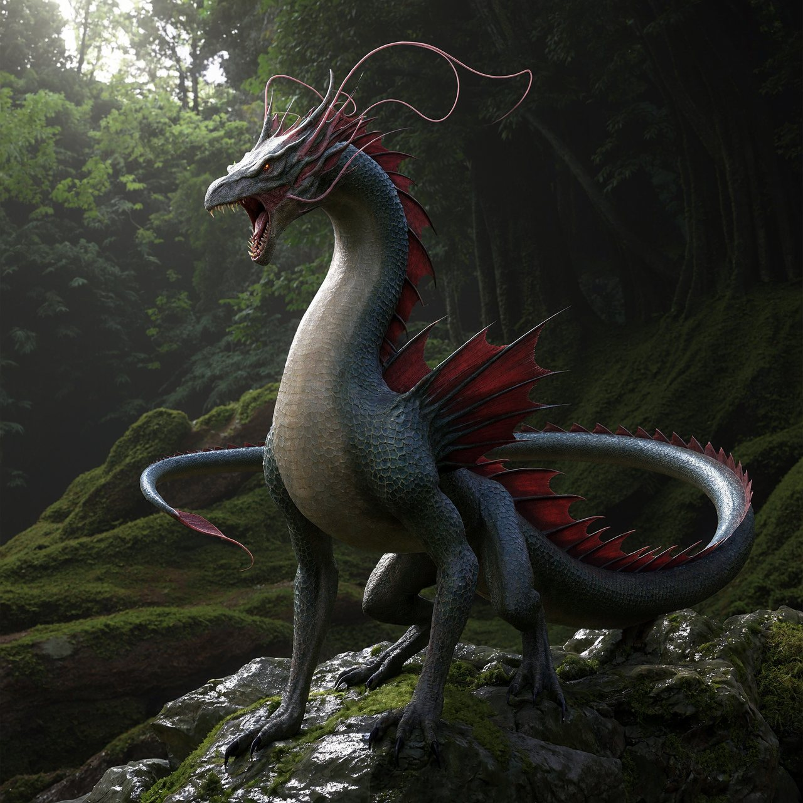

<blockquote>A realistic fantasy-film creature stands on a rock in a dim forest, in a square full-body composition. The subject is a dragon with a tall neck and slender body, fine gray-blue and dark-green scales, a beige-gray belly, and fan-shaped dark-red dorsal membranes rising from its shoulders to its tail. Its mouth is open in a roar, with many long pink tendrils and horn-like fleshy crests growing from its forehead and cheeks and curling backward, forming an elegant, complex silhouette. Its four limbs have a reptilian structure with sharp claws, its long tail curves around the body toward the left, and its feet rest on damp rocks and moss. Soft natural forest light shines through parts of the tendril crest. Fine, credible materials, with no text or watermark.</blockquote>

#### First-person shooter scene

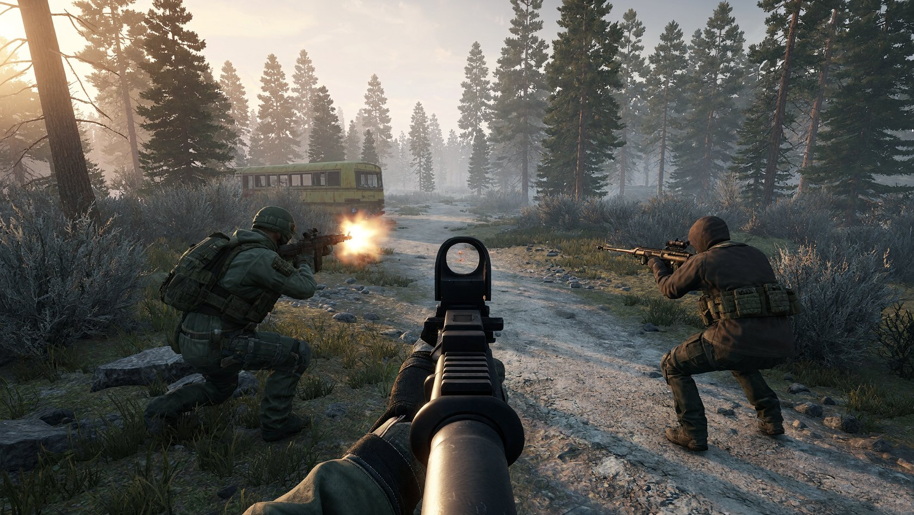

<blockquote>Aspect ratio 16:9. A realistic post-apocalyptic first-person shooter scene. At the lower edge, the player's hands hold a rifle and optic aimed down an abandoned woodland road. In the left midground, a companion wearing green tactical clothing, a backpack, and a helmet fires forward, with a small orange-yellow muzzle flash. On the right, another fighter in a hood and worn brown coat crouches halfway while holding a long gun. Tall pines, gray shrubs, and thin fog surround the distant road; a rusty yellow bus sits in the left background. The ground has rich details of weeds, stones, and soil. Low sunlight at dawn or dusk filters through the trees, contrasting the cool gray-green environment with brief gunfire flashes. Equipment structures should be realistic. Tense atmosphere with no gore and no HUD.</blockquote>

#### Untextured render to film still

<table><tr><td width="50%" valign="top">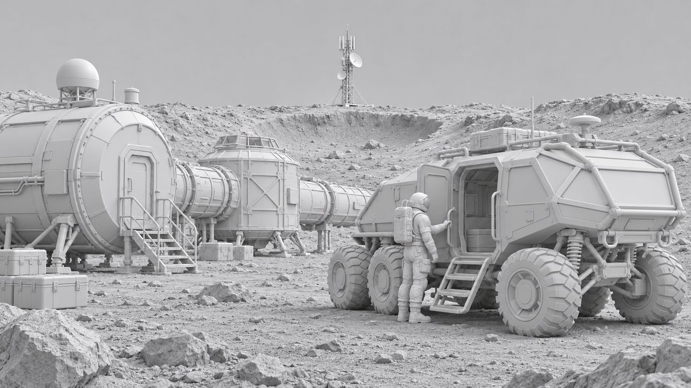 Input</td><td width="50%" valign="top">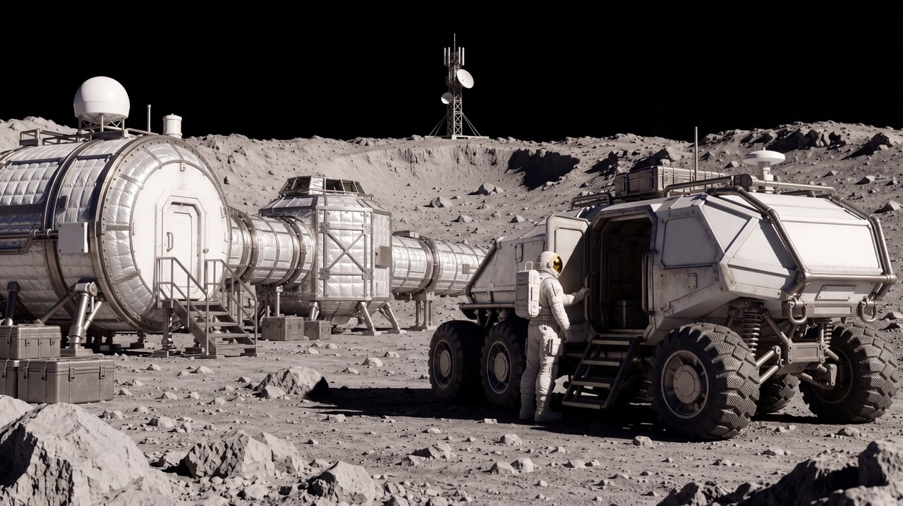 Output</td></tr></table>

<blockquote>Render this untextured 3D model as a realistic cinematic lunar research scene. Add gray lunar soil, silvery-white thermal insulation, coated metal, glass, and wheel-mesh materials, with off-white spacesuits. Use strongly directional sunlight and limited ground bounce. Keep the distant sky pure black, with no blue sky, clouds, or Earth-like haze. Preserve the rover's six wheels and the arrangement of the people and modules. Keep shadow directions consistent and material detail visible in highlights. Preserve the original composition, camera angle, perspective, geometry, and the position and proportions of every subject. Output 4K in 16:9 landscape format, combining AAA photorealistic CG with cinematic live-action texture. Do not add text, brands, interface elements, or watermarks.</blockquote>

#### Hydro station in a canyon, matte painting

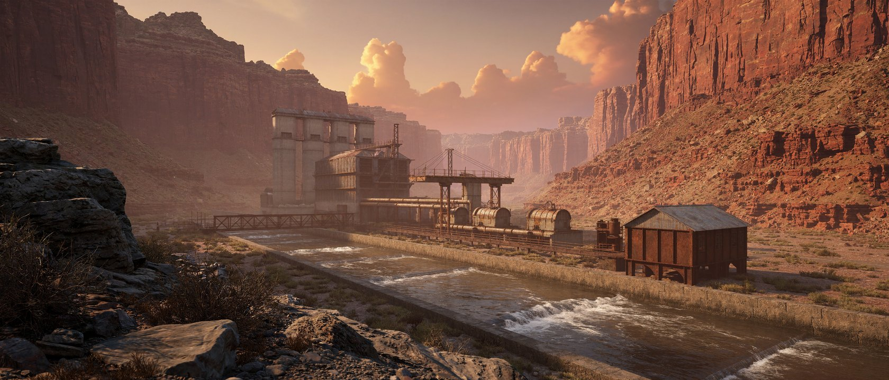

<blockquote>Aspect ratio 21:9, 4K. Create a cinematic photoreal matte painting suitable for extending an AAA cutscene. Use a crisp foreground, structured middle distance and atmospheric recession, with consistent horizon, light and scale and seamless transitions between architecture and terrain. Scene: An old hydro station enclosed by red canyons with a long channel crossing the scene. Use original identities and designs without existing franchise names, characters, brand marks or watermarks.</blockquote>

#### Abandoned station

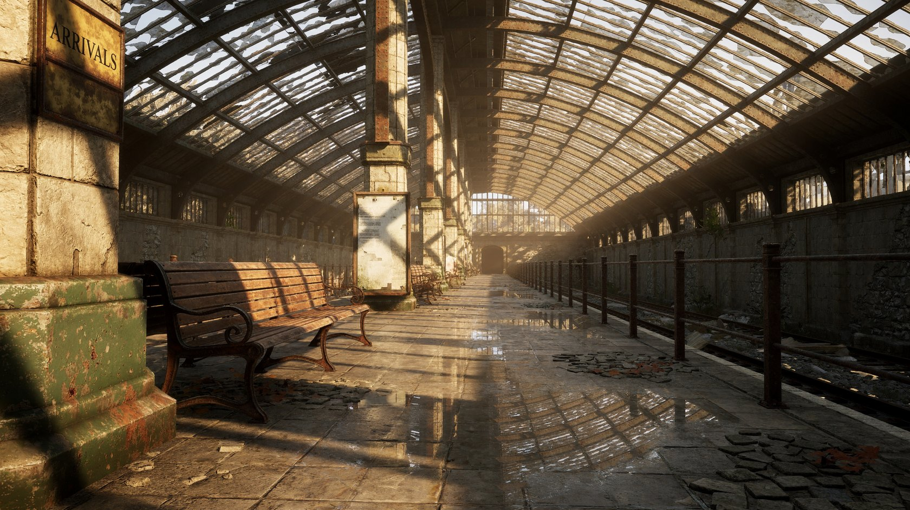

<blockquote>Aspect ratio 16:9, 4K. Generate a photorealistic AAA image with a high-end real-time engine look. Emphasize indirect illumination, varied roughness, contact shadows and depth separation. Show only the rendered scene, without an editor or performance counters. Scene: Sunlight enters an abandoned station through a glass roof and reflects its steel frame in wet tiles. Use original identities and designs without existing franchise names, characters, brand marks or watermarks.</blockquote>

#### Industrial ruins

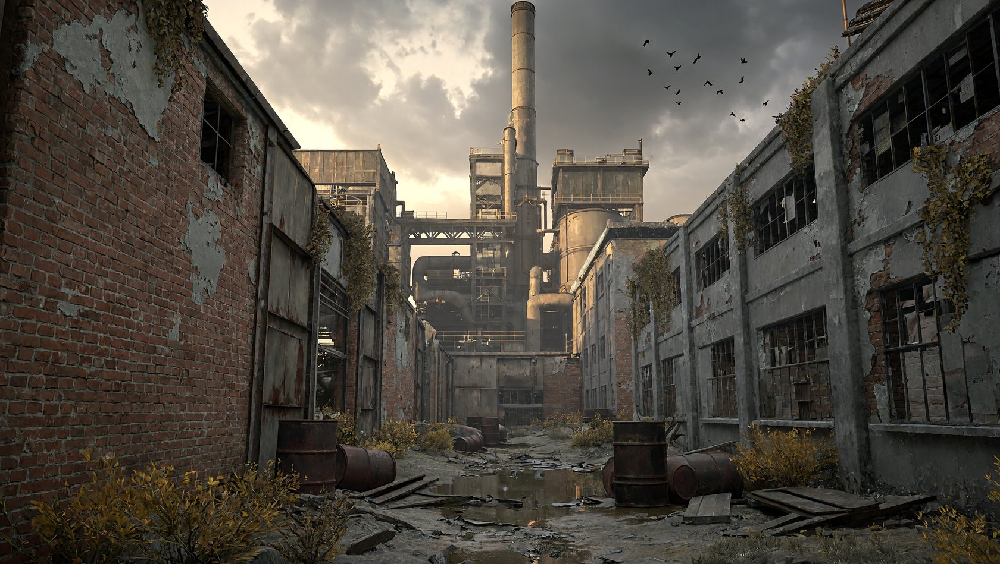

<blockquote>Aspect ratio 16:9. A realistic exterior of a post-apocalyptic industrial complex, viewed from a low camera position through a narrow yard filled with rubble and scrap. A tall faded red-brick wall dominates the left foreground, with a ruined concrete factory building on the right. In the central distance stand multi-level steel production towers, cylindrical tanks, connecting bridges, and massive chimneys. Rusty barrels, broken planks, and withered yellow shrubs are scattered in the foreground, and shallow puddles reflect light on the muddy ground. Heavy gray clouds hang low, with sunlight breaking through to illuminate parts of the buildings and black birds circling above. Strong depth and architectural occlusion create tension. Clearly show peeling concrete, rusted steel panels, broken window frames, and encroaching vegetation. Use a muted gray-yellow palette and realistic game-environment rendering. Output one complete artwork with no website borders, artist signatures, or watermarks.</blockquote>

#### Shipwrecks in a frozen bay

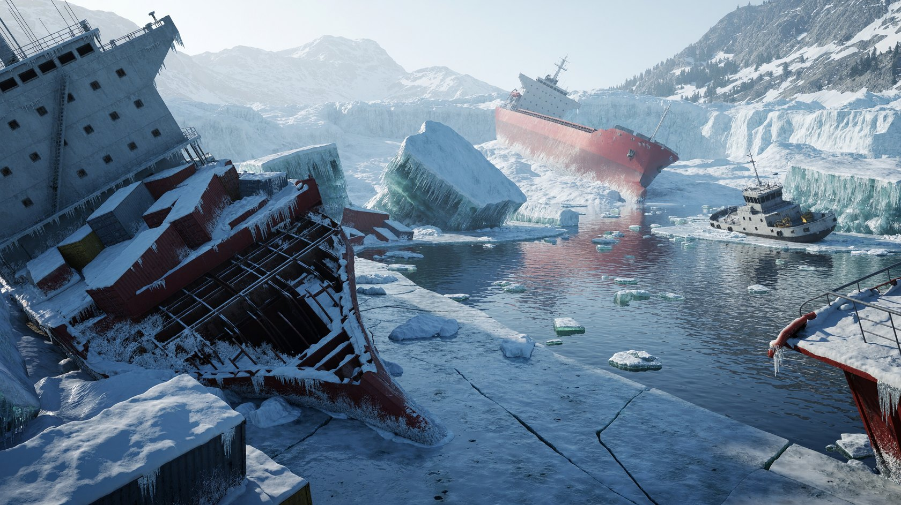

<blockquote>Abandoned shipwrecks in an intensely cold, frozen bay, in a 2.2:1 ultra-wide panorama, with a 24 mm wide-angle lens looking slightly downward. On the left, a tilted wreck is covered in snow and icicles, with rusty containers scattered across its deck. Central cracks in broken ice lead to a blue channel, translucent teal ice walls, and drifting ice floes and debris. A white-gray tugboat is grounded on the right, while a red cargo ship lies capsized among glaciers in the distance. Snowy mountains, ice cliffs, and sparse conifers fade into cold mist. Use an ice-blue and teal-gray palette punctuated by dark-red hulls. Cold daylight creates a dark-near, bright-far hierarchy, with a silent, desolate mood. Cinematic realism, authentic ice, snow, and metal materials, water reflections, deep depth of field, volumetric fog, 8K, no people, text, or watermarks.</blockquote>

#### Combat pilot

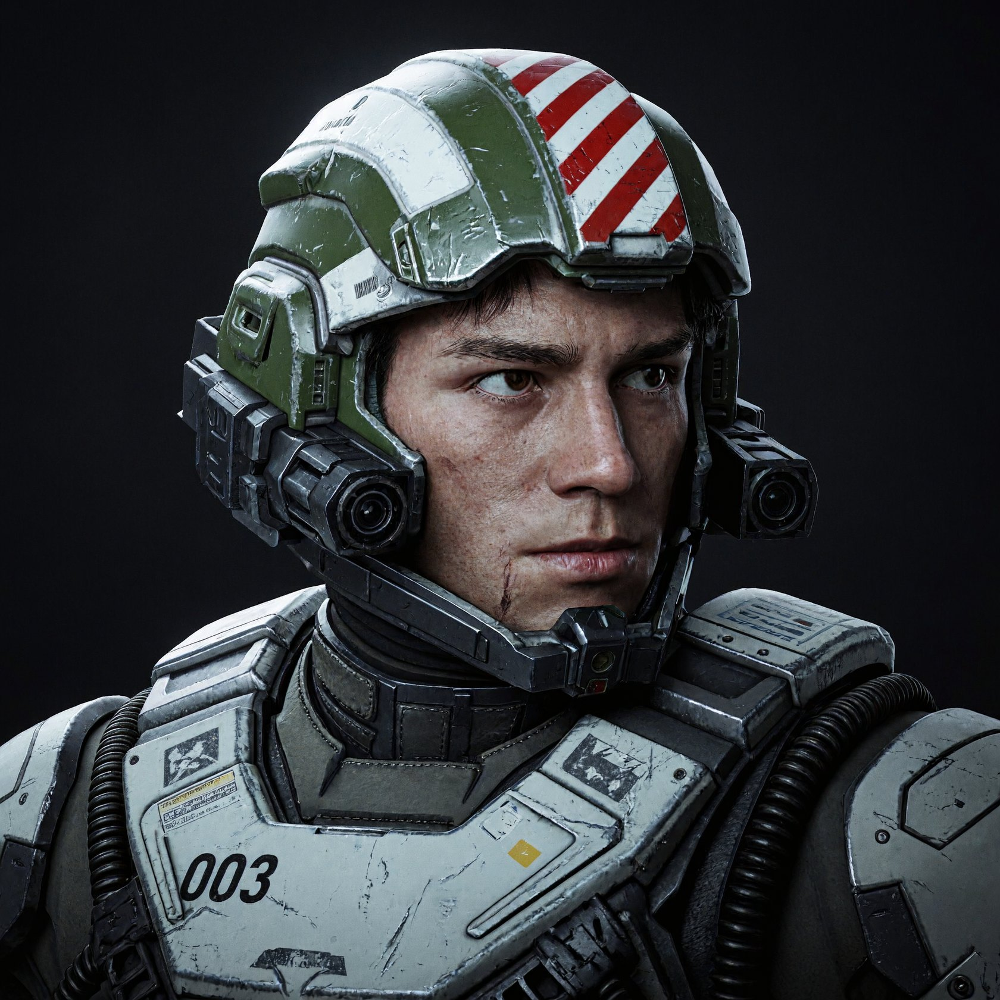

<blockquote>Aspect ratio 1:1. A close half-body portrait of a realistic futuristic combat pilot. The young man has a stern face, eyes glancing slightly right, and small abrasions on his cheeks. His hair is hidden inside a complex open-face armored helmet. The helmet has an olive-green and aged-white industrial shell, a red-and-white striped insignia on top, sensors, black optical lenses, communication boxes, and hinged brackets along both sides of the face, and a protective neck frame beneath the jaw. Thick white-gray chest armor features dark straps, hoses, the number “003,” stickers, and small warning markings, with scratches, dust, and chipped edges. Keep the subject close to the camera against a pure-black background. Soft cool light from the upper left outlines his face and equipment, emphasizing complex mechanical assembly, realistic skin, and military hard-surface materials. Output one complete artwork with no website borders, artist signatures, or watermarks.</blockquote>

#### Polar outfit, costume board

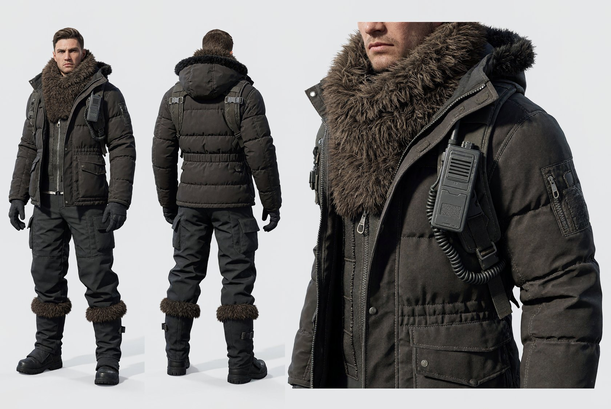

<blockquote>Aspect ratio 3:2, 4K. Create an original AAA costume board: full front view on the left, full rear view in the center and one construction close-up on the right, using the same adult model and outfit. Show realistic 3D drape, seams and fastening structures against pale gray without text. Scene: An insulated polar communicator outfit with fur collar, sealed cuffs and gaiters. Use original identities and designs without existing franchise names, characters, brand marks or watermarks.</blockquote>

#### Helmet on a red plain, key art

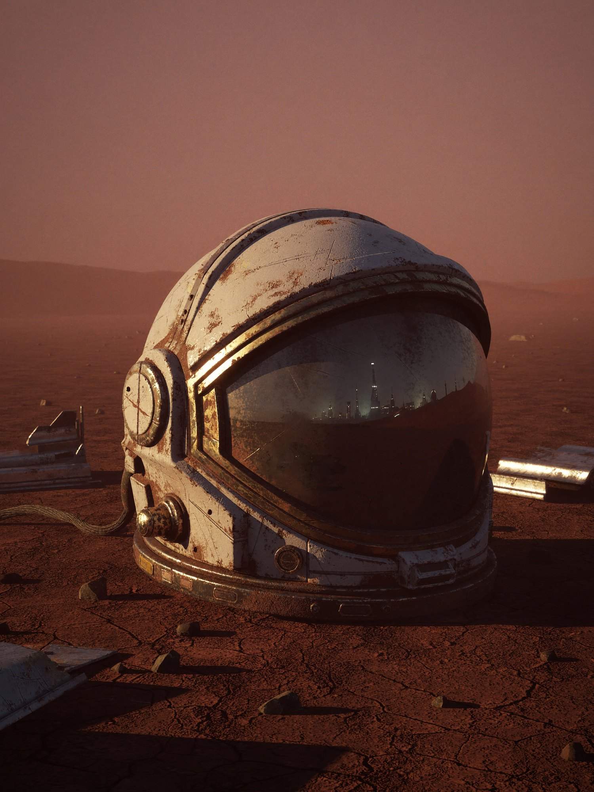

<blockquote>Aspect ratio 3:4, 4K. Create a portrait-format cover key visual for an original AAA game, using realistic 3D and dramatic but restrained cinematic lighting. Establish a clear focal point with one main character or central object. Keep approximately the top quarter quiet for later typography, and do not generate a title, logo, or text in the current image. Specific subject: a dust-covered astronaut helmet lying on a red wasteland, its visor reflecting a distant base. Do not use names, characters, or brand logos from existing works, and do not add a watermark.</blockquote>

#### Sci-fi fighter

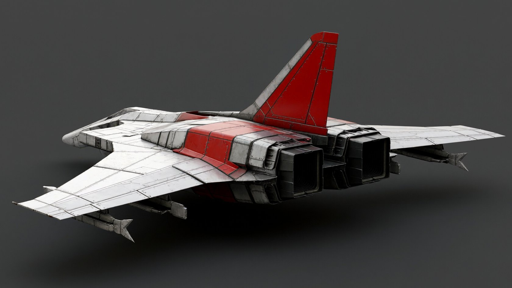

<blockquote>Aspect ratio 16:9. A realistic sci-fi fighter aircraft asset presentation from a slightly elevated rear three-quarter view. The fighter rests on neutral dark-gray ground, with a low, streamlined white-gray fuselage accented by red armor panels and red tail fins. Two large black rectangular exhausts sit at the rear, surrounded by layered machinery and cooling structures. Wings extend to both sides, with small payloads and slender equipment underneath, and a raised fin-like structure along the upper fuselage. Preserve clearly defined panel seams, panel thickness, metal connections, and light wear. Use soft overhead studio lighting and natural ground contact shadows, emphasizing the twin-engine layout and clean, readable hard-surface silhouette. Output one complete artwork with no website borders, artist signatures, or watermarks.</blockquote>

#### Modified muscle car

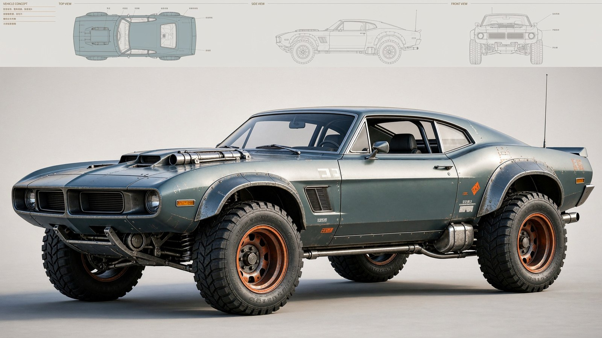

<blockquote>A detailed concept design presentation sheet of a modified sci-fi vehicle, in landscape format against a light warm-gray studio background. The subject is a heavily mechanically modified vintage two-door muscle car: a long engine bay, a low sloping windshield, a smooth fastback roof, and a short, substantial rear, with a wide body and an aggressive stance. Preserve the recognizable character of a classic road-going sports car while integrating mechanical details from near-future industrial equipment and post-apocalyptic off-road vehicles. 
 
Body Design: 
Use a muted gray-blue finish with a slight teal cast. Build the long hood from several broad metal panels with clearly defined creases, seams, and fastening bolts. The nose is low and wide, with separate black intake grilles on each side set within a thick metal frame, deeply recessed round headlights, and narrow amber light strips. Flare the front fenders, and construct the wheel arches from overlapping curved metal guards with visible rivets and mounting seams along their edges. 
 
Mount a low exposed mechanical power module at the center of the hood, including metal intakes, short cylinders, pipes, connecting brackets, and fasteners. Keep it close to the body so it does not disrupt the long nose silhouette. Add small triangular vents and vertical cooling louvers behind the front wheels. The wide doors retain simple mechanical handles and small mirrors; dark seats, a steering wheel, and a few roll-cage elements are visible through the side-window openings. Give the rear fenders a full, powerful shape, add a small rear spoiler, and extend a thin antenna vertically from the rear. 
 
Tires and Chassis: 
Use a four-wheel layout with broad, thick off-road tires at both front and rear. Give them clearly defined large-block tread patterns and restrained molded lettering on the sidewalls. Use deeply recessed rims with worn orange-copper outer rings and dark-metal mechanical centers, creating the vehicle's most prominent color accents. 
 
Raise the body moderately, leaving visible clearance between tires and wheel arches to expose suspension, dampers, and connecting brackets. Beneath the front bumper, show an open mechanical structure with a crossmember, round drivetrain components, metal protective frames, lines, and towing points. Slender metal links and protective bars run beneath the doors. A silver cylindrical tank with connecting pipes is visible ahead of the rear wheel, and a short, thick metal exhaust projects beneath the side of the rear. Concentrate mechanical detail around the lower front, chassis, and inside the wheel arches, while retaining larger uninterrupted metal surfaces on the doors and roof. 
 
Materials and Wear: 
The gray-blue paint has subtle semi-matte reflections, with slight chipping at some edges exposing dark-silver metal. Add small amounts of dust, grease, and wear around wheel arches, service hatches, door seams, and the chassis, with realistic rough rubber tires. Scatter a few faded white identification marks, orange industrial warning stickers, small numbers, and maintenance labels across the body, keeping them modest in size and logically placed for machinery. The overall condition should suggest prolonged use with good maintenance. 
 
Main View Composition: 
The vehicle occupies approximately 75% of the visual area in the middle and lower portions of the image, shown from a front-left three-quarter angle, with the nose pointing left and the rear extending right. Position the camera slightly above the headlights, using natural medium-to-long-lens perspective to show the hood, side door, both near-side wheels, and part of the roof. Leave adequate space around the car, keeping the nose, tires, rear, and antenna fully visible. The vehicle is parked on light-gray ground with clear contact shadows underneath, conveying a grounded, substantial, powerful stance. 
 
Supporting Views and Layout: 
Reserve an open technical-information strip along the top: a narrow column of small explanatory text and a few orange-brown divider lines at the upper left, a small top view of the same vehicle left of center, a small side view in the middle, and a paler front structural line drawing at the upper right. Use low-contrast gray-brown lines for the supporting views, with some pale gray-blue body-color areas, giving them clearly less visual weight than the main view. 
 
Align all supporting views along one horizontal baseline, with even spacing and very few fine leader lines, numbers, and short labels. Titles and labels may use short English phrases such as “VEHICLE CONCEPT,” “TOP VIEW,” “SIDE VIEW,” and “FRONT VIEW,” in a thin, condensed engineering sans-serif font. The result should resemble a highly finished industrial vehicle design dossier, with restrained typography, rich information, and a clear hierarchy. 
 
Lighting and Visual Style: 
Use a broad, soft key light from the upper left with a slight side-back light to reveal body facets, paint reflections, tire thickness, and layered chassis machinery. Keep the background a clean light-gray gradient with natural shadows. Use gray-blue, warm gray, dark metal, and small orange-copper accents. Realistic 3D hard-surface rendering, precision industrial-design materials, high clarity, and rich detail, with a retro, composed, rugged near-future character. 
 
Output one complete concept design presentation image with one large main view of the full vehicle and three small technical views at the top. No real car-brand logos, website interface, artist signature, or watermark.</blockquote>

### The Real World

#### Farm in the fog, documentary film photo

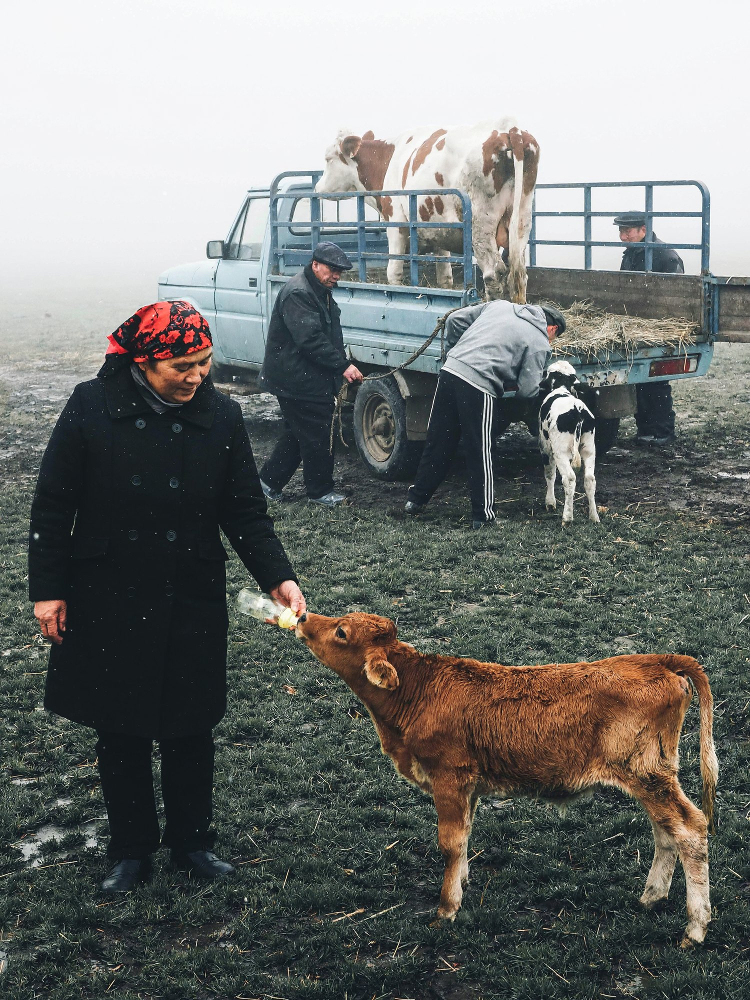

<blockquote>A real rural documentary photograph in portrait format, like an ordinary moment on a farm captured by a documentary photographer with a standard lens on film. Natural light, no artificial lighting at all, nothing staged. 
 
[Weather and Space] 
A foggy day, perhaps with fine snowflakes or drizzle drifting down; tiny white specks float in the air. The distance is completely swallowed by thick white fog: no horizon, buildings, or trees are visible, only an even fog-white. Fully diffused light, almost no shadows. 
 
[Foreground Subject: Woman and Calf] 
Left of center in the lower middle of the image, a woman in her late middle age stands on wet grass, taking up about half the height of the image. Her face is calm; she lowers her head slightly, looking at the calf at her feet. She wears a red-and-black patterned headscarf, a black double-breasted coat that reaches past her knees, black trousers, and black shoes. In her right hand she holds a feeding bottle, reaching down to feed the calf. 
To the right of her feet, a tawny calf raises its head and sucks on the bottle, docile. 
 
[Midground: Old Pickup and People Loading Cattle] 
Behind the woman, an old pale-blue single-cab pickup truck is parked on the grass. Its bed has added dark-blue steel side rails, the rear rails are swung wide open to both sides, and the bed is lined with hay. 
- In the bed stands an adult dairy cow, white with brown patches, facing left; 
- Beside the cab, a slightly hunched old man in a dark flat cap, dark jacket, and black trousers pulls with both hands on a rope tied to the truck; 
- Next to the open rail on the right at the back of the truck, a man in a dark flat cap and a work jacket keeps an eye on the bed; 
- Directly behind the truck, another man in a gray hoodie and black track pants with white side stripes bends over, reaching into the bed with his upper body to work; 
- On the ground beside the back of the truck, a black-and-white calf, side-on or facing away from the camera, stretches its head into the bed to eat hay. 
Everyone is busy with their own task; no one looks at the camera. 
 
[Foreground Ground] 
Dark, wet grass and messy weeds, with patches of bare mud. 
 
[Lens and Composition] 
A full shot from a roughly eye-level camera, slightly low, at about the height of the woman's chest. A standard 35mm to 50mm focal length, natural perspective, no distortion. Medium depth of field: the woman and calf are relatively sharp, the pickup and people behind them are complete but slightly soft, and the distance is naturally swallowed by the fog. 
 
[Color and Image Quality] 
Cool tones, blue-green overall and leaning gray, low saturation. The main colors are fog white, blue-gray, the deep black of the clothes, the dark green of the grass, and the retro pale blue of the pickup; the red of the woman's headscarf is the only warm accent. Contrast is moderate to low, highlights in the fog are slightly overexposed to white, and the image has a soft, diffused feel and medium film grain. No text, watermarks, or interface elements anywhere in the image. 
 
The overall mood is plain, vast, and quiet, with the feel of everyday work and a touch of tenderness between people and animals. Not CG, not an illustration, not staged: a real photograph.</blockquote>

#### Picnic on film

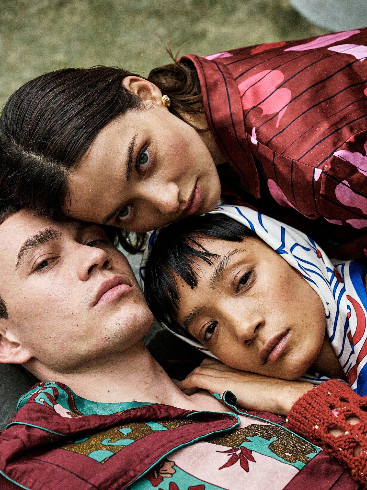

<blockquote>A vintage film-look outdoor fashion lifestyle photograph: three adult friends picnic lazily among lavish woven rugs on the grass. The mood is quiet, intimate, and languid, with a bohemian style and an autumn pastoral feel. Landscape format, aspect ratio 3:2, shot from a slightly high camera angle looking down at a slant, a medium close-up group composition. The people and textiles occupy the lower middle of the image, with naturally growing dark-green grass as the background, keeping some environmental space. 
 
Slightly above the center, an adult woman sits on the rug, with straight shoulder-length dark-brown hair parted naturally in the middle, wearing a loose rose-red long-sleeved shirt with a turn-down collar, its fabric covered in dark burgundy abstract botanical patterns. Her body faces the camera while her face turns to the left of the image; her expression is calm, her gaze far away, and her hands rest naturally near the shoulders and arms of the friends beside her. She is the top point of the triangular arrangement of figures, and her bright top is the main visual focus against the dark-green surroundings. 
 
In the lower-left foreground, an adult man with short hair reclines on the rug and cushions, his head near the center of the image and his legs stretched toward the lower left corner, one leg slightly bent, wearing loose teal-blue trousers. His chest and shoulders are bare, loosely and partly covered by a fabric with a dark ground and large cream and ochre-yellow leaf patterns; one hand rests lightly on his chest, and his expression is relaxed. On the right, an adult woman lies on her side with her head resting beside the seated woman. She wears a light printed headscarf, a chunky-knit cardigan in grayish rose, and trousers with burgundy spots on a cream ground; her bare feet stretch to the right, her arms are bent naturally, and she looks gently at the camera. 
 
The ground is covered by a large black and ochre-yellow animal-print rug with a fine red border all around, layered with several thin blankets printed with botanical patterns in teal, golden yellow, burgundy, and cream. Decorative cushions of different shapes sit by the people's heads and in front of their waists, including long pink and teal leaf-pattern bolsters and square cushions with brownish-red illustrations on a cream ground and bright yellow sides. Render in detail the thick loops of the knit cardigan, the creases of the cotton, and the pile and tassels of the rug, so the intricate patterns form rich but harmonious layers. 
 
On the left of the image, arrange an abundant, natural picnic still life: a rattan basket with a long baguette, a blue-and-white striped napkin, and a bunch of rustic flowers and grasses with small pale blossoms; behind the basket, on a wooden crate, a white footed cake stand holds a dark-brown fruit tart. On the wooden crate in the lower left corner are blue-and-white ceramic bowls and plates, purple-red grapes, a cut watermelon, and a few warm-colored fruits, some cropped naturally by the frame. In the left foreground, add a cluster of dark-green plants close to the lens and clearly out of focus, partly covering the basket and the background, so the picnic seems glimpsed through the greenery. 
 
Use soft, natural diffused light with a slightly warm side sheen; skin tones are real and soft, and the shadows keep their detail. The palette is mainly olive green, burgundy, rose pink, teal blue, and ochre yellow, with low to medium contrast, slight fading, fine film grain, and slightly deep shadows; avoid oversaturation and the slick finish of a commercial studio shoot. Parameters: focal length about 40mm, aperture about f/4, shutter about 1/250 s, ISO 400, medium depth of field; the people and main textiles are sharp, the nearby plants clearly blurred, and the background grass soft but recognizable; high resolution, realistic body proportions, natural skin texture, no text, no watermarks, no interface buttons.</blockquote>

#### Close-up portrait on film

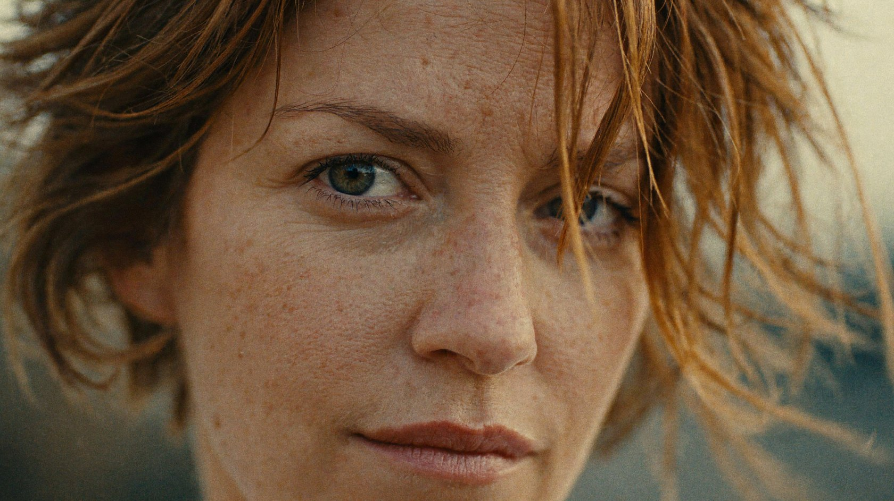

<blockquote>A realistic cinematic film-style portrait close-up. In the center of the image is an adult woman's face: fair skin, short light reddish-brown hair that is naturally fluffy, gray-green eyes looking at the camera, and a calm, slightly thoughtful expression. The face keeps real skin texture, fine freckles, and natural coloring; the eyebrows are thin and soft, the eyelashes distinct, and the lips a low-saturation rose, gently closed with no teeth showing. 
 
Use an extremely close frontal composition, with the face filling almost the whole image area; the top of the forehead and the chin are cropped by the frame, and the lips are near the bottom edge. The eye on the left of the image is complete and sharp and is the main visual focus; the other eye is partly covered by hair sweeping across the face. The bridge and tip of the nose sit just below the center, and the composition is slightly asymmetrical, giving a natural candid feel. 
 
A light breeze moves the light chestnut-brown hair; strands with a coppery-gold sheen sweep diagonally from the top of the image to the right, forming soft arcs with slight motion blur. A few fine hairs fall across the forehead, brows, eyes, and cheeks, contrasting with the sharp eye, nostrils, and lips; the hair falls in natural layers, avoiding a neat, stiff style. 
 
The light is soft, warm natural light that lights the face evenly, with faint shadows beside the nose and on the cheeks and delicate transitions between light and dark; no strong hard light or obvious rim light. The overall tones are warm amber brown, light beige, and low-saturation gray-green; the background is heavily blurred, showing only a few blurred patches of color on either side of the face, with no recognizable environmental detail. 
 
Give it the feel of a frame from vintage film footage: low to medium contrast, soft highlights, fine grain, slight fading and soft focus, while keeping real detail in the eyes and skin. The edges of the image are slightly softened; no text, no watermarks, no logos. 
 
Parameters: overall aspect ratio about 16:9; inner image ratio about 7:5; shot size: extreme close-up of the face; focal length 85–105mm; aperture f/2.0–f/2.8; shallow depth of field; focus on the eye on the left of the image; warm white balance; low saturation; soft contrast; fine-grain film texture; slight motion blur in the hair; natural skin texture; avoid heavy skin smoothing, oversharpening, and strong beauty filters.</blockquote>

#### Snapshot from an old phone

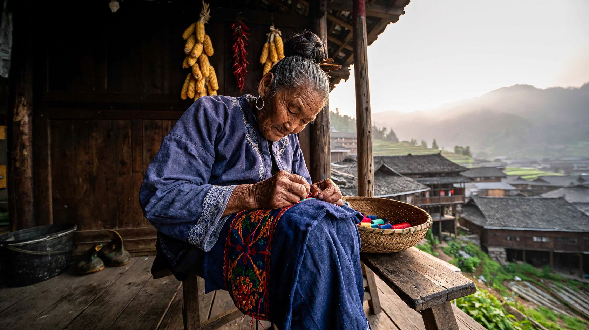

<blockquote>A photo taken with the rear camera of an iPhone 7, the phone held sideways, straight out of the default camera mode: no beautification, no filters, no editing. It looks like a photo casually taken in 2017 by someone traveling to a Miao village in Qiandongnan, Guizhou, while passing under the veranda of a home early in the morning. 
 
[Scene] 
A Miao village in the early morning, with thin mist still in the mountains. A Miao grandmother of about seventy sits under the veranda of her wooden stilt house, head lowered, absorbed in embroidery. On her knees lies an embroidered panel with an indigo ground and red, orange, and green Miao embroidery patterns, and she holds a needle and thread. She wears an everyday dark-indigo top with hand-embroidered trim on the sleeves and collar; her hair is coiled into a high bun with a wooden comb in it, and she wears old silver earrings. Her face is wrinkled and her skin tanned dark by the sun; her expression is calm and focused, and she has not noticed the camera. 
On a wooden stool beside her sit a woven bamboo sewing basket and a few balls of colored thread; behind her is a smoke-blackened plank wall hung with strings of dried corn and chili peppers, with a plastic bucket and a pair of rubber shoes in the corner. Beyond the veranda, in the distance, layers of black-tiled stilt houses and terraced fields stand in the mist. 
 
[Realism] 
The grandmother is a real, ordinary villager, as she looks during everyday work, not a model in festival dress. Her skin, hands, and clothes look as they naturally do in daily life, without deliberately emphasizing flaws. 
 
[iPhone 7 Image Quality] 
A 12-megapixel single phone camera with a 28mm-equivalent wide angle and an f/1.8 aperture. In daylight the image is clean and clear and the subject sharp, with enough detail but no oversharpening. Fairly deep depth of field: the background is only slightly softened, with no portrait-mode blur. The colors are the natural, slightly warm, moderately saturated straight-out-of-camera colors of that generation of iPhone, with true skin tones. Limited dynamic range: the mist and sky beyond the veranda are bright and slightly overexposed, while the shadows under the veranda are dark and keep a little fine-grain noise, without the strong HDR brightening and algorithmic smoothing of modern phones. The composition is casual, with the grandmother left of center and the frame slightly tilted. Not a DSLR, not professional photography, not cinematic, not CG, not an illustration: a real, clear, natural photo from an old iPhone.</blockquote>

#### Flash portrait on film

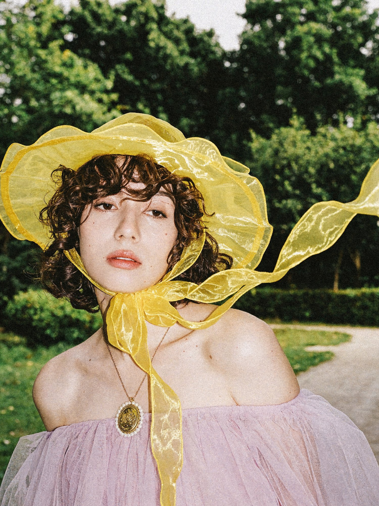

<blockquote>A vintage, dreamy direct-flash film fashion portrait, 3:4 portrait format. 
A young woman of about twenty with fair skin, short dark-brown curly hair, and slightly curled bangs, with defined, delicate features. She wears a soft wide-brimmed hat of bright amber-yellow translucent organza, its brim gently undulating, with two long ribbons of the same fabric tied under her chin; one ribbon is lifted by the wind and flies toward the right of the image, covering part of it. She wears a pale pinkish-lavender strapless dress with a translucent, pleated, gauzy texture; around her neck is a fine gold chain with an oval embossed antique gold medallion pendant, its edge set with a ring of small pearls. 
Her body is turned slightly and her head faces almost straight ahead; her gaze is calm, cool, and absent, looking forward, her lips slightly parted, distant and reserved. An outdoor garden background of blurred green trees, lawn, and a pale path, with a slightly staged feel. A medium close-up portrait, the figure toward the lower left, the right side left for the lifted yellow ribbon, eye-level camera. 
A flash fired straight on from the front, hard light, obvious highlights on the face, the background slightly darker; color temperature neutral to slightly warm. Palette: bright yellow (dominant), pale pinkish lavender, forest green, pale skin, and gold. 35mm film texture with visible grain, medium depth of field, background lightly blurred. Vintage, dreamy, avant-garde, slightly melancholy and aloof. A single photo, with no text, watermark, or border.</blockquote>

#### Grandma's birthday, home video

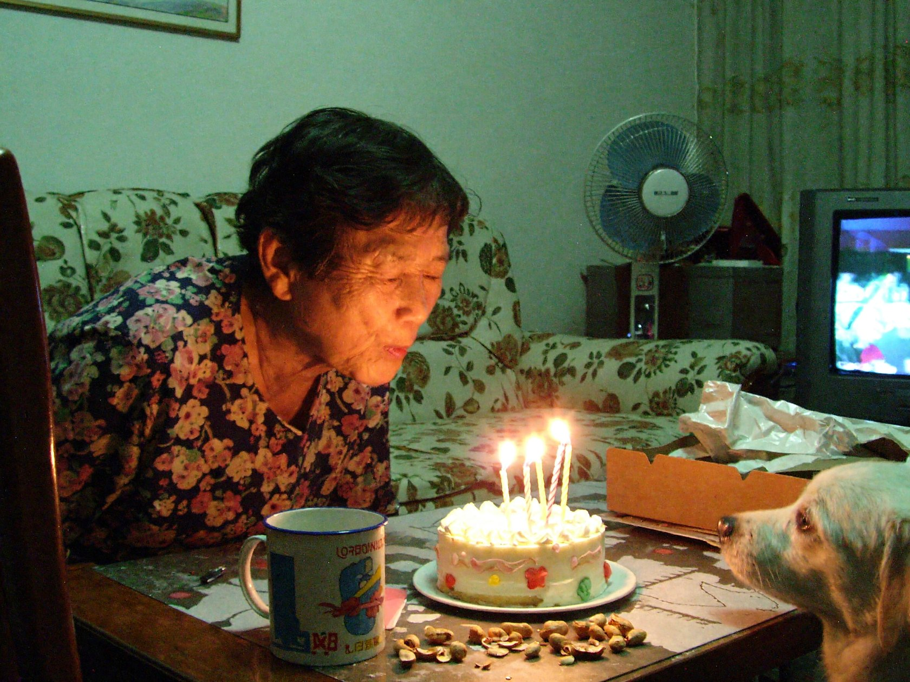

<blockquote>In the living room of an ordinary old residential building, a Chinese grandmother in her sixties, wearing an everyday floral house shirt, leans forward to blow out a few candles on a small cake, her eyes closed for a moment, smiling. On the low coffee table are peanut shells, an enamel mug, and a crumpled cake box; a small white dog pokes its nose toward the cake from the lower right corner. In the background are a floral sofa, a standing electric fan, and an old TV showing only a blurry glow. A close, eye-level handheld shot, with the grandmother off to the left and the back of a chair near the camera blocking one corner. The main light comes from a greenish ceiling lamp and the orange-yellow candlelight; the shadows in the room are a little muddy, and the candle flames have small halos. Not a carefully planned birthday portrait, but the instant a family member suddenly pressed record. 
 
The image looks like a frame from a real home video shot on an ordinary consumer MiniDV camcorder around 2001: landscape 4:3, with the unretouched feel of a private recording. A small CCD sensor, soft standard-definition detail, fine colored digital noise in the shadows, slight color bleeding and compression artifacts, automatic white balance with a bit of a color cast, highlights allowed to blow out, and slight natural smearing where people move; even when output at a large size, keep the information density of the original low-resolution footage. The handheld camera is slightly tilted, the composition has incidental obstructions and edge cropping, the depth of field is deep, and the real setting is clearly recognizable. No polished cinematic lighting, film-grain filters, simulated VHS lines, exaggerated light leaks, skin smoothing, commercial posing, or CG rendering look. The image fills the canvas, with no border, date or time stamp, recording indicator, subtitles, or watermark. Generate only one complete photo.</blockquote>

#### Rooftop at dusk

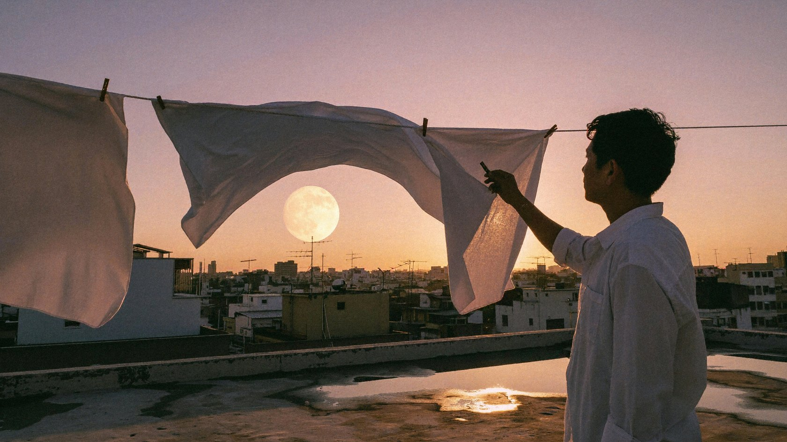

<blockquote>An old city rooftop at dusk in late summer. Several clotheslines cross the foreground, with white sheets lifted by the wind into soft waves. Through the gaps, show dense distant rooftops, antennas, and a low pale-gold moon. On the right, a backlit person in a white shirt takes down laundry, visible as a clear profile silhouette. The concrete rooftop has warm-gray textures and shallow puddles. The sky transitions from rose pink to smoky purple, and sunset rim light passes through the fabric. Combine the authenticity of an everyday-life documentary with the poetic composition of a cinematic still. Use a 35 mm lens, natural wind, and slight film grain, without an excessive romantic filter. 
Real photographic and cinematic-still texture. Prioritize natural light and physically credible reflections, with a clear visual focal point and breathing room. Keep colors restrained with one or two narrative accents, finely realistic materials, and natural human gestures. Retain moderate 35 mm film grain, gentle highlight bloom, and realistic depth of field. The image should be refined, rewarding to look at, and capture a narrative moment. Avoid cheap-looking CG, plastic skin, excessive sharpening, HDR halos, randomly added objects, watermarks, borders, logos, or unnecessary text.</blockquote>

#### A pause before tea

<blockquote>Photograph a realistic portrait of a curly-haired person pausing before drinking tea. Include the head, shoulders, upper chest, and both hands holding a dark ceramic cup, with the face slightly turned. Warm light from the rear right grazes the hair against a darker interior wall. The edges of loose curls and a few flyaway strands glow translucently, with the dark background still visible between strands. Dense locks remain dark inside, and the bright rim breaks naturally where strands occlude one another. Very weak soft light from the camera's front left illuminates the face so the eyes, cheeks, and fingers remain visible. Only the edges of the ear and shoulder facing the rear light are lit. The ceramic cup has a broad, weak surface highlight, with contact shadows where its rim meets the fingers. Focus should cover the eyes, outer hair strands, and cup rim.</blockquote>

#### Flamingos at dawn

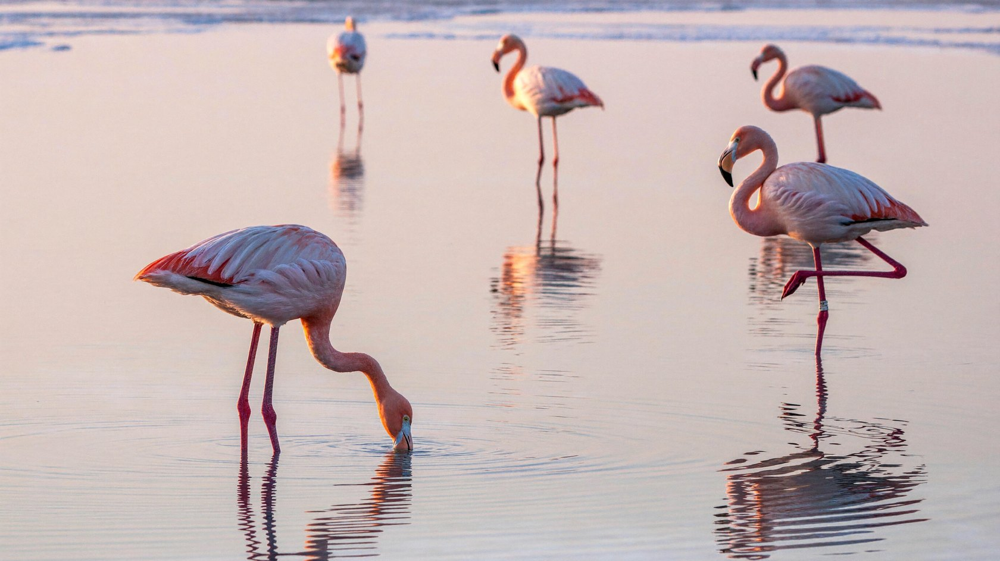

<blockquote>In the shallows of a salt lake at dawn, five flamingos are spread across a broad, mirror-like water surface. The nearest bends its head to feed, the second stands on one leg, and three distant birds create a gentle rhythm of pink. The lake reflects a pale-pink sky and distant white salt crusts. Use an eye-level telephoto composition with water filling almost the entire frame and ample breathing room between the birds. Feather colors should have delicate gradations from grayish pink to coral pink. Water ripples, reflections, salt crusts, and bird legs must be realistic. Elegant nature photography, without crowded flocks or highly saturated cartoon colors. 
Real photographic and cinematic-still texture. Prioritize natural light and physically credible reflections, with a clear visual focal point and breathing room. Keep colors restrained with one or two narrative accents, finely realistic materials, and natural human gestures. Retain moderate 35 mm film grain, gentle highlight bloom, and realistic depth of field. The image should be refined, rewarding to look at, and capture a narrative moment. Avoid cheap-looking CG, plastic skin, excessive sharpening, HDR halos, randomly added objects, watermarks, borders, logos, or unnecessary text.</blockquote>

### Surreal Worlds

#### A cloud in a barber chair

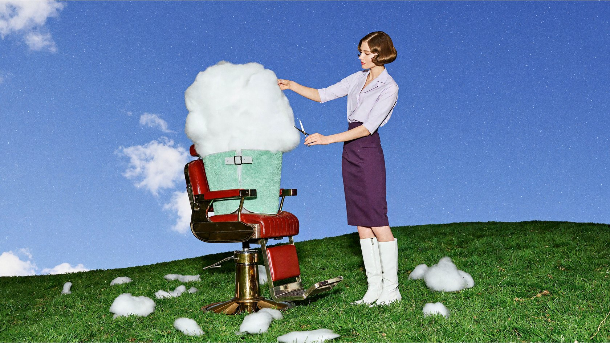

<blockquote>A retro, playful, refined surreal fashion photograph. A cherry-red barber chair stands on a vivid green hill, with an enormous white cloud seated in it, its fluffy body wrapped in a mint-green barber cape. An adult female model in a pale-purple short-sleeved blouse, dark-purple pencil skirt, and white tall boots stands beside the chair, carefully trimming the cloud with silver scissors while lifting one corner of it with her other hand. Small cut-off tufts of cloud lie scattered on the lawn like freshly cut hair. The model has a neat retro short haircut and a focused expression. Use a low-angle wide shot with blue sky filling most of the frame, a simple set, and vivid colors. Give it the look of a live-action fashion editorial, with soft translucent cloud details, credible volumetric shadows, slight direct-flash fill, and film grain, without a cartoon feel. Landscape 16:9, no text.</blockquote>

#### Slicing the moon

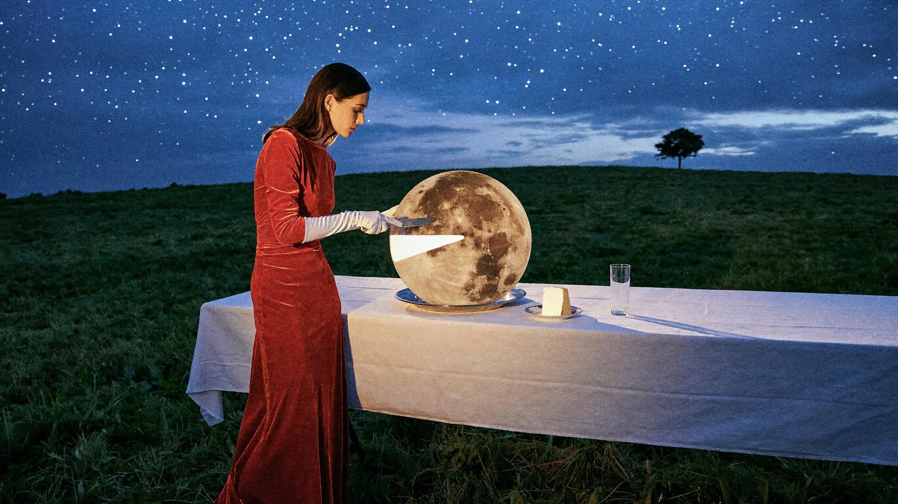

<blockquote>A surreal fashion photograph with the texture of a retro film set. Beneath a cobalt-blue twilight sky, a long dining table covered with a white tablecloth stands on a green hill. An adult female model in a tomato-red velvet gown and long white gloves stands calmly at one side, using a silver dinner knife to cut a small wedge from an enormous full moon on a plate. The moon stands upright like a round cake, retaining realistic craters on its surface. The cut interior emits a soft milky-white glow, and the removed moon slice rests securely on a small porcelain plate beside it. Moonlight illuminates her gloves and jaw, while glasses on the table cast long, slender shadows. There is no second moon in the sky, only a lone small tree in the distance. Elegant, absurd, and subtly deadpan, with the photographic feel of real people and practical props, fine film grain, landscape 16:9, no text.</blockquote>

#### A pear as a dressing room

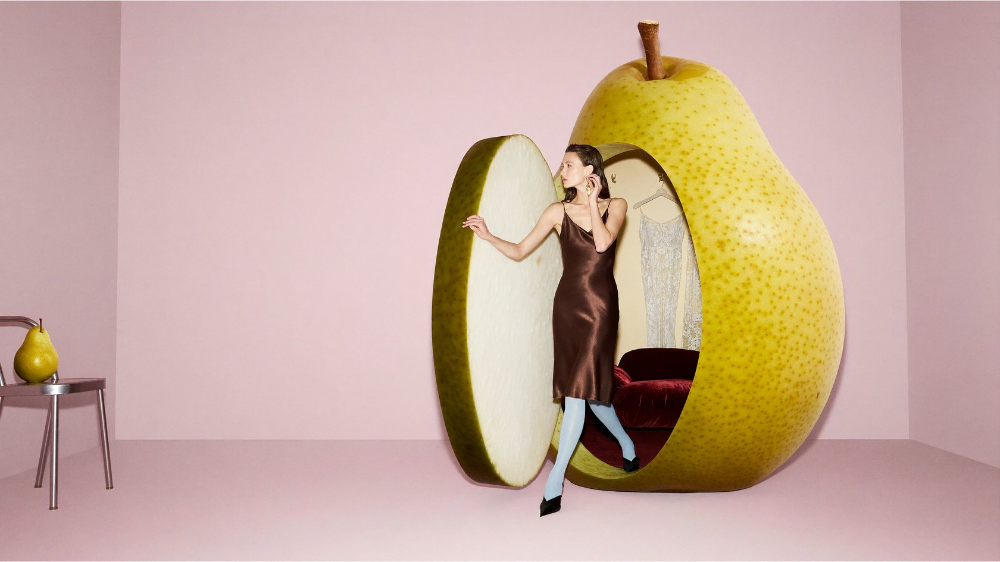

<blockquote>A surreal photograph for a 2000s avant-garde fashion magazine. In a pale-pink studio, a three-meter-tall yellow-green pear has been converted into a changing room. A small round-cornered doorway is cut into its skin, with the door retaining a thick cross-section of peel and milky-white flesh. An adult female model steps one foot out of the pear, wearing a chocolate-brown satin dress, pale-blue tights, and pointed shoes. One hand rests on the doorway while the other adjusts an earring, with a nonchalant expression. The interior is lined with burgundy velvet padding and contains two elegant hanging garments. A normal-sized pear rests on a small silver chair nearby, establishing a clear scale contrast. Use an off-center composition with clean empty space, soft studio light, and a slight frontal flash. Pear-skin pores, juicy flesh, velvet, and satin all have tactile, realistic textures, with the look of a carefully constructed physical set. Landscape 16:9, no text.</blockquote>

#### Cut-paper collage

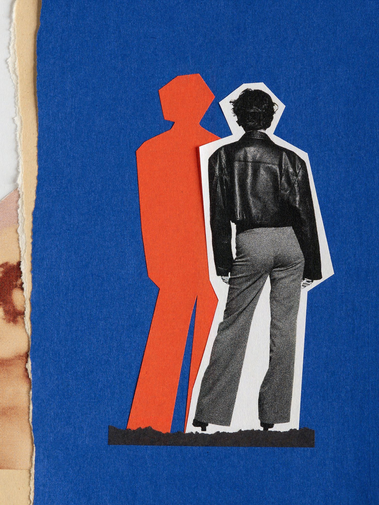

<blockquote>A 3:4 portrait abstract collage combining vintage fashion-magazine photography, hand-cut paper, and street-poster print textures. Rich cobalt-blue paper fills about two thirds of the image, with white space at the upper right. Slightly right of center, place a full-body black-and-white film-photo cutout of an adult woman, back to the camera and leaning slightly right, wearing a broad-shouldered cropped jacket and loose trousers. Retain coarse grain, deep-black shadows, and an irregular thin white paper edge. Layer a solid orange-red silhouette along her outline, offset to the left, with no facial or clothing details. Place a short, thick charcoal-black paper strip horizontally beneath her feet. A narrow torn-paper strip along the left edge reveals cream backing paper and faded photo fragments. Show genuine cut edges, paper fibers, uneven ink, and photocopy halftone dots, with the texture of a flat, high-resolution scan. Simple and forceful, with no text, logos, frame, or staged setting.</blockquote>

#### Sticker-residue type poster

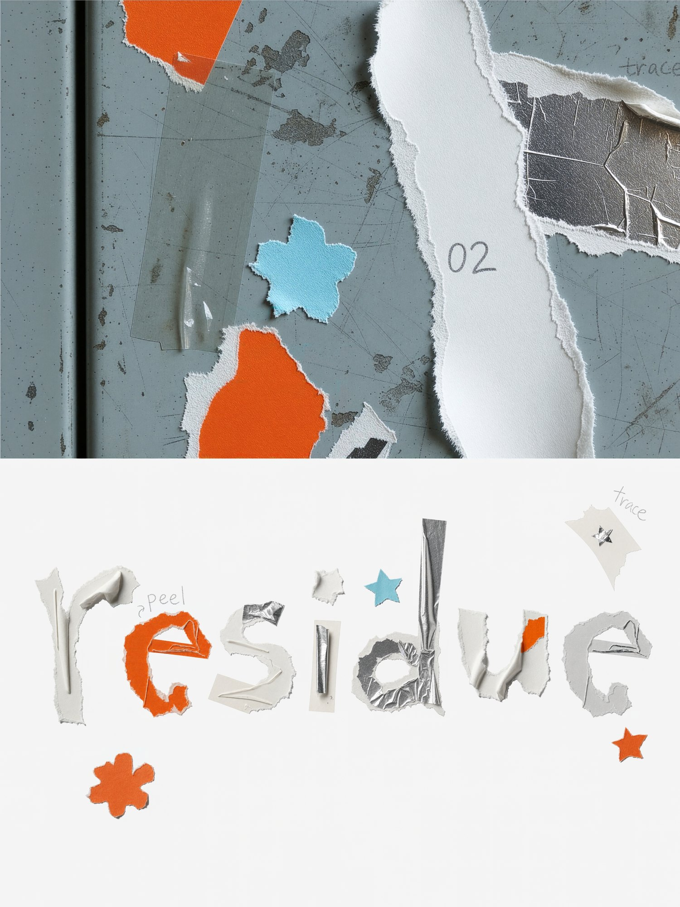

<blockquote>An experimental typography poster themed “After the Stickers Are Gone,” portrait 3:4. The upper 55% is a macro view of a worn cool gray-blue metal cabinet door, with remnants of transparent tape, milky-white torn paper, fluorescent-orange labels, and curling silver film, punctuated by fragments of blue flowers and orange stars. Soft side light emphasizes fibers, adhesive residue, and wear. 
The lower 45% has a pure-white background, with the lowercase word “residue” formed from the actual outlines of the materials, spanning about 90% of the width. Letters combine orange paper edges, translucent adhesive film, and silver film; the long ascender of the d is tallest. Vary their heights and thicknesses while keeping them clearly legible. Do not fill a standard font with images. Add sparse blue and silver paper stars, blue tape, and a half-torn orange flower. Include a few faint pencil lines with tiny annotations “peel,” “trace,” and “02,” short arrows, and unfinished star shapes. Use authentic photography and handmade-collage textures, playful but restrained with ample whitespace. No heavy 3D, additional text, or watermark.</blockquote>

#### Pixel cat poster

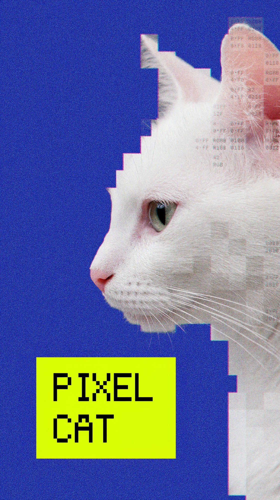

<blockquote>Generate an experimental pixel-art poster with a cobalt-blue background. The subject is the profile of a white cat facing left, ears upright, eyes half closed, and an aloof expression. Build its silhouette from hard-edged white, light-gray, and pale-pink squares of varying sizes. Retain a few real photographic details in the eye, nose tip, and some whiskers; simplify the cheek into medium-sized pixels; and gradually dissolve the back of the head into larger translucent squares. Establish clear changes in pixel scale across different areas. 
Fill some squares with tiny monospaced letters and numbers to suggest an image divided, sampled, and quantized by a program. Place a small fluorescent-yellow rectangle in the lower left containing “PIXEL CAT” in black pixel lettering. Use an off-center composition with a large area of blue negative space, retro print grain, slight color-registration offsets, and a low-resolution screen texture. The result is a flat digital-collage poster in which the squares form the cat's shape, without a 3D cartoon character or watermark.</blockquote>

### Artistic Worlds

#### Mandarin ducks, Old Master oil painting

<blockquote>An oil painting on canvas in the style of a 17th-century European Old Master, depicting Chinese mandarin ducks and a lotus pond. At the center, a pair of mandarin ducks swim close together on the dark pond: the male has brilliant plumage, orange-red sail-like feathers, a crest with purple-green metallic sheen, white eyebrow markings, and a red bill; the female is understated gray-brown with a white stripe behind the eye. Their heads and necks incline gently toward each other, with a quiet, affectionate air. Surround them with lotus leaves of late summer and early autumn, some full and dark green, others with scorched, curling edges. At the upper right, show a half-open pink-white lotus and a drooping seedpod. Use Rembrandt-like chiaroscuro, with a warm beam of side light from the upper left falling on the ducks while the rest recedes into deep olive-green and amber-brown shadows. The water is an ink-dark mirror reflecting the ducks and lotus flowers, disturbed by tiny ripples. Combine impasto with thin glazes: raised paint on feather highlights, clearly visible brushwork and canvas texture, and aged varnish lending a warm golden cast and fine craquelure. A stable composition with large dark areas of breathing room, poetic and serene, a museum-quality masterpiece.</blockquote>

#### Fishermen and a pelican, Caravaggio style

<blockquote>Oil painting in the style of Caravaggio, dramatic chiaroscuro, dark background. Two old fishermen in ragged clothes pull a wet fishing net out of a wooden boat. A pelican is caught in the net, its beak and one wing poking out through the holes as it struggles. The rope mesh wraps around its body and stretches tight between the fishermen's hands. A single beam of light from the upper left falls on the pelican's white feathers and the men's faces.</blockquote>

#### Table tennis, Caravaggio style

<blockquote>A Caravaggio-style oil painting of a group of 17th-century Italian townspeople playing and watching a singles match in a modern table-tennis hall. All six retain Baroque-era appearances, natural curls, and coarse linen shirts, wearing brown short jackets, wool capes, fitted-waist dresses, or knee breeches with leather boots, with no modern sportswear. The table cuts diagonally from the lower foreground toward the rear right, clearly showing its green surface, white boundary lines, taut central net, and two rubber-faced paddles. A small white ball bounces over the net toward the foreground. On the near side, a young man in a reddish-brown jacket leans forward and steps into a stroke, while a white-shirted man opposite lowers his center of gravity for the next return, their actions responding to one another. An older woman at the front left grips the edge of her cape; a girl behind her follows the ball over her shoulder. Of two men at the rear right, one leans forward with a hand on a chair back while the other raises a hand to indicate the score. Overlapping figures create depth. The sole main light enters through a high window at the upper left, concentrating on the hitter's cheekbone, forearm, and the white ball, while the spectators' faces recede in layers into warm-brown darkness. Natural flesh tones, creamy white, and ocher red dominate. Give the wooden floor and matte-coated tabletop distinct textures. Shape fingers and clothing folds with subtle transitions, thin glazes, and restrained highlights, preserving the weight of a complex multi-figure narrative oil painting. Avoid uniformly thick coarse textures, crackle filters, and a photographic look.</blockquote>

#### Mandarin ducks in a Suzhou garden, Impressionist oil painting

<blockquote>A physical French Impressionist oil painting on canvas, in portrait format, depicting mandarin ducks playing in the morning mist of a classical Suzhou garden. It should look as though Monet, late in life, painted beside a garden pond in Suzhou with thick oils and coarse hog-bristle brushes, working directly from the morning fog. Evoke the original paintings Impression, Sunrise, Water Lilies, and the morning-mist works in the Rouen Cathedral series: forms dissolve in light and fog, yet every inch of the painting has visible brushwork and pigment. This is Western oil painting, with no ink wash, gongbi outlines, inscriptions, or seals. 
 
[Scene Content] 
Water occupies roughly the lower 60% of the painting. Slightly left of center in the lower middle, a pair of mandarin ducks play facing each other, suggested with only a few strokes. The male's thick orange-red strokes are the painting's only rich, warm accent, like the red sun in Impression, Sunrise; the female is a soft gray-brown mark. Loose pink and blue-green patches of water lilies and lotus leaves float around them. 
On the right of the midground, a zigzag stone bridge and lakeside Taihu rocks become a few pale violet-gray strokes. 
In the distance, occupying roughly the upper 40%, a whitewashed wall, a circular moon gate, and a pavilion with upturned eaves dissolve into ghostly pale-lavender and creamy shapes in the mist. Only the wall's undulating top, the curved eaves, and a faint circle remain barely recognizable. At the upper left, weeping willows become descending green-purple strokes; at the upper right, a flowering tree becomes clusters of pink marks. All architectural reflections dissolve and tremble on the water. 
 
[Atmospheric Softness] 
Dense, moist morning fog fills the entire image. The air itself is light blending pink-purple, pale gold, and gray-blue. There are no outlines and almost no boundaries between water, air, and the far bank; forms emerge only through slight differences in color temperature. Keep the whole image soft and high-key, with colors at similar values. Shadows contain only pale purple and pale blue, with no black. 
 
[Brushwork — Most Important] 
The atmospheric softness must come entirely from interlocking brushstrokes of similar value, never from blur. There must be no soft focus, airbrushed gradients, smooth transitions, or digital blur anywhere. Even the fog itself consists of individually countable strokes of paint. 
Fill the canvas with clearly visible, free, varied-size brushstrokes: comma-shaped marks, short dashes, and broken strokes, about a finger's width. Each must show its beginning, end, and the fine grooves left by hog bristles. 
Vary stroke direction with the subject: layers of short horizontal marks across the water; trembling vertical strokes for reflections; long, descending curved strokes swept rapidly through the willows; loosely woven diagonal strokes for sky and fog; and short curved strokes circling the ducks like spreading ripples. 
Give the paint real thickness. Lit areas, water lilies, and the male duck's orange-red accents use obvious impasto, with raised paint and small ridges at the edges that appear sculptural in side light. In darker areas, dry-brush strokes reveal underlying colors and the weave of coarse canvas. 
Juxtapose unmixed pure colors between brushstrokes: pink-purple beside pale gold, gray-blue beside pale rose. Work wet-on-wet, allowing some local dragging and mixing by the next stroke, but never smoothing the surface flat. 
 
Up close, the work is all expressive brushstrokes and pigment; only from a distance do they coalesce into a garden in the mist. A museum-quality Impressionist masterpiece with the material presence of a work in the Musée d'Orsay collection.</blockquote>

#### The Sun, illuminated manuscript

<blockquote>A medieval illuminated manuscript illustration with gold leaf and a wide border of curling vines. A rooster in a short red cloak stands upon a stone platform above a sleeping town. It grips a thick cord in its beak and leans backward with its whole body, pulling open a heavy dark blue curtain that covers the sky. Behind the lifted curtain appears a great golden sun with a calm human face. Below, small red roofs, a church tower and a few open windows mark the town beginning to wake. The rooster’s feet are firmly planted, its effort shown through its awkward, determined posture. 
 
Flat perspective, dark ink outlines, opaque tempera on aged parchment. Rich red, ultramarine blue and gold. A broad blue border filled with curling gold foliage and red blossoms. Worn gilding and slightly irregular hand-painted forms. A small numeral XIX above, and THE SUN in a parchment cartouche below.</blockquote>

#### The Jade Rabbit, illuminated manuscript

<blockquote>A medieval illuminated manuscript illustration with gold leaf and a wide border of curling vines. Beneath an old osmanthus tree, the Jade Rabbit of Chinese folklore stands beside a blue-grey stone mortar. Wearing a simple red cloth sash, it grips a long jade pestle and carefully grinds a single ivory crescent moon into fine golden powder. Part of the crescent remains intact inside the mortar. Small osmanthus blossoms fall onto the stone rim, and several folded medicine packets lie nearby. The rabbit works with the solemn concentration of an old apothecary. The deep blue sky contains a few stars but no second moon. 
Flat perspective, dark ink outlines, opaque tempera on aged parchment. Rich red, ultramarine blue and antique gold. A broad blue border filled with curling gold lotus vines, small blossoms and Chinese cloud motifs. Worn gold leaf and slightly irregular hand-painted forms. A small numeral XVIII above, and THE MOON in a parchment cartouche below.</blockquote>

#### Space station repair, Dunhuang mural

<blockquote>Translate exterior maintenance on a modern space station into a Tang-dynasty Dunhuang-style earthen-wall mural in rich mineral pigments. The image is a flat wall painting, not a space movie. At the center, a technician resembling a flying apsara reaches sideways toward a solar-panel pivot, wearing a simplified modern safety vest over wide sleeves, with long ribbons forming two flowing arcs behind them. A companion at the lower left passes a tool to the main figure, while another at the upper right steadies a folded solar panel. All three direct their hands and eyes toward the same pivot. Clear, fine safety lines connect the figures to the station wall; ribbons and safety tethers each follow distinct paths and must not merge into tangled lines. The station consists of an ocher-white cylinder and a few geometric planes, with solar panels rendered as small azurite-blue squares. Make the modern facilities recognizable without smooth metal or realistic space lighting. Use Tang-mural-style linework for faces and clothing folds, light bodily contours, and overlapping forms instead of precise perspective. Render Earth at the side as a muted malachite-green disc. Keep the background earthen ocher with a few traditional scrolling clouds and star dots. Balance cinnabar red, azurite blue, malachite green, and warm white. Show mineral grains and slight natural wear in the paint layers, with locally exposed wall substrate rather than a uniform crackle filter. Organize movement through ribbons, panel wings, and the cylinder. Make the main figure large and the helpers slightly smaller, leaving open wall areas that breathe like blank paper. No sci-fi armor, blue volumetric light, photographic starfields, subtitles, trademarks, inscriptions, or seals.</blockquote>

#### Pelican shadow puppet

<blockquote>Traditional Chinese shadow puppetry, with an oil lamp behind the screen making the beige fabric glow. On the screen is a colorful translucent leather pelican puppet, with a small blue fish inside its red throat pouch and intricate cutout patterns carved into its body. Also visible are the thin shadows of several control rods and the blurred shadows of the puppeteer's two hands operating it. A red wooden frame and tassels surround the screen.</blockquote>

#### Circuit-board textile, gongbi

<blockquote>Design a modern textile pattern that tiles seamlessly in all four directions, merging circuit boards and plant structures through Chinese gongbi painting in color on silk. Integrated circuits resemble flowerbeds, resistors become slender flower stems, neat solder joints appear between curling leaves, and small beetles crawl along copper traces. Use a scattered composition with varied density, ensuring branches cut by each edge continue precisely on the opposite edge. Avoid a single isolated large floral cluster at the center. Combine gray-green, pale coral, and light copper-gold on an aubergine ground. Fine, dense linework clearly distinguishes chip pins, leaf veins, and beetle shells. Layered shading and glazing make leaves thin, shells lustrous, and circuits flat, while every detail remains hand-painted gongbi. Precise decorative lines preserve circuit order while creating the bends of natural growth. Evenly distributed small areas of bare-silk-colored negative space allow the pattern to breathe. Add no title label or border. The rhythm should feel modern from a distance and materially rich up close, ready for use as an apparel fabric pattern.</blockquote>

#### Pelican at a mirror, gongbi painting

<blockquote>Chinese gongbi painting in color on silk. A round bronze mirror stands on a dressing table in an ancient woman's chamber. A white pelican stands before it, lowering its head to groom its chest feathers with its long bill. The slightly yellowed, somewhat hazy mirror reflects the pelican's face and the carved wooden window behind it. Include a vertical inscription and a red seal in the upper-left corner.</blockquote>

#### Golden flames, Eastern fantasy illustration

<blockquote>Create an Eastern-fantasy anime-style illustration themed around golden flames and dancing spirits. Style tags: #anime illustration #Eastern fantasy #gongbi with heavy color #decorative flat color #fine line drawing #gold-leaf texture. Landscape 16:9, with a composition full of spinning momentum: right of center, a young man with black-and-gold curly hair and short horns leans forward and twists, his face turned to the lower left, his wide golden sleeves and red cords flying with the movement; behind him, a large circular vessel and curved ribbons form a vortex from the upper right to the lower left. In the upper left, a spirit with long pale-gold hair, seen from the side, holds up a shallow dish of golden liquid; in the lower left and the right foreground are more pale-gold humanlike spirits, whose bead strings, long hair, arms, and discs interweave around the central figure. The central figure's clothing layers gold-brown, vermilion, and ink green; the background is filled with vermilion-orange, with curved gold edging, splashing wine, flames, and cloud-and-smoke patterns. Style focus: combine Japanese anime character design with the fine line work of gongbi heavy-color painting, with long, flowing lines running through the hair, bead strings, and folds of the clothes. Use large flat areas of cinnabar red, ochre orange, and antique gold as the base, with thin local glazes to show volume, keeping paper grain, mottled gold leaf, and traditional decorative patterns for a strong flat, decorative feel. The image contains no text, numbers, letters, logos, signatures, or watermarks.</blockquote>

