

  <a href="SHOWCASE.md">English</a> |
  <a href="SHOWCASE.zh-CN.md"><strong>简体中文</strong></a> |
  <a href="SHOWCASE.ko.md">한국어</a> |
  <a href="SHOWCASE.ja.md">日本語</a>

# MiniMax-H3-Image 效果展示

官方使用手册中的作品，附生成它们的提示词。MiniMax API 会先扩写这些提示词再生成；本地部署时，请先按[完整工作流](README.zh-CN.md#完整工作流)扩写。

## 开源高智能

### 最高 16 图参考

#### 十张参考图组合成客厅

<table><tr><td width="30%" valign="top"> 输入</td><td width="70%" valign="top">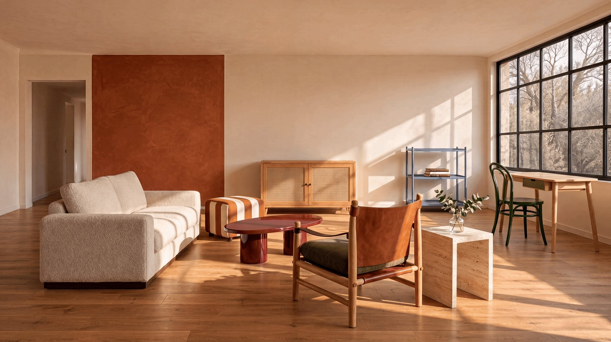 输出</td></tr></table>

<blockquote>为「向阳家居」拍一张春季家具目录的客厅氛围图。第一张是空房实景，后面九张是本期在售家具白底图。沿用空房的机位、墙面、门窗和木地板，把九件原款家具各摆入一次，布置成一间平时可以两三个人聊天、也可以靠窗读写的客厅。皮带扶手休闲椅是主推款，给它一个看得清木框、皮带扶手和坐垫的角度。其他家具按真实尺寸和用途安排，坐下能用到桌面，书椅能拉开，从门口进屋有连续的通道。 
保留每件商品的颜色、材质、结构和比例，让右侧窗光自然落在布面、皮革和木头上，桌腿椅脚有可信的接触阴影。允许少量书或一枝绿植，保持陈列清爽。室内实景摄影，不加文字。</blockquote>

### 教育、科普、知识推理

#### 小熊猫科普图

<blockquote>制作2:3中文竖版信息图，标题“读懂小熊猫”，副标题“山地森林里的树栖生活家”。高密度动物图鉴风，扁平矢量插画，浅青柠底、深松绿文字、赤陶橙身体与奶白面纹。顶部深色圆角标题条，下接档案、标尺、分布图和行为图标；中央小熊猫占约四分之一，侧身站在树枝上回望，环纹尾巴自然垂向右下，比例准确。两侧排列局部图与注释，底部以连续资料带衔接，整板视觉统一。 
完整包含14组知识，每组配标题、3—5条短知识及插图： 
01 身份：哺乳纲、食肉目、小熊猫科；以剪影区分大熊猫幼崽与浣熊。 
02 体型：头体长约56—62.5厘米，不含尾；尾长约37—47厘米，双标尺注明个体差异。 
03 面部：圆头短吻、尖耳、浅脸深泪纹，腿腹深色，配局部窗口。 
04 毛发：长护毛、浓密底绒、足底毛；配苔藓地衣环境色对照。 
05 抓握：每足五趾、爪部分收回；假拇指为特化腕骨，帮助握竹。 
06 尾巴：环纹、平衡、围身保暖，不能卷枝承重。 
07 攀树：树上休息避险、爪抓树干、灵活踝关节辅助头朝下下树。 
08 食谱：竹叶嫩笋为主，也吃果实昆虫，不编摄食比例。 
09 吃竹：前足握枝、嘴择嫩叶、臼齿咀嚼，配三步图。 
10 栖息地：尼泊尔、印度、不丹、中国、缅甸适宜山区；配局部分布及森林、竹丛、水源图。 
11 节奏：晨昏活跃、炎热时树上休息，冷时蜷缩、暖时伸展，不编精确作息。 
12 交流：多独居，通过气味、叫声和姿态交流。 
13 成长：隐蔽处营巢、新生未睁眼、母兽哺乳、逐渐探索，配四阶段图。 
14 保护：森林丧失与破碎化、偷猎贸易、游荡犬，对应栖息地保护、巡护监测、社区参与。 
至少40条有效信息、约25幅辅助图。统一造型线宽，以编号、对齐和细分隔线组织，避免同质卡片、大块空白及交叉引线。中文层级清晰，无乱码、重复填充或虚构数据。页脚来源：Smithsonian National Zoo、San Diego Zoo Wildlife Alliance、Red Panda Network。输出完整平面展板，无样机。</blockquote>

#### 人员选派推理题

<blockquote>请解答下面的人员选派推理题，并生成一张可视化解答图。16:9 横向，白底，规范清晰的中文排版。 
某单位要从甲、乙、丙、丁、戊、己六名工作人员中，恰好选派三人组成调研组，必须同时满足： 
如果甲入选，那么乙也必须入选。 
丙、丁两人中恰好有一人入选。 
乙和戊不能同时入选。 
如果己入选，那么丙也必须入选。 
已确定戊入选。 
请根据全部条件确定三人名单。 
图中上方呈现题目条件，下方分成“入选”和“未入选”两个区域，将六张工作人员卡片分别放入正确区域。每张卡片用人物图标和醒目的姓名标签表示，六人各出现一次，不得重复或遗漏。 
底部用简短批注展示关键排除依据。卡片所在区域、名单与批注必须一致，不得增加额外条件。仅输出完成后的解答图片。</blockquote>

### 工业与产品设计

#### 电动摩托爆炸图

<table><tr><td width="50%" valign="top"> 输入</td><td width="50%" valign="top"> 输出</td></tr></table>

<blockquote>把图1这辆概念电动摩托车拆成一张非常细致的零件爆炸图，造型、白色几何车壳、金属灰电机、无轮毂车轮和橙红色灯条都与图1一致。 
 
拆解方式：等轴测视角，以电机单元为中心，所有零件沿各自装配方向向四周放射状展开，彼此留出清楚的间距、互不重叠： 
- 前部：前整流罩拆成上下两片，车头灯条、风挡、前叉、前轮无轮毂轮圈、轮胎、轮圈内的环形轴承和刹车盘分别分离； 
- 中部：白色几何车架外壳拆成左右多块切面板，露出内部管状主车架；电机单元拆出外壳、散热鳍片、定子、转子和电机控制器；电池包单独抽出，旁边是电池模组和线束； 
- 后部：座椅总成拆成坐垫和底座，后摇臂、后减震器、后轮轮圈、轮胎、尾灯条依次分离； 
- 小零件：螺栓、垫片、卡扣、轴承、接插件按所属位置成组排列在对应部件旁，用细虚线连回安装点； 
- 加两个圆形放大框，分别放大无轮毂轮圈的轴承结构和电机内部的定子绕组。 
 
文字标注：每个主要部件用细白色引线（末端带小圆点）连接全大写英文标签，文字清晰、拼写准确，标签沿画面边缘整齐排布。 
 
深灰色背景，带淡淡的等距网格线，柔和均匀的光线，零件边缘有干净的高光。画面饱满、层次分明、排布有序，像专业工业设计公司的结构拆解图。</blockquote>

#### 喷气发动机爆炸图

<table><tr><td width="50%" valign="top"> 输入</td><td width="50%" valign="top"> 输出</td></tr></table>

<blockquote>把图1这台喷气发动机做成高精度爆炸结构渲染图。纯深灰色背景，斜俯视等轴测视角，部件沿一条从右上到左下的对角轴线悬浮分开：进气罩、压气机叶片盘、燃烧室、涡轮盘、中心主轴、尾喷管依次排开，机匣外壳分成几块弧形板，悬在主轴周围；电子控制盒、燃油泵、齿轮附件、燃油管和铜色线束分布在主轴两侧。外壳和机匣是冷灰、银色和哑光白，涡轮核心和主轴是暖金色和古铜色。零件对齐、间距均匀，柔和影棚光，金属反光真实。主要部件用细白色引线连到画面两侧，标注部件名称：进气罩、压气机叶片盘、燃烧室、涡轮盘、中心主轴、尾喷管、机匣外壳、电子控制单元、燃油泵、附件齿轮箱、燃油管路。标注为简洁的白色无衬线小字，左右两列整齐排布，引线不交叉，不遮挡部件。竖版2:3，无品牌标识。</blockquote>

#### 摩卡壶工程蓝图

<table><tr><td width="39%" valign="top"> 图 1  图 2</td><td width="61%" valign="top"> 输出</td></tr></table>

<blockquote>把图1这只八角摩卡壶做成经典工程蓝图海报，零件构成参照图2。深蓝色带浅色网格的背景，所有图形是带轻微做旧颗粒感的白色线稿。顶部居中是大写标题"MOKA POT"；左侧竖向排列各部件的爆炸分解图（顶盖与胶木小把手、带手柄的上壶身、不锈钢过滤网、橡胶密封圈、漏斗滤杯、带安全泄压阀的下壶底座）；右上方是较大的剖面图，展示内部水路与咖啡粉仓；右下方是较小的俯视图和侧立面图。各处带尺寸线、引线和字母标记。竖版3:4，技术图纸排版。</blockquote>

### 机器人与具身智能

#### 四足机甲 CAD 图纸

<table><tr><td width="50%" valign="top"> 输入</td><td width="50%" valign="top"> 输出</td></tr></table>

<blockquote>把图1这台四足机甲整理成一张规范的 CAD 多角度工程图纸。白色图纸背景，黑色细线绘制，可见轮廓用实线，被遮挡的结构用虚线，对称轴和关节中心用点划线。 
 
图纸包含五个视图，排布整齐： 
- 左上：正视图； 
- 右上：左侧视图； 
- 左中：俯视图，清楚表现两个武器舱的发射孔阵列和四条腿的展开角度； 
- 右中：后视图； 
- 下方：一个较大的等轴测线框图，表现整体立体结构。 
 
各视图之间比例统一，机身、武器舱、腿部关节和大腿装甲板的形状与图1一致。标注主要尺寸：总高、总长、总宽、腿部跨距、武器舱尺寸；关键部件用引线标注"武器舱""翻盖""机身""大腿装甲板""膝关节""足部"。右下角放标准标题栏"四足机甲 总装图 1:20"。线条干净准确，排版规整，像正式的机械设计图纸</blockquote>

#### 吊轨配送机

<blockquote>Create a 16:9 English engineering concept sheet titled "Ceiling Rail Courier," marked "Fictional indoor transport concept." Show a long side elevation across the upper half, a detailed suspended carriage at lower left, and a three-position storyboard at lower right. Use warm white paper and cobalt linework. 
A straight horizontal rail spans X = 0 to 2400 mm. Define three docking stations by carriage-center coordinates: A at X = 300, B at X = 1200, and C at X = 2100 mm. Adjacent station spacing is 900 mm. The carriage is 400 mm long along X, so its footprint at A is 100–500 mm and at C is 1900–2300 mm; all positions remain within the rail. The three storyboard panels show the same carriage at A, B, and C, not three simultaneous robots. 
At the illustrated extension, the vertical suspension comprises an 80 mm carriage housing, a 120 mm mounting bracket, a 300 mm telescoping stem, and a 60 mm gripper, measured as consecutive segments. Mark their total as 560 mm, measured from the housing top to the gripper bottom; rail, rollers and parcel are excluded from this dimension. The gripper holds one sealed parcel throughout all panels. Include two rail rollers, one linear drive unit, one downward camera, and one two-finger gripper in the component ledger. Maintain the same dimensions, parcel, roller count, and sensor position across all views. Clearly separate horizontal station dimensions from the vertical stack.</blockquote>

#### 轮腿配送机器人

<blockquote>机甲CAD绘制16:9中文轮腿配送机器人概念图，包含同一机器人的站立、下蹲侧视图，三维图及动力轴表，注明“虚构结构研究”。车体长500、宽360、高180毫米；四个角各装一条二关节腿，每腿末端一个直径120毫米的主动轮。腿关节共8个，轮轴电机共4个，合计12个受控旋转轴。四条腿标FL、FR、RL、RR，各自的上、下关节编号1和2，轮轴编号W；缩写中的左右以机器人自身为准。站立姿态车体顶面离地560毫米，下蹲姿态为440毫米，用同一地平线画出降低120毫米的差值。两幅图只改变关节角度，车体、轮径和连杆长度保持一致。前面板只有一台深度相机，车体上方只有一个封闭货箱；货箱在两种姿态中保持水平。用对照表区分8个腿部关节与4个驱动轮轴，避免把12个受控轴误画成12条腿或12个轮子。</blockquote>

### 复杂视觉挑战

#### 直角镜面

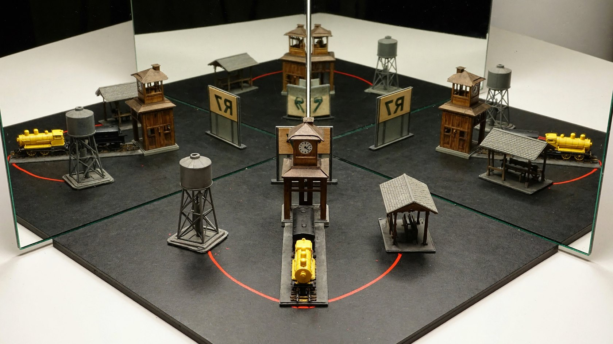

<blockquote>真实摄影呈现一套桌面光学展示：两面竖直平面镜沿竖边相接，夹角为直角，镜面朝向夹角内部。相机从开口方向略偏一侧拍摄，完整纳入镜角前的实物和两面镜中的三组对应镜像。实物是一座小型车站模型：中央钟楼、只位于钟楼一侧的高水塔、另一侧的低候车棚，前方停着一辆带黄色车头和黑色尾部的小车；一根弯曲红线连接水塔底部与候车棚。模型前方竖着正面朝向镜角的标牌，文字为“R7”，实拍可见标牌背面。两侧各有一组经过一次反射的模型像，镜角深处还有一组经过两次反射的模型像；两侧标牌文字呈镜写，双次反射中的“R7”可以正常阅读。水塔、候车棚、车头和红线在三组镜像中随反射共同改变方向，保留各自与钟楼的位置关系。镜面接缝和装置底座清楚可辨，倒影之间留出足够空间识别每组模型。</blockquote>

#### 伸进投影的手

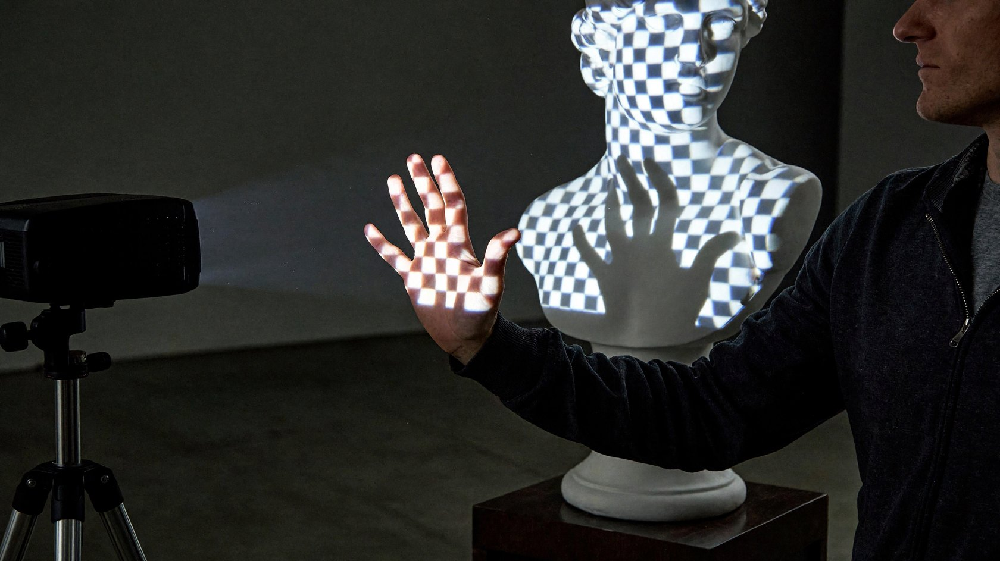

<blockquote>一张真实的投影艺术装置现场照片：投影机把蓝白棋盘格投到白色石膏半身像上，格线随鼻梁、面颊和胸部曲面改变形状。操作者站在投射范围旁，将一只五指分开的手伸到雕像胸前的光路中，掌面朝向投影机。手掌本身接到一部分棋盘图案，后方雕像胸前则出现不含棋盘纹样的暗手影；亮格在影边被截断，指缝对应的位置仍有投射光通过。从侧前方取景，让实际手掌与胸前手影在画面中错开，能同时看到人物上半身、雕像和侧缘开启的投影机。</blockquote>

#### 游戏地图变 3D 游戏画面

<table><tr><td width="46%" valign="top">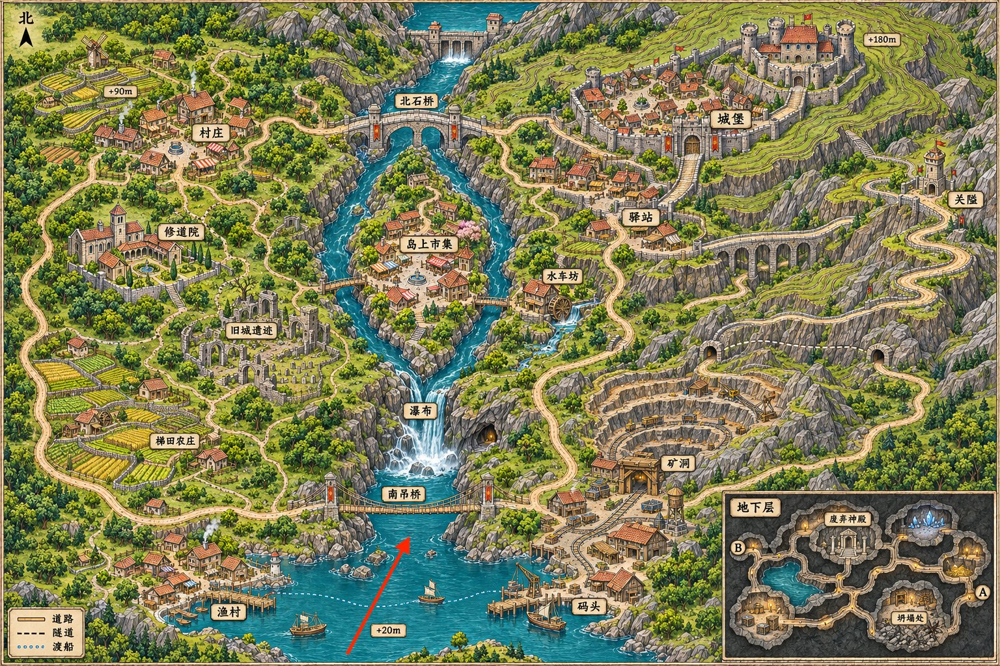 输入</td><td width="54%" valign="top">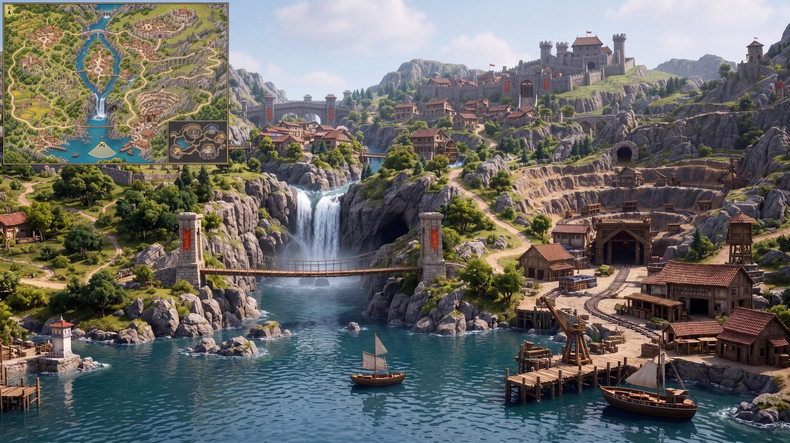 输出</td></tr></table>

<blockquote>以提供的游戏地图为唯一空间依据，生成一张 16:9、写实 3D CG 风格的开放世界游戏实机画面。 
相机位置与朝向 
将红色箭头的尾端作为相机位置，箭头尖端所指方向作为镜头朝向。相机位于地图南部湖面上方约 1.7 米，以第一人称视角向北偏东看去，视野约 70°，保持自然透视。画面不出现玩家身体。 
空间还原 
严格按照地图还原地形高差、建筑位置、河流走向、桥梁连接和道路关系。 
根据真实视线决定两岸聚落、矿区、山体和远处城堡的可见范围。保留合理遮挡与远近比例，不要为了展示所有地标而移动建筑、拉平地形或扩大视野。 
画面风格 
高品质写实游戏引擎渲染，真实尺度的建筑与山体，细致的岩石、木材、植被和水面材质，自然日光、全局光照、水面反射与适度空气透视。呈现玩家真正置身于这个世界中的感觉。避免手绘地图质感、微缩沙盘、等距视角和鸟瞰构图。 
左上角小地图 
在画面左上角加入清晰的游戏 HUD 小地图，宽度约占画面的 15%。使用参考图的地表地图作为缩略底图，保持原始比例与北向朝上，保留主要地形和道路，去掉地下层插图。 
小地图上以一个小型方向箭头标出玩家位置，位置对应原图红色箭头的尾端，朝向与主画面镜头完全一致，并用淡色扇形表示视野范围。采用简洁细边框，保持地图清楚可读。 
最终只输出一张完整游戏画面。主场景中不要出现原图的红色箭头、地名标签、海拔数字或地图边框；除左上角小地图外，不添加其他界面元素。</blockquote>

## 创意生产

### 游戏世界

#### 森林中的古剧场

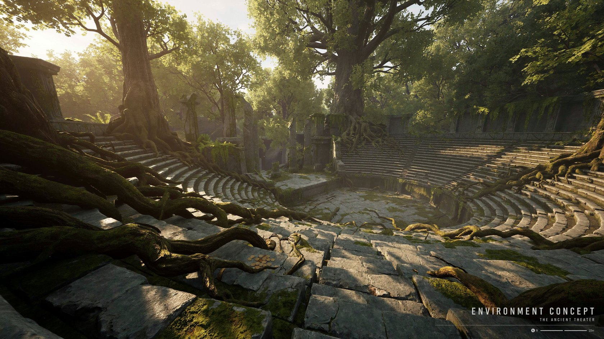

<blockquote>画面比例16:9，4K。做一张面向3A游戏的环境概念成图，先读出地形、地标和聚落用途，再看到细节。采用可信写实3D空间，建筑顺应气候与地势，保留前中后景。具体内容：被森林吞没的圆形剧场，树根沿裂缝进入座席。不使用现有作品的名称、角色或品牌标志，不添加水印。</blockquote>

#### 战斗驾驶员

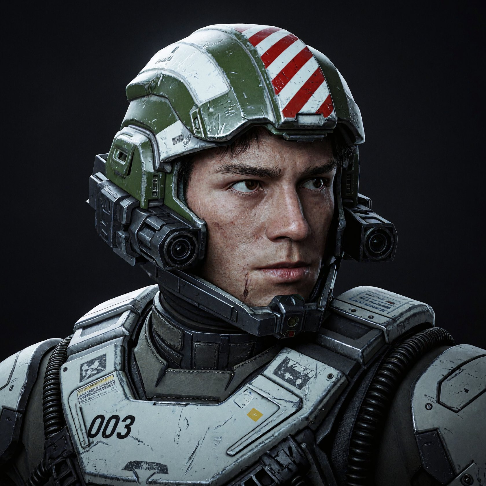

<blockquote>画幅比例 1:1。写实未来战斗驾驶员的近距离半身肖像，年轻男性脸部冷峻、眼睛微向右看，面颊有细小擦伤，头发藏在复杂的开放式装甲头盔内。头盔为橄榄绿与旧白色工业壳体，顶部有红白斜纹徽记，面部两侧排列传感器、黑色光学镜头、通讯盒和铰接支架，下颌装有护颈框架。白灰色胸甲厚重，有深色胸带、软管、编号“003”、贴纸和细小警示标记，表面有划痕、积尘和边缘掉漆。主体靠近镜头，纯黑背景，冷色左上软光勾勒脸部与设备轮廓，强调复杂机械装配、皮肤真实感和军用硬表面材质。 输出单张完整作品画面，不添加网站边框、作者署名或水印。</blockquote>

#### 森林中的龙

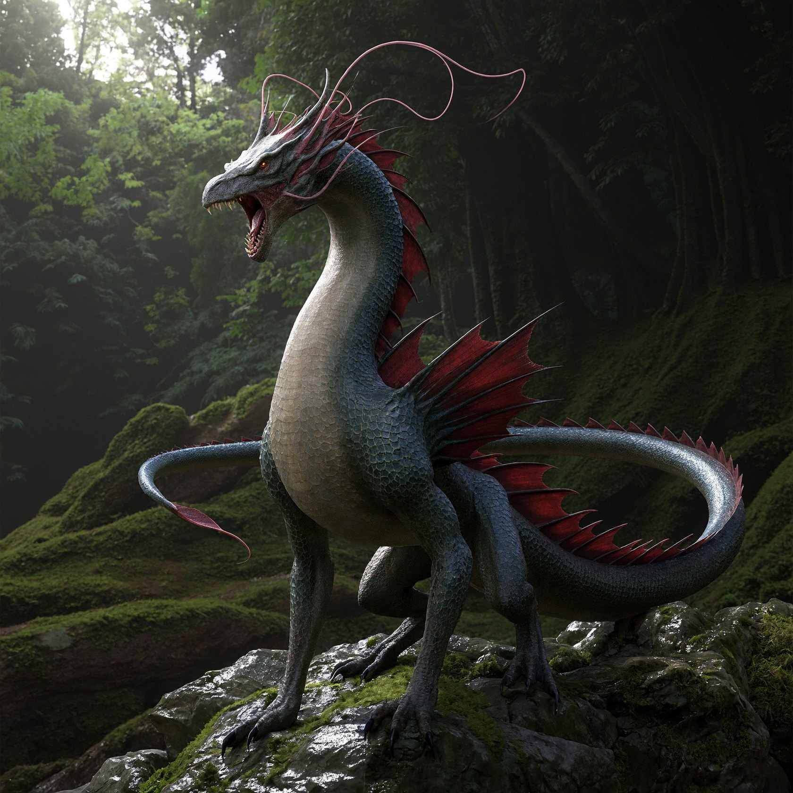

<blockquote>写实幻想电影生物立于幽暗森林的岩石上，正方形全身构图。主体是一只高颈、细长身体的龙，灰蓝与墨绿色细鳞皮肤，腹部偏米灰色，背部从肩膀到尾部竖起扇形暗红色鳍膜；头部张嘴嘶吼，额头与脸颊生出许多向后飘卷的粉红色长须和角状肉质冠，须丝形成优雅复杂的轮廓。四肢为有锐爪的爬行动物结构，长尾绕身体向左弯曲，脚踩湿润石块和苔藓。森林柔和自然光穿透部分须冠，材质细腻可信，无文字或水印。</blockquote>

#### 白模渲染图变电影剧照

<table><tr><td width="50%" valign="top">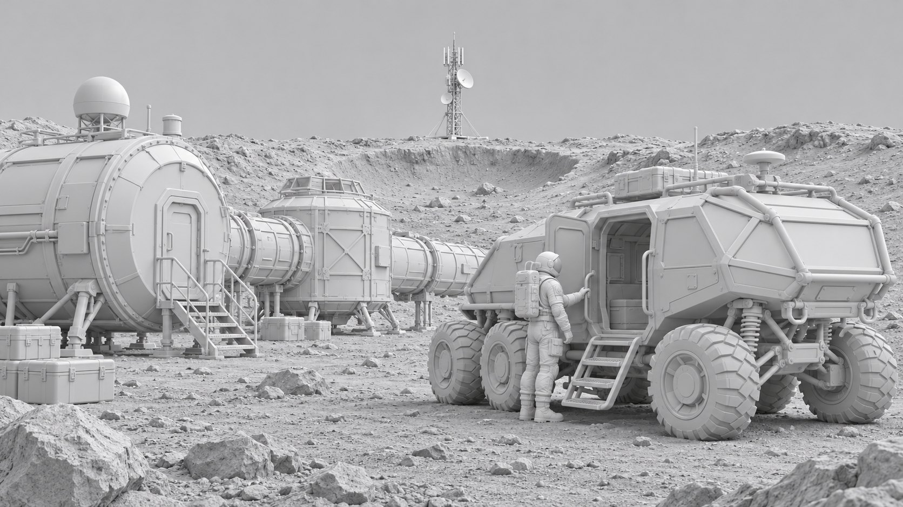 输入</td><td width="50%" valign="top">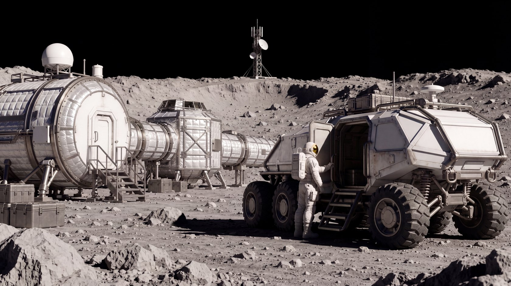 输出</td></tr></table>

<blockquote>把这张白模渲染成真实月面科考电影画面。补全灰色月壤、银白隔热层、涂层金属、玻璃与轮网材质，宇航服为米白色。使用强方向性太阳光和有限地面反射，远处天空纯黑，不加蓝天、云或地球式雾气。保持探测车六个车轮、人物和舱段布局，阴影方向统一，亮部保留材质细节。 保留原图构图、镜头角度、透视、几何结构与各主体的位置和比例；输出4K、16:9横版，呈现3A级写实CG与电影实拍融合的质感，不添加文字、品牌、界面或水印。</blockquote>

### 现实世界

#### 黄昏屋顶

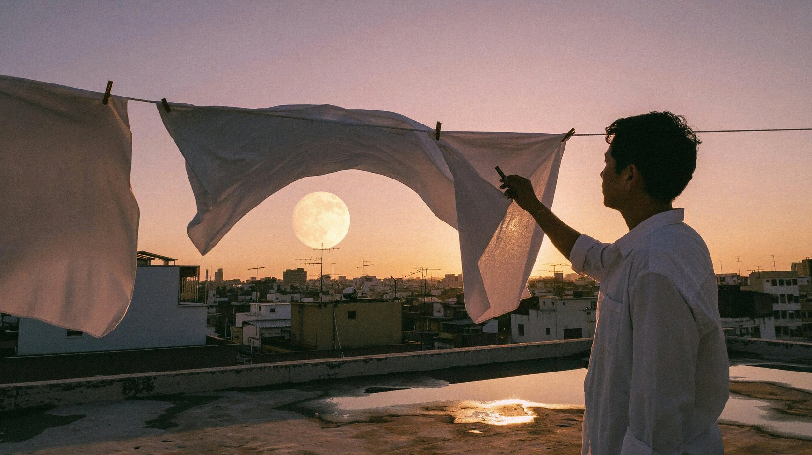

<blockquote>夏末黄昏的旧城市屋顶，几根晾衣绳横跨前景，白床单被风吹起形成柔软的波浪，床单间隙露出远处密集的屋顶、天线和一轮低悬的淡金色月亮；逆光中一位穿白衬衫的人站在右侧收衣服，只保留清晰的侧面轮廓，屋顶水泥表面有暖灰纹理和浅浅积水，天空从玫瑰粉过渡到烟紫，夕阳边缘光穿过织物，画面有生活纪录片的真实和电影静帧的构图诗意，35mm镜头、自然风、轻微胶片颗粒，不要浪漫滤镜过重。 
真实摄影与电影静帧质感，优先自然光和可信的物理反射，构图有明确视觉重心与呼吸空间，色彩克制但有一到两个叙事性点色，材质细腻真实，人物动作自然，保留适度35mm胶片颗粒、柔和高光晕染和真实景深；画面高级、耐看、具有叙事瞬间，不要廉价CG感，不要塑料皮肤，不要过度锐化，不要HDR光晕，不要随机添加物件，不要水印、边框、logo或多余文字。</blockquote>

#### 喝茶前的停顿

<blockquote>拍摄一位卷发人物喝茶前停顿的真实肖像，头部、肩膀、上胸和双手捧着的深色陶杯入镜，人物略微侧脸。画面右后方的暖色灯光掠过头发，背景是较暗的室内墙面。松散卷发外缘和几根翘起的碎发被照得透亮，发丝之间仍能看见暗背景；浓密发束的内部保持深色，亮边随着发束遮挡自然中断。脸部由相机左前方很弱的柔光照亮，能看清眼睛、面颊和手指。耳廓与肩部只在朝向后侧灯光的边缘受光，陶杯呈宽而弱的表面亮部，杯沿和手指交接处保留接触阴影。焦点覆盖眼睛、外缘发丝与杯口。</blockquote>

#### 清晨火烈鸟

<blockquote>清晨盐湖浅水区，五只火烈鸟分散在宽阔的镜面水面上，最前景一只低头觅食，第二只单腿站立，远处三只形成柔和的粉色节奏，湖面倒映淡粉天空和远处白色盐壳；采用长焦平视构图，水面几乎占据整个画面，鸟群之间留出足够呼吸空间，羽毛粉色从灰粉到珊瑚粉有细腻层次，水纹、倒影、盐壳和鸟腿真实，优雅自然摄影，不要拥挤鸟群，不要高饱和卡通色。 
真实摄影与电影静帧质感，优先自然光和可信的物理反射，构图有明确视觉重心与呼吸空间，色彩克制但有一到两个叙事性点色，材质细腻真实，人物动作自然，保留适度35mm胶片颗粒、柔和高光晕染和真实景深；画面高级、耐看、具有叙事瞬间，不要廉价CG感，不要塑料皮肤，不要过度锐化，不要HDR光晕，不要随机添加物件，不要水印、边框、logo或多余文字。</blockquote>

### 超现实世界

#### 理发椅上的云

<blockquote>一张复古、俏皮又高级的超现实时尚摄影。鲜绿色的山丘上摆着一张樱桃红色理发椅，一团巨大的白云坐在椅子里，蓬松的云体被薄荷绿色理发围布围住。一位成年女模特穿淡紫色短袖衬衫、深紫色铅笔裙和白色长靴，站在椅子旁，认真地用一把银色剪刀修剪白云，另一只手托起云朵的一角。剪下的小团云絮散落在草坪上，像刚剪落的头发。模特留利落的复古短发，神情专注。低机位广角构图，蓝天占据大半画面，布景简洁而色彩鲜明。真人时装大片质感，云朵有柔软半透明的细节与可信的体积阴影，轻微直闪补光，胶片颗粒，无卡通感。横向16:9，无文字。</blockquote>

#### 切月亮

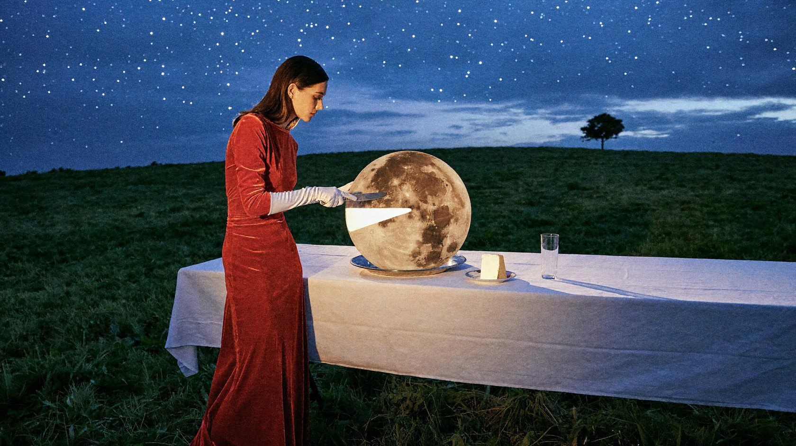

<blockquote>一张具有复古电影布景质感的超现实时尚摄影。钴蓝色暮光天空下，绿色山丘上摆着一张铺白色桌布的长餐桌。一位成年女模特穿番茄红色丝绒长裙和白色长手套，神情冷静地站在桌子一侧，用银色餐刀从餐盘里的巨大满月上切下一小块楔形月亮。满月如圆形蛋糕般立在盘中，表面保留真实的陨石坑，切口内部散发柔和的乳白色光芒，切下的月亮块稳稳落在旁边的小瓷盘上。月光照亮她的手套与下颌，桌上玻璃杯投下细长阴影。空中的天空没有第二个月亮，远处只有一棵孤独的小树。优雅、荒诞、略带冷幽默，真实人物和实体道具摄影质感，细腻胶片颗粒，横向16:9，无文字。</blockquote>

### 艺术世界

#### 鸳鸯，古典大师油画

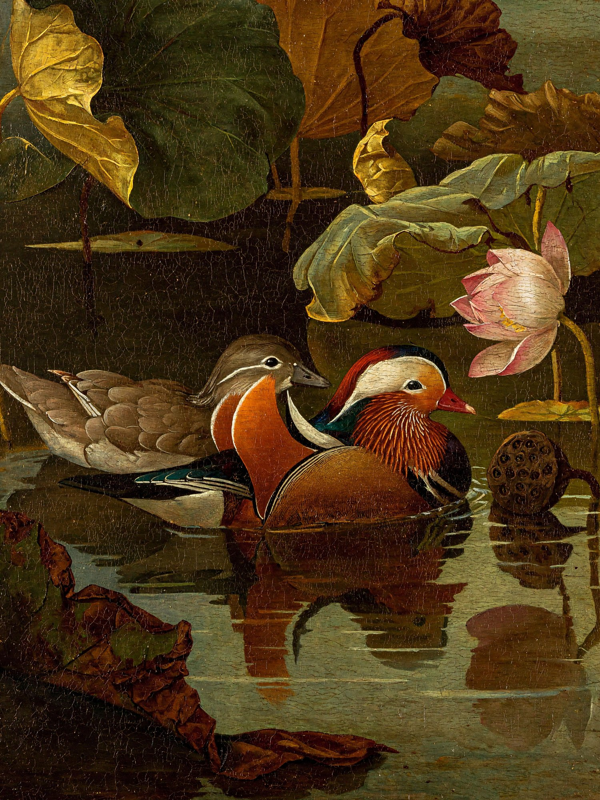

<blockquote>一幅17世纪欧洲古典大师风格的布面油画，题材是中国的鸳鸯与荷塘。画面中央，一对鸳鸯在幽暗的荷塘水面上相依而游：雄鸳鸯羽色华丽，橙红色帆状饰羽、带紫绿金属光泽的头冠、白色眉纹、红色的喙；雌鸳鸯灰褐素雅，眼后一道白纹。两只鸳鸯头颈微微相靠，神态安静深情。四周是夏末初秋的荷叶，有的饱满墨绿，有的边缘焦枯卷曲，右上方一枝半开的粉白荷花和一个低垂的莲蓬。伦勃朗式明暗对照光，一束温暖的侧光从左上方落在鸳鸯身上，其余部分沉入深橄榄绿与琥珀棕的暗部。水面像一面墨色的镜子，倒映着鸳鸯与荷花，泛起细小的涟漪。厚涂与薄罩染结合，羽毛高光处颜料堆起，能看到清晰的笔触和画布纹理，古旧清漆带来温暖的金色调和细微的龟裂。构图稳重，留有大片暗部的呼吸空间，诗意、静谧，博物馆级杰作。</blockquote>

#### 玉兔，中世纪泥金手抄本

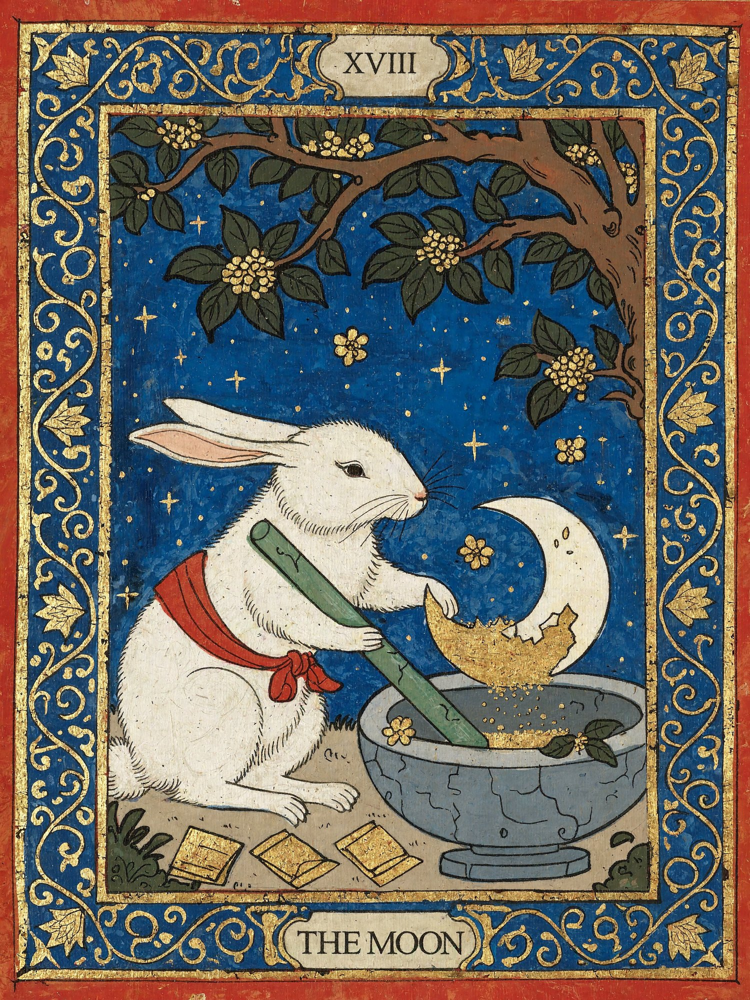

<blockquote>A medieval illuminated manuscript illustration with gold leaf and a wide border of curling vines. Beneath an old osmanthus tree, the Jade Rabbit of Chinese folklore stands beside a blue-grey stone mortar. Wearing a simple red cloth sash, it grips a long jade pestle and carefully grinds a single ivory crescent moon into fine golden powder. Part of the crescent remains intact inside the mortar. Small osmanthus blossoms fall onto the stone rim, and several folded medicine packets lie nearby. The rabbit works with the solemn concentration of an old apothecary. The deep blue sky contains a few stars but no second moon. 
Flat perspective, dark ink outlines, opaque tempera on aged parchment. Rich red, ultramarine blue and antique gold. A broad blue border filled with curling gold lotus vines, small blossoms and Chinese cloud motifs. Worn gold leaf and slightly irregular hand-painted forms. A small numeral XVIII above, and THE MOON in a parchment cartouche below.</blockquote>

#### 照镜子的鹈鹕，工笔画

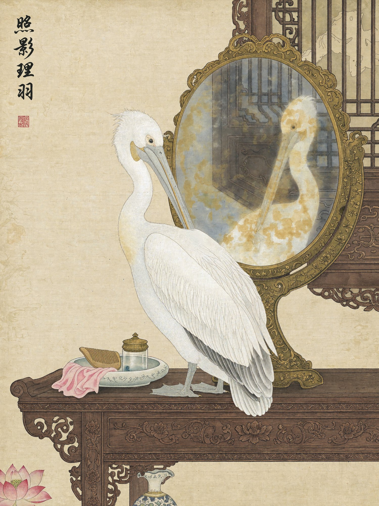

<blockquote>中国工笔画风格，绢本设色。古代闺房的梳妆台上立着一面圆形铜镜，一只白色鹈鹕站在镜前，低头用长嘴整理胸前的羽毛。铜镜表面偏黄、有点模糊，映出鹈鹕的正脸和它身后的雕花木窗。左上角有竖排题字和一枚红色印章。</blockquote>

