

  <a href="artistic-worlds.md">English</a> |
  <a href="artistic-worlds.zh-CN.md">简体中文</a> |
  <a href="artistic-worlds.ko.md"><strong>한국어</strong></a> |
  <a href="artistic-worlds.ja.md">日本語</a>

# 예술 세계

고전 유화와 르네상스부터 동양적 미감과 선화 일러스트까지.

← [초현실 세계](surreal-worlds.ko.md) · [쇼케이스](README.ko.md)

## 원앙, 고전 거장풍 유화

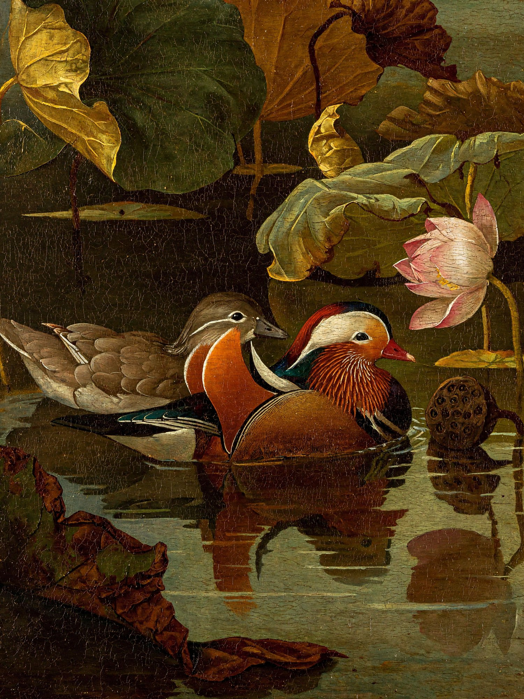

프롬프트

<blockquote>An oil painting on canvas in the style of a 17th-century European Old Master, depicting Chinese mandarin ducks and a lotus pond. At the center, a pair of mandarin ducks swim close together on the dark pond: the male has brilliant plumage, orange-red sail-like feathers, a crest with purple-green metallic sheen, white eyebrow markings, and a red bill; the female is understated gray-brown with a white stripe behind the eye. Their heads and necks incline gently toward each other, with a quiet, affectionate air. Surround them with lotus leaves of late summer and early autumn, some full and dark green, others with scorched, curling edges. At the upper right, show a half-open pink-white lotus and a drooping seedpod. Use Rembrandt-like chiaroscuro, with a warm beam of side light from the upper left falling on the ducks while the rest recedes into deep olive-green and amber-brown shadows. The water is an ink-dark mirror reflecting the ducks and lotus flowers, disturbed by tiny ripples. Combine impasto with thin glazes: raised paint on feather highlights, clearly visible brushwork and canvas texture, and aged varnish lending a warm golden cast and fine craquelure. A stable composition with large dark areas of breathing room, poetic and serene, a museum-quality masterpiece.</blockquote>

## 어부와 펠리컨, 카라바조풍

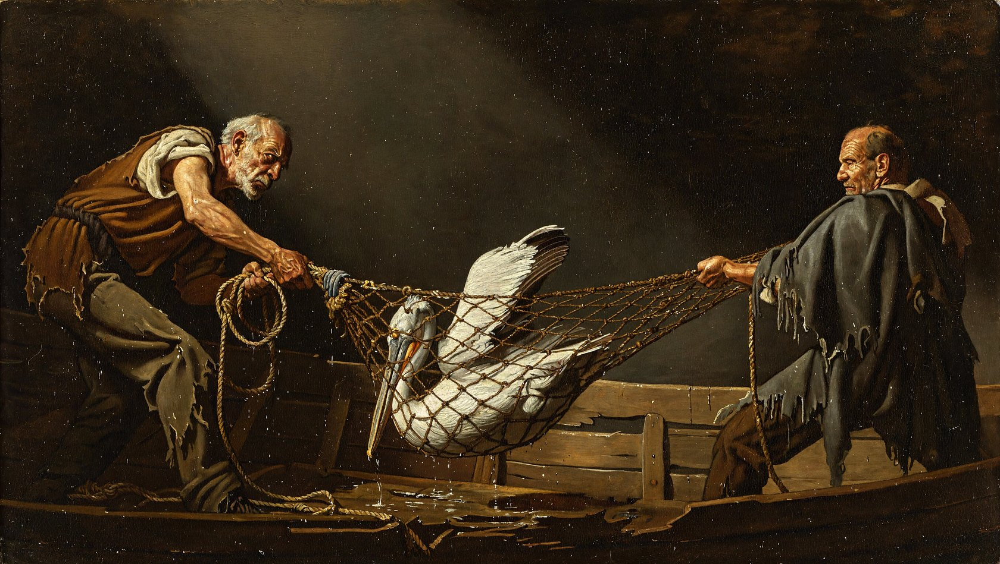

프롬프트

<blockquote>Oil painting in the style of Caravaggio, dramatic chiaroscuro, dark background. Two old fishermen in ragged clothes pull a wet fishing net out of a wooden boat. A pelican is caught in the net, its beak and one wing poking out through the holes as it struggles. The rope mesh wraps around its body and stretches tight between the fishermen's hands. A single beam of light from the upper left falls on the pelican's white feathers and the men's faces.</blockquote>

## 탁구 경기, 카라바조풍

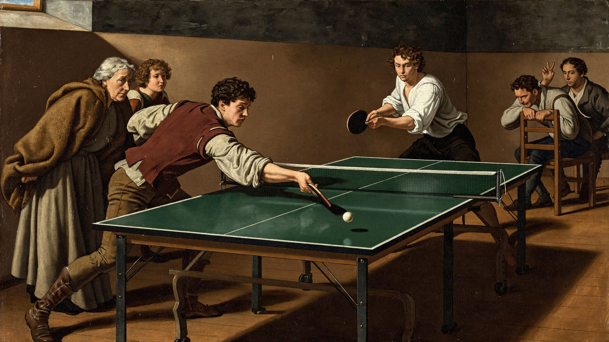

프롬프트

<blockquote>A Caravaggio-style oil painting of a group of 17th-century Italian townspeople playing and watching a singles match in a modern table-tennis hall. All six retain Baroque-era appearances, natural curls, and coarse linen shirts, wearing brown short jackets, wool capes, fitted-waist dresses, or knee breeches with leather boots, with no modern sportswear. The table cuts diagonally from the lower foreground toward the rear right, clearly showing its green surface, white boundary lines, taut central net, and two rubber-faced paddles. A small white ball bounces over the net toward the foreground. On the near side, a young man in a reddish-brown jacket leans forward and steps into a stroke, while a white-shirted man opposite lowers his center of gravity for the next return, their actions responding to one another. An older woman at the front left grips the edge of her cape; a girl behind her follows the ball over her shoulder. Of two men at the rear right, one leans forward with a hand on a chair back while the other raises a hand to indicate the score. Overlapping figures create depth. The sole main light enters through a high window at the upper left, concentrating on the hitter's cheekbone, forearm, and the white ball, while the spectators' faces recede in layers into warm-brown darkness. Natural flesh tones, creamy white, and ocher red dominate. Give the wooden floor and matte-coated tabletop distinct textures. Shape fingers and clothing folds with subtle transitions, thin glazes, and restrained highlights, preserving the weight of a complex multi-figure narrative oil painting. Avoid uniformly thick coarse textures, crackle filters, and a photographic look.</blockquote>

## 쑤저우 정원의 원앙, 인상파 유화

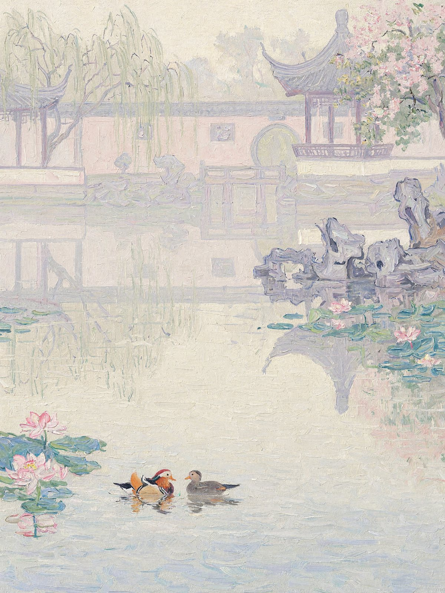

프롬프트

<blockquote>A physical French Impressionist oil painting on canvas, in portrait format, depicting mandarin ducks playing in the morning mist of a classical Suzhou garden. It should look as though Monet, late in life, painted beside a garden pond in Suzhou with thick oils and coarse hog-bristle brushes, working directly from the morning fog. Evoke the original paintings Impression, Sunrise, Water Lilies, and the morning-mist works in the Rouen Cathedral series: forms dissolve in light and fog, yet every inch of the painting has visible brushwork and pigment. This is Western oil painting, with no ink wash, gongbi outlines, inscriptions, or seals. 
 
[Scene Content] 
Water occupies roughly the lower 60% of the painting. Slightly left of center in the lower middle, a pair of mandarin ducks play facing each other, suggested with only a few strokes. The male's thick orange-red strokes are the painting's only rich, warm accent, like the red sun in Impression, Sunrise; the female is a soft gray-brown mark. Loose pink and blue-green patches of water lilies and lotus leaves float around them. 
On the right of the midground, a zigzag stone bridge and lakeside Taihu rocks become a few pale violet-gray strokes. 
In the distance, occupying roughly the upper 40%, a whitewashed wall, a circular moon gate, and a pavilion with upturned eaves dissolve into ghostly pale-lavender and creamy shapes in the mist. Only the wall's undulating top, the curved eaves, and a faint circle remain barely recognizable. At the upper left, weeping willows become descending green-purple strokes; at the upper right, a flowering tree becomes clusters of pink marks. All architectural reflections dissolve and tremble on the water. 
 
[Atmospheric Softness] 
Dense, moist morning fog fills the entire image. The air itself is light blending pink-purple, pale gold, and gray-blue. There are no outlines and almost no boundaries between water, air, and the far bank; forms emerge only through slight differences in color temperature. Keep the whole image soft and high-key, with colors at similar values. Shadows contain only pale purple and pale blue, with no black. 
 
[Brushwork — Most Important] 
The atmospheric softness must come entirely from interlocking brushstrokes of similar value, never from blur. There must be no soft focus, airbrushed gradients, smooth transitions, or digital blur anywhere. Even the fog itself consists of individually countable strokes of paint. 
Fill the canvas with clearly visible, free, varied-size brushstrokes: comma-shaped marks, short dashes, and broken strokes, about a finger's width. Each must show its beginning, end, and the fine grooves left by hog bristles. 
Vary stroke direction with the subject: layers of short horizontal marks across the water; trembling vertical strokes for reflections; long, descending curved strokes swept rapidly through the willows; loosely woven diagonal strokes for sky and fog; and short curved strokes circling the ducks like spreading ripples. 
Give the paint real thickness. Lit areas, water lilies, and the male duck's orange-red accents use obvious impasto, with raised paint and small ridges at the edges that appear sculptural in side light. In darker areas, dry-brush strokes reveal underlying colors and the weave of coarse canvas. 
Juxtapose unmixed pure colors between brushstrokes: pink-purple beside pale gold, gray-blue beside pale rose. Work wet-on-wet, allowing some local dragging and mixing by the next stroke, but never smoothing the surface flat. 
 
Up close, the work is all expressive brushstrokes and pigment; only from a distance do they coalesce into a garden in the mist. A museum-quality Impressionist masterpiece with the material presence of a work in the Musée d'Orsay collection.</blockquote>

## 태양, 중세 채식 필사본

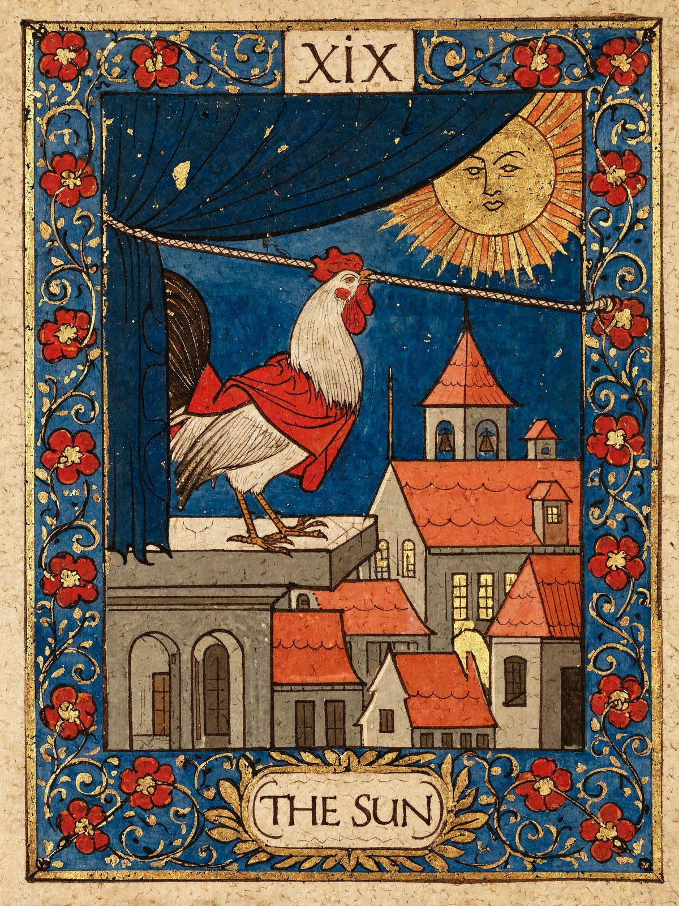

프롬프트

<blockquote>A medieval illuminated manuscript illustration with gold leaf and a wide border of curling vines. A rooster in a short red cloak stands upon a stone platform above a sleeping town. It grips a thick cord in its beak and leans backward with its whole body, pulling open a heavy dark blue curtain that covers the sky. Behind the lifted curtain appears a great golden sun with a calm human face. Below, small red roofs, a church tower and a few open windows mark the town beginning to wake. The rooster’s feet are firmly planted, its effort shown through its awkward, determined posture. 
 
Flat perspective, dark ink outlines, opaque tempera on aged parchment. Rich red, ultramarine blue and gold. A broad blue border filled with curling gold foliage and red blossoms. Worn gilding and slightly irregular hand-painted forms. A small numeral XIX above, and THE SUN in a parchment cartouche below.</blockquote>

## 옥토끼, 중세 채식 필사본

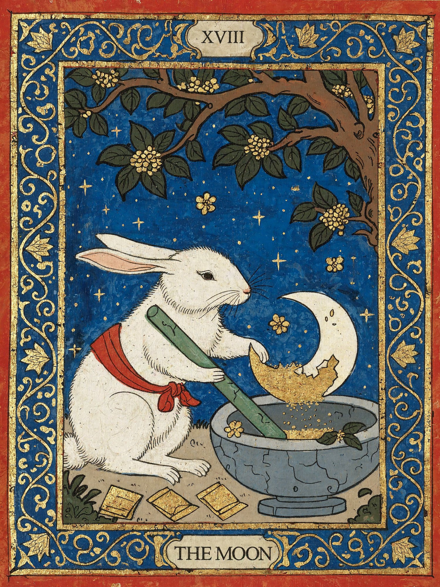

프롬프트

<blockquote>A medieval illuminated manuscript illustration with gold leaf and a wide border of curling vines. Beneath an old osmanthus tree, the Jade Rabbit of Chinese folklore stands beside a blue-grey stone mortar. Wearing a simple red cloth sash, it grips a long jade pestle and carefully grinds a single ivory crescent moon into fine golden powder. Part of the crescent remains intact inside the mortar. Small osmanthus blossoms fall onto the stone rim, and several folded medicine packets lie nearby. The rabbit works with the solemn concentration of an old apothecary. The deep blue sky contains a few stars but no second moon. 
Flat perspective, dark ink outlines, opaque tempera on aged parchment. Rich red, ultramarine blue and antique gold. A broad blue border filled with curling gold lotus vines, small blossoms and Chinese cloud motifs. Worn gold leaf and slightly irregular hand-painted forms. A small numeral XVIII above, and THE MOON in a parchment cartouche below.</blockquote>

## 우주정거장 수리, 둔황 벽화

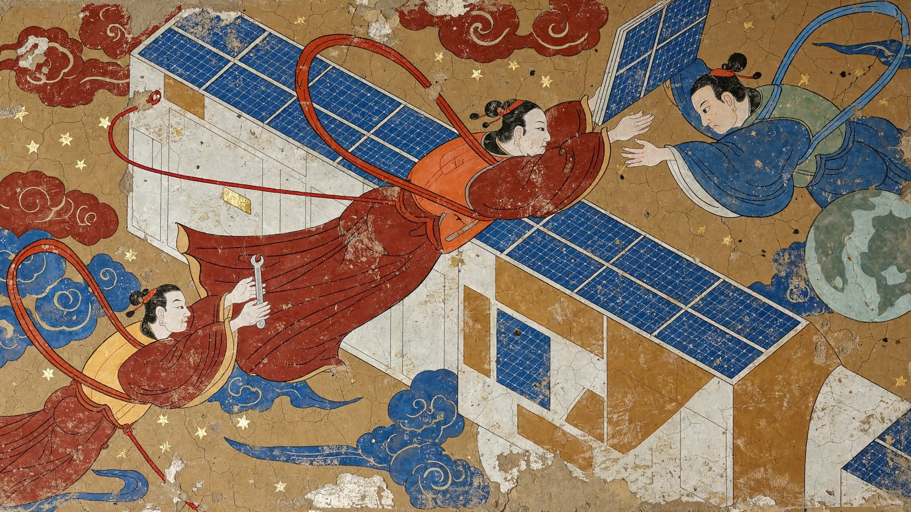

프롬프트

<blockquote>Translate exterior maintenance on a modern space station into a Tang-dynasty Dunhuang-style earthen-wall mural in rich mineral pigments. The image is a flat wall painting, not a space movie. At the center, a technician resembling a flying apsara reaches sideways toward a solar-panel pivot, wearing a simplified modern safety vest over wide sleeves, with long ribbons forming two flowing arcs behind them. A companion at the lower left passes a tool to the main figure, while another at the upper right steadies a folded solar panel. All three direct their hands and eyes toward the same pivot. Clear, fine safety lines connect the figures to the station wall; ribbons and safety tethers each follow distinct paths and must not merge into tangled lines. The station consists of an ocher-white cylinder and a few geometric planes, with solar panels rendered as small azurite-blue squares. Make the modern facilities recognizable without smooth metal or realistic space lighting. Use Tang-mural-style linework for faces and clothing folds, light bodily contours, and overlapping forms instead of precise perspective. Render Earth at the side as a muted malachite-green disc. Keep the background earthen ocher with a few traditional scrolling clouds and star dots. Balance cinnabar red, azurite blue, malachite green, and warm white. Show mineral grains and slight natural wear in the paint layers, with locally exposed wall substrate rather than a uniform crackle filter. Organize movement through ribbons, panel wings, and the cylinder. Make the main figure large and the helpers slightly smaller, leaving open wall areas that breathe like blank paper. No sci-fi armor, blue volumetric light, photographic starfields, subtitles, trademarks, inscriptions, or seals.</blockquote>

## 펠리컨 그림자극

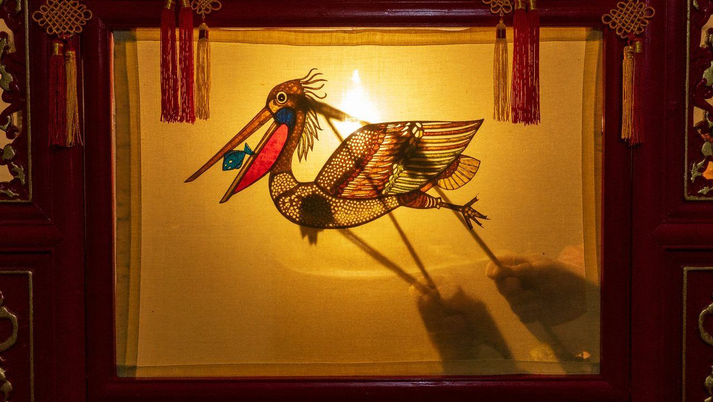

프롬프트

<blockquote>Traditional Chinese shadow puppetry, with an oil lamp behind the screen making the beige fabric glow. On the screen is a colorful translucent leather pelican puppet, with a small blue fish inside its red throat pouch and intricate cutout patterns carved into its body. Also visible are the thin shadows of several control rods and the blurred shadows of the puppeteer's two hands operating it. A red wooden frame and tassels surround the screen.</blockquote>

## 회로와 꽃, 공필화 직물 문양

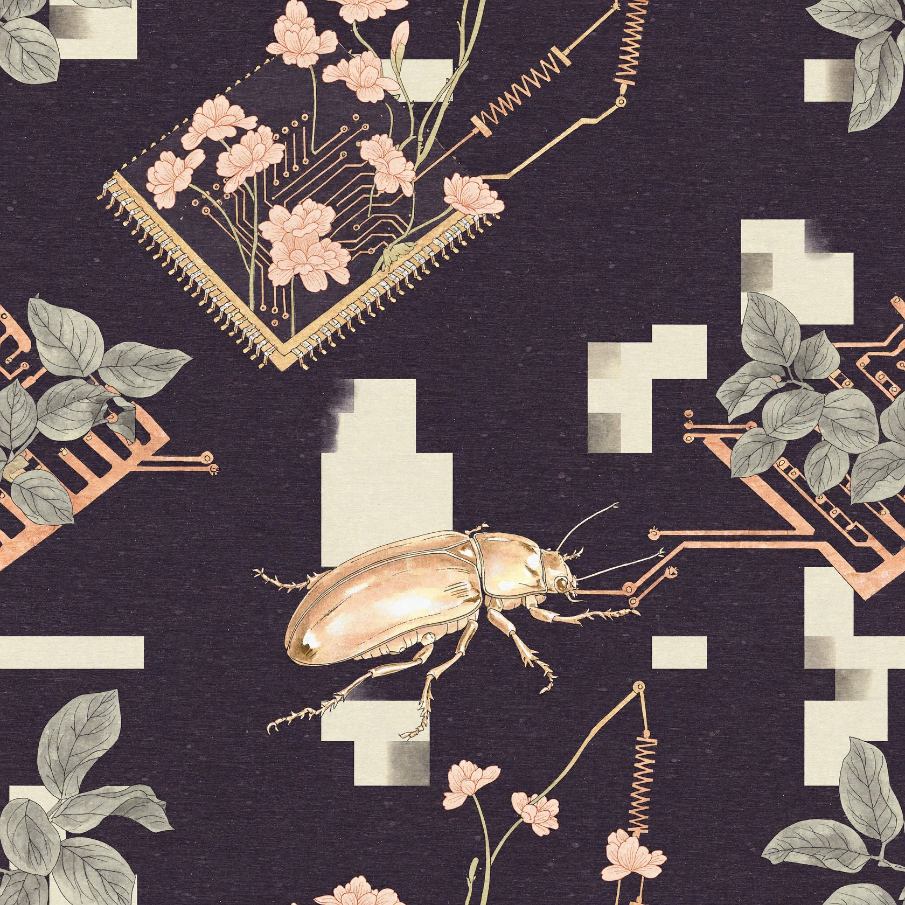

프롬프트

<blockquote>Design a modern textile pattern that tiles seamlessly in all four directions, merging circuit boards and plant structures through Chinese gongbi painting in color on silk. Integrated circuits resemble flowerbeds, resistors become slender flower stems, neat solder joints appear between curling leaves, and small beetles crawl along copper traces. Use a scattered composition with varied density, ensuring branches cut by each edge continue precisely on the opposite edge. Avoid a single isolated large floral cluster at the center. Combine gray-green, pale coral, and light copper-gold on an aubergine ground. Fine, dense linework clearly distinguishes chip pins, leaf veins, and beetle shells. Layered shading and glazing make leaves thin, shells lustrous, and circuits flat, while every detail remains hand-painted gongbi. Precise decorative lines preserve circuit order while creating the bends of natural growth. Evenly distributed small areas of bare-silk-colored negative space allow the pattern to breathe. Add no title label or border. The rhythm should feel modern from a distance and materially rich up close, ready for use as an apparel fabric pattern.</blockquote>

## 거울 앞의 펠리컨, 공필화

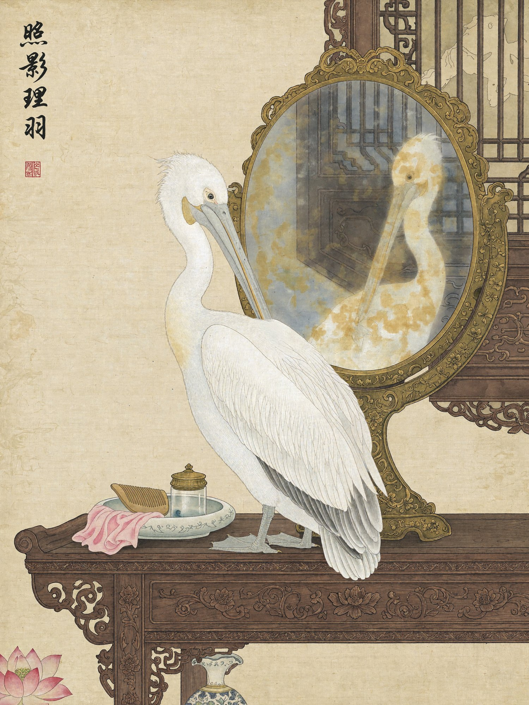

프롬프트

<blockquote>Chinese gongbi painting in color on silk. A round bronze mirror stands on a dressing table in an ancient woman's chamber. A white pelican stands before it, lowering its head to groom its chest feathers with its long bill. The slightly yellowed, somewhat hazy mirror reflects the pelican's face and the carved wooden window behind it. Include a vertical inscription and a red seal in the upper-left corner.</blockquote>

## 금빛 불꽃, 동양 판타지 일러스트

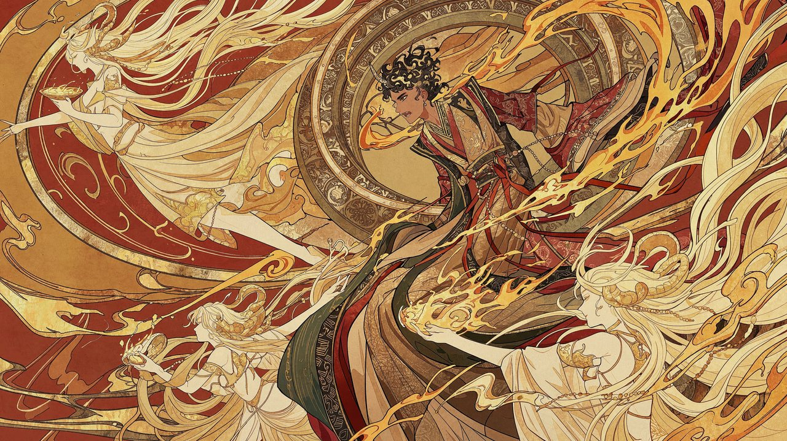

프롬프트

<blockquote>Create an Eastern-fantasy anime-style illustration themed around golden flames and dancing spirits. Style tags: #anime illustration #Eastern fantasy #gongbi with heavy color #decorative flat color #fine line drawing #gold-leaf texture. Landscape 16:9, with a composition full of spinning momentum: right of center, a young man with black-and-gold curly hair and short horns leans forward and twists, his face turned to the lower left, his wide golden sleeves and red cords flying with the movement; behind him, a large circular vessel and curved ribbons form a vortex from the upper right to the lower left. In the upper left, a spirit with long pale-gold hair, seen from the side, holds up a shallow dish of golden liquid; in the lower left and the right foreground are more pale-gold humanlike spirits, whose bead strings, long hair, arms, and discs interweave around the central figure. The central figure's clothing layers gold-brown, vermilion, and ink green; the background is filled with vermilion-orange, with curved gold edging, splashing wine, flames, and cloud-and-smoke patterns. Style focus: combine Japanese anime character design with the fine line work of gongbi heavy-color painting, with long, flowing lines running through the hair, bead strings, and folds of the clothes. Use large flat areas of cinnabar red, ochre orange, and antique gold as the base, with thin local glazes to show volume, keeping paper grain, mottled gold leaf, and traditional decorative patterns for a strong flat, decorative feel. The image contains no text, numbers, letters, logos, signatures, or watermarks.</blockquote>

---

← [초현실 세계](surreal-worlds.ko.md) · [쇼케이스](README.ko.md)
