

  <a href="artistic-worlds.md">English</a> |
  <a href="artistic-worlds.zh-CN.md"><strong>简体中文</strong></a> |
  <a href="artistic-worlds.ko.md">한국어</a> |
  <a href="artistic-worlds.ja.md">日本語</a>

# 艺术世界

← [超现实世界](surreal-worlds.zh-CN.md) · [效果展示](README.zh-CN.md)

## 鸳鸯，古典大师油画

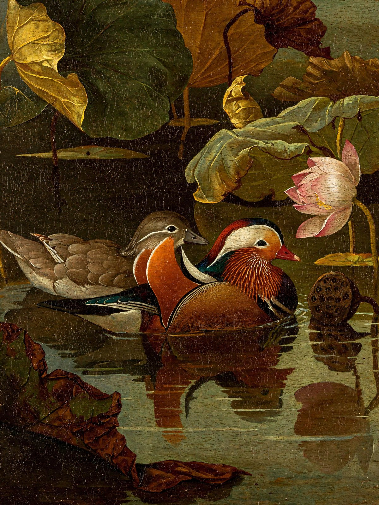

提示词

<blockquote>一幅17世纪欧洲古典大师风格的布面油画，题材是中国的鸳鸯与荷塘。画面中央，一对鸳鸯在幽暗的荷塘水面上相依而游：雄鸳鸯羽色华丽，橙红色帆状饰羽、带紫绿金属光泽的头冠、白色眉纹、红色的喙；雌鸳鸯灰褐素雅，眼后一道白纹。两只鸳鸯头颈微微相靠，神态安静深情。四周是夏末初秋的荷叶，有的饱满墨绿，有的边缘焦枯卷曲，右上方一枝半开的粉白荷花和一个低垂的莲蓬。伦勃朗式明暗对照光，一束温暖的侧光从左上方落在鸳鸯身上，其余部分沉入深橄榄绿与琥珀棕的暗部。水面像一面墨色的镜子，倒映着鸳鸯与荷花，泛起细小的涟漪。厚涂与薄罩染结合，羽毛高光处颜料堆起，能看到清晰的笔触和画布纹理，古旧清漆带来温暖的金色调和细微的龟裂。构图稳重，留有大片暗部的呼吸空间，诗意、静谧，博物馆级杰作。</blockquote>

## 渔夫与鹈鹕，卡拉瓦乔风格

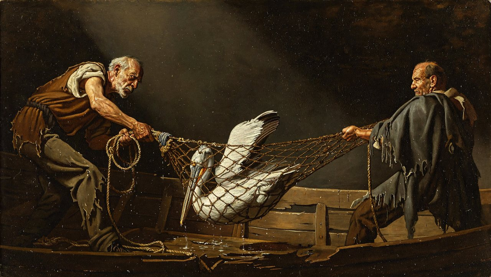

提示词

<blockquote>Oil painting in the style of Caravaggio, dramatic chiaroscuro, dark background. Two old fishermen in ragged clothes pull a wet fishing net out of a wooden boat. A pelican is caught in the net, its beak and one wing poking out through the holes as it struggles. The rope mesh wraps around its body and stretches tight between the fishermen's hands. A single beam of light from the upper left falls on the pelican's white feathers and the men's faces.</blockquote>

## 乒乓球赛，卡拉瓦乔风格

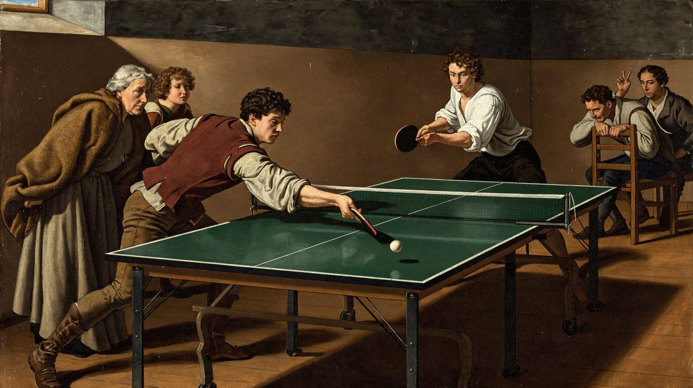

提示词

<blockquote>卡拉瓦乔油画，一群十七世纪意大利市民正在现代乒乓球馆进行单打比赛与观赛。六人均保留巴洛克时代的面貌、自然卷发与粗麻衬衣，身着褐色短上衣、羊毛披风、束腰长裙或及膝裤与皮靴，没有现代运动装。球台沿画面下方向右后方斜切，清晰呈现绿色台面、白色边线、绷紧的中央球网与两支胶面球拍；一颗小白球越网弹向近处。近侧红褐短衣青年俯身跨步迎球挥拍，对面白衬衣男子压低重心准备下一次回击，动作彼此呼应。左前老妇攥住披风边缘，身后少女越过她肩头追看球路，右后两名男子一人按住椅背前倾、一人抬手示意比分，遮挡形成远近层次。唯一主光自左上高窗侧入，集中照亮击球者颧骨、前臂与白球，观众面孔逐层沉入暖褐暗处。真实肉色、乳白、赭红统摄色彩，木地板与哑光涂层台面各有质感；以细腻转折塑造手指与衣褶，薄层罩染并克制提亮，保持复杂多人叙事油画的重量，避免统一粗厚纹理、龟裂滤镜和摄影感。</blockquote>

## 苏州园林鸳鸯，印象派油画

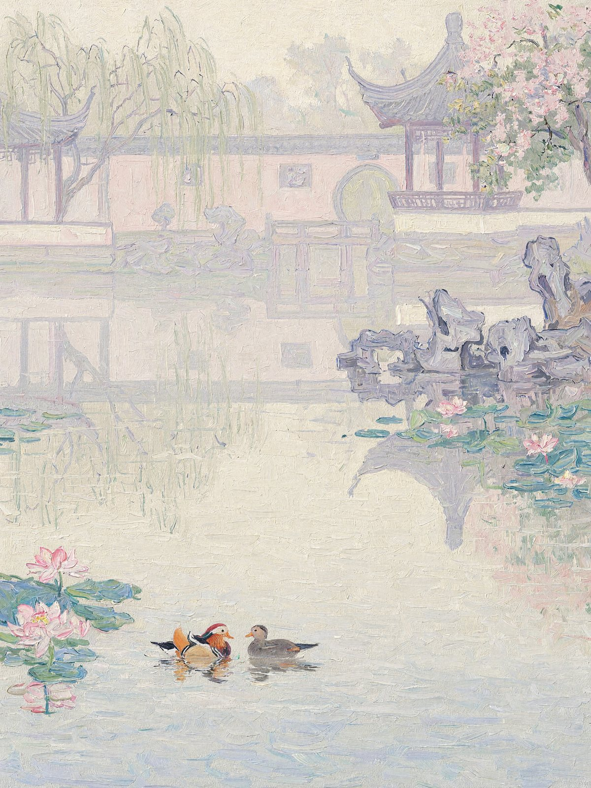

提示词

<blockquote>一幅法国印象派布面油画的实物，竖幅构图，题材是苏州古典园林晨雾中的鸳鸯戏水，就像莫奈晚年在苏州园林的池塘边，用浓稠的油彩和粗猪鬃笔对着清晨的雾写生而成。气息接近《日出·印象》《睡莲》和《鲁昂大教堂》晨雾系列的原作：物象溶解在光和雾里，但整幅画每一寸都是看得见的笔触和颜料。这是西方油画，没有水墨，没有工笔线条，没有题字和印章。 
 
【画面内容】 
水面占画面下方约六成。中下部偏左，一对鸳鸯相向嬉戏，只用几笔概括，雄鸟那几笔厚重的橙红色是全画唯一温暖浓郁的一点，像《日出·印象》里的红日；雌鸟是一抹柔和的灰褐。周围松散地浮着粉色和蓝绿色的睡莲、荷叶色块。 
中景右侧，九曲石桥和岸边的太湖石化成几抹淡紫灰。 
远处（画面上方约四成），一道白粉墙、一扇圆形月洞门和一座飞檐高翘的亭子，在雾中融化成淡薰衣草色和奶油色的幽影，只隐约辨认出墙头的起伏、飞檐的弧线和一个淡淡的圆。左上方垂柳化成下垂的绿紫色笔触，右上方花树是粉色的笔触团块。所有建筑的倒影都在水面上溶解、颤动。 
 
【朦胧感】 
浓厚湿润的晨雾充满整个画面，空气本身是粉紫、淡金和灰蓝交融的光。没有轮廓线，水面、空气和远岸几乎没有分界，形体只靠色温的微弱差异浮现。整体高调柔和，色彩处在相近的明度上，阴影里只有淡紫和淡蓝，不用黑色。 
 
【笔触，最重要】 
朦胧完全来自相近明度的笔触彼此交错，绝不来自模糊。画面上没有任何柔焦、喷枪式渐变、光滑的过渡或数码模糊，雾气本身也是由一笔一笔可数的颜料构成的。 
全画布满清晰可见、奔放、大小不一的笔触：逗号状、短划状、断续的笔痕，宽约一指，每一笔都能看出起笔、收笔和猪鬃刷留下的细沟纹。 
笔触方向随物象变化：水面是横向短笔层层铺开；倒影是竖向颤动的笔触；垂柳是下垂的弧形长笔，飞快扫过；天空和雾气是斜向交错、松散编织的笔触；鸳鸯周围是环绕的弧形短笔，如涟漪般打开。 
颜料有真实的厚度：受光处、睡莲和雄鸳鸯的橙红处是明显的厚涂，颜料堆起，边缘带小脊，在侧光下呈浮雕感；较暗处干笔擦过，露出下层颜色和粗麻画布的织纹。 
笔触之间是未经调和的纯色并置：粉紫旁边是淡金，灰蓝旁边是淡玫瑰，湿画叠湿画，局部被下一笔拖带混合，但绝不抹平。 
 
近看全是奔放的笔触和颜料，退远看才聚拢成雾中园林。博物馆级印象派杰作，奥赛博物馆的藏品质感。</blockquote>

## 太阳，中世纪泥金手抄本

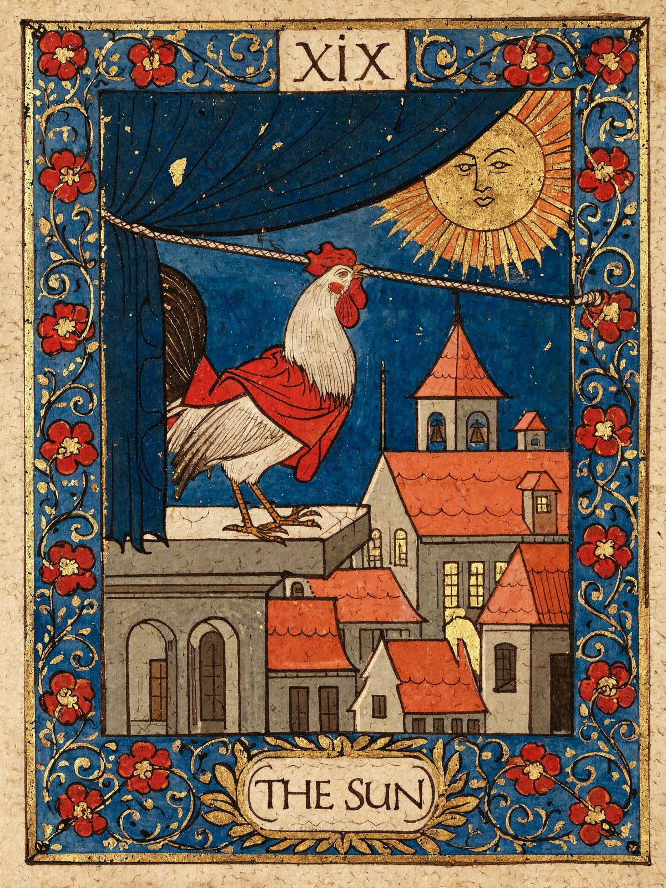

提示词

<blockquote>A medieval illuminated manuscript illustration with gold leaf and a wide border of curling vines. A rooster in a short red cloak stands upon a stone platform above a sleeping town. It grips a thick cord in its beak and leans backward with its whole body, pulling open a heavy dark blue curtain that covers the sky. Behind the lifted curtain appears a great golden sun with a calm human face. Below, small red roofs, a church tower and a few open windows mark the town beginning to wake. The rooster’s feet are firmly planted, its effort shown through its awkward, determined posture. 
 
Flat perspective, dark ink outlines, opaque tempera on aged parchment. Rich red, ultramarine blue and gold. A broad blue border filled with curling gold foliage and red blossoms. Worn gilding and slightly irregular hand-painted forms. A small numeral XIX above, and THE SUN in a parchment cartouche below.</blockquote>

## 玉兔，中世纪泥金手抄本

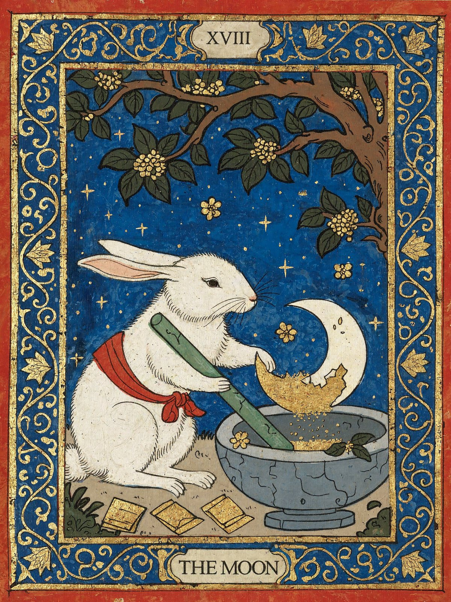

提示词

<blockquote>A medieval illuminated manuscript illustration with gold leaf and a wide border of curling vines. Beneath an old osmanthus tree, the Jade Rabbit of Chinese folklore stands beside a blue-grey stone mortar. Wearing a simple red cloth sash, it grips a long jade pestle and carefully grinds a single ivory crescent moon into fine golden powder. Part of the crescent remains intact inside the mortar. Small osmanthus blossoms fall onto the stone rim, and several folded medicine packets lie nearby. The rabbit works with the solemn concentration of an old apothecary. The deep blue sky contains a few stars but no second moon. 
Flat perspective, dark ink outlines, opaque tempera on aged parchment. Rich red, ultramarine blue and antique gold. A broad blue border filled with curling gold lotus vines, small blossoms and Chinese cloud motifs. Worn gold leaf and slightly irregular hand-painted forms. A small numeral XVIII above, and THE MOON in a parchment cartouche below.</blockquote>

## 空间站维修，敦煌壁画

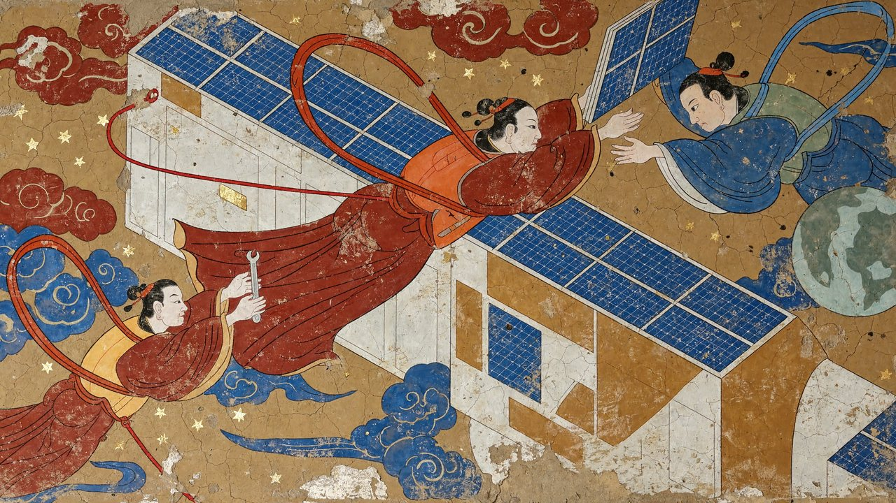

提示词

<blockquote>把现代空间站舱外维修转译为敦煌唐代矿物重彩土壁壁画，画面是平面壁绘，不是太空电影。中央一位飞天形貌的维修者侧身伸向太阳能板转轴，宽袖外叠着简化的现代安全背心，长飘带在身后绕成两段流畅弧线；左下同伴将一件工具递向主角，右上另一人扶住折起的太阳能板，三人的手眼都指向同一转轴。安全绳以清楚细线连接人物与舱壁，飘带与安全绳各有路径，不能合为杂乱细线。空间站舱体是赭白色圆筒与几块几何平面，太阳能板以石青小格表现，可辨现代设施，但不用光滑金属与真实太空光照。人物面容和衣褶用唐代壁画式线描，身体轮廓轻盈，叠压关系代替精密透视，侧面地球画成一枚低饱和石绿圆盘，背景仍是土壁赭色与少数传统卷云、星点。朱砂、石青、石绿和温白彼此制约，色层有矿物颗粒与轻微自然磨损，局部露出墙底而非全幅统一裂纹滤镜。画面动势由飘带、板翼与圆筒共同组织，主角大、协作者略小，有纸白般的空壁呼吸。不画科幻盔甲、蓝色体积光、摄影星空、字幕和商标，无题款与印章。</blockquote>

## 鹈鹕皮影戏

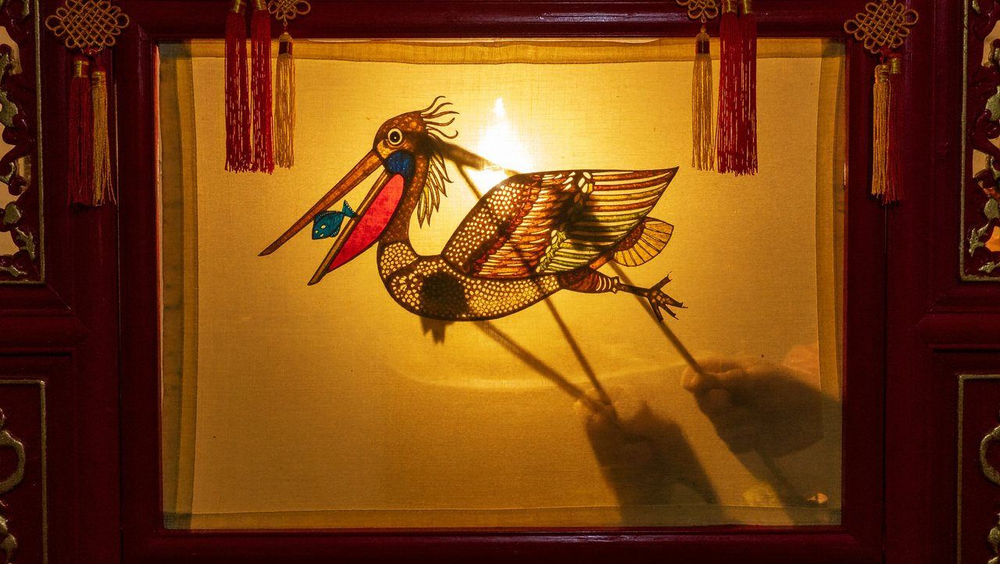

提示词

<blockquote>中国传统皮影戏，背后的油灯把米黄色布幕照得发亮。幕布上是一只彩色半透明的皮影鹈鹕，红色的喉囊里装着一条蓝色小鱼，身上刻着精细的镂空花纹。幕布上还能看到几根操纵杆的细影子，以及艺人两只手的模糊影子在操控。幕布外面是红色木框和流苏。</blockquote>

## 电路与花，工笔织物纹样

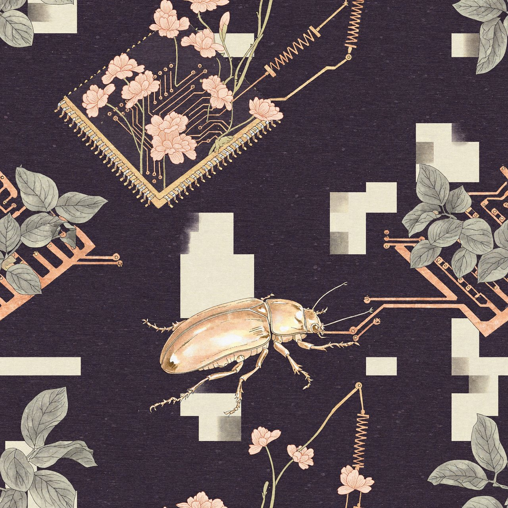

提示词

<blockquote>设计一块可以上下左右连续拼接的现代织物纹样，以中国工笔绢本设色把电路板与植物组织融合：集成电路像花床，电阻形成纤长花梗，卷叶之间可见整齐焊点，小型甲虫沿铜箔线路爬行。构图采用有松有紧的散点组织，四边切出的枝线在对边准确接续，避免中心孤立的大团花。茄紫底色上配置灰绿、浅珊瑚与淡铜金，细密线描把芯片引脚、叶脉和甲壳分得清楚，分染罩染让叶片薄、甲壳润、线路平整，所有细节仍是手绘工笔。精确装饰线既维持电路的秩序，也形成自然生长的曲折。以均匀分布的小块净绢色负形让纹样呼吸，不另设题签或边框，远看节奏现代，近看材质丰富，可直接作为服装面料图案。</blockquote>

## 照镜子的鹈鹕，工笔画

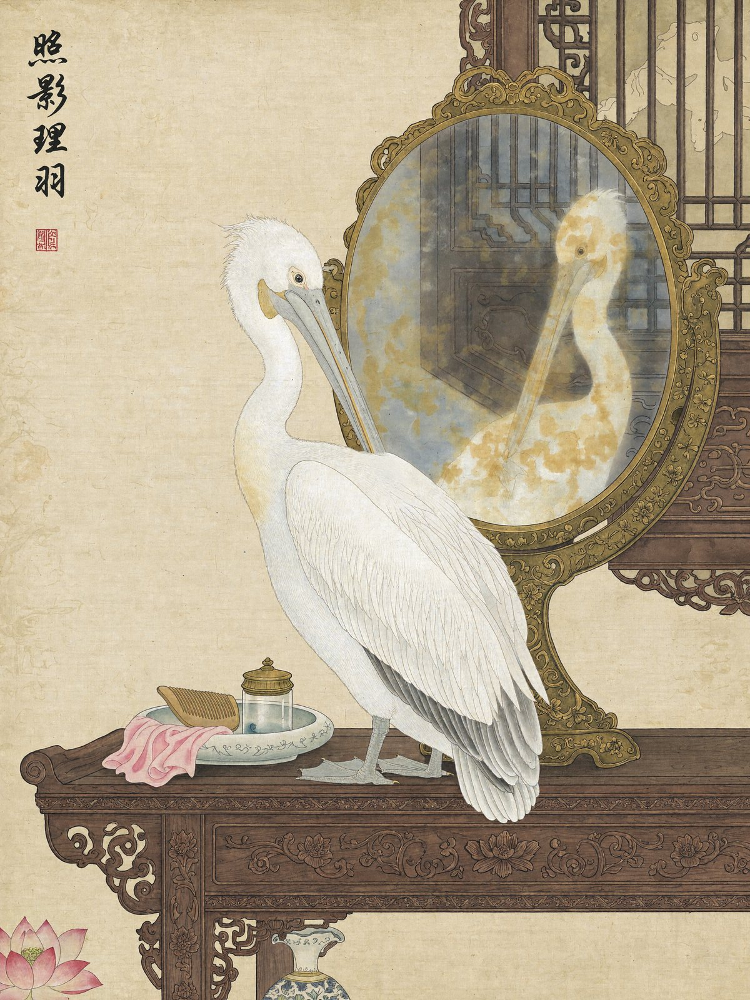

提示词

<blockquote>中国工笔画风格，绢本设色。古代闺房的梳妆台上立着一面圆形铜镜，一只白色鹈鹕站在镜前，低头用长嘴整理胸前的羽毛。铜镜表面偏黄、有点模糊，映出鹈鹕的正脸和它身后的雕花木窗。左上角有竖排题字和一枚红色印章。</blockquote>

## 金色烈焰，东方幻想插画

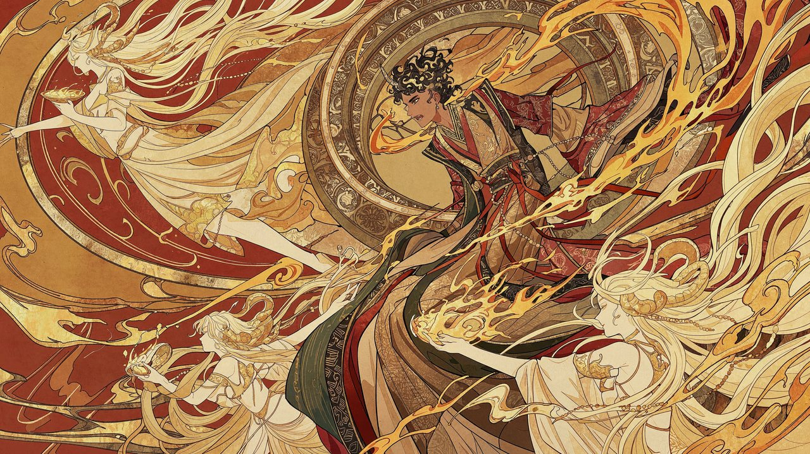

提示词

<blockquote>制作一张以金色烈焰和舞动妖灵为主题的东方幻想二次元插画。画风标签：#二次元插画 #东方幻想 #工笔重彩 #装饰性平涂 #精细线描 #金箔肌理。横向16:9，构图充满旋转动势：中央偏右是一位黑金卷发、头生短角的年轻男性，俯身扭转，脸朝左下方，宽大金色袖袍和红绳随动作翻飞；背后的大型圆形器物和弧形飘带沿右上至左下形成旋涡。左上安排浅金色长发妖灵侧身托起盛有金色液体的浅盘，左下与右前景再安排浅金色人形妖灵，珠串、长发、手臂和圆盘交错环绕中央人物。中央服装以金褐、朱红、墨绿叠搭，背景用朱橙色铺满，加入弯曲金边、喷溅酒液、火焰和烟云纹样。画风重点：将日系二次元人物造型与工笔重彩式细密线描结合，细长流动线条贯穿发丝、珠串和衣褶。以朱砂红、赭橙、古金的大块平涂为底，局部薄层罩染表现体积，保留纸张颗粒、金箔斑驳与传统装饰纹样，平面装饰感突出。画面不含文字、数字、字母、Logo、署名或水印。</blockquote>

---

← [超现实世界](surreal-worlds.zh-CN.md) · [效果展示](README.zh-CN.md)
