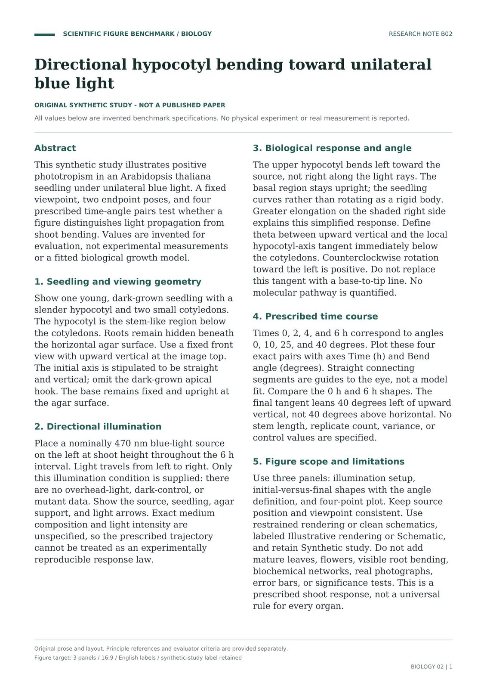
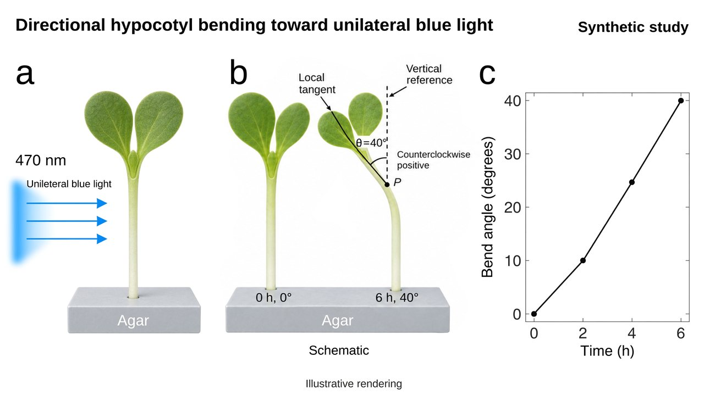
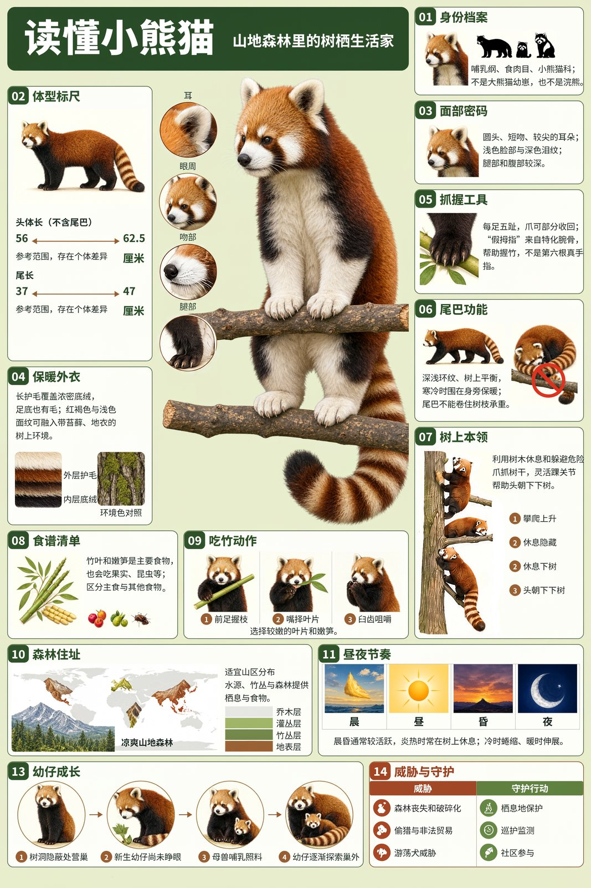
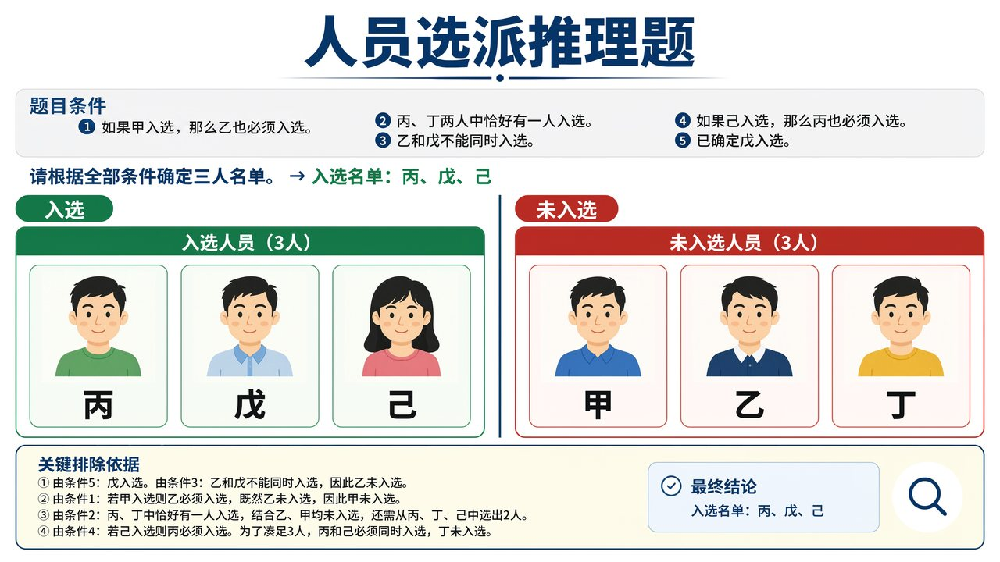

  <a href="education-and-reasoning.md">English</a> |
  <a href="education-and-reasoning.zh-CN.md">简体中文</a> |
  <a href="education-and-reasoning.ko.md"><strong>한국어</strong></a> |
  <a href="education-and-reasoning.ja.md">日本語</a>

# 교육, 과학 커뮤니케이션, 추론

← [최대 16장의 참조 이미지](multi-reference.ko.md) · [쇼케이스](README.ko.md) · [산업 및 제품 디자인](product-design.ko.md) →

## 논문 페이지로 만든 생물학 그림

<table><tr><td width="28%" valign="top"> 입력</td><td width="72%" valign="top"> 출력</td></tr></table>

프롬프트

<blockquote>Based on the uploaded text page from an English-language paper, generate a publication-quality biological research figure in 16:9 landscape format at 4K. Organize it into three logically connected panels: the lighting experiment setup; a comparison of the seedlings' initial and final states with the angle definition; and a plot of time versus bending angle. Use simple, credible scientific renderings or academic schematics for the seedlings and growth apparatus, and keep the data plot accurate, clear, and restrained. Read the viewing direction, light-source position, morphological changes, angle definition, and data from the source text yourself, and keep them consistent across all panels. Use a white background, consistent typography, short English labels, and panel labels a–c, with the hierarchy and whitespace of a formal academic figure. Retain the label “synthetic study” and identify the visuals as schematics or renderings. Do not add control groups, molecular mechanism diagrams, error bars, or statistical conclusions absent from the original text.</blockquote>

## 레서판다 인포그래픽

프롬프트

<blockquote>Create a 2:3 portrait infographic in Chinese, with the exact Chinese title “读懂小熊猫” and subtitle “山地森林里的树栖生活家” (meaning “Understanding Red Pandas” and “Tree-Dwelling Specialists of Mountain Forests,” respectively). Use a dense animal field-guide style with flat vector illustrations, a pale lime background, dark pine-green text, terracotta-orange bodies, and creamy-white facial markings. Place a dark rounded title bar at the top, followed by a profile, scale bars, a distribution map, and behavioral icons. A central red panda should occupy about one quarter of the composition, standing sideways on a branch and looking back, with its ringed tail hanging naturally toward the lower right and accurate proportions. Arrange detail illustrations and annotations on both sides, with a continuous information strip along the bottom, keeping the entire panel visually consistent. 
Include all 14 knowledge groups below, each with a heading, 3–5 short facts, and illustrations: 
01 Identity: Class Mammalia, order Carnivora, family Ailuridae; use silhouettes to distinguish it from giant panda cubs and raccoons. 
02 Size: Head-and-body length approximately 56–62.5 cm, excluding the tail; tail length approximately 37–47 cm. Use two scale bars and note individual variation. 
03 Face: Round head, short muzzle, pointed ears, pale face with dark tear markings, and dark legs and belly; include close-up windows. 
04 Fur: Long guard hairs, dense underfur, and fur on the soles; compare its colors with a moss-and-lichen environment. 
05 Grip: Five toes on each foot and partially retractile claws; the false thumb is a specialized wrist bone that helps it grasp bamboo. 
06 Tail: Ringed pattern, balance, and wrapping around the body for warmth; it cannot coil around a branch to support body weight. 
07 Climbing: Rests and takes refuge in trees, grips trunks with its claws, and uses flexible ankles to descend headfirst. 
08 Diet: Mainly bamboo leaves and tender shoots, with fruit and insects as well; do not invent dietary percentages. 
09 Eating Bamboo: Forepaws hold the branch, the mouth selects tender leaves, and molars chew them; include a three-step diagram. 
10 Habitat: Suitable mountain regions in Nepal, India, Bhutan, China, and Myanmar; include a regional distribution map and illustrations of forests, bamboo thickets, and water sources. 
11 Activity: Active around dawn and dusk; rests in trees when hot, curls up when cold, and stretches out when warm. Do not invent an exact daily timetable. 
12 Communication: Mostly solitary; communicates through scent, calls, and posture. 
13 Development: Builds nests in secluded places; newborns have closed eyes, nurse from the mother, and gradually begin exploring. Include a four-stage diagram. 
14 Conservation: Forest loss and fragmentation, poaching and trade, and free-roaming dogs; pair these with habitat protection, patrols and monitoring, and community participation. 
Include at least 40 substantive facts and approximately 25 supporting illustrations. Keep forms and line weights consistent, organizing the content through numbering, alignment, and thin dividers. Avoid repetitive cards, large empty areas, and crossing leader lines. Maintain a clear Chinese text hierarchy with no garbled characters, repetitive filler, or invented data. Footer sources: Smithsonian National Zoo, San Diego Zoo Wildlife Alliance, Red Panda Network. Output a complete flat display panel, not a mockup.</blockquote>

## 인원 선발 추리 문제

프롬프트

<blockquote>Solve the following personnel-selection reasoning problem and generate a visual explanation. Use 16:9 landscape format, a white background, and clear, standardized Chinese typography. 
An organization must select exactly three of six staff members—甲, 乙, 丙, 丁, 戊, and 己—for a research team. All of the following conditions must be met: 
If 甲 is selected, 乙 must also be selected. 
Exactly one of 丙 and 丁 must be selected. 
乙 and 戊 cannot both be selected. 
If 己 is selected, 丙 must also be selected. 
戊 has already been confirmed as selected. 
Determine the three-person team using all the conditions. 
Show the problem conditions at the top. Divide the lower section into “入选” (Selected) and “未入选” (Not Selected), placing each of the six staff cards in the correct area. Each card should contain a person icon and a prominent name label. Each person must appear exactly once, with no duplicates or omissions. 
At the bottom, use brief notes to show the key reasons for exclusion. The card placements, selected names, and notes must agree. Do not add extra conditions. Output only the finished solution image.</blockquote>

---

← [최대 16장의 참조 이미지](multi-reference.ko.md) · [쇼케이스](README.ko.md) · [산업 및 제품 디자인](product-design.ko.md) →
