

  <a href="game-worlds.md">English</a> |
  <a href="game-worlds.zh-CN.md">简体中文</a> |
  <a href="game-worlds.ko.md">한국어</a> |
  <a href="game-worlds.ja.md"><strong>日本語</strong></a>

# ゲームの世界

壮大なファンタジーと SF・ポストアポカリプスの 2 方向で、背景・キャラクター・世界観を描くゲームのコンセプトアート。

← [複雑な視覚的課題](visual-challenges.ja.md) · [ショーケース](README.ja.md) · [現実の世界](real-world.ja.md) →

## 壮大なファンタジー

### 辺境の騎手

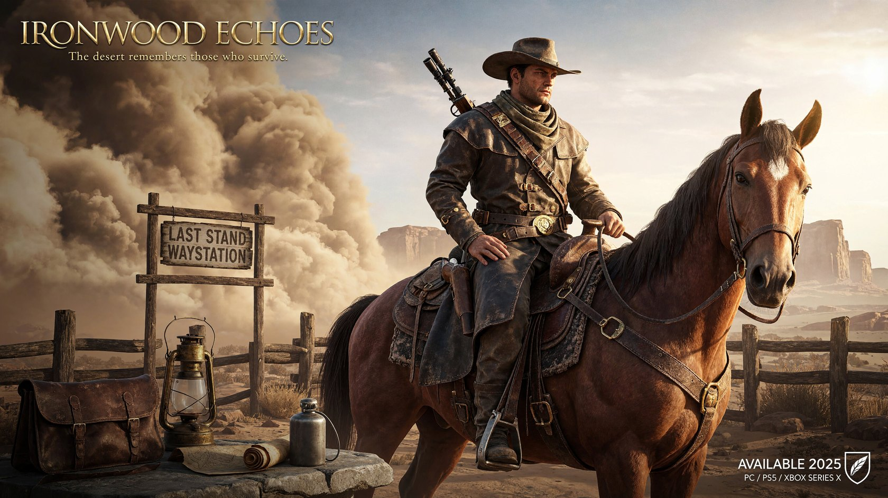

プロンプト

<blockquote>Aspect ratio 16:9, 4K. Create original game key art that evokes the genre atmosphere of a major AAA production through mood, gameplay motifs and composition. Use realistic 3D materials and cinematic lighting, with original identities, costumes and symbols. Scene: An adult frontier rider waits at a waystation as a sandstorm approaches and the horse turns its head. Use original identities and designs without existing franchise names, characters, brand marks or watermarks.</blockquote>

### 砂漠の大集会

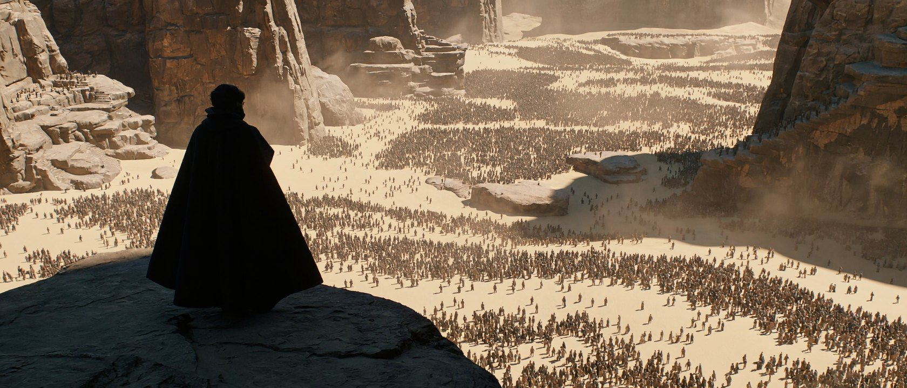

プロンプト

<blockquote>Aspect ratio 21:9. An epic, realistic cinematic scene looking down on a vast desert gathering from a high rock ledge behind a figure. A person in a long dark cloak stands slightly left of center in the foreground, back to the camera, their outline almost a black silhouette. Below, a dense crowd fills a broad sandy area and a natural amphitheater enclosed by rocks. Tiny figures extend into the distance in imperfect rows, merging into a fine, orderly texture. Brown rock walls, rough steps, and raised ledges on both sides define the space, with a slight dusty haze in the warm beige air. Natural daylight from above illuminates the gathering while the foreground remains in deep shadow, emphasizing the contrast in scale between the isolated nearby figure and the immense crowd. Realistic cinematic color grading.</blockquote>

### 寒色の鉱物荒野、空撮

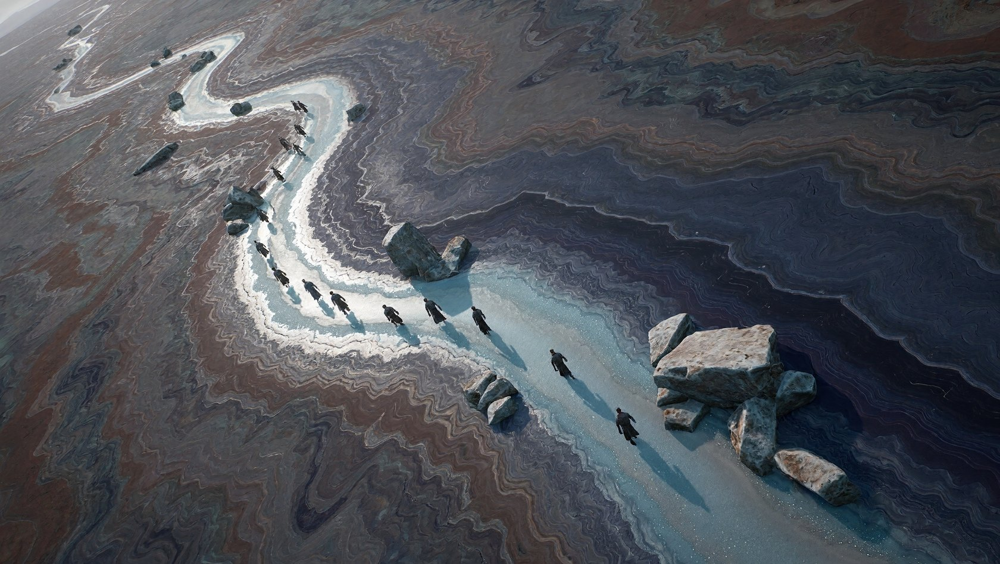

プロンプト

<blockquote>An ultra-wide aerial image in a game-CG style, showing an expansive mineral wasteland from a slightly oblique high-altitude viewpoint. Shift the overall palette from warm reddish-browns to deep indigo, cool gray, teal, and silvery white. The surface spreads like a natural agate cross-section, with layered mineral bands intertwining into irregular rings of sediment and winding branches. No sky or horizon is visible; all visual information is concentrated in the ground textures, creating an unfamiliar, silent, and magnificent alien landscape. 
 
A brighter, narrow gray-teal passage enters from the lower right, bends toward the center-left, then follows a gentle S-curve into the upper-left distance. This replaces a straight diagonal layout and serves as the main visual guide into the image. Keep the passage mostly on the left, leaving a large expanse of deep-indigo mineral deposits on the right for an asymmetrical composition with varied density. Silvery-white and cool-gray mineral crusts and narrow channels line the passage, their naturally winding edges resembling pale traces of a dried-up water system. Broad dark-teal sedimentary areas have fine wavy strata, interspersed with pale blue-green lines that curve, converge, and branch with the terrain. 
 
About ten tiny travelers in dark-gray and black-brown long garments walk loosely spaced along the passage. They occupy only a very small portion of the image, with clear human silhouettes but no emphasis on facial detail. The group extends from the lower right toward the center-left bend, then gradually disappears into the narrow passage at the upper left. Spacing is uneven; some travelers pass near white rocks, while others cross exposed gray-teal ground. Place the group's visual center near the left-third line to balance the vast empty terrain on the right. The stark contrast between the travelers' scale and the immense landforms conveys a lonely journey and an epic narrative. 
 
Gray-white rocks of varied sizes lie scattered along the passage. Larger rugged boulders cluster near the lower-right entrance, with scattered stones and a few prominent pale boulders at the center-left bend and in the upper-left distance, creating depth from near to far. The rocks have weathered, powdery, granular surfaces and irregular edges. Lit faces glow cool white, while unlit faces sink into deep blue-gray shadow. The ground combines dry mineral crust, fine sand, and a few tiny reflective particles, rendered with the rich material detail of high-fidelity game-environment assets without excessive sharpening. 
 
Low-angle, cool-white sunlight enters from the upper left, casting extremely long diagonal shadows from travelers and rocks toward the lower right. These narrow shadows overlap along the S-shaped passage, contrasting with the winding ground patterns. Use low-key exposure overall, darker terrain on the right and a slightly brighter passage on the left, retaining natural vignetting. Silvery highlights, muted teal midtones, and deep-indigo shadows form a restrained cool palette, with a slight dusty haze and refined cinematic post-processing. 
 
Style and parameters: High-quality game CG, realistic 3D terrain rendering, cinematic game cutscene, physically based materials, global illumination, cinematic aerial composition, oblique high-altitude view, extreme long shot, S-shaped leading line, asymmetrical layout, widescreen ratio approximately 2.5:1, high-definition detail, deep depth of field, clear ground textures, low-light cool illumination, high dynamic range, moderately muted colors, soft highlights, dark shadows, no text, logos, or borders.</blockquote>

### 赤褐色の鉱物荒野、空撮

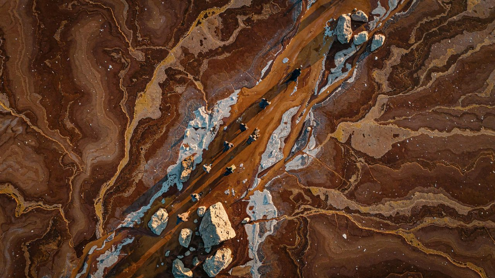

プロンプト

<blockquote>A cinematic ultra-wide aerial view, looking almost vertically down on a vast reddish-brown mineral wasteland, 2.5:1 widescreen, with no sky or horizon. The terrain resembles a natural agate cross-section, with interwoven layers of rust red, deep ocher, caramel orange, and dark brown forming irregular sedimentary rings, wavy strata, and winding branches, with occasional fine gold lines. The landscape feels unfamiliar, silent, and magnificent. 
A bright, narrow orange-brown passage extends from the lower left to the upper right, forming the composition's diagonal backbone. Creamy-white mineral crusts, gray-white rocks, and narrow channels line its sides like a dried-up water system. About ten tiny travelers in dark-gray and black-brown long garments follow the winding passage at uneven intervals, some close to white rocks. Do not emphasize faces. Their tiny scale contrasts with the immense landscape, evoking a lonely journey and an epic narrative. 
Rocks of varied sizes punctuate the route, with rough, weathered surfaces and irregular edges. The ground blends dry mineral crust, fine sand, and a few reflective particles. Low-angle warm sunlight enters from the upper left, stretching the travelers' and rocks' shadows toward the lower right, where narrow shadows intersect curved ground patterns. Keep exposure low-key, darker at the edges and slightly brighter in the center, with restrained layers of warm-orange highlights and deep reddish-brown shadows. 
Realistic landscape photography, extreme long shot, deep depth of field, high-definition textures, high dynamic range, moderately muted colors, soft highlights and natural vignetting, slight dusty haze and fine film grain, no excessive sharpening, no text, logos, or borders.</blockquote>

### 森の古代劇場

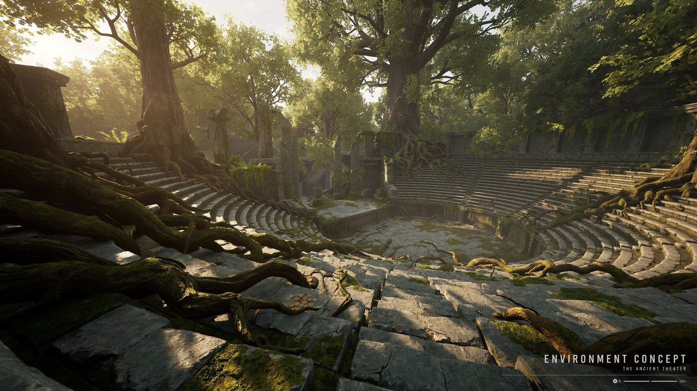

プロンプト

<blockquote>Aspect ratio 16:9, 4K. Create a finished environment concept image for a AAA game, in which the terrain, landmarks, and function of the settlement are immediately legible before the viewer notices the finer details. Use a credible, realistic 3D space, architecture adapted to climate and terrain, and distinct foreground, midground, and background. Specific subject: an amphitheater swallowed by the forest, with tree roots entering the seating through cracks. Do not use names, characters, or brand logos from existing works, and do not add a watermark.</blockquote>

### 雲海の上の宮殿

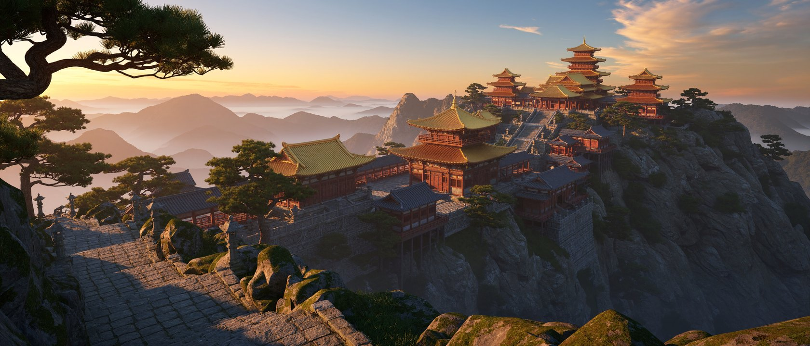

プロンプト

<blockquote>Aspect ratio 21:9, 4K. Create a cinematic, photorealistic digital matte painting suitable for extending a distant view in a AAA cutscene. Keep the foreground clear, the midground structured, and the background progressively softened by atmospheric perspective. Unify the horizon, lighting, and scale, and integrate buildings naturally with the terrain without collage seams. Specific subject: a mountain monastery complex extending along a ridge, its roofs illuminated layer by layer by golden morning light. Do not use names, characters, or brand logos from existing works, and do not add a watermark.</blockquote>

### 扇状の炎を放つ魔法使い

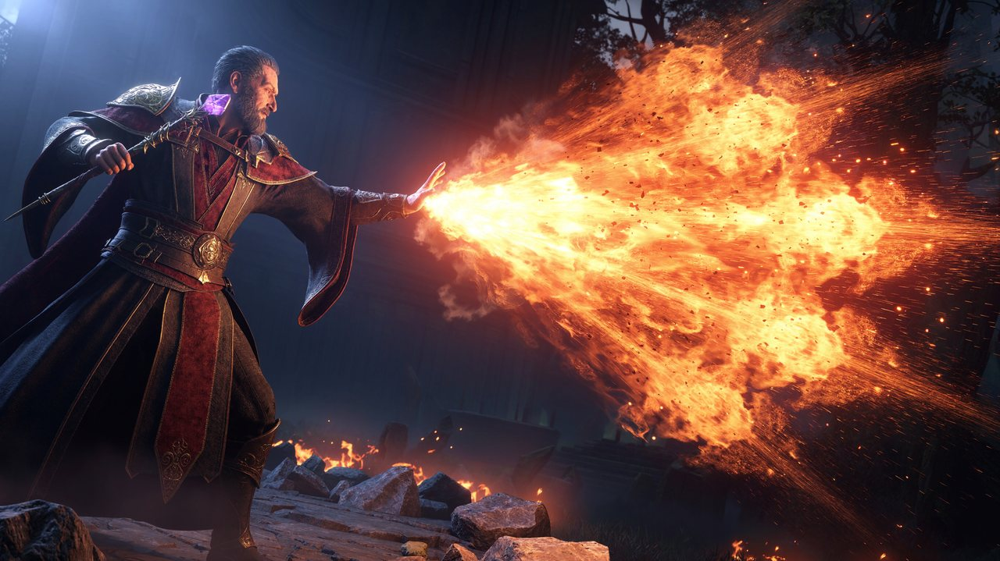

プロンプト

<blockquote>Aspect ratio 16:9, 4K. Render a realistic AAA game effect at its peak, keeping the character or device and ground readable. Clearly distinguish origin, direction and area of influence, with layered particle density and environmental light interaction, without damage numbers, UI or text. Scene: An adult mage releases a fan of fire from the palm with flame tails bending downwind. Use original identities and designs without existing franchise names, characters, brand marks or watermarks.</blockquote>

### 爆発の 2 段階

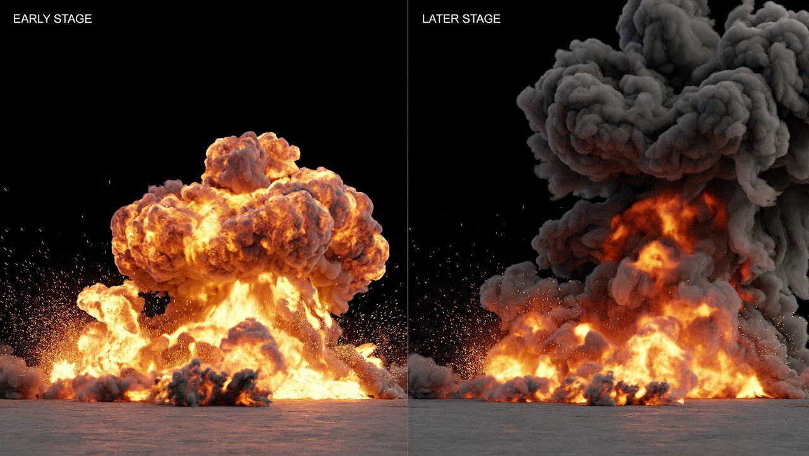

プロンプト

<blockquote>A two-stage comparison image of a cinematic VFX explosion simulation, against a pure-black background, with a gray untextured horizontal ground plane beneath each view. Two side-by-side panels use identical camera positions and scale: the left shows an early explosion stage, with a rolling bright orange-yellow fireball and densely packed tongues of flame forming cauliflower-like details; the right shows a slightly later stage, with orange flames still at the base and a large mass of dense dark-gray smoke curling toward the upper right. The volumetric fire and smoke have realistic translucency, density, turbulence, and layering. Use a fast shutter speed to freeze the instant, emphasizing the shapes of fire and smoke and their mutual occlusion. Output one complete image, preserving this composition and number of views. Do not add webpage borders, artist signatures, or watermarks.</blockquote>

### 重装騎士のキャラクターシート

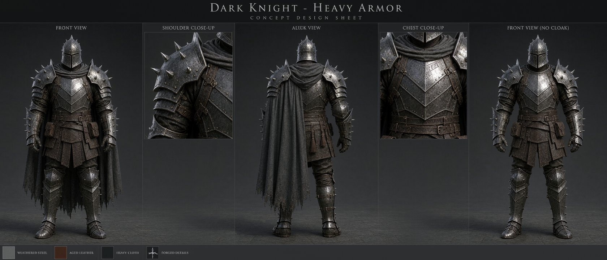

プロンプト

<blockquote>A dark-fantasy game character design sheet against a dark-gray gradient studio background. Show the same tall male knight in heavy armor in three side-by-side full-body views: front, back, and front with the shoulder cloak removed. Keep pose and proportions consistent. His face is fully concealed inside an angular closed helmet. The dark-steel plate armor has pointed pauldrons, segmented chest plates, arm guards, knee guards, and greaves. A worn gray-black cloth mantle wraps his neck and shoulders, and layered dark-brown leather skirt armor and straps hang at his waist. Place small isolated close-ups of the shoulder and chest armor between the views. Realistic game concept art, with clear metal wear, leather roughness, and fabric folds, a cool-gray palette, and soft top-side lighting. Show the feet and full silhouette. Output one complete image, preserving this composition and number of views. Do not add webpage borders, artist signatures, or watermarks.</blockquote>

### 獅子王の顔のクローズアップ

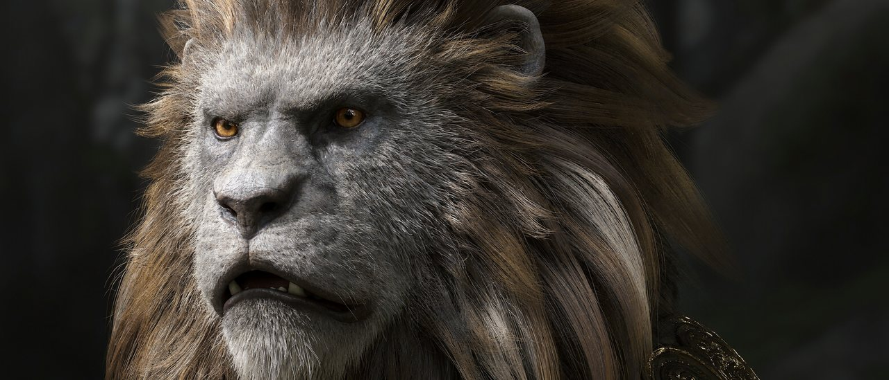

プロンプト

<blockquote>Aspect ratio 21:9. A realistic fantasy-creature facial close-up: a beast king combining a lion's mane with an ape-like facial structure faces the camera, angled slightly left. Clearly show its broad gray nose bridge, deep-set eye sockets, and amber eyes. Its lips are slightly parted, revealing a few small ivory-colored teeth. Short, dense gray-white fur covers its face, surrounded by an enormous brown and silvery-white mane spreading toward the right and bottom of the frame. The fur has natural curls, layers, and fluffy volume, with fine side lighting on individual strands. Only a small portion of a dark-gold ornament appears at the lower-right edge; the face and mane remain the focus. Use a dark, blurred background, realistic transitions between skin and fur, moist eye reflections, and cinematic creature materials. Output one complete artwork with no website borders, artist signatures, or watermarks.</blockquote>

### 森のドラゴン

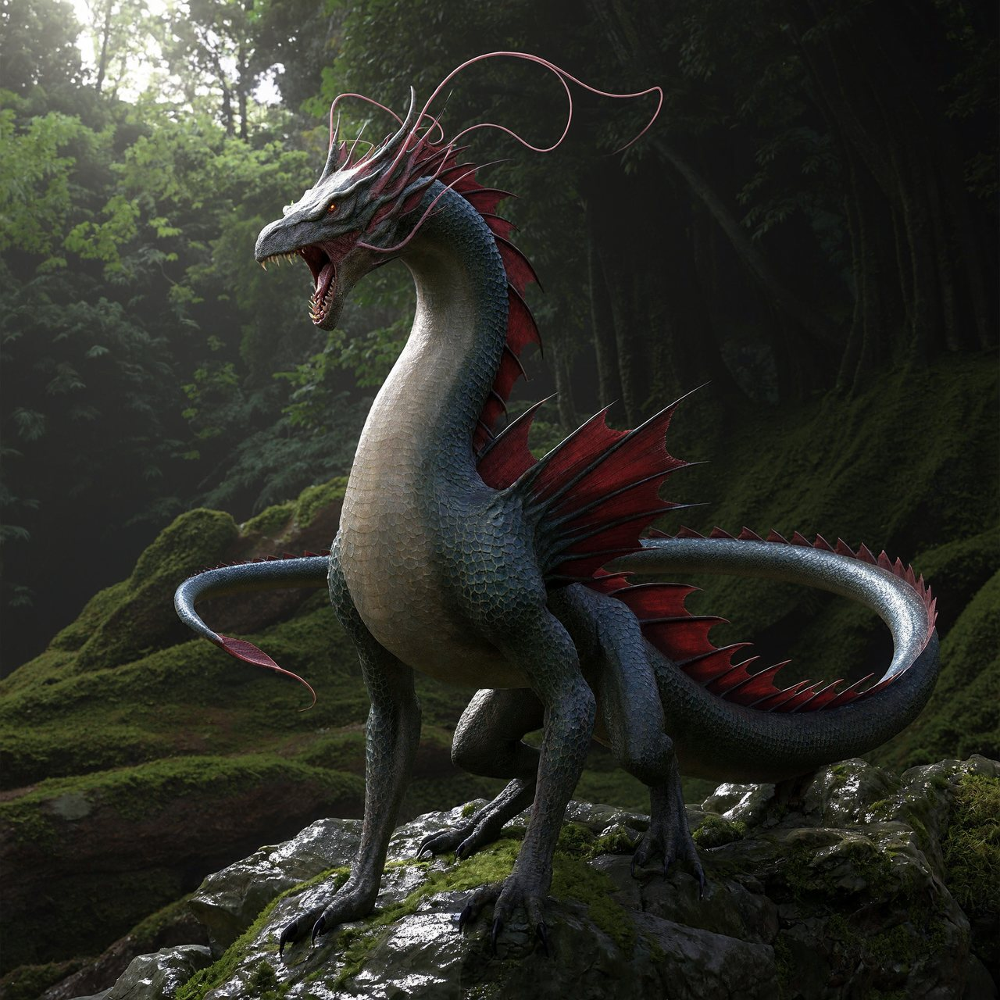

プロンプト

<blockquote>A realistic fantasy-film creature stands on a rock in a dim forest, in a square full-body composition. The subject is a dragon with a tall neck and slender body, fine gray-blue and dark-green scales, a beige-gray belly, and fan-shaped dark-red dorsal membranes rising from its shoulders to its tail. Its mouth is open in a roar, with many long pink tendrils and horn-like fleshy crests growing from its forehead and cheeks and curling backward, forming an elegant, complex silhouette. Its four limbs have a reptilian structure with sharp claws, its long tail curves around the body toward the left, and its feet rest on damp rocks and moss. Soft natural forest light shines through parts of the tendril crest. Fine, credible materials, with no text or watermark.</blockquote>

## SF とポストアポカリプス

### 一人称シューティングの場面

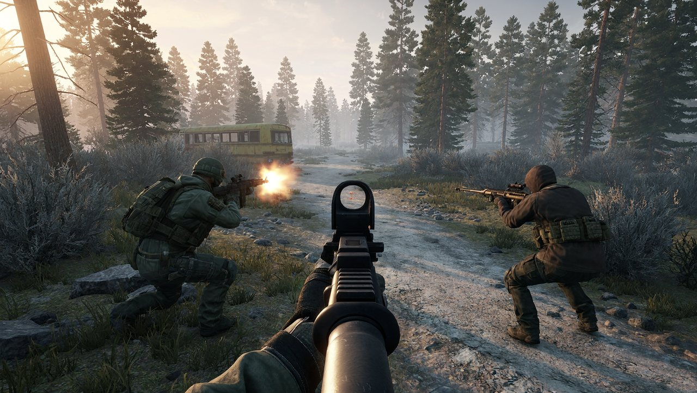

プロンプト

<blockquote>Aspect ratio 16:9. A realistic post-apocalyptic first-person shooter scene. At the lower edge, the player's hands hold a rifle and optic aimed down an abandoned woodland road. In the left midground, a companion wearing green tactical clothing, a backpack, and a helmet fires forward, with a small orange-yellow muzzle flash. On the right, another fighter in a hood and worn brown coat crouches halfway while holding a long gun. Tall pines, gray shrubs, and thin fog surround the distant road; a rusty yellow bus sits in the left background. The ground has rich details of weeds, stones, and soil. Low sunlight at dawn or dusk filters through the trees, contrasting the cool gray-green environment with brief gunfire flashes. Equipment structures should be realistic. Tense atmosphere with no gore and no HUD.</blockquote>

### 白モデルのレンダリングを映画のスチルに

<table><tr><td width="50%" valign="top">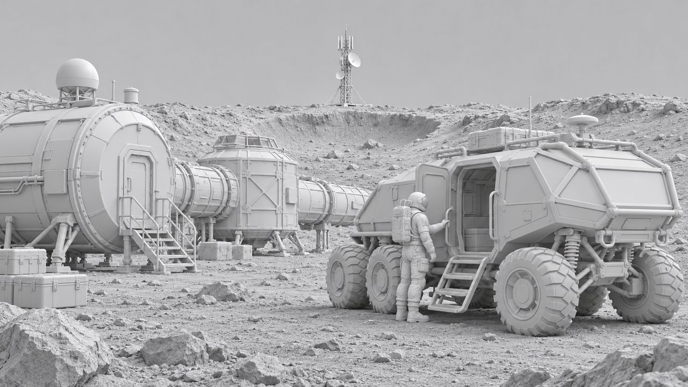 入力</td><td width="50%" valign="top">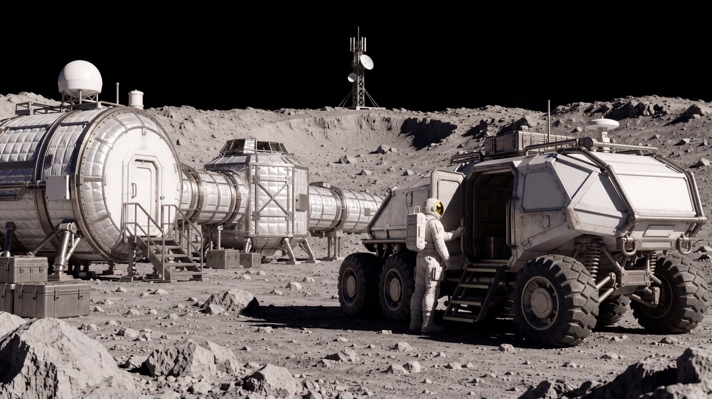 出力</td></tr></table>

プロンプト

<blockquote>Render this untextured 3D model as a realistic cinematic lunar research scene. Add gray lunar soil, silvery-white thermal insulation, coated metal, glass, and wheel-mesh materials, with off-white spacesuits. Use strongly directional sunlight and limited ground bounce. Keep the distant sky pure black, with no blue sky, clouds, or Earth-like haze. Preserve the rover's six wheels and the arrangement of the people and modules. Keep shadow directions consistent and material detail visible in highlights. Preserve the original composition, camera angle, perspective, geometry, and the position and proportions of every subject. Output 4K in 16:9 landscape format, combining AAA photorealistic CG with cinematic live-action texture. Do not add text, brands, interface elements, or watermarks.</blockquote>

### 峡谷の水力発電所、マットペインティング

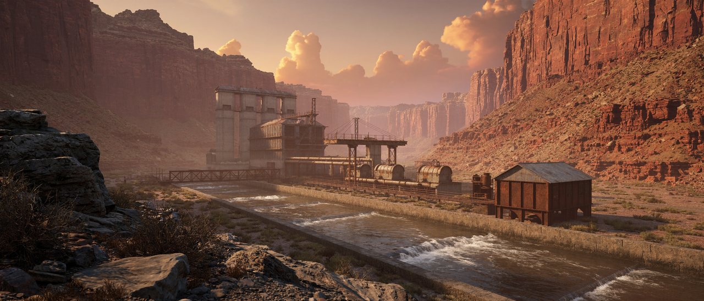

プロンプト

<blockquote>Aspect ratio 21:9, 4K. Create a cinematic photoreal matte painting suitable for extending an AAA cutscene. Use a crisp foreground, structured middle distance and atmospheric recession, with consistent horizon, light and scale and seamless transitions between architecture and terrain. Scene: An old hydro station enclosed by red canyons with a long channel crossing the scene. Use original identities and designs without existing franchise names, characters, brand marks or watermarks.</blockquote>

### 廃駅

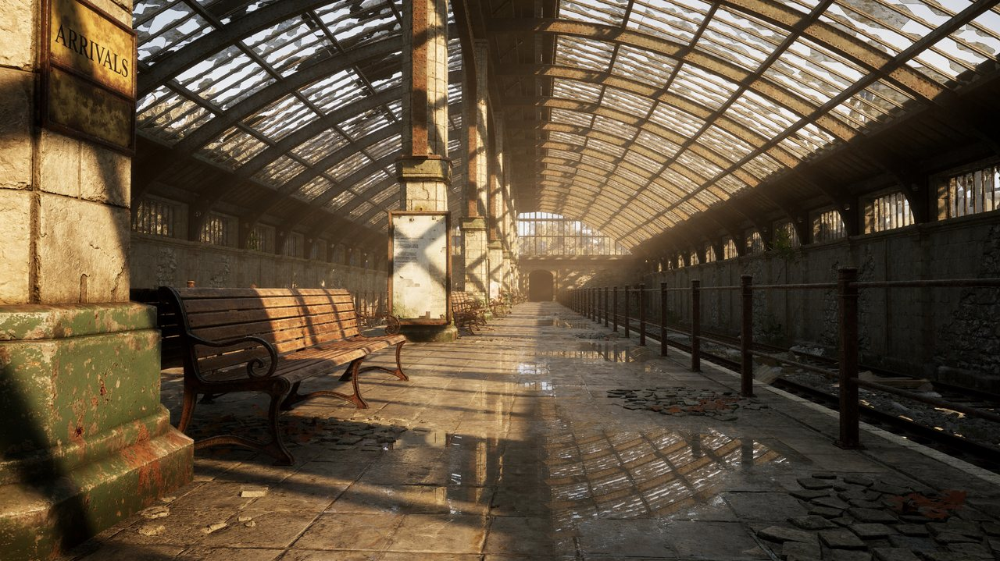

プロンプト

<blockquote>Aspect ratio 16:9, 4K. Generate a photorealistic AAA image with a high-end real-time engine look. Emphasize indirect illumination, varied roughness, contact shadows and depth separation. Show only the rendered scene, without an editor or performance counters. Scene: Sunlight enters an abandoned station through a glass roof and reflects its steel frame in wet tiles. Use original identities and designs without existing franchise names, characters, brand marks or watermarks.</blockquote>

### 荒廃した工業地帯

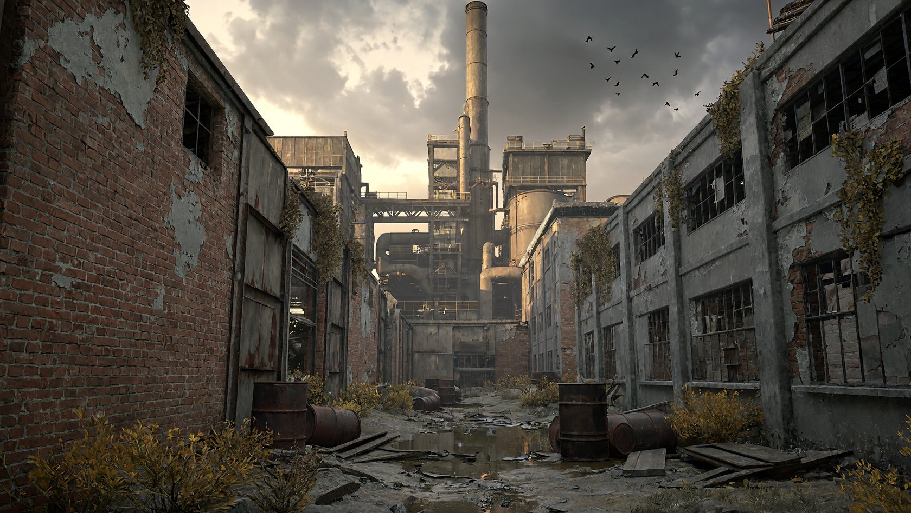

プロンプト

<blockquote>Aspect ratio 16:9. A realistic exterior of a post-apocalyptic industrial complex, viewed from a low camera position through a narrow yard filled with rubble and scrap. A tall faded red-brick wall dominates the left foreground, with a ruined concrete factory building on the right. In the central distance stand multi-level steel production towers, cylindrical tanks, connecting bridges, and massive chimneys. Rusty barrels, broken planks, and withered yellow shrubs are scattered in the foreground, and shallow puddles reflect light on the muddy ground. Heavy gray clouds hang low, with sunlight breaking through to illuminate parts of the buildings and black birds circling above. Strong depth and architectural occlusion create tension. Clearly show peeling concrete, rusted steel panels, broken window frames, and encroaching vegetation. Use a muted gray-yellow palette and realistic game-environment rendering. Output one complete artwork with no website borders, artist signatures, or watermarks.</blockquote>

### 凍った湾の難破船

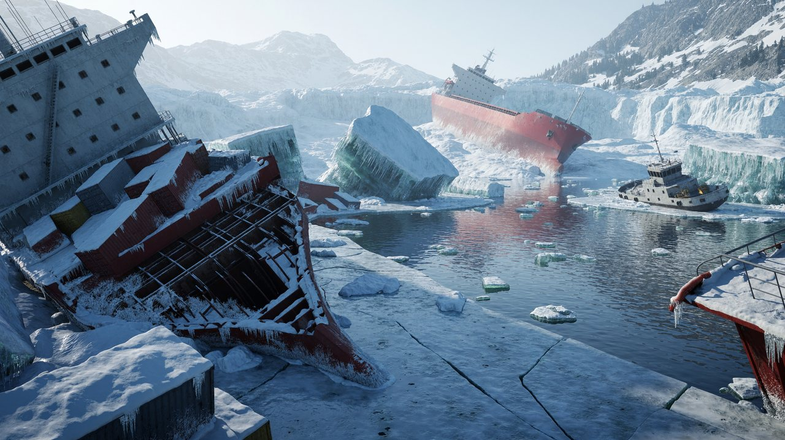

プロンプト

<blockquote>Abandoned shipwrecks in an intensely cold, frozen bay, in a 2.2:1 ultra-wide panorama, with a 24 mm wide-angle lens looking slightly downward. On the left, a tilted wreck is covered in snow and icicles, with rusty containers scattered across its deck. Central cracks in broken ice lead to a blue channel, translucent teal ice walls, and drifting ice floes and debris. A white-gray tugboat is grounded on the right, while a red cargo ship lies capsized among glaciers in the distance. Snowy mountains, ice cliffs, and sparse conifers fade into cold mist. Use an ice-blue and teal-gray palette punctuated by dark-red hulls. Cold daylight creates a dark-near, bright-far hierarchy, with a silent, desolate mood. Cinematic realism, authentic ice, snow, and metal materials, water reflections, deep depth of field, volumetric fog, 8K, no people, text, or watermarks.</blockquote>

### 戦闘パイロット

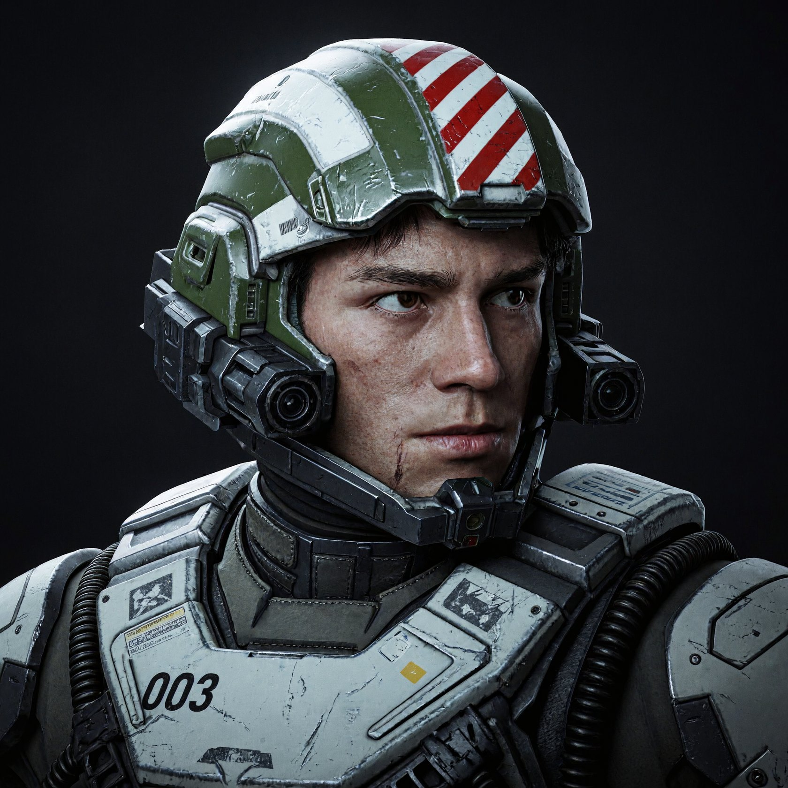

プロンプト

<blockquote>Aspect ratio 1:1. A close half-body portrait of a realistic futuristic combat pilot. The young man has a stern face, eyes glancing slightly right, and small abrasions on his cheeks. His hair is hidden inside a complex open-face armored helmet. The helmet has an olive-green and aged-white industrial shell, a red-and-white striped insignia on top, sensors, black optical lenses, communication boxes, and hinged brackets along both sides of the face, and a protective neck frame beneath the jaw. Thick white-gray chest armor features dark straps, hoses, the number “003,” stickers, and small warning markings, with scratches, dust, and chipped edges. Keep the subject close to the camera against a pure-black background. Soft cool light from the upper left outlines his face and equipment, emphasizing complex mechanical assembly, realistic skin, and military hard-surface materials. Output one complete artwork with no website borders, artist signatures, or watermarks.</blockquote>

### 極地服のコスチュームボード

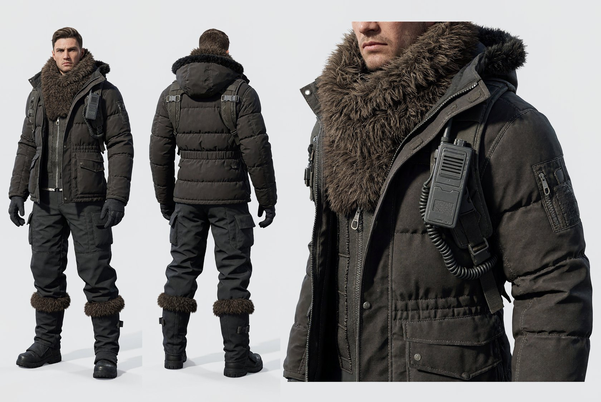

プロンプト

<blockquote>Aspect ratio 3:2, 4K. Create an original AAA costume board: full front view on the left, full rear view in the center and one construction close-up on the right, using the same adult model and outfit. Show realistic 3D drape, seams and fastening structures against pale gray without text. Scene: An insulated polar communicator outfit with fur collar, sealed cuffs and gaiters. Use original identities and designs without existing franchise names, characters, brand marks or watermarks.</blockquote>

### 赤い荒野のヘルメット

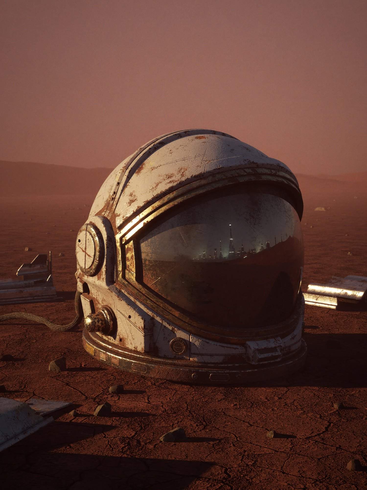

プロンプト

<blockquote>Aspect ratio 3:4, 4K. Create a portrait-format cover key visual for an original AAA game, using realistic 3D and dramatic but restrained cinematic lighting. Establish a clear focal point with one main character or central object. Keep approximately the top quarter quiet for later typography, and do not generate a title, logo, or text in the current image. Specific subject: a dust-covered astronaut helmet lying on a red wasteland, its visor reflecting a distant base. Do not use names, characters, or brand logos from existing works, and do not add a watermark.</blockquote>

### SF 戦闘機

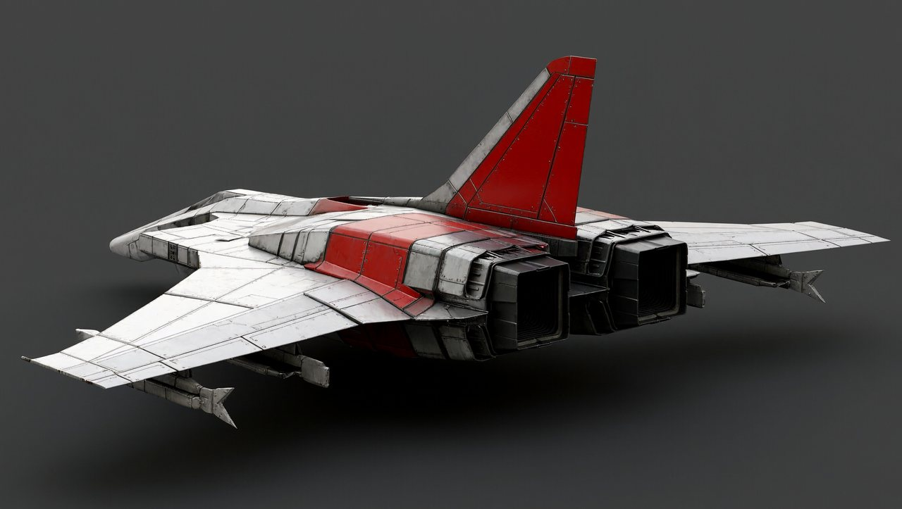

プロンプト

<blockquote>Aspect ratio 16:9. A realistic sci-fi fighter aircraft asset presentation from a slightly elevated rear three-quarter view. The fighter rests on neutral dark-gray ground, with a low, streamlined white-gray fuselage accented by red armor panels and red tail fins. Two large black rectangular exhausts sit at the rear, surrounded by layered machinery and cooling structures. Wings extend to both sides, with small payloads and slender equipment underneath, and a raised fin-like structure along the upper fuselage. Preserve clearly defined panel seams, panel thickness, metal connections, and light wear. Use soft overhead studio lighting and natural ground contact shadows, emphasizing the twin-engine layout and clean, readable hard-surface silhouette. Output one complete artwork with no website borders, artist signatures, or watermarks.</blockquote>

### 改造マッスルカー

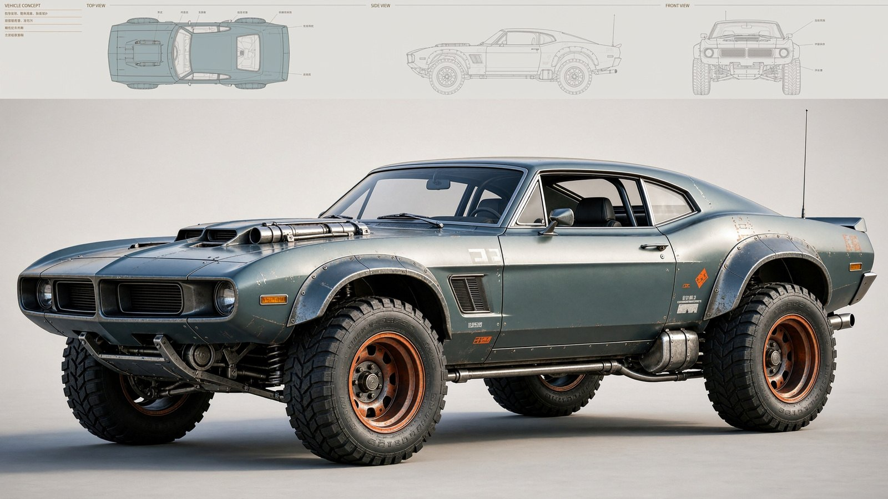

プロンプト

<blockquote>A detailed concept design presentation sheet of a modified sci-fi vehicle, in landscape format against a light warm-gray studio background. The subject is a heavily mechanically modified vintage two-door muscle car: a long engine bay, a low sloping windshield, a smooth fastback roof, and a short, substantial rear, with a wide body and an aggressive stance. Preserve the recognizable character of a classic road-going sports car while integrating mechanical details from near-future industrial equipment and post-apocalyptic off-road vehicles. 
 
Body Design: 
Use a muted gray-blue finish with a slight teal cast. Build the long hood from several broad metal panels with clearly defined creases, seams, and fastening bolts. The nose is low and wide, with separate black intake grilles on each side set within a thick metal frame, deeply recessed round headlights, and narrow amber light strips. Flare the front fenders, and construct the wheel arches from overlapping curved metal guards with visible rivets and mounting seams along their edges. 
 
Mount a low exposed mechanical power module at the center of the hood, including metal intakes, short cylinders, pipes, connecting brackets, and fasteners. Keep it close to the body so it does not disrupt the long nose silhouette. Add small triangular vents and vertical cooling louvers behind the front wheels. The wide doors retain simple mechanical handles and small mirrors; dark seats, a steering wheel, and a few roll-cage elements are visible through the side-window openings. Give the rear fenders a full, powerful shape, add a small rear spoiler, and extend a thin antenna vertically from the rear. 
 
Tires and Chassis: 
Use a four-wheel layout with broad, thick off-road tires at both front and rear. Give them clearly defined large-block tread patterns and restrained molded lettering on the sidewalls. Use deeply recessed rims with worn orange-copper outer rings and dark-metal mechanical centers, creating the vehicle's most prominent color accents. 
 
Raise the body moderately, leaving visible clearance between tires and wheel arches to expose suspension, dampers, and connecting brackets. Beneath the front bumper, show an open mechanical structure with a crossmember, round drivetrain components, metal protective frames, lines, and towing points. Slender metal links and protective bars run beneath the doors. A silver cylindrical tank with connecting pipes is visible ahead of the rear wheel, and a short, thick metal exhaust projects beneath the side of the rear. Concentrate mechanical detail around the lower front, chassis, and inside the wheel arches, while retaining larger uninterrupted metal surfaces on the doors and roof. 
 
Materials and Wear: 
The gray-blue paint has subtle semi-matte reflections, with slight chipping at some edges exposing dark-silver metal. Add small amounts of dust, grease, and wear around wheel arches, service hatches, door seams, and the chassis, with realistic rough rubber tires. Scatter a few faded white identification marks, orange industrial warning stickers, small numbers, and maintenance labels across the body, keeping them modest in size and logically placed for machinery. The overall condition should suggest prolonged use with good maintenance. 
 
Main View Composition: 
The vehicle occupies approximately 75% of the visual area in the middle and lower portions of the image, shown from a front-left three-quarter angle, with the nose pointing left and the rear extending right. Position the camera slightly above the headlights, using natural medium-to-long-lens perspective to show the hood, side door, both near-side wheels, and part of the roof. Leave adequate space around the car, keeping the nose, tires, rear, and antenna fully visible. The vehicle is parked on light-gray ground with clear contact shadows underneath, conveying a grounded, substantial, powerful stance. 
 
Supporting Views and Layout: 
Reserve an open technical-information strip along the top: a narrow column of small explanatory text and a few orange-brown divider lines at the upper left, a small top view of the same vehicle left of center, a small side view in the middle, and a paler front structural line drawing at the upper right. Use low-contrast gray-brown lines for the supporting views, with some pale gray-blue body-color areas, giving them clearly less visual weight than the main view. 
 
Align all supporting views along one horizontal baseline, with even spacing and very few fine leader lines, numbers, and short labels. Titles and labels may use short English phrases such as “VEHICLE CONCEPT,” “TOP VIEW,” “SIDE VIEW,” and “FRONT VIEW,” in a thin, condensed engineering sans-serif font. The result should resemble a highly finished industrial vehicle design dossier, with restrained typography, rich information, and a clear hierarchy. 
 
Lighting and Visual Style: 
Use a broad, soft key light from the upper left with a slight side-back light to reveal body facets, paint reflections, tire thickness, and layered chassis machinery. Keep the background a clean light-gray gradient with natural shadows. Use gray-blue, warm gray, dark metal, and small orange-copper accents. Realistic 3D hard-surface rendering, precision industrial-design materials, high clarity, and rich detail, with a retro, composed, rugged near-future character. 
 
Output one complete concept design presentation image with one large main view of the full vehicle and three small technical views at the top. No real car-brand logos, website interface, artist signature, or watermark.</blockquote>

---

← [複雑な視覚的課題](visual-challenges.ja.md) · [ショーケース](README.ja.md) · [現実の世界](real-world.ja.md) →
