

  <a href="game-worlds.md">English</a> |
  <a href="game-worlds.zh-CN.md"><strong>简体中文</strong></a> |
  <a href="game-worlds.ko.md">한국어</a> |
  <a href="game-worlds.ja.md">日本語</a>

# 游戏世界

围绕场景、角色与世界观的游戏概念设计，分奇幻史诗和科幻末世两个方向。

← [复杂视觉挑战](visual-challenges.zh-CN.md) · [效果展示](README.zh-CN.md) · [现实世界](real-world.zh-CN.md) →

## 奇幻史诗

### 边境骑手

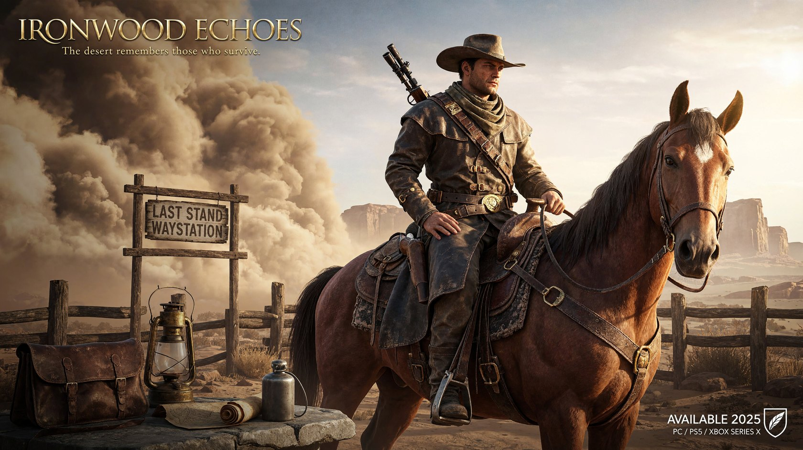

提示词

<blockquote>Aspect ratio 16:9, 4K. Create original game key art that evokes the genre atmosphere of a major AAA production through mood, gameplay motifs and composition. Use realistic 3D materials and cinematic lighting, with original identities, costumes and symbols. Scene: An adult frontier rider waits at a waystation as a sandstorm approaches and the horse turns its head. Use original identities and designs without existing franchise names, characters, brand marks or watermarks.</blockquote>

### 荒漠大集会

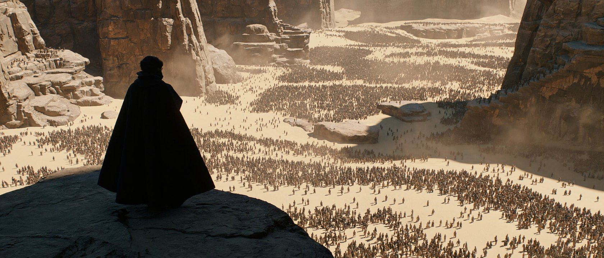

提示词

<blockquote>画幅比例 21:9。史诗感写实电影场面，从人物身后的高处岩台俯视巨大沙漠集会，一个披着深色长斗篷的人物站在近景中央偏左，背对镜头，轮廓几乎形成黑色剪影。下方密密麻麻的人群铺满宽阔的沙地与岩石围合的天然剧场，人群以极小尺度向远方延伸，排列不完全整齐，每个身影融成细密有序的纹理。两侧褐色岩壁、粗糙台阶和隆起岩台构成空间边界，暖米黄色空气中有轻微尘雾。高处自然日光照亮场地，前景保留深阴影，强调孤立的近景人物与庞大集体的尺度对照，真实电影调色。</blockquote>

### 冷色矿物荒原航拍

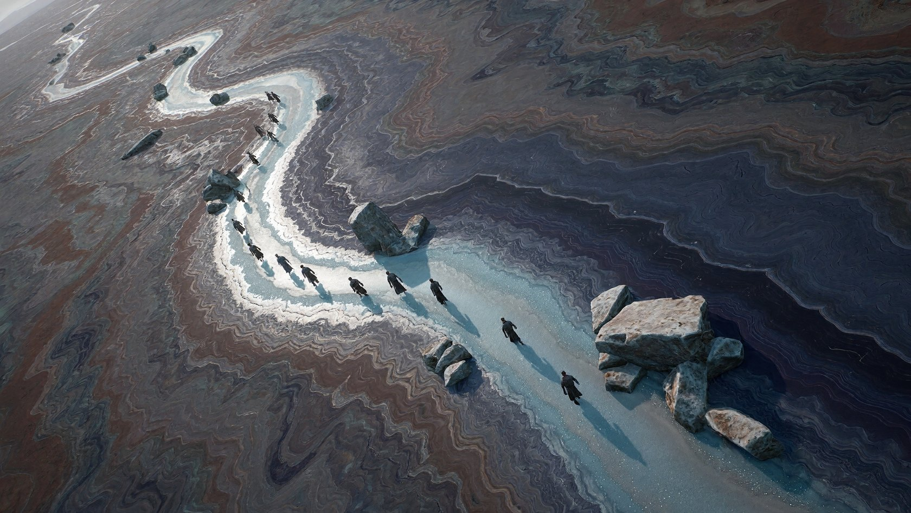

提示词

<blockquote>一幅游戏CG风格的超广角航拍画面，以略带倾斜的高空俯视视角呈现辽阔的矿物荒原。整体色调由红褐暖色转为深靛蓝、冷灰、青绿色与银白色，地表如天然玛瑙切片般铺展，层层矿物色带交织成不规则的环状沉积纹理与蜿蜒分支。画面没有天空和地平线，所有视觉信息集中于地表肌理，营造陌生、寂静而壮阔的异域地貌。 
 
一条较明亮的灰青色狭长通道从画面右下方进入，向中央偏左弯折，再沿柔缓的S形曲线延伸至左上方远处，取代笔直的对角线布局，成为引导视线深入画面的主要动线。通道位于画面偏左区域，右侧保留大面积深靛蓝矿物沉积地貌，形成疏密有致的非对称构图。通道两侧分布银白色、冷灰色的矿物结壳与细窄沟槽，边缘曲折自然，仿佛干涸水系留下的浅色脉络。大片暗青色沉积区域具有细密的波浪状层理，局部夹杂淡蓝绿色细线，纹路顺着地形弯曲、汇聚、分流。 
 
约十名身穿深灰与黑褐色长衣的微小旅人沿通道疏散行进，人物在画面中占比极小，仅保留清晰的人形轮廓，不强调面部细节。队伍从右下方向中央偏左的弯道延伸，再逐渐隐入左上方的狭窄通路，间距不均，部分人物靠近白色岩块，部分穿行于裸露的灰青色地面。队伍的视觉重心落在左侧三分线附近，与右侧辽阔空旷的地貌形成平衡，人物尺度与巨大地貌形成强烈对比，使画面带有孤独的旅途感与史诗叙事气息。 
 
通道沿线散落大小不一的灰白色岩石，右下方通道入口附近分布较大的粗粝岩块，中央偏左的转弯处与左上方远处有零散碎石和几块突出的浅色巨石，形成由近及远的空间层次。岩石表面呈风化、粉化的颗粒质感，棱角不规则，受光面泛出冷白亮色，背光面沉入深蓝灰色阴影。地面兼具干燥矿壳、细砂与少量细碎反光颗粒，以高精度游戏环境资产的材质表现呈现丰富细节，不过度锐化。 
 
低角度冷白色阳光从画面左上方照入，旅人与岩石的阴影向右下方拉出极长的斜线。多道狭长阴影沿S形通道交错分布，与蜿蜒地纹形成鲜明对照。整体采用低调曝光，右侧地貌深沉、左侧通道稍亮，保留自然暗角；银白高光、低饱和青绿色中间调与深靛蓝阴影构成克制的冷色层次，带有轻微空气尘雾与细腻的电影级后期质感。 
 
风格与参数：高品质游戏CG，写实向三维地貌渲染，电影级游戏过场画面，基于物理的材质表现，全局光照，电影级航拍构图，高空倾斜俯拍，超远景，S形引导线，非对称布局，宽银幕比例约2.5:1，高清细节，深景深，地表纹理清晰，低照度冷光，高动态范围，适度低饱和，柔和高光，深色阴影，无文字、无标志、无边框。</blockquote>

### 红褐矿物荒原航拍

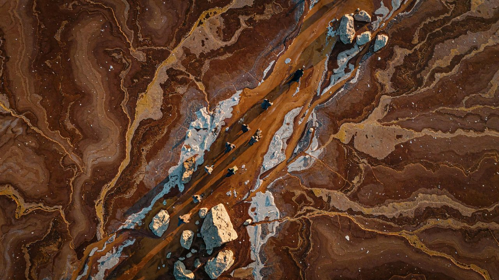

提示词

<blockquote>电影感超广角航拍，近乎垂直俯视辽阔的红褐色矿物荒原，2.5:1宽银幕，无天空与地平线。地表如天然玛瑙切片，铁锈红、深赭石、焦糖橙与暗棕层层交织，形成不规则环状沉积、波浪层理与蜿蜒分支，局部夹杂金色细线，呈现陌生、寂静而壮阔的地貌。 
明亮的橙褐色狭长通道从左下延伸至右上，构成对角线骨架。两侧分布乳白矿物结壳、灰白岩块与细窄沟槽，宛如干涸水系。约十名身穿深灰、黑褐长衣的微小旅人沿通道蜿蜒前行，间距不均，部分靠近白色岩块，人物不强调面部，与巨大地貌形成鲜明尺度对比，带出孤独旅途与史诗叙事感。 
沿途岩石大小错落，表面粗粝风化、棱角不规则；地面融合干燥矿壳、细砂与少量反光颗粒。低角度暖阳从左上照入，将旅人与岩石的阴影拉向右下，狭长阴影与弯曲地纹交错。整体低调曝光，四周深暗、中央稍亮，暖橙高光与深红褐阴影层次克制。 
写实地貌摄影，超远景、深景深、高清纹理、高动态范围，适度低饱和，柔和高光与自然暗角，轻微尘雾和细腻胶片颗粒，不过度锐化，无文字、标志及边框。</blockquote>

### 森林中的古剧场

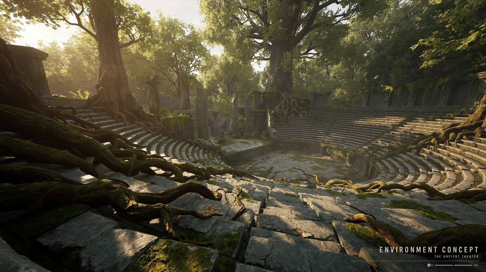

提示词

<blockquote>画面比例16:9，4K。做一张面向3A游戏的环境概念成图，先读出地形、地标和聚落用途，再看到细节。采用可信写实3D空间，建筑顺应气候与地势，保留前中后景。具体内容：被森林吞没的圆形剧场，树根沿裂缝进入座席。不使用现有作品的名称、角色或品牌标志，不添加水印。</blockquote>

### 云海仙山宫阙

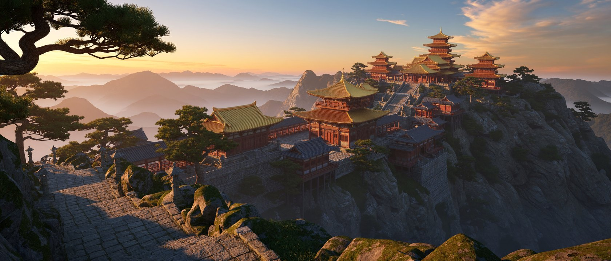

提示词

<blockquote>画面比例21:9，4K。制作电影级写实数字绘景，适合3A过场的远景扩展。前景清晰、中景有结构、远景用大气透视递减，统一地平线、光照与尺度，建筑和地貌自然衔接，不出现拼贴边缘。具体内容：高山寺院群沿山脊延伸，金色晨光逐层照亮屋顶。不使用现有作品的名称、角色或品牌标志，不添加水印。</blockquote>

### 巫师释放扇形火焰

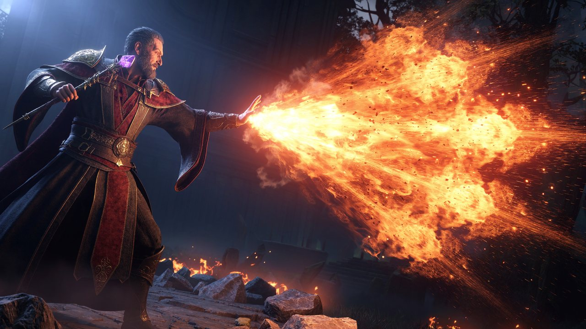

提示词

<blockquote>Aspect ratio 16:9, 4K. Render a realistic AAA game effect at its peak, keeping the character or device and ground readable. Clearly distinguish origin, direction and area of influence, with layered particle density and environmental light interaction, without damage numbers, UI or text. Scene: An adult mage releases a fan of fire from the palm with flame tails bending downwind. Use original identities and designs without existing franchise names, characters, brand marks or watermarks.</blockquote>

### 爆炸的两个阶段

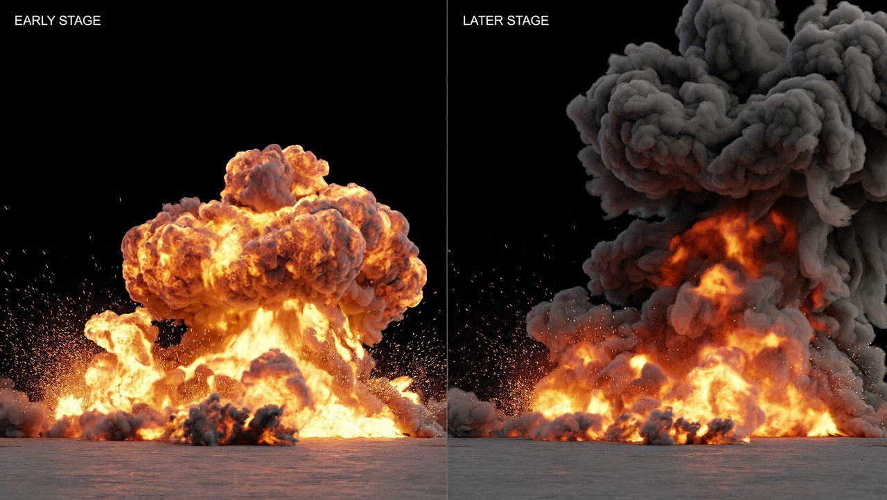

提示词

<blockquote>一张电影特效爆炸模拟的双状态对照画面，纯黑背景，下方各有灰色无纹理水平地面。左右两个并排视窗保持相同机位和尺度：左侧呈现爆炸早期，翻滚火球呈明亮橙黄颜色，火舌密集形成花椰菜状细节；右侧呈现稍晚阶段，底部仍有橙色火焰，上方大团厚重深灰烟云向右上翻卷。体积火焰与烟雾具有真实透光、密度、湍流和层次，较高快门凝固瞬间，画面重点是火与烟的形态及相互遮挡。 输出一张完整图像，保留上述构图和视图数量；不添加网页边框、作者签名或水印。</blockquote>

### 重甲骑士角色设定

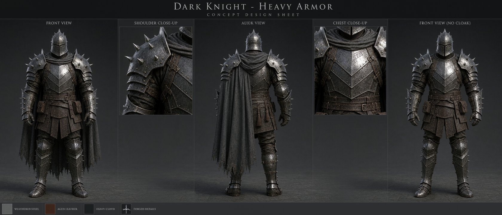

提示词

<blockquote>暗黑奇幻游戏角色设定板，深灰渐变摄影棚背景。同一名高大男性重甲骑士以正面、背面和去除披肩后的正面全身三个视图并排展示，姿势和比例一致。面部完全藏在尖棱封闭头盔内，深色钢铁板甲有尖角肩甲、分片胸甲、护臂、膝甲与胫甲；颈肩围着磨损的灰黑布披肩，腰间是层叠的暗褐皮革裙甲和绑带。视图之间放置独立肩甲与胸甲小特写。写实游戏概念美术，金属磨痕、皮革粗糙度和布料褶皱清晰，冷灰主色，柔和顶侧光，完整展示脚部与轮廓。 输出一张完整图像，保留上述构图和视图数量；不添加网页边框、作者签名或水印。</blockquote>

### 狮王面部特写

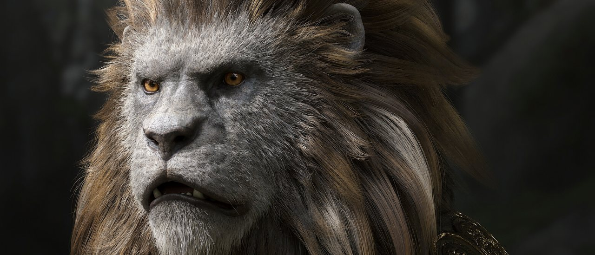

提示词

<blockquote>画幅比例 21:9。写实奇幻生物面部特写，一个兼具狮子鬃毛与猿类面部结构的兽王朝向镜头略偏左，宽阔灰色鼻梁、深陷眼窝和琥珀色眼睛清楚，嘴唇略微张开露出少量小型象牙色牙齿。面部覆盖短而密的灰白毛发，周围巨大的棕褐与银白鬃毛向画面右侧和下方铺开，毛束有自然卷曲、层次和蓬松体积，发丝受到细腻侧光照亮。右下边缘仅露出一小部分暗金色饰件，主体仍是脸部与鬃毛。深色虚化背景，真实皮肤与毛发交界、湿润眼球反射和电影级生物材质。 输出单张完整作品画面，不添加网站边框、作者署名或水印。</blockquote>

### 森林中的龙

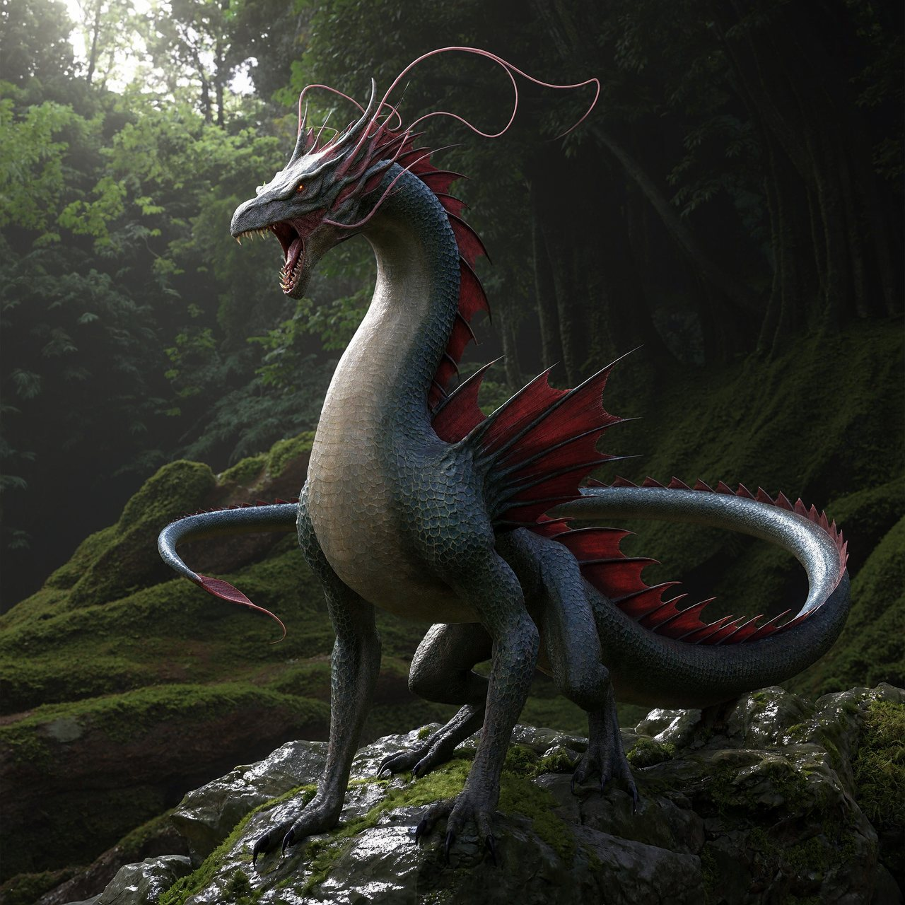

提示词

<blockquote>写实幻想电影生物立于幽暗森林的岩石上，正方形全身构图。主体是一只高颈、细长身体的龙，灰蓝与墨绿色细鳞皮肤，腹部偏米灰色，背部从肩膀到尾部竖起扇形暗红色鳍膜；头部张嘴嘶吼，额头与脸颊生出许多向后飘卷的粉红色长须和角状肉质冠，须丝形成优雅复杂的轮廓。四肢为有锐爪的爬行动物结构，长尾绕身体向左弯曲，脚踩湿润石块和苔藓。森林柔和自然光穿透部分须冠，材质细腻可信，无文字或水印。</blockquote>

## 科幻末世

### 第一人称射击场景

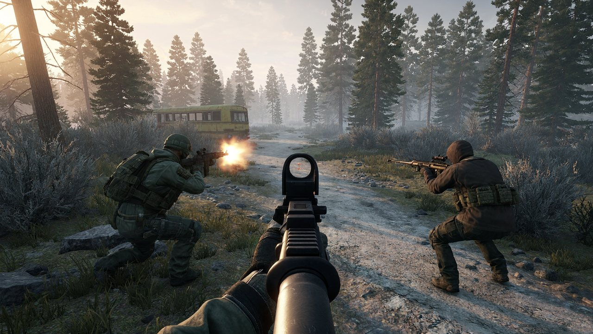

提示词

<blockquote>画幅比例 16:9。写实末世第一人称射击游戏场景，镜头前方下缘可见玩家双手持握的步枪与瞄具，指向一条荒废林地公路。左侧中景一名穿绿色战术服、背包与头盔的同伴向前方射击，枪口闪出小团橙黄色火光；右侧另一名戴兜帽、穿旧棕色外套的战士半蹲持长枪。远处道路被高大松树、灰色灌木与薄雾包围，左后方有一辆生锈黄色巴士，地面杂草、石块与泥土细节丰富。清晨或黄昏的低位日光从树林后透出，冷灰绿环境与短促枪火对比，人物装备结构真实，紧张但没有血腥内容，不加 HUD。</blockquote>

### 白模渲染图变电影剧照

<table><tr><td width="50%" valign="top">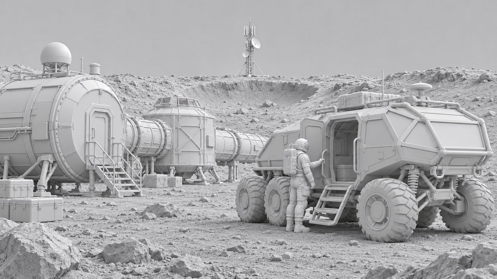 输入</td><td width="50%" valign="top">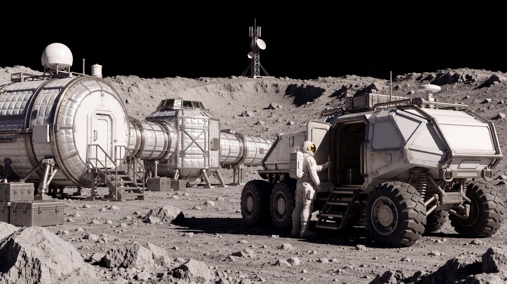 输出</td></tr></table>

提示词

<blockquote>把这张白模渲染成真实月面科考电影画面。补全灰色月壤、银白隔热层、涂层金属、玻璃与轮网材质，宇航服为米白色。使用强方向性太阳光和有限地面反射，远处天空纯黑，不加蓝天、云或地球式雾气。保持探测车六个车轮、人物和舱段布局，阴影方向统一，亮部保留材质细节。 保留原图构图、镜头角度、透视、几何结构与各主体的位置和比例；输出4K、16:9横版，呈现3A级写实CG与电影实拍融合的质感，不添加文字、品牌、界面或水印。</blockquote>

### 峡谷水电站绘景

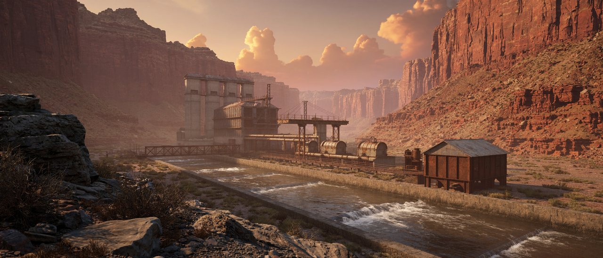

提示词

<blockquote>Aspect ratio 21:9, 4K. Create a cinematic photoreal matte painting suitable for extending an AAA cutscene. Use a crisp foreground, structured middle distance and atmospheric recession, with consistent horizon, light and scale and seamless transitions between architecture and terrain. Scene: An old hydro station enclosed by red canyons with a long channel crossing the scene. Use original identities and designs without existing franchise names, characters, brand marks or watermarks.</blockquote>

### 废弃车站

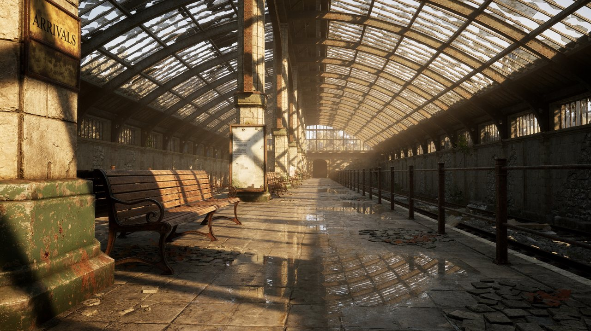

提示词

<blockquote>Aspect ratio 16:9, 4K. Generate a photorealistic AAA image with a high-end real-time engine look. Emphasize indirect illumination, varied roughness, contact shadows and depth separation. Show only the rendered scene, without an editor or performance counters. Scene: Sunlight enters an abandoned station through a glass roof and reflects its steel frame in wet tiles. Use original identities and designs without existing franchise names, characters, brand marks or watermarks.</blockquote>

### 末世工业厂区

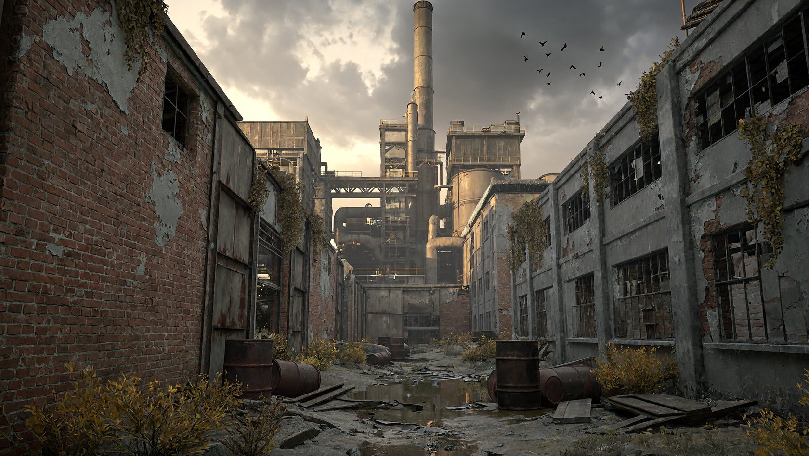

提示词

<blockquote>画幅比例 16:9。写实末世工业厂区外景，低机位穿过满是碎石和废料的狭窄院落。左侧近景为高大的褪色红砖墙，右侧是残破混凝土厂房；中央远处立着多层钢架生产塔、圆筒罐、连桥和粗大烟囱。前景零散摆放生锈油桶、破木板与枯黄灌木，地面泥泞有浅水反射。厚重灰云压低天空，阳光从云缝穿出局部照亮建筑，黑色鸟群盘旋。强烈纵深和建筑遮挡形成紧张气氛，混凝土剥落、锈蚀钢板、断裂窗框与植被侵蚀细节清晰，整体低饱和灰黄配色，写实游戏环境渲染。 输出单张完整作品画面，不添加网站边框、作者署名或水印。</blockquote>

### 冰封海湾中的沉船

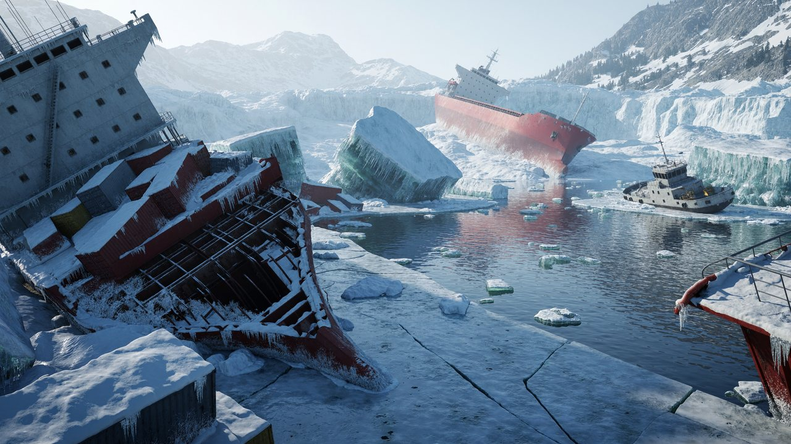

提示词

<blockquote>极寒冰封海湾中的废弃船舶遗址，2.2:1超宽全景，24mm广角微俯视。左侧倾斜船骸覆满积雪与冰柱，锈蚀集装箱散落甲板。中央碎冰裂隙延伸至蓝水道，青绿冰壁透光，浮冰与残片漂流。右侧白灰拖船搁浅，远处红色货轮倾覆于冰川之间。背景雪山、冰崖与稀疏针叶林隐入寒雾。冰蓝青灰主调，暗红船体点缀，冷冽日光形成近暗远亮层次，寂静荒凉。电影级写实，真实冰雪金属材质与水面反射，深景深、体积雾、8K，无人、无字、无水印。</blockquote>

### 战斗驾驶员

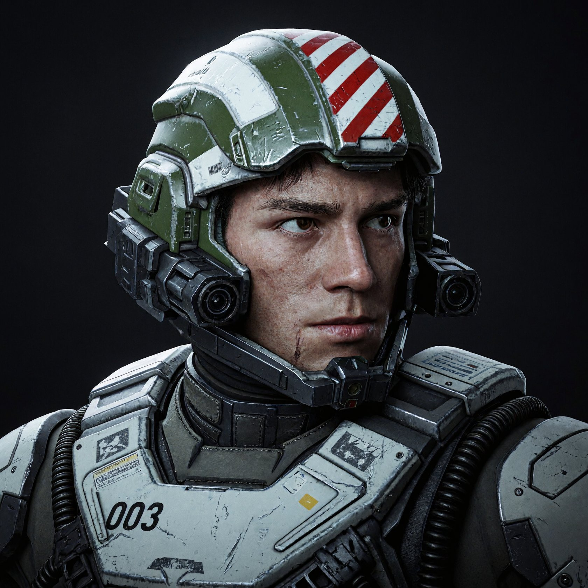

提示词

<blockquote>画幅比例 1:1。写实未来战斗驾驶员的近距离半身肖像，年轻男性脸部冷峻、眼睛微向右看，面颊有细小擦伤，头发藏在复杂的开放式装甲头盔内。头盔为橄榄绿与旧白色工业壳体，顶部有红白斜纹徽记，面部两侧排列传感器、黑色光学镜头、通讯盒和铰接支架，下颌装有护颈框架。白灰色胸甲厚重，有深色胸带、软管、编号“003”、贴纸和细小警示标记，表面有划痕、积尘和边缘掉漆。主体靠近镜头，纯黑背景，冷色左上软光勾勒脸部与设备轮廓，强调复杂机械装配、皮肤真实感和军用硬表面材质。 输出单张完整作品画面，不添加网站边框、作者署名或水印。</blockquote>

### 极地服装设定

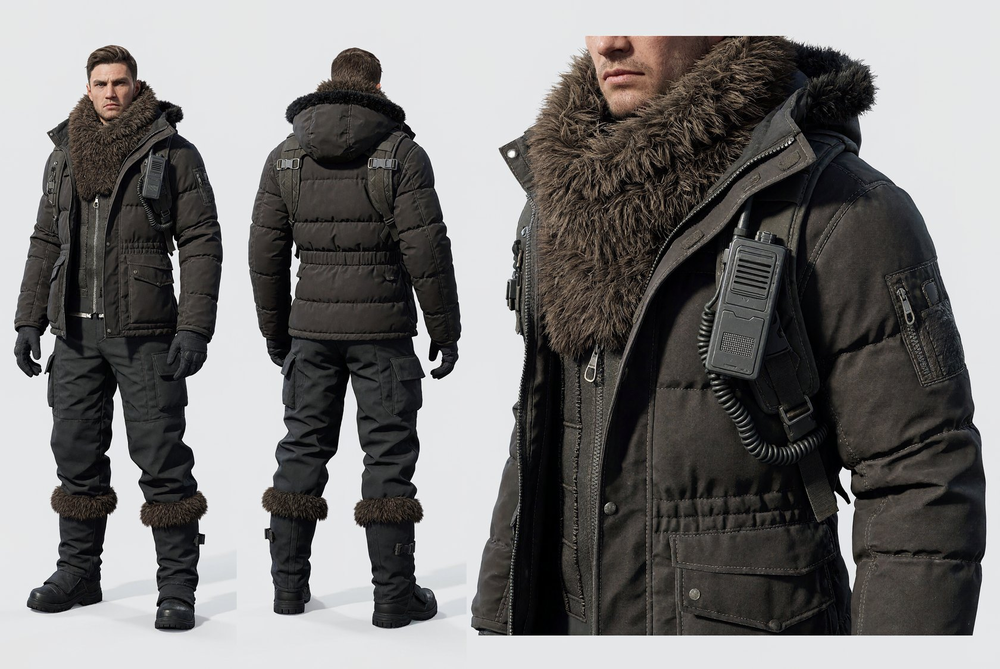

提示词

<blockquote>Aspect ratio 3:2, 4K. Create an original AAA costume board: full front view on the left, full rear view in the center and one construction close-up on the right, using the same adult model and outfit. Show realistic 3D drape, seams and fastening structures against pale gray without text. Scene: An insulated polar communicator outfit with fur collar, sealed cuffs and gaiters. Use original identities and designs without existing franchise names, characters, brand marks or watermarks.</blockquote>

### 红色荒原上的头盔

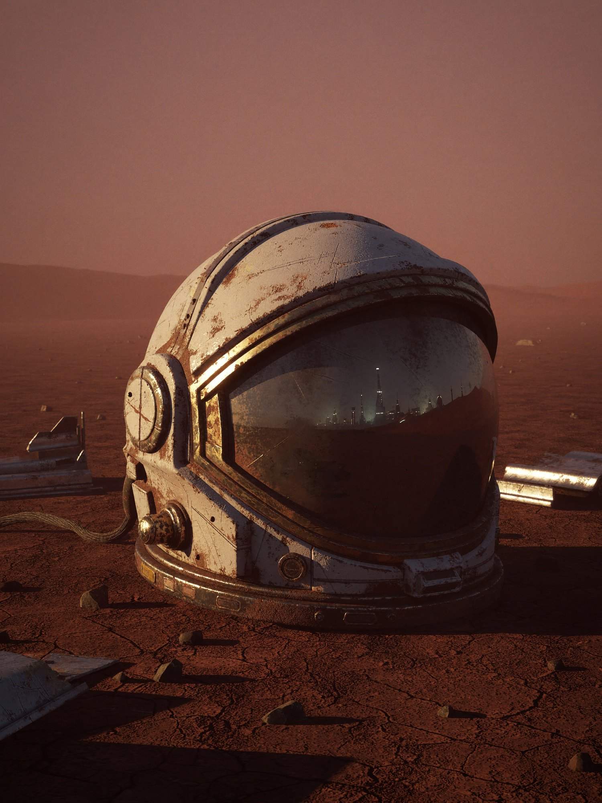

提示词

<blockquote>画面比例3:4，4K。绘制原创3A游戏的竖版封面主视觉，写实3D、强烈而克制的电影光影。让单一主角或核心物占据明确焦点，顶部约四分之一保持安静用于后续排字，当前图不生成标题、标志或文字。具体内容：蒙尘宇航头盔躺在红色荒原上，镜面反射远处基地。不使用现有作品的名称、角色或品牌标志，不添加水印。</blockquote>

### 科幻战斗机

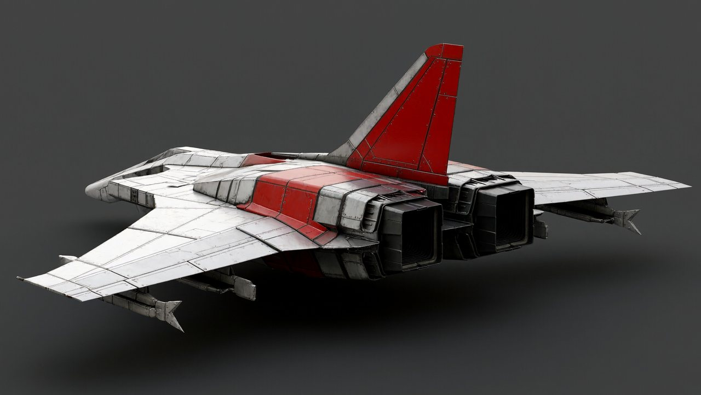

提示词

<blockquote>画幅比例 16:9。写实科幻战斗机资产展示，从上方略俯视机体后侧的三分之四视角，战机停在中性深灰地面上，整体为低矮流线形白灰机身，局部红色装甲与红色尾翼形成鲜明点缀。两组大尺寸黑色矩形喷口位于机身尾部，喷口周围有机械层级与散热结构，机翼向左右展开，翼下分布小型挂载和细长设备，机背有抬起的鳍状结构。表面保留清晰分件缝、面板厚度、金属连接与轻度使用痕迹。柔和棚拍顶光，地面有自然接触阴影，重点展示双引擎布局和干净可读的硬表面轮廓。 输出单张完整作品画面，不添加网站边框、作者署名或水印。</blockquote>

### 科幻改装肌肉车

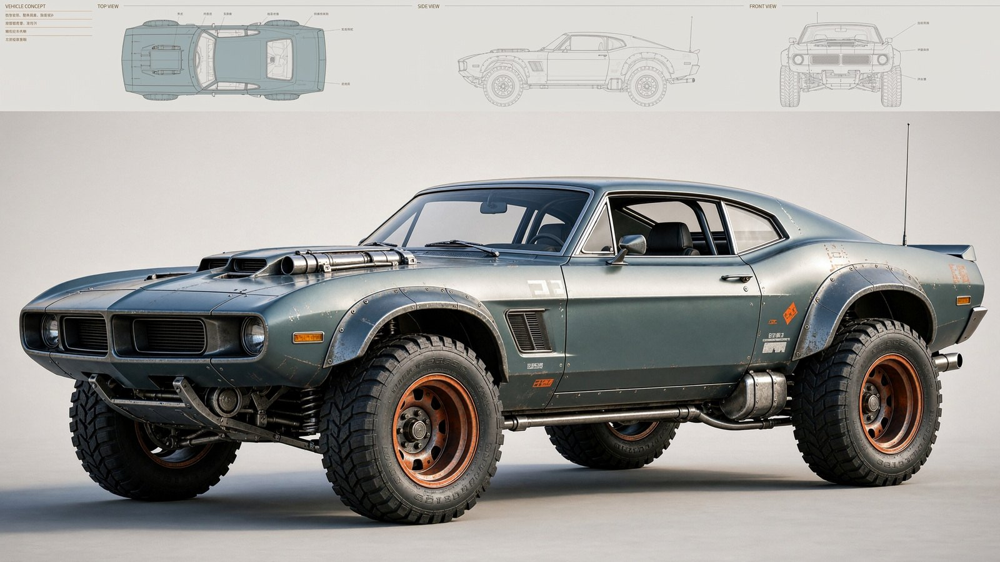

提示词

<blockquote>一张精细的科幻改装载具概念设计展示板，横版构图，浅暖灰色工作室背景。主体是一辆经过重度机械改装的复古双门肌肉跑车：修长的发动机舱、低矮倾斜的前挡风玻璃、流畅的溜背车顶、短促厚实的车尾，车身宽阔，姿态强悍。保留经典公路跑车的辨识度，同时融入近未来工业设备与末世越野载具的机械细节。 
 
车身造型： 
整车采用低饱和灰蓝色涂装，带轻微青绿色倾向。长引擎盖由几块宽大的金属面板构成，表面具有明确的折线、分缝和固定螺栓。车头低平而宽，左右分体式黑色进气格栅嵌在厚实的金属框架内，两侧配置深陷式圆形前灯，辅以细窄的琥珀色灯条。前翼子板外扩，轮拱由多层弧形金属护板叠合而成，边缘清楚可见铆钉与安装缝。 
 
引擎盖中央安装一组低矮的外露机械动力模块，包含金属进气口、短圆筒、管路、连接支架和紧固件，整体紧贴车身，不破坏修长的车头轮廓。前轮后方设置小型三角通风口和竖向散热百叶。车门宽大，保留简洁的机械门把手与小型后视镜；侧窗开口中可以看见深色座椅、方向盘以及少量防滚架结构。后翼子板饱满有力，车尾设置小型扰流板，一根细长天线从后部垂直伸出。 
 
轮胎与底盘： 
采用四轮布局，前后轮都使用宽厚的越野轮胎，胎面是清晰的大块切割纹路，胎壁有克制的模压字符。轮毂采用深凹式结构，外圈为磨损的橙铜色，中央为暗金属色机械轮芯，形成整车最醒目的色彩点缀。 
 
车身适度抬高，轮胎与轮拱之间保留可见间隙，露出悬挂、减振器和连接支架。前保险杠下方是开放的机械结构，可以看见横梁、圆形传动件、金属护架、管线与拖曳固定点。车门下沿延伸出细长的金属连杆与保护杆，后轮前方露出银色圆筒形储罐及连接管路，车尾侧下方伸出短粗的金属排气管。机械细节主要集中在前下部、底盘和轮拱内部，车门与车顶保留较完整的大块金属表面。 
 
材质与使用痕迹： 
灰蓝色漆面具有细腻的半哑光反射，局部边缘轻微掉漆，露出暗银色金属。轮拱、检修口、门缝和底盘附近带有少量灰尘、油污与磨损，橡胶轮胎呈现真实的粗糙质感。车身散布少量褪色的白色识别标记、橙色工业警示贴纸、细小编号和维护标签，尺寸克制，分布符合机械设备的使用逻辑。整体呈现长期使用但维护良好的状态。 
 
主视图构图： 
整车占据画面中下部约75%的视觉面积，采用左前侧三分之四视角，车头朝向画面左侧，车尾延伸至右侧。相机略高于车灯，以自然的中长焦透视同时呈现引擎盖、侧面车门、近侧两只车轮和部分车顶。四周留出适当空间，完整保留车头、轮胎、车尾和天线。车辆静止停放在浅灰地面上，底部有清楚的接触阴影，整体姿态沉稳、厚重而富有力量。 
 
辅助视图与版式： 
画面顶部保留一条疏朗的技术资料区域：左上是窄列的小字号说明与几条橙褐色分隔线；顶部偏左放置同一车辆的小型俯视图，中间放置小型侧视图，右上角放置更淡的正面结构线稿。辅助视图使用低对比度灰褐色线条，局部保留淡灰蓝色车身色块，视觉权重明显低于主视图。 
 
所有辅助图沿统一水平线组织，保持整齐间距，并使用极少量细引线、编号和短标签。标题与标签可使用“VEHICLE CONCEPT”“TOP VIEW”“SIDE VIEW”“FRONT VIEW”等简短英文，采用细窄的工程无衬线字体。整体像一张完成度很高的工业载具设计档案，排版克制，信息丰富，主次明确。 
 
光照与画面风格： 
使用左上方的大面积柔和主光，结合轻微侧逆光，清楚表现车身折面、漆面反射、轮胎厚度和底盘机械层次。背景保持干净的浅灰渐变，阴影自然，色调以灰蓝、暖灰、暗金属和少量橙铜色为主。写实的三维硬表面渲染，精密工业设计质感，高清晰度，细节丰富，整体具有复古、冷静、硬朗的近未来气质。 
 
输出一张完整概念设计展示图，保持一张大型整车主视图和顶部三张小型技术视图。无真实汽车品牌标识、无网站界面、无作者签名或水印。</blockquote>

---

← [复杂视觉挑战](visual-challenges.zh-CN.md) · [效果展示](README.zh-CN.md) · [现实世界](real-world.zh-CN.md) →
