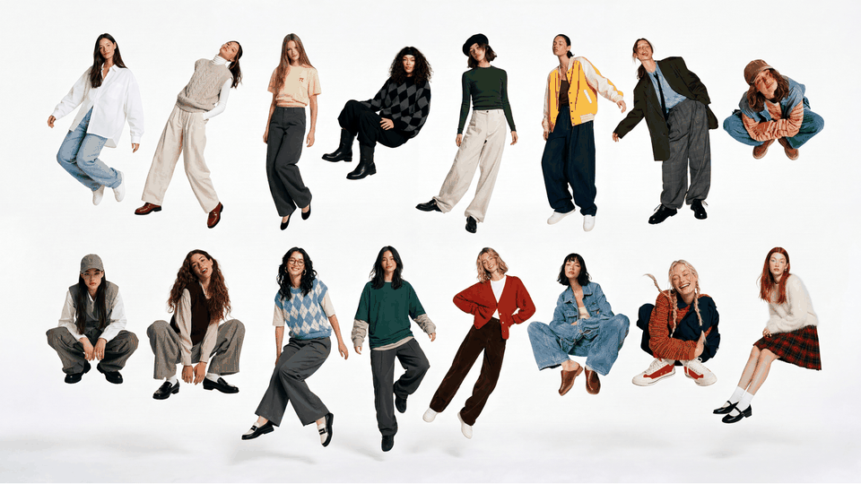
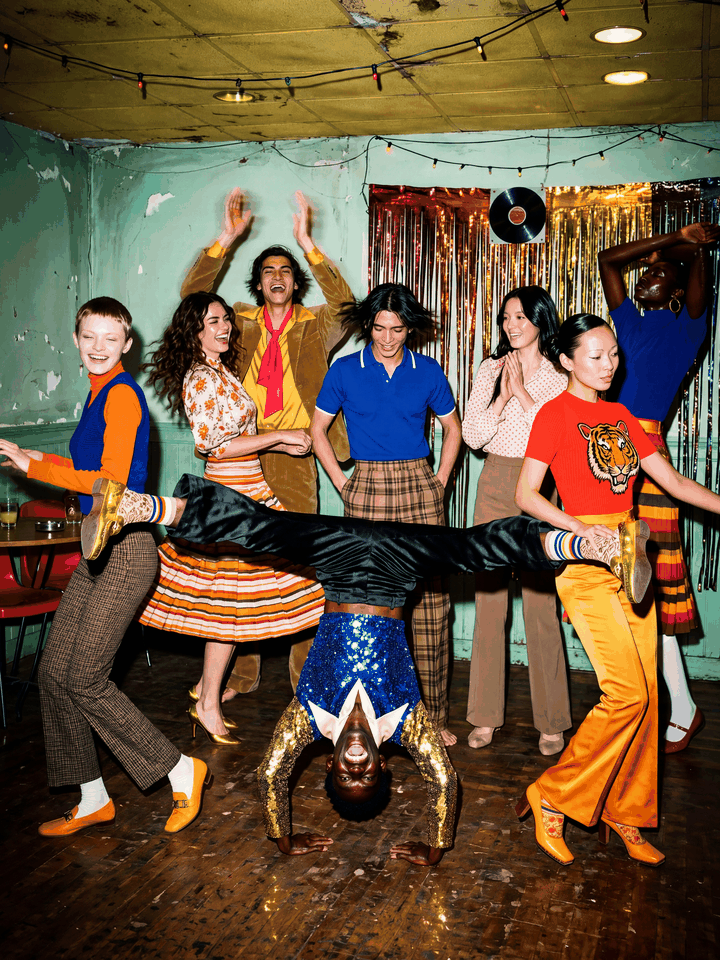
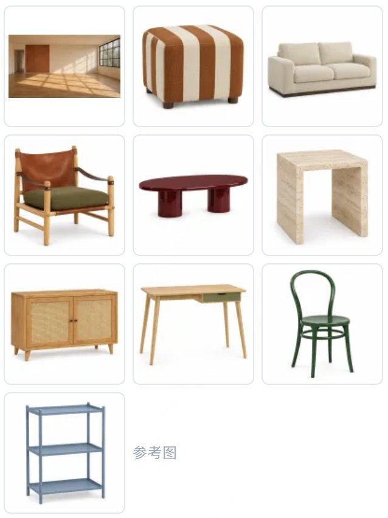
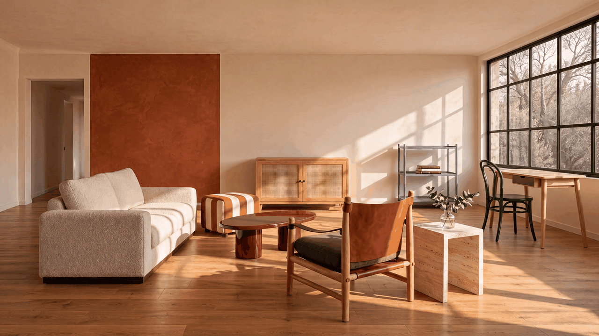

  <a href="multi-reference.md">English</a> |
  <a href="multi-reference.zh-CN.md">简体中文</a> |
  <a href="multi-reference.ko.md"><strong>한국어</strong></a> |
  <a href="multi-reference.ja.md">日本語</a>

# 최대 16장의 참조 이미지

[쇼케이스](README.ko.md) · [교육, 과학 커뮤니케이션, 추론](education-and-reasoning.ko.md) →

## 16명의 군상, 여섯 장면

인물 사진 16장을 참조해 같은 16명을 여섯 장면에 담은 군상입니다.

## 다중 참조 의상 배색

모델 8명과 색상 견본 8개를 참조해 배색이 다른 군상 6장을 만들었습니다.

## 참조 이미지 10장으로 만든 거실

<table><tr><td width="30%" valign="top"> 입력</td><td width="70%" valign="top"> 출력</td></tr></table>

프롬프트

<blockquote>Photograph a living-room lifestyle scene for the spring furniture catalog for the brand “向阳家居” (Xiangyang Home). The first image shows the actual empty room, and the following nine images show the furniture currently on sale against white backgrounds. Retain the camera position, walls, doors, windows, and wooden floor of the empty room. Place each of the nine original furniture pieces in the room exactly once, creating a living room where two or three people can chat or read and write by the window. The lounge chair with leather-strap armrests is the featured product; show it from an angle that clearly reveals its wooden frame, leather-strap armrests, and cushion. Arrange the other furniture according to its actual size and function: tabletops should be accessible when seated, the desk chair should have room to pull out, and there should be an uninterrupted path from the doorway into the room. 
Preserve the color, material, structure, and proportions of every product. Let light from the right-hand window fall naturally on the fabric, leather, and wood, with convincing contact shadows beneath table and chair legs. A few books or a single sprig of greenery are allowed; keep the display uncluttered. Real interior photography, with no text.</blockquote>

---

[쇼케이스](README.ko.md) · [교육, 과학 커뮤니케이션, 추론](education-and-reasoning.ko.md) →
