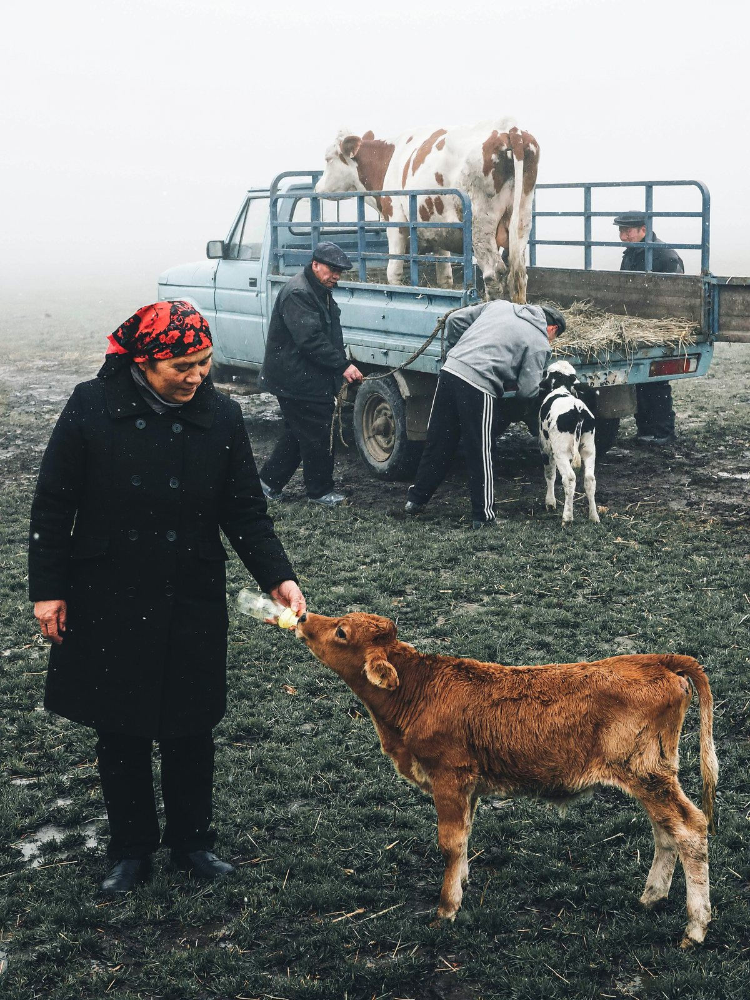
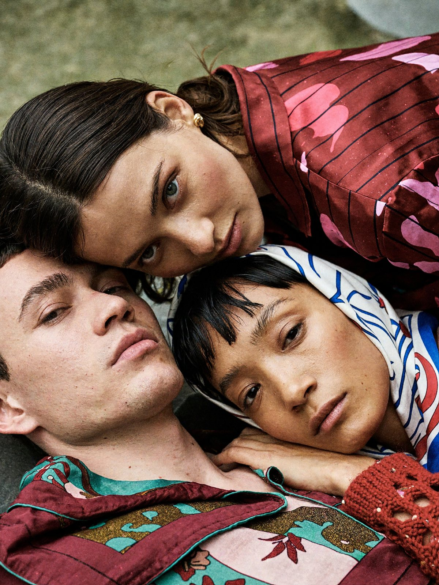
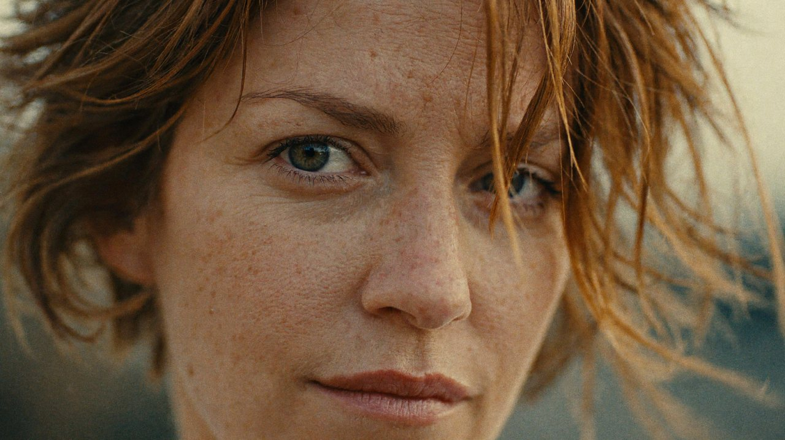
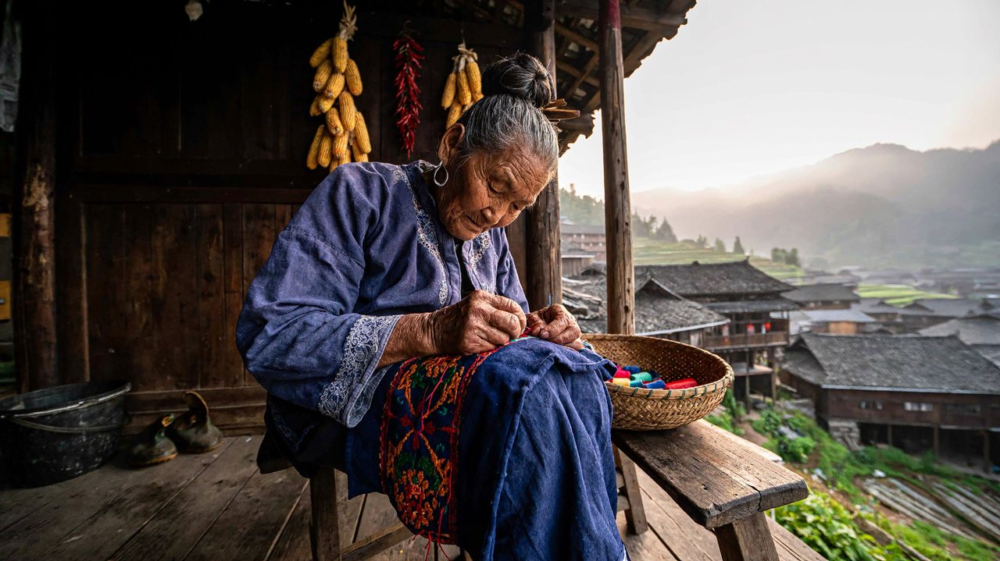
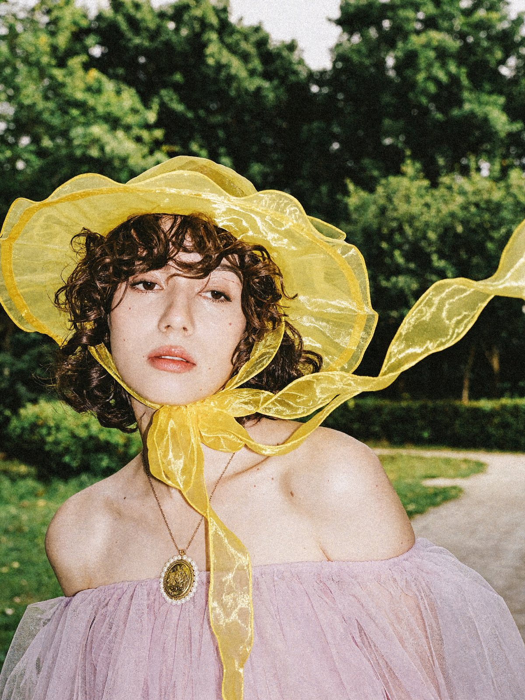
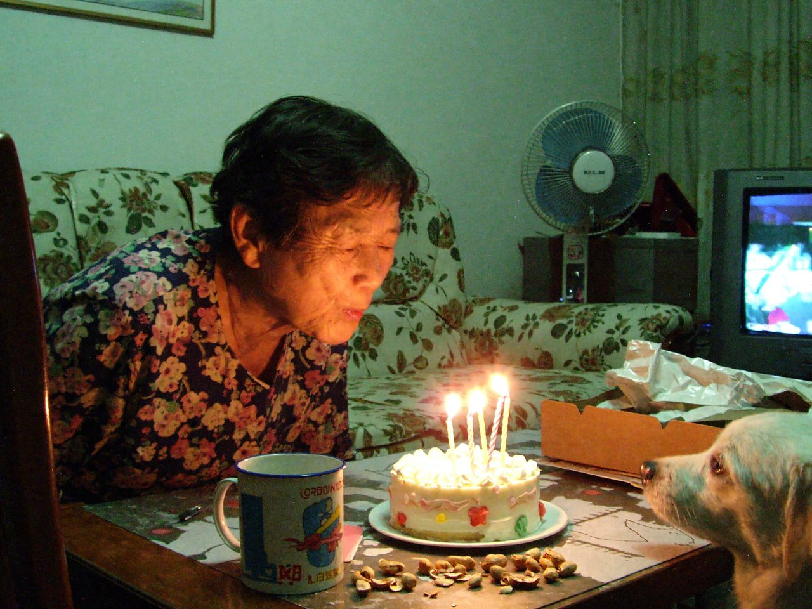
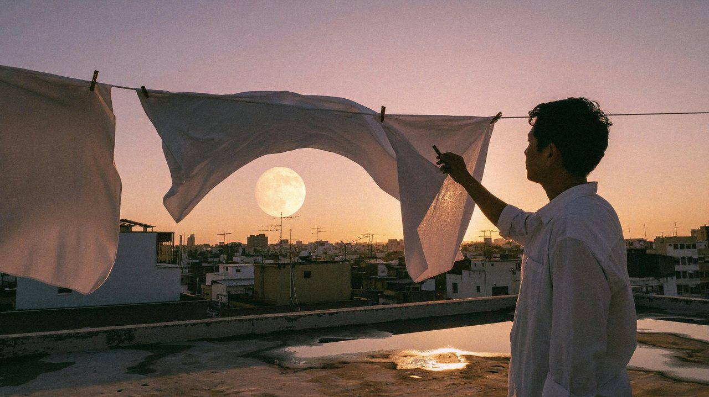
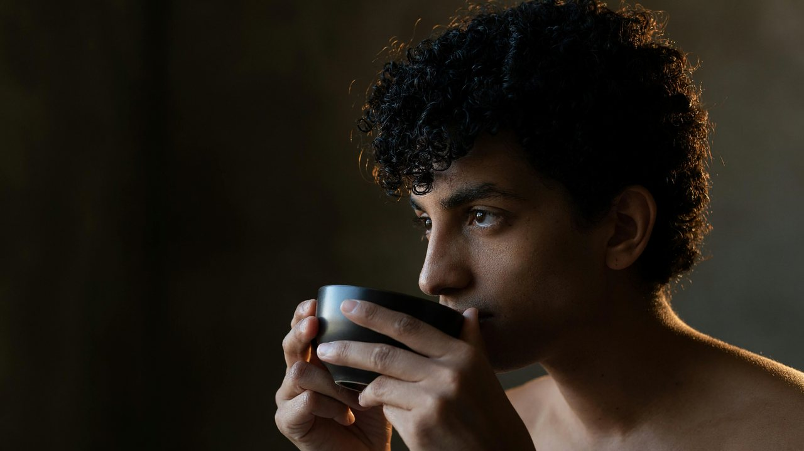
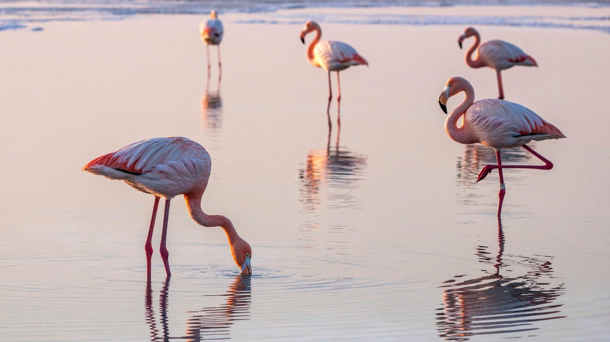

  <a href="real-world.md">English</a> |
  <a href="real-world.zh-CN.md">简体中文</a> |
  <a href="real-world.ko.md"><strong>한국어</strong></a> |
  <a href="real-world.ja.md">日本語</a>

# 현실 세계

← [게임 세계](game-worlds.ko.md) · [쇼케이스](README.ko.md) · [초현실 세계](surreal-worlds.ko.md) →

## 안개 낀 농장, 다큐멘터리 필름 사진

프롬프트

<blockquote>A real rural documentary photograph in portrait format, like an ordinary moment on a farm captured by a documentary photographer with a standard lens on film. Natural light, no artificial lighting at all, nothing staged. 
 
[Weather and Space] 
A foggy day, perhaps with fine snowflakes or drizzle drifting down; tiny white specks float in the air. The distance is completely swallowed by thick white fog: no horizon, buildings, or trees are visible, only an even fog-white. Fully diffused light, almost no shadows. 
 
[Foreground Subject: Woman and Calf] 
Left of center in the lower middle of the image, a woman in her late middle age stands on wet grass, taking up about half the height of the image. Her face is calm; she lowers her head slightly, looking at the calf at her feet. She wears a red-and-black patterned headscarf, a black double-breasted coat that reaches past her knees, black trousers, and black shoes. In her right hand she holds a feeding bottle, reaching down to feed the calf. 
To the right of her feet, a tawny calf raises its head and sucks on the bottle, docile. 
 
[Midground: Old Pickup and People Loading Cattle] 
Behind the woman, an old pale-blue single-cab pickup truck is parked on the grass. Its bed has added dark-blue steel side rails, the rear rails are swung wide open to both sides, and the bed is lined with hay. 
- In the bed stands an adult dairy cow, white with brown patches, facing left; 
- Beside the cab, a slightly hunched old man in a dark flat cap, dark jacket, and black trousers pulls with both hands on a rope tied to the truck; 
- Next to the open rail on the right at the back of the truck, a man in a dark flat cap and a work jacket keeps an eye on the bed; 
- Directly behind the truck, another man in a gray hoodie and black track pants with white side stripes bends over, reaching into the bed with his upper body to work; 
- On the ground beside the back of the truck, a black-and-white calf, side-on or facing away from the camera, stretches its head into the bed to eat hay. 
Everyone is busy with their own task; no one looks at the camera. 
 
[Foreground Ground] 
Dark, wet grass and messy weeds, with patches of bare mud. 
 
[Lens and Composition] 
A full shot from a roughly eye-level camera, slightly low, at about the height of the woman's chest. A standard 35mm to 50mm focal length, natural perspective, no distortion. Medium depth of field: the woman and calf are relatively sharp, the pickup and people behind them are complete but slightly soft, and the distance is naturally swallowed by the fog. 
 
[Color and Image Quality] 
Cool tones, blue-green overall and leaning gray, low saturation. The main colors are fog white, blue-gray, the deep black of the clothes, the dark green of the grass, and the retro pale blue of the pickup; the red of the woman's headscarf is the only warm accent. Contrast is moderate to low, highlights in the fog are slightly overexposed to white, and the image has a soft, diffused feel and medium film grain. No text, watermarks, or interface elements anywhere in the image. 
 
The overall mood is plain, vast, and quiet, with the feel of everyday work and a touch of tenderness between people and animals. Not CG, not an illustration, not staged: a real photograph.</blockquote>

## 필름으로 찍은 피크닉

프롬프트

<blockquote>A vintage film-look outdoor fashion lifestyle photograph: three adult friends picnic lazily among lavish woven rugs on the grass. The mood is quiet, intimate, and languid, with a bohemian style and an autumn pastoral feel. Landscape format, aspect ratio 3:2, shot from a slightly high camera angle looking down at a slant, a medium close-up group composition. The people and textiles occupy the lower middle of the image, with naturally growing dark-green grass as the background, keeping some environmental space. 
 
Slightly above the center, an adult woman sits on the rug, with straight shoulder-length dark-brown hair parted naturally in the middle, wearing a loose rose-red long-sleeved shirt with a turn-down collar, its fabric covered in dark burgundy abstract botanical patterns. Her body faces the camera while her face turns to the left of the image; her expression is calm, her gaze far away, and her hands rest naturally near the shoulders and arms of the friends beside her. She is the top point of the triangular arrangement of figures, and her bright top is the main visual focus against the dark-green surroundings. 
 
In the lower-left foreground, an adult man with short hair reclines on the rug and cushions, his head near the center of the image and his legs stretched toward the lower left corner, one leg slightly bent, wearing loose teal-blue trousers. His chest and shoulders are bare, loosely and partly covered by a fabric with a dark ground and large cream and ochre-yellow leaf patterns; one hand rests lightly on his chest, and his expression is relaxed. On the right, an adult woman lies on her side with her head resting beside the seated woman. She wears a light printed headscarf, a chunky-knit cardigan in grayish rose, and trousers with burgundy spots on a cream ground; her bare feet stretch to the right, her arms are bent naturally, and she looks gently at the camera. 
 
The ground is covered by a large black and ochre-yellow animal-print rug with a fine red border all around, layered with several thin blankets printed with botanical patterns in teal, golden yellow, burgundy, and cream. Decorative cushions of different shapes sit by the people's heads and in front of their waists, including long pink and teal leaf-pattern bolsters and square cushions with brownish-red illustrations on a cream ground and bright yellow sides. Render in detail the thick loops of the knit cardigan, the creases of the cotton, and the pile and tassels of the rug, so the intricate patterns form rich but harmonious layers. 
 
On the left of the image, arrange an abundant, natural picnic still life: a rattan basket with a long baguette, a blue-and-white striped napkin, and a bunch of rustic flowers and grasses with small pale blossoms; behind the basket, on a wooden crate, a white footed cake stand holds a dark-brown fruit tart. On the wooden crate in the lower left corner are blue-and-white ceramic bowls and plates, purple-red grapes, a cut watermelon, and a few warm-colored fruits, some cropped naturally by the frame. In the left foreground, add a cluster of dark-green plants close to the lens and clearly out of focus, partly covering the basket and the background, so the picnic seems glimpsed through the greenery. 
 
Use soft, natural diffused light with a slightly warm side sheen; skin tones are real and soft, and the shadows keep their detail. The palette is mainly olive green, burgundy, rose pink, teal blue, and ochre yellow, with low to medium contrast, slight fading, fine film grain, and slightly deep shadows; avoid oversaturation and the slick finish of a commercial studio shoot. Parameters: focal length about 40mm, aperture about f/4, shutter about 1/250 s, ISO 400, medium depth of field; the people and main textiles are sharp, the nearby plants clearly blurred, and the background grass soft but recognizable; high resolution, realistic body proportions, natural skin texture, no text, no watermarks, no interface buttons.</blockquote>

## 필름 클로즈업 인물 사진

프롬프트

<blockquote>A realistic cinematic film-style portrait close-up. In the center of the image is an adult woman's face: fair skin, short light reddish-brown hair that is naturally fluffy, gray-green eyes looking at the camera, and a calm, slightly thoughtful expression. The face keeps real skin texture, fine freckles, and natural coloring; the eyebrows are thin and soft, the eyelashes distinct, and the lips a low-saturation rose, gently closed with no teeth showing. 
 
Use an extremely close frontal composition, with the face filling almost the whole image area; the top of the forehead and the chin are cropped by the frame, and the lips are near the bottom edge. The eye on the left of the image is complete and sharp and is the main visual focus; the other eye is partly covered by hair sweeping across the face. The bridge and tip of the nose sit just below the center, and the composition is slightly asymmetrical, giving a natural candid feel. 
 
A light breeze moves the light chestnut-brown hair; strands with a coppery-gold sheen sweep diagonally from the top of the image to the right, forming soft arcs with slight motion blur. A few fine hairs fall across the forehead, brows, eyes, and cheeks, contrasting with the sharp eye, nostrils, and lips; the hair falls in natural layers, avoiding a neat, stiff style. 
 
The light is soft, warm natural light that lights the face evenly, with faint shadows beside the nose and on the cheeks and delicate transitions between light and dark; no strong hard light or obvious rim light. The overall tones are warm amber brown, light beige, and low-saturation gray-green; the background is heavily blurred, showing only a few blurred patches of color on either side of the face, with no recognizable environmental detail. 
 
Give it the feel of a frame from vintage film footage: low to medium contrast, soft highlights, fine grain, slight fading and soft focus, while keeping real detail in the eyes and skin. The edges of the image are slightly softened; no text, no watermarks, no logos. 
 
Parameters: overall aspect ratio about 16:9; inner image ratio about 7:5; shot size: extreme close-up of the face; focal length 85–105mm; aperture f/2.0–f/2.8; shallow depth of field; focus on the eye on the left of the image; warm white balance; low saturation; soft contrast; fine-grain film texture; slight motion blur in the hair; natural skin texture; avoid heavy skin smoothing, oversharpening, and strong beauty filters.</blockquote>

## 오래된 휴대폰 스냅

프롬프트

<blockquote>A photo taken with the rear camera of an iPhone 7, the phone held sideways, straight out of the default camera mode: no beautification, no filters, no editing. It looks like a photo casually taken in 2017 by someone traveling to a Miao village in Qiandongnan, Guizhou, while passing under the veranda of a home early in the morning. 
 
[Scene] 
A Miao village in the early morning, with thin mist still in the mountains. A Miao grandmother of about seventy sits under the veranda of her wooden stilt house, head lowered, absorbed in embroidery. On her knees lies an embroidered panel with an indigo ground and red, orange, and green Miao embroidery patterns, and she holds a needle and thread. She wears an everyday dark-indigo top with hand-embroidered trim on the sleeves and collar; her hair is coiled into a high bun with a wooden comb in it, and she wears old silver earrings. Her face is wrinkled and her skin tanned dark by the sun; her expression is calm and focused, and she has not noticed the camera. 
On a wooden stool beside her sit a woven bamboo sewing basket and a few balls of colored thread; behind her is a smoke-blackened plank wall hung with strings of dried corn and chili peppers, with a plastic bucket and a pair of rubber shoes in the corner. Beyond the veranda, in the distance, layers of black-tiled stilt houses and terraced fields stand in the mist. 
 
[Realism] 
The grandmother is a real, ordinary villager, as she looks during everyday work, not a model in festival dress. Her skin, hands, and clothes look as they naturally do in daily life, without deliberately emphasizing flaws. 
 
[iPhone 7 Image Quality] 
A 12-megapixel single phone camera with a 28mm-equivalent wide angle and an f/1.8 aperture. In daylight the image is clean and clear and the subject sharp, with enough detail but no oversharpening. Fairly deep depth of field: the background is only slightly softened, with no portrait-mode blur. The colors are the natural, slightly warm, moderately saturated straight-out-of-camera colors of that generation of iPhone, with true skin tones. Limited dynamic range: the mist and sky beyond the veranda are bright and slightly overexposed, while the shadows under the veranda are dark and keep a little fine-grain noise, without the strong HDR brightening and algorithmic smoothing of modern phones. The composition is casual, with the grandmother left of center and the frame slightly tilted. Not a DSLR, not professional photography, not cinematic, not CG, not an illustration: a real, clear, natural photo from an old iPhone.</blockquote>

## 직광 플래시 필름 인물 사진

프롬프트

<blockquote>A vintage, dreamy direct-flash film fashion portrait, 3:4 portrait format. 
A young woman of about twenty with fair skin, short dark-brown curly hair, and slightly curled bangs, with defined, delicate features. She wears a soft wide-brimmed hat of bright amber-yellow translucent organza, its brim gently undulating, with two long ribbons of the same fabric tied under her chin; one ribbon is lifted by the wind and flies toward the right of the image, covering part of it. She wears a pale pinkish-lavender strapless dress with a translucent, pleated, gauzy texture; around her neck is a fine gold chain with an oval embossed antique gold medallion pendant, its edge set with a ring of small pearls. 
Her body is turned slightly and her head faces almost straight ahead; her gaze is calm, cool, and absent, looking forward, her lips slightly parted, distant and reserved. An outdoor garden background of blurred green trees, lawn, and a pale path, with a slightly staged feel. A medium close-up portrait, the figure toward the lower left, the right side left for the lifted yellow ribbon, eye-level camera. 
A flash fired straight on from the front, hard light, obvious highlights on the face, the background slightly darker; color temperature neutral to slightly warm. Palette: bright yellow (dominant), pale pinkish lavender, forest green, pale skin, and gold. 35mm film texture with visible grain, medium depth of field, background lightly blurred. Vintage, dreamy, avant-garde, slightly melancholy and aloof. A single photo, with no text, watermark, or border.</blockquote>

## 할머니의 생일, 홈비디오

프롬프트

<blockquote>In the living room of an ordinary old residential building, a Chinese grandmother in her sixties, wearing an everyday floral house shirt, leans forward to blow out a few candles on a small cake, her eyes closed for a moment, smiling. On the low coffee table are peanut shells, an enamel mug, and a crumpled cake box; a small white dog pokes its nose toward the cake from the lower right corner. In the background are a floral sofa, a standing electric fan, and an old TV showing only a blurry glow. A close, eye-level handheld shot, with the grandmother off to the left and the back of a chair near the camera blocking one corner. The main light comes from a greenish ceiling lamp and the orange-yellow candlelight; the shadows in the room are a little muddy, and the candle flames have small halos. Not a carefully planned birthday portrait, but the instant a family member suddenly pressed record. 
 
The image looks like a frame from a real home video shot on an ordinary consumer MiniDV camcorder around 2001: landscape 4:3, with the unretouched feel of a private recording. A small CCD sensor, soft standard-definition detail, fine colored digital noise in the shadows, slight color bleeding and compression artifacts, automatic white balance with a bit of a color cast, highlights allowed to blow out, and slight natural smearing where people move; even when output at a large size, keep the information density of the original low-resolution footage. The handheld camera is slightly tilted, the composition has incidental obstructions and edge cropping, the depth of field is deep, and the real setting is clearly recognizable. No polished cinematic lighting, film-grain filters, simulated VHS lines, exaggerated light leaks, skin smoothing, commercial posing, or CG rendering look. The image fills the canvas, with no border, date or time stamp, recording indicator, subtitles, or watermark. Generate only one complete photo.</blockquote>

## 해 질 녘 옥상

프롬프트

<blockquote>An old city rooftop at dusk in late summer. Several clotheslines cross the foreground, with white sheets lifted by the wind into soft waves. Through the gaps, show dense distant rooftops, antennas, and a low pale-gold moon. On the right, a backlit person in a white shirt takes down laundry, visible as a clear profile silhouette. The concrete rooftop has warm-gray textures and shallow puddles. The sky transitions from rose pink to smoky purple, and sunset rim light passes through the fabric. Combine the authenticity of an everyday-life documentary with the poetic composition of a cinematic still. Use a 35 mm lens, natural wind, and slight film grain, without an excessive romantic filter. 
Real photographic and cinematic-still texture. Prioritize natural light and physically credible reflections, with a clear visual focal point and breathing room. Keep colors restrained with one or two narrative accents, finely realistic materials, and natural human gestures. Retain moderate 35 mm film grain, gentle highlight bloom, and realistic depth of field. The image should be refined, rewarding to look at, and capture a narrative moment. Avoid cheap-looking CG, plastic skin, excessive sharpening, HDR halos, randomly added objects, watermarks, borders, logos, or unnecessary text.</blockquote>

## 차를 마시기 전 잠깐

프롬프트

<blockquote>Photograph a realistic portrait of a curly-haired person pausing before drinking tea. Include the head, shoulders, upper chest, and both hands holding a dark ceramic cup, with the face slightly turned. Warm light from the rear right grazes the hair against a darker interior wall. The edges of loose curls and a few flyaway strands glow translucently, with the dark background still visible between strands. Dense locks remain dark inside, and the bright rim breaks naturally where strands occlude one another. Very weak soft light from the camera's front left illuminates the face so the eyes, cheeks, and fingers remain visible. Only the edges of the ear and shoulder facing the rear light are lit. The ceramic cup has a broad, weak surface highlight, with contact shadows where its rim meets the fingers. Focus should cover the eyes, outer hair strands, and cup rim.</blockquote>

## 새벽의 플라밍고

프롬프트

<blockquote>In the shallows of a salt lake at dawn, five flamingos are spread across a broad, mirror-like water surface. The nearest bends its head to feed, the second stands on one leg, and three distant birds create a gentle rhythm of pink. The lake reflects a pale-pink sky and distant white salt crusts. Use an eye-level telephoto composition with water filling almost the entire frame and ample breathing room between the birds. Feather colors should have delicate gradations from grayish pink to coral pink. Water ripples, reflections, salt crusts, and bird legs must be realistic. Elegant nature photography, without crowded flocks or highly saturated cartoon colors. 
Real photographic and cinematic-still texture. Prioritize natural light and physically credible reflections, with a clear visual focal point and breathing room. Keep colors restrained with one or two narrative accents, finely realistic materials, and natural human gestures. Retain moderate 35 mm film grain, gentle highlight bloom, and realistic depth of field. The image should be refined, rewarding to look at, and capture a narrative moment. Avoid cheap-looking CG, plastic skin, excessive sharpening, HDR halos, randomly added objects, watermarks, borders, logos, or unnecessary text.</blockquote>

---

← [게임 세계](game-worlds.ko.md) · [쇼케이스](README.ko.md) · [초현실 세계](surreal-worlds.ko.md) →
