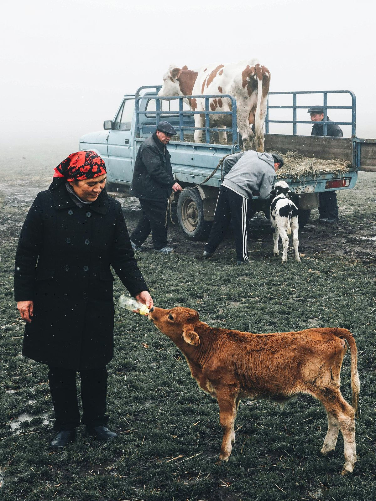
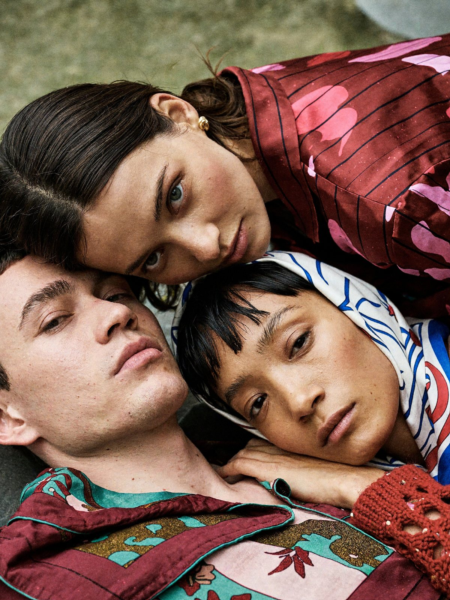
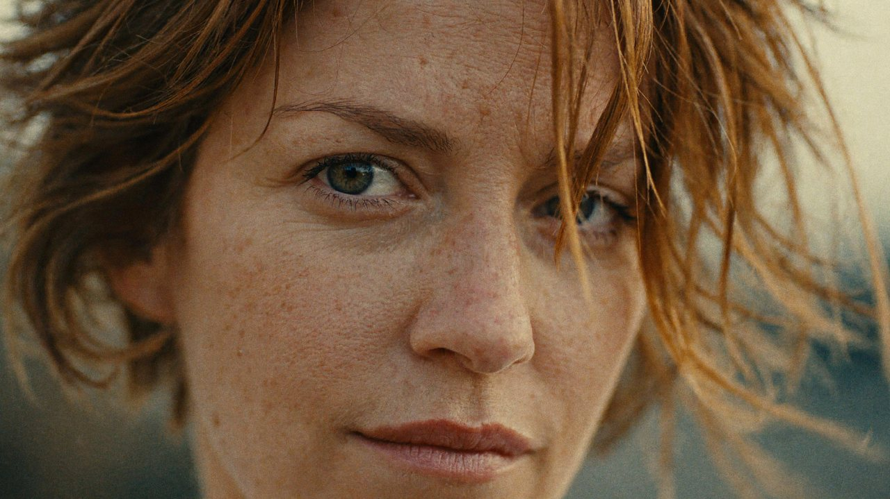
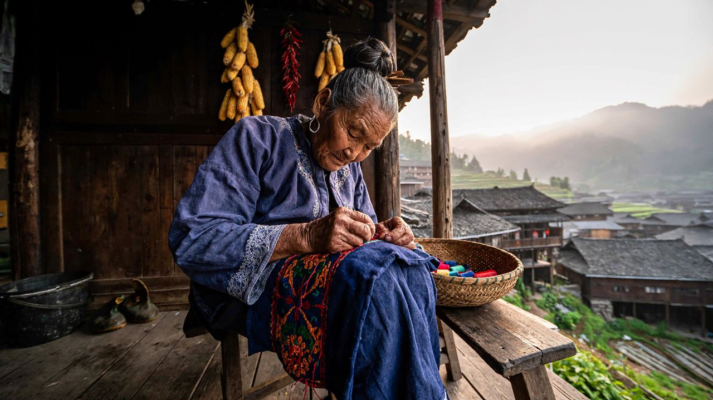
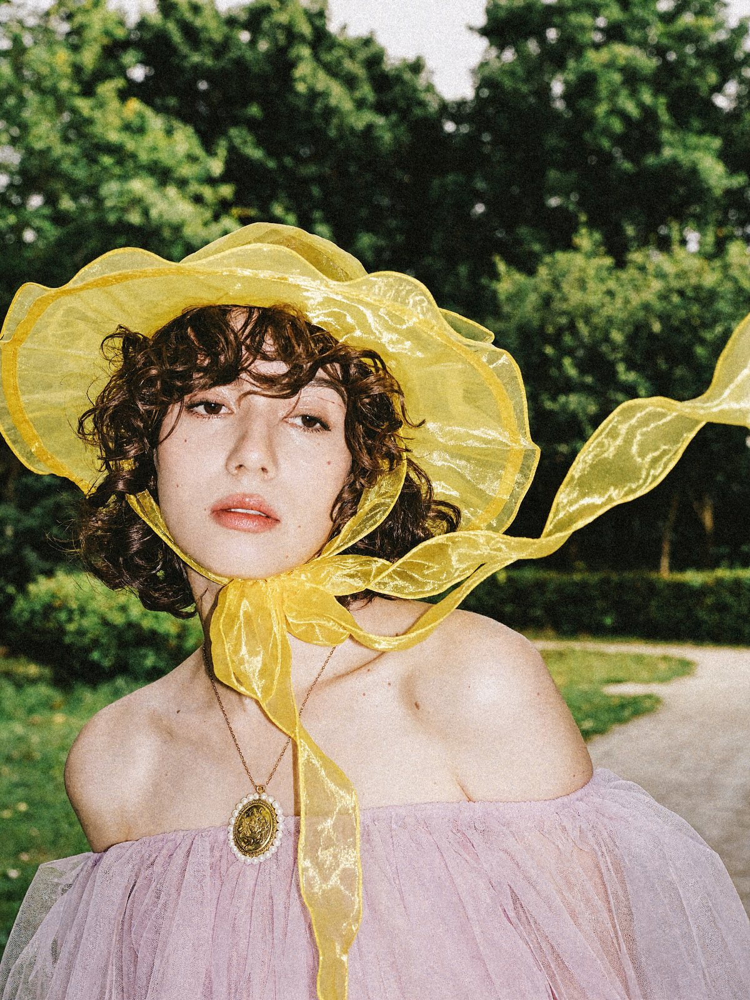
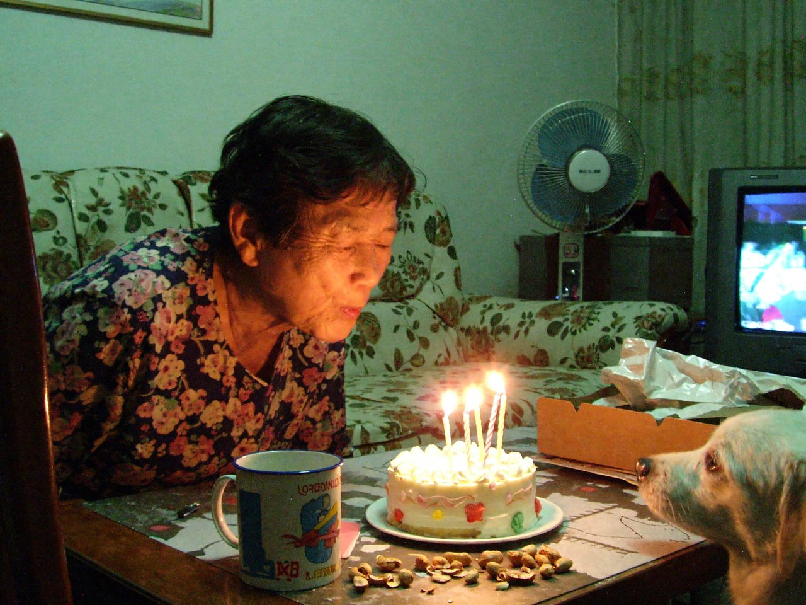
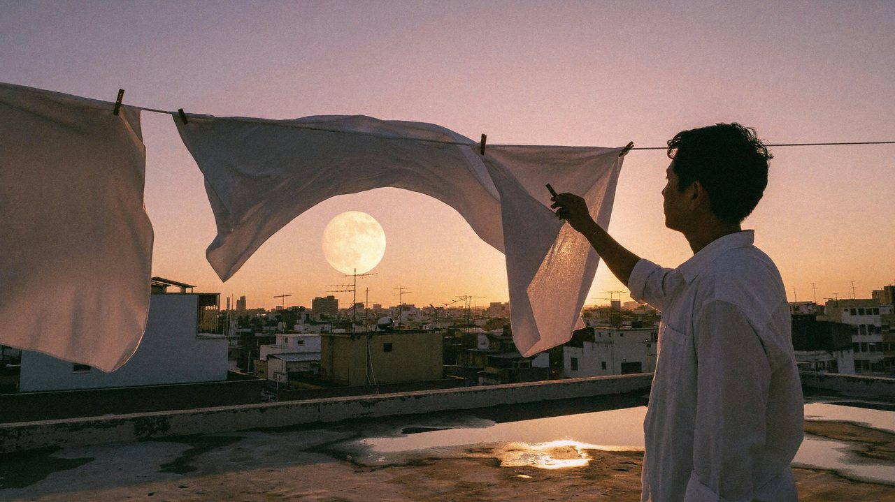
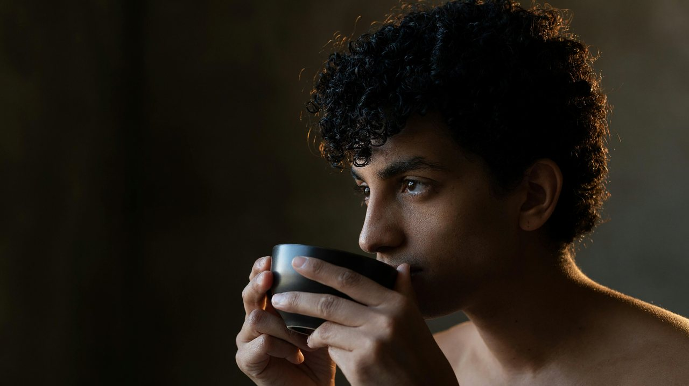
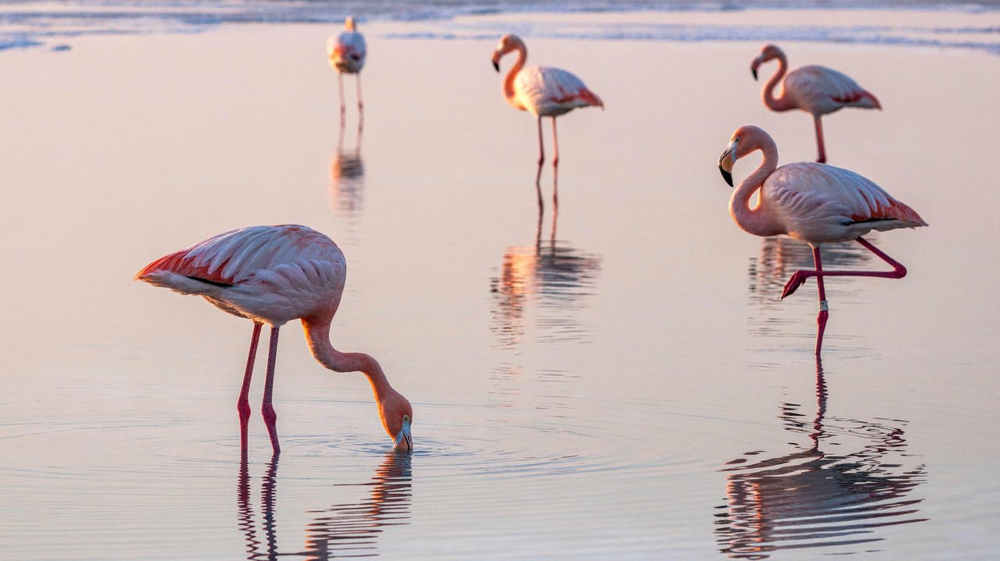

  <a href="real-world.md">English</a> |
  <a href="real-world.zh-CN.md"><strong>简体中文</strong></a> |
  <a href="real-world.ko.md">한국어</a> |
  <a href="real-world.ja.md">日本語</a>

# 现实世界

← [游戏世界](game-worlds.zh-CN.md) · [效果展示](README.zh-CN.md) · [超现实世界](surreal-worlds.zh-CN.md) →

## 雾中农场，纪实胶片

提示词

<blockquote>一张真实的乡村纪实摄影照片，竖幅构图，像纪实摄影师用标准镜头和胶片拍下的一个农场里的普通瞬间，自然光，没有任何人工打光，没有摆拍。 
 
【天气与空间】 
大雾天，可能还飘着细小的雪花或雨丝，空气里散落着微小的白点。远处完全被浓重的白雾吞没，看不到地平线、建筑或树，只有一片均匀的雾白。全漫射光，几乎没有影子。 
 
【前景主体：妇人与小牛】 
画面中下部偏左，一位中年偏老的妇人站在湿漉漉的草地上，约占画面高度的一半。她面容沉静，微微低着头，看着脚边的小牛。头上包着一条红黑花色的头巾，身穿一件黑色过膝的双排扣长大衣，黑裤子、黑鞋。她右手握着一个奶瓶，向下伸着在喂小牛。 
她脚边偏右，一头棕黄色毛的小牛犊，仰着头衔住奶瓶吮吸，姿态温顺。 
 
【中景：旧皮卡和装牛的人】 
妇人身后，草地上停着一辆老旧的淡蓝色单排座皮卡车，车斗加装了深蓝色的铁栏板，后栏板向两边大开着，车斗里铺着干草。 
- 车斗里站着一头成年的白底褐色斑块奶牛，头朝左； 
- 车头侧面，一位微微驼背的老汉，戴深色鸭舌平顶帽，穿深色夹克和黑裤，双手拉着系在车上的绳子； 
- 车尾右侧敞开的栏板旁，站着一个戴深色鸭舌帽、穿工装外套的男人，正照看着车斗； 
- 车尾正后方，另一个穿灰色连帽卫衣和侧边带白条纹的黑色运动裤的男人，弯着腰把上半身探进车斗里干活； 
- 车尾旁的地上，一头黑白花的小牛侧对或背对镜头，正探头往车斗里吃干草。 
这些人都在各忙各的，没有人看镜头。 
 
【前景地面】 
颜色偏暗的湿草地，杂草蓬乱，局部露出泥土。 
 
【镜头与构图】 
全景，机位基本平视，略低一点，大约与妇人胸口同高。35mm 到 50mm 的标准焦段，透视自然，没有畸变。中等景深：妇人和小牛相对清晰，后面的皮卡和人的轮廓完整但稍软，远处被雾自然吃掉。 
 
【色调与画质】 
冷色调，整体青绿偏灰，饱和度低。主要颜色是雾白、青灰、衣服的深黑、草地的暗绿和皮卡复古的淡蓝，妇人头巾的红色是唯一的暖色点缀。对比度适中偏低，雾气里的高光略微过曝发白，画面有柔和的漫射感和中等的胶片颗粒。画面里没有任何文字、水印或界面元素。 
 
整体氛围质朴、苍茫、沉静，带着生计的气息，又有一点人和动物之间的温情。不是CG，不是插画，不是摆拍，是一张真实的照片。</blockquote>

## 胶片质感野餐

提示词

<blockquote>一幅复古胶片质感的户外时尚生活方式摄影，三位成年朋友在草地上的华丽织毯间悠闲野餐，整体氛围静谧、亲密、慵懒，带有波西米亚风格与秋日田园气息。横向画幅，画面比例3:2，略高机位斜向俯拍，中近景群像构图，人物与织物占据画面中下部，背景为自然生长的深绿色草地，保留适量环境空间。 
 
画面中央偏上，一位成年女性坐在地毯上，深棕色齐肩直发自然中分，身穿宽松的玫红色翻领长袖衬衫，布料上分布深酒红色抽象植物纹样。她的身体朝向镜头，面部转向画面左侧，神情沉静，视线望向远处，双手自然搭在身旁朋友的肩臂附近。她是三角形人物布局的最高点，鲜艳上衣成为深绿色环境中的主要视觉焦点。 
 
前景左下方，一位短发成年男性斜躺在地毯与抱枕上，头部靠近画面中心，双腿伸向左下角，一条腿微微屈起，穿着宽松的青蓝色长裤。胸肩自然露出，深色底、奶白色与土黄色大叶片图案的织物松散覆盖部分躯干，手掌轻搭胸前，表情放松。右侧一位成年女性侧躺，头枕在坐姿女性身旁，戴浅色印花头巾，穿灰玫瑰色粗针织开衫及奶白底酒红色斑点图案长裤，赤足向右侧伸展，手臂自然弯曲，目光轻柔地看向镜头。 
 
地面铺着大面积黑色与赭黄色动物纹地毯，四周饰有细密红色边框，叠放多条青绿、金黄、酒红、奶白相间的植物印花薄毯。人物头侧与腰前摆放不同形状的装饰抱枕，包括粉红与青绿色叶片纹长枕，以及奶白底棕红色插画、亮黄色侧边的方形抱枕。细致呈现针织开衫的粗线圈、棉布褶皱、地毯绒面与流苏，使繁复图案形成丰富但协调的层次。 
 
画面左侧安排丰盛而自然的野餐静物：藤编篮中露出长法棍面包、蓝白条纹餐布和一束带浅色小花的乡野花草；篮子后方的木箱上放置白色高脚蛋糕盘，盘中是一只深棕色水果挞。左下角木箱桌面上摆放蓝白陶瓷碗盘、紫红色葡萄、切开的西瓜和几颗暖色水果，部分物件被画框自然裁切。左侧前景加入一簇贴近镜头、明显虚化的深绿色植物，局部遮挡篮子与背景，营造从草木间窥见野餐场景的空间感。 
 
采用柔和的自然漫射光，略带温暖的侧向光泽，人物肤色真实柔润，阴影保留细节。整体色调以橄榄绿、酒红、玫瑰粉、青蓝与赭黄为主，低至中等对比度，轻微褪色，细腻胶片颗粒，暗部略沉，避免鲜艳过度和商业棚拍般的光滑质感。参数：焦距约40mm，光圈约f/4，快门约1/250秒，感光度ISO 400，中等景深，人物与主要织物清晰，近景植物明显虚化，背景草地柔和可辨；高分辨率，真实人体比例，自然皮肤纹理，无文字、无水印、无界面按钮。</blockquote>

## 胶片人像特写

提示词

<blockquote>一幅写实电影胶片风格的人像特写，画面中央是一位成年女性的面部，浅肤色，浅棕偏红的短发自然蓬松，灰绿色眼睛望向镜头，神情平静而略带思索。面部保留真实肌肤纹理、细微雀斑与自然色泽，眉毛纤细柔和，睫毛清晰，嘴唇呈低饱和玫瑰色，轻轻闭合，不露齿。 
 
采用极近距离正面构图，面部几乎占满整个影像区域，额头上缘与下巴被画面裁切，嘴唇靠近底部边缘。画面左侧的眼睛完整清晰，是主要视觉焦点；另一只眼睛被掠过面部的发丝部分遮挡。鼻梁与鼻尖位于中央偏下，左右构图略微不对称，呈现自然抓拍感。 
 
微风吹动浅栗棕色头发，带有铜金色光泽的发束从画面上方斜向右侧横掠，形成柔和的弧线与轻微运动模糊。少量细发散落在额头、眉眼及脸颊前方，与清晰的眼睛、鼻翼和唇部形成虚实对比；发丝层次自然，避免整齐僵硬的造型。 
 
光线为柔和的暖色自然光，面部受光均匀，鼻侧与脸颊保留浅淡阴影，明暗过渡细腻，没有强烈硬光或明显轮廓光。整体采用温暖的琥珀棕、浅米色与低饱和灰绿色调，背景高度虚化，仅在面部两侧露出少量模糊色块，不出现可辨识的环境细节。 
 
呈现复古胶片影像截帧质感，低至中等反差，柔和高光，细微颗粒，轻微褪色与柔焦效果，保留眼神与皮肤的真实细节。影像边缘略带柔化，无文字、无水印、无标志。 
 
参数：整体画幅比例约16:9；内部影像比例约7:5；景别为面部极近特写；镜头焦距85—105mm；光圈f/2.0—f/2.8；浅景深；焦点位于画面左侧眼睛；暖色白平衡；低饱和度；柔和对比；细颗粒胶片质感；发丝轻微动态模糊；自然皮肤纹理；避免过度磨皮、过度锐化及高强度美颜。</blockquote>

## 老手机随手拍

提示词

<blockquote>一张用 iPhone 7 后置摄像头拍的照片，横拿手机，默认相机模式直出，没有美颜、没有滤镜、没有后期修图，就像2017年去贵州黔东南苗寨旅行的人，清晨路过一户人家的廊下，顺手拍下的照片。 
 
【画面】 
清晨的苗寨，山间还有薄雾。一位七十岁左右的苗族阿婆坐在自家木头吊脚楼的廊下，低头专心刺绣，膝上摊着一块靛蓝底的绣片，上面是红、橙、绿色的苗绣纹样，手里捏着针线。她穿着日常的深靛蓝色上衣，衣袖和领口有手绣的花边，头发盘成高髻，插着一把木梳，耳朵上戴着旧银耳环。脸上有皱纹，皮肤被太阳晒得黝黑，神情平静专注，没有注意到镜头。 
她身边的木凳上放着竹编针线篓和几团彩线，身后是被熏黑的木板墙，墙上挂着几串晒干的玉米和辣椒，墙角有一个塑料水桶和一双胶鞋。廊外远处，雾气里是层层叠叠的黑瓦吊脚楼和梯田。 
 
【真实感】 
阿婆是真实的普通村民，日常干活时的样子，不是穿盛装的模特。皮肤、手和衣服都是生活里自然的样子，不刻意强调瑕疵。 
 
【iPhone 7 的拍摄质感】 
1200万像素、28mm 等效广角、f/1.8 光圈的手机单摄。白天光线下画面干净清晰，主体锐利，细节够用但不过分锐化。景深较深，背景只有很轻微的柔化，没有人像模式虚化。颜色是那一代 iPhone 自然、略偏暖、饱和度适中的直出色彩，肤色真实。动态范围有限：廊外的雾和天空偏亮、略微过曝，廊下的暗部偏暗、保留一点细颗粒噪点，没有现代手机那种强烈的 HDR 提亮和算法涂抹。构图是随手拍的，阿婆偏左，画面略微倾斜。不是单反、不是专业摄影、不是电影感，不是CG、不是插画，是一张真实、清楚、自然的老款 iPhone 照片。</blockquote>

## 直闪胶片人像

提示词

<blockquote>一张复古梦幻的直闪胶片时装肖像，3:4竖幅。 
一位二十岁左右的年轻女性，皮肤白皙，深棕色短卷发，刘海微卷，五官立体清秀。她戴一顶亮黄琥珀色半透明欧根纱宽檐软帽，帽檐柔软起伏，两条同色长纱带在下巴处打结，其中一条被风扬起，飘向画面右侧并遮挡部分画面；穿淡粉紫色抹胸裙，有半透明褶皱纱质纹理；颈间戴一条细金链，挂着一枚椭圆形浮雕金色古董徽章吊坠，边缘镶一圈小珍珠。 
身体微侧，头部正对略偏，眼神沉静冷淡、放空望向前方，嘴唇微张，疏离内敛。户外园林背景，模糊的绿树、草坪和浅色小路，略带布景感。中近景肖像，人物偏左下，右侧留给扬起的黄色纱带，平视机位。 
正面直打闪光灯，硬光，面部高光明显，背景略暗；色温中性偏暖。色盘：亮黄（主色）、淡粉紫、森林绿、苍白肤色与金色。35mm胶片质感，明显颗粒，中等景深，背景轻度虚化。复古、梦幻、前卫、略带忧郁与疏离。单张照片，无文字、水印和边框。</blockquote>

## 奶奶的生日，家用 DV

提示词

<blockquote>普通旧式居民楼的客厅里，一位六十多岁的中国奶奶穿着日常碎花家居衫，俯身准备吹一个小蛋糕上的几根蜡烛，刚好闭了一下眼睛，带着笑意。矮茶几有花生壳、一个搪瓷杯和皱巴巴的蛋糕纸盒，一只小白狗从画面右下角把鼻子探向蛋糕。背景是碎花沙发、立式电风扇和一台只露出模糊亮光的旧电视。近距离平视手持，奶奶偏在左侧，靠近镜头的椅背挡住一角。主要光线是偏绿的顶灯与橙黄的烛光，屋内暗部略脏，烛火有小小光晕，不是精心策划的生日写真，而是家人突然按下录制键的一瞬间。 
 
画面像2001年前后普通家用MiniDV摄像机的真实生活录像截帧，横向4:3，未经修饰的私人录像感。小尺寸CCD成像，标准清晰度的柔软细节，阴影有细小彩色数字噪点，轻微色彩溢出和压缩痕迹，自动白平衡有一点偏色，亮处允许过曝，人物运动处有自然的轻微拖影；即使输出为大图也保留原始低清的信息密度。手持机位略歪，构图有偶然遮挡和边缘裁切，深景深，现场环境真实可辨。不要精致电影布光、胶片颗粒滤镜、模拟VHS横纹、夸张漏光、皮肤磨皮、商业摆拍或CG渲染感。画面铺满画布，不加边框、日期时间、录制标志、字幕、水印。只生成一张完整照片。</blockquote>

## 黄昏屋顶

提示词

<blockquote>夏末黄昏的旧城市屋顶，几根晾衣绳横跨前景，白床单被风吹起形成柔软的波浪，床单间隙露出远处密集的屋顶、天线和一轮低悬的淡金色月亮；逆光中一位穿白衬衫的人站在右侧收衣服，只保留清晰的侧面轮廓，屋顶水泥表面有暖灰纹理和浅浅积水，天空从玫瑰粉过渡到烟紫，夕阳边缘光穿过织物，画面有生活纪录片的真实和电影静帧的构图诗意，35mm镜头、自然风、轻微胶片颗粒，不要浪漫滤镜过重。 
真实摄影与电影静帧质感，优先自然光和可信的物理反射，构图有明确视觉重心与呼吸空间，色彩克制但有一到两个叙事性点色，材质细腻真实，人物动作自然，保留适度35mm胶片颗粒、柔和高光晕染和真实景深；画面高级、耐看、具有叙事瞬间，不要廉价CG感，不要塑料皮肤，不要过度锐化，不要HDR光晕，不要随机添加物件，不要水印、边框、logo或多余文字。</blockquote>

## 喝茶前的停顿

提示词

<blockquote>拍摄一位卷发人物喝茶前停顿的真实肖像，头部、肩膀、上胸和双手捧着的深色陶杯入镜，人物略微侧脸。画面右后方的暖色灯光掠过头发，背景是较暗的室内墙面。松散卷发外缘和几根翘起的碎发被照得透亮，发丝之间仍能看见暗背景；浓密发束的内部保持深色，亮边随着发束遮挡自然中断。脸部由相机左前方很弱的柔光照亮，能看清眼睛、面颊和手指。耳廓与肩部只在朝向后侧灯光的边缘受光，陶杯呈宽而弱的表面亮部，杯沿和手指交接处保留接触阴影。焦点覆盖眼睛、外缘发丝与杯口。</blockquote>

## 清晨火烈鸟

提示词

<blockquote>清晨盐湖浅水区，五只火烈鸟分散在宽阔的镜面水面上，最前景一只低头觅食，第二只单腿站立，远处三只形成柔和的粉色节奏，湖面倒映淡粉天空和远处白色盐壳；采用长焦平视构图，水面几乎占据整个画面，鸟群之间留出足够呼吸空间，羽毛粉色从灰粉到珊瑚粉有细腻层次，水纹、倒影、盐壳和鸟腿真实，优雅自然摄影，不要拥挤鸟群，不要高饱和卡通色。 
真实摄影与电影静帧质感，优先自然光和可信的物理反射，构图有明确视觉重心与呼吸空间，色彩克制但有一到两个叙事性点色，材质细腻真实，人物动作自然，保留适度35mm胶片颗粒、柔和高光晕染和真实景深；画面高级、耐看、具有叙事瞬间，不要廉价CG感，不要塑料皮肤，不要过度锐化，不要HDR光晕，不要随机添加物件，不要水印、边框、logo或多余文字。</blockquote>

---

← [游戏世界](game-worlds.zh-CN.md) · [效果展示](README.zh-CN.md) · [超现实世界](surreal-worlds.zh-CN.md) →
