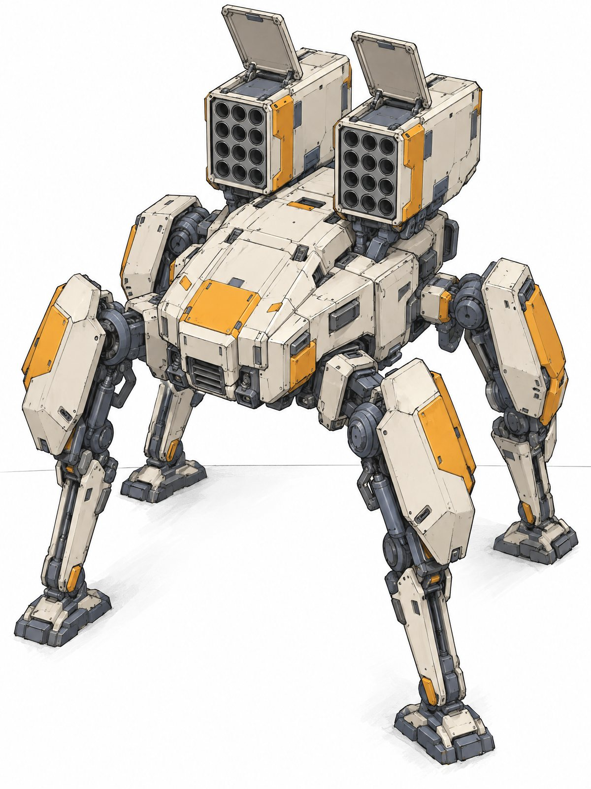
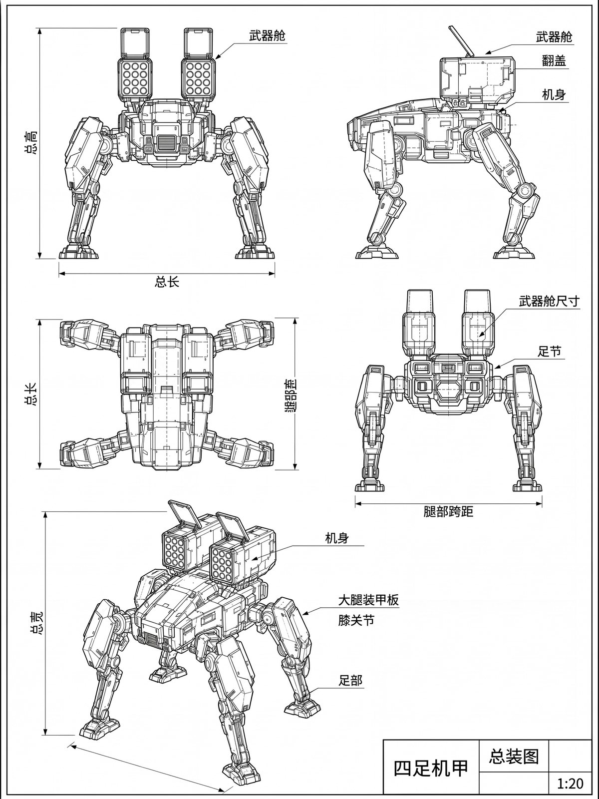
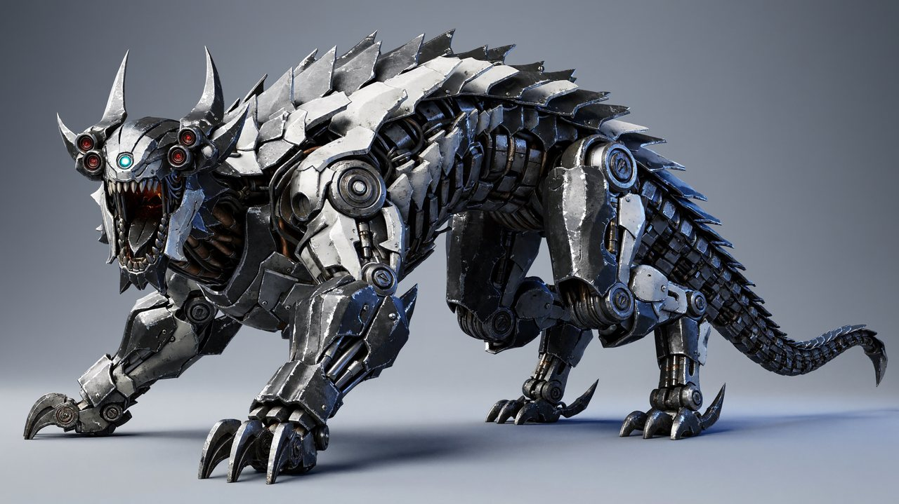
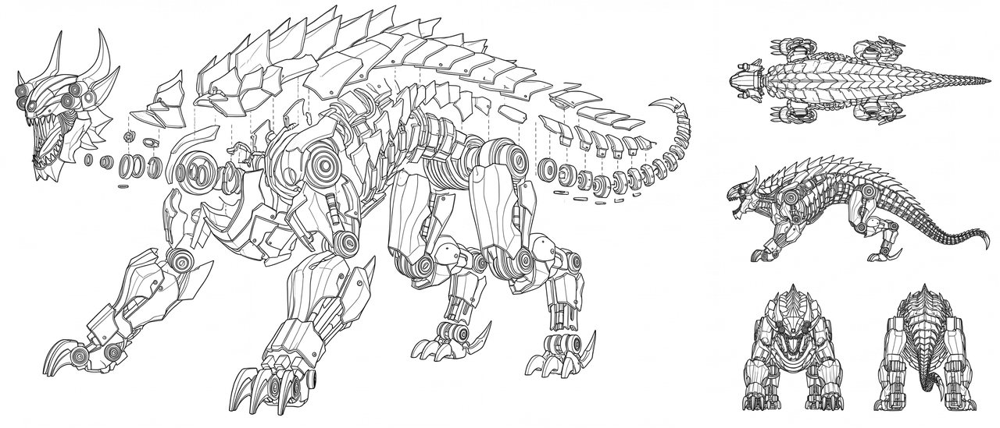
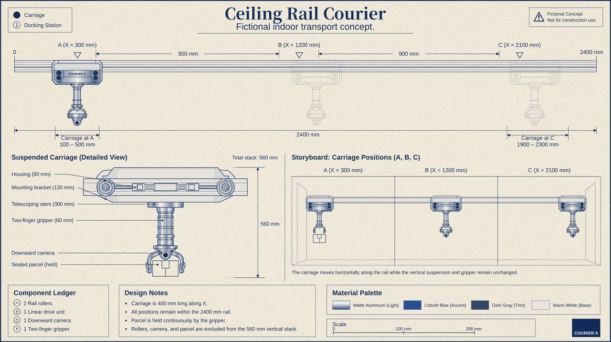
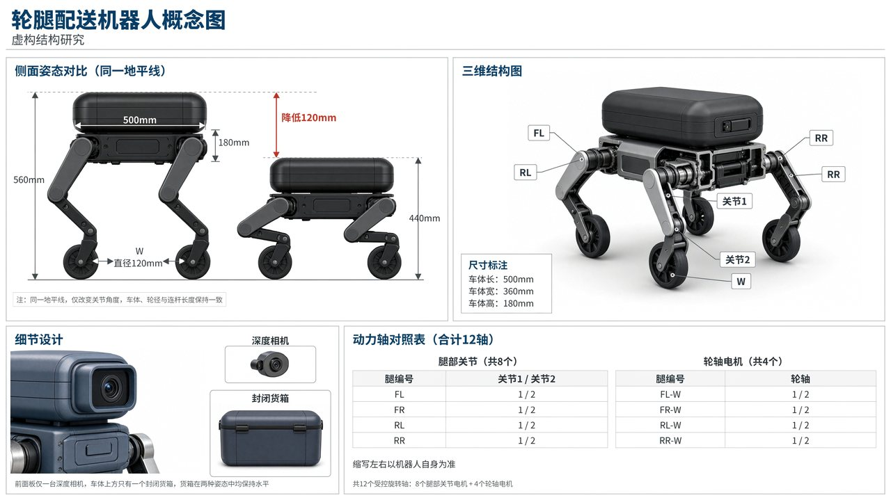

  <a href="robotics.md">English</a> |
  <a href="robotics.zh-CN.md">简体中文</a> |
  <a href="robotics.ko.md"><strong>한국어</strong></a> |
  <a href="robotics.ja.md">日本語</a>

# 로보틱스와 체화 지능

← [산업 및 제품 디자인](product-design.ko.md) · [쇼케이스](README.ko.md) · [복잡한 시각 과제](visual-challenges.ko.md) →

## 사족 메카 CAD 도면

<table><tr><td width="50%" valign="top"> 입력</td><td width="50%" valign="top"> 출력</td></tr></table>

프롬프트

<blockquote>Turn the quadruped mech in image 1 into a standardized CAD engineering drawing with multiple views. Use a white drawing-sheet background and fine black lines: solid lines for visible outlines, dashed lines for hidden structures, and dash-dot lines for axes of symmetry and joint centers. 
 
Include five neatly arranged views: 
- Upper left: Front view. 
- Upper right: Left-side view. 
- Middle left: Top view, clearly showing the launch-port arrays of both weapon pods and the spread angles of all four legs. 
- Middle right: Rear view. 
- Bottom: A larger isometric wireframe view showing the overall three-dimensional structure. 
 
Use the same scale across all views, keeping the shapes of the body, weapon pods, leg joints, and thigh armor plates consistent with image 1. Annotate the main dimensions: overall height, length, width, leg span, and weapon-pod dimensions. Use leader lines to label the key parts “武器舱,” “翻盖,” “机身,” “大腿装甲板,” “膝关节,” and “足部” (weapon pod, hatch, body, thigh armor plate, knee joint, and foot). Place a standard title block in the lower right reading “四足机甲 总装图 1:20” (Quadruped Mech — General Assembly — 1:20). Use clean, accurate lines and an orderly layout resembling a formal mechanical design drawing.</blockquote>

## 메카 야수 분해 CAD 도면

<table><tr><td width="43%" valign="top"> 입력</td><td width="57%" valign="top"> 출력</td></tr></table>

프롬프트

<blockquote>[Left Side Exploded View: Widely Spread, Fully Separated] 
 
The left side shows a fully spread mechanical assembly exploded view. Only the continuous internal load-bearing skeleton stays in the center; the head shell, chest and back armor, limb guard plates, joint end caps, back spikes, and tail scales move far from their mounting positions, forming a wide, orderly array of parts around the skeleton. 
 
The central skeleton takes up only about 45% of the width and 40% of the height of the left area; the complete group of exploded components covers about 90% of the width and 85% of the height of the left area. Leave enough space for the removed parts to show each part's full outline, thickness, inner reinforcing ribs, and mounting holes. 
 
[Clear Separation Distances] 
 
At least 80% of the external armor is completely detached from the skeleton. Each large armor piece moves away from its original mounting position by about 1 to 1.5 times its own width. Clearly visible white gaps separate the main parts; avoid guard plates that still touch the body with only a thin seam showing. 
 
Use three levels of separation distance: 
 
The outer armor moves farthest, forming the outer ring of parts; the middle-layer connecting brackets sit between the armor and the skeleton; internal bearings, connecting rings, washers, and fasteners spread out in order along their axes. Leave clear empty space between the layers so the assembly order can be read at a glance. 
 
[Separation Direction by Region] 
 
The head components spread toward the upper left: the forehead plate, the twin horn mounting modules, the cheek guards on both sides, the sensor module, and the jaw assembly each move away from the skull along their own assembly direction. Leave a large enough gap between the head shell and the internal frame to fully reveal the structure hidden inside the skull. 
 
The chest and back armor spread upward: the back spikes and scale armor, in their original front-to-back order, form two to three staggered layers of floating component bands above the skeleton. Each armor piece has its own outline, with white gaps between the pieces. The inner sides of the armor face the viewer, clearly showing reinforcing ribs, mounting seats, and screw holes. 
 
The chest side plates spread left and right: the outer armor moves to the outer ring, the rib-like brackets stay in the middle layer, and the central power module and mechanical spine stay at the center of the skeleton. Pipes and cables stay with the components they belong to, and the separated connectors are clearly visible. 
 
The limb components spread outward and downward: the front-limb armor is laid out in the lower left and the rear-limb armor in the lower right; guard plates, brackets, and joint assemblies each have their own space, avoiding dense stacks around the legs. 
 
The round joints are pulled out into long rows along their axes: end caps, locking rings, washers, bearings, and connecting flanges are arranged in order, with gaps of about 0.3 to 0.6 times the joint diameter between adjacent main parts; all rings are strictly coaxial, clearly showing each layer's thickness and the assembly order. 
 
The tail components spread toward the upper right: the central vertebra chain stays continuous, while the outer scale armor moves up and to the sides in groups, forming component bands parallel to the tail. The hooked blade at the tip of the tail is clearly detached from its mount, keeping a clear assembly axis. 
 
[Assembly Relationships and Readability] 
 
All removed parts keep their original proportions and mounting orientation and are connected to their positions by thin, clear dashed lines. Even with the larger separation distances, it should remain clear which body part each armor piece belongs to and how each joint group goes back together. 
 
Avoid main parts hiding each other, and keep the assembly guide lines as parallel as possible with few crossings. Screws and small fasteners are grouped near the components they belong to and do not fill the white space between the main parts. 
 
The final image should clearly show a bare mechanical beast skeleton in the center, surrounded by widely displaced, multi-layered armor and mechanical components, with wide, distinct, continuous white gaps between the parts. Keep the pure white background, the precise black CAD line art, and the assembled four views on the right.</blockquote>

## 천장 레일 배송기

프롬프트

<blockquote>Create a 16:9 English engineering concept sheet titled "Ceiling Rail Courier," marked "Fictional indoor transport concept." Show a long side elevation across the upper half, a detailed suspended carriage at lower left, and a three-position storyboard at lower right. Use warm white paper and cobalt linework. 
A straight horizontal rail spans X = 0 to 2400 mm. Define three docking stations by carriage-center coordinates: A at X = 300, B at X = 1200, and C at X = 2100 mm. Adjacent station spacing is 900 mm. The carriage is 400 mm long along X, so its footprint at A is 100–500 mm and at C is 1900–2300 mm; all positions remain within the rail. The three storyboard panels show the same carriage at A, B, and C, not three simultaneous robots. 
At the illustrated extension, the vertical suspension comprises an 80 mm carriage housing, a 120 mm mounting bracket, a 300 mm telescoping stem, and a 60 mm gripper, measured as consecutive segments. Mark their total as 560 mm, measured from the housing top to the gripper bottom; rail, rollers and parcel are excluded from this dimension. The gripper holds one sealed parcel throughout all panels. Include two rail rollers, one linear drive unit, one downward camera, and one two-finger gripper in the component ledger. Maintain the same dimensions, parcel, roller count, and sensor position across all views. Clearly separate horizontal station dimensions from the vertical stack.</blockquote>

## 휠-레그 배송 로봇

프롬프트

<blockquote>Draw a 16:9 concept diagram in Chinese of a wheeled-legged delivery robot. Include side views of the same robot standing and crouching, a 3D view, and an actuator-axis table, labeled “虚构结构研究” (Fictional Structural Study). The body is 500 mm long, 360 mm wide, and 180 mm high. Each of its four corners has a two-joint leg ending in a powered wheel 120 mm in diameter. There are eight leg joints and four wheel-axis motors, for a total of 12 controlled rotary axes. Label the legs FL, FR, RL, and RR, with upper and lower joints numbered 1 and 2 and wheel axes labeled W. Left and right are from the robot's own perspective. The top of the body is 560 mm above the ground when standing and 440 mm when crouching. Use the same ground line to show the 120 mm reduction. Change only the joint angles between the two views; keep the body, wheel diameters, and link lengths identical. There is only one depth camera on the front panel and only one enclosed cargo box above the body; keep the box level in both poses. Use a comparison table to distinguish the eight leg joints from the four powered wheel axes, avoiding any depiction of 12 controlled axes as 12 legs or 12 wheels.</blockquote>

---

← [산업 및 제품 디자인](product-design.ko.md) · [쇼케이스](README.ko.md) · [복잡한 시각 과제](visual-challenges.ko.md) →
