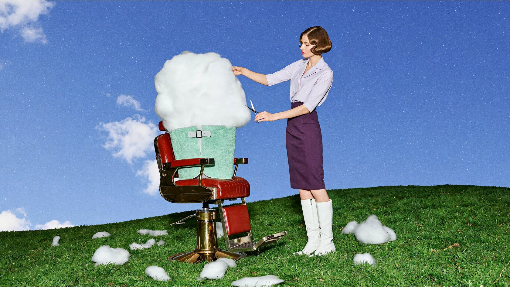
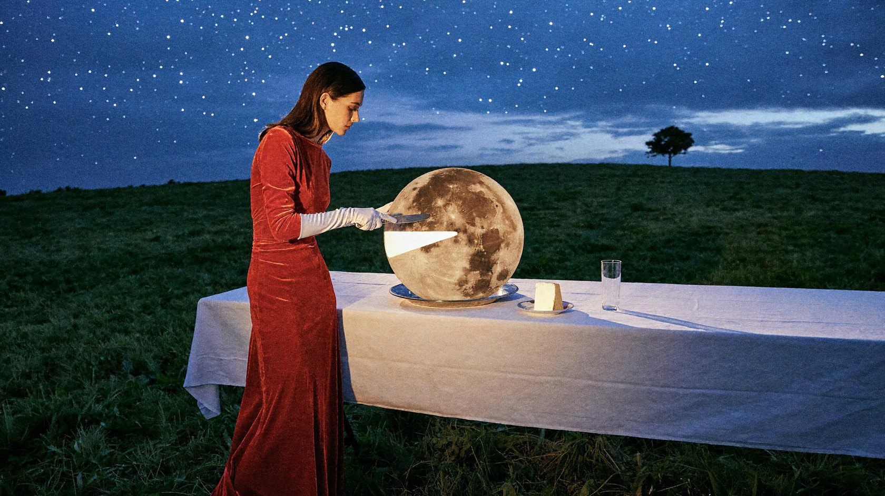
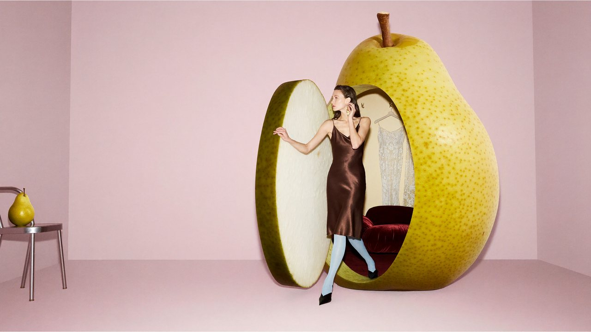
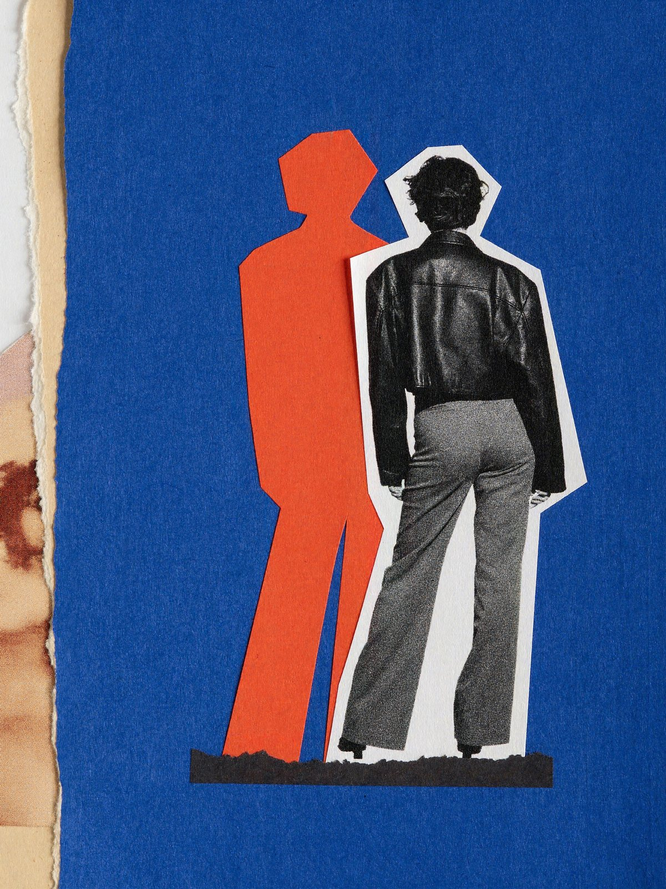
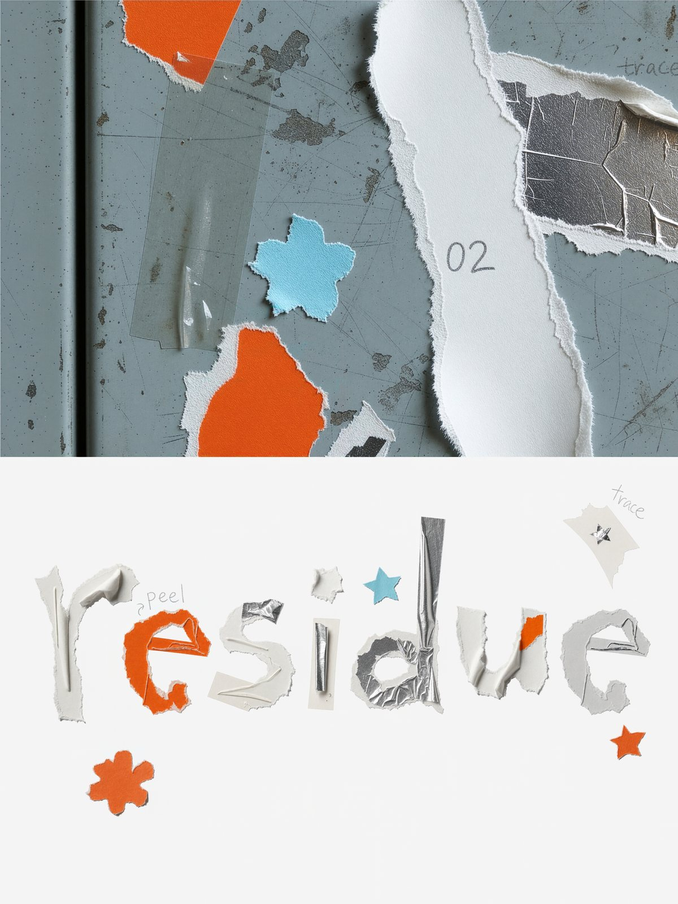
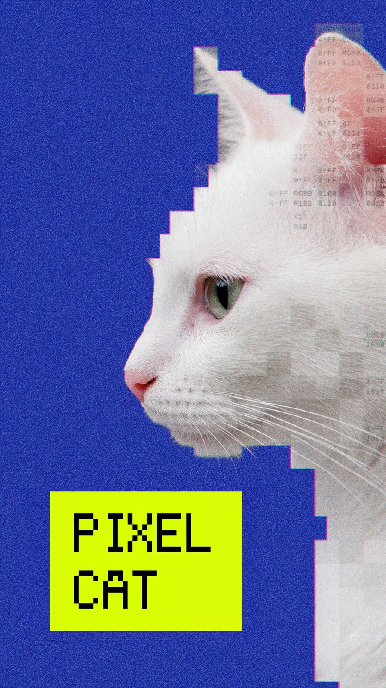

  <a href="surreal-worlds.md"><strong>English</strong></a> |
  <a href="surreal-worlds.zh-CN.md">简体中文</a> |
  <a href="surreal-worlds.ko.md">한국어</a> |
  <a href="surreal-worlds.ja.md">日本語</a>

# Surreal Worlds

Photography styled as retro film sets, playful fashion shoots and avant-garde magazines.

← [The Real World](real-world.md) · [Showcase](README.md) · [Artistic Worlds](artistic-worlds.md) →

## A cloud in a barber chair

Prompt

<blockquote>A retro, playful, refined surreal fashion photograph. A cherry-red barber chair stands on a vivid green hill, with an enormous white cloud seated in it, its fluffy body wrapped in a mint-green barber cape. An adult female model in a pale-purple short-sleeved blouse, dark-purple pencil skirt, and white tall boots stands beside the chair, carefully trimming the cloud with silver scissors while lifting one corner of it with her other hand. Small cut-off tufts of cloud lie scattered on the lawn like freshly cut hair. The model has a neat retro short haircut and a focused expression. Use a low-angle wide shot with blue sky filling most of the frame, a simple set, and vivid colors. Give it the look of a live-action fashion editorial, with soft translucent cloud details, credible volumetric shadows, slight direct-flash fill, and film grain, without a cartoon feel. Landscape 16:9, no text.</blockquote>

## Slicing the moon

Prompt

<blockquote>A surreal fashion photograph with the texture of a retro film set. Beneath a cobalt-blue twilight sky, a long dining table covered with a white tablecloth stands on a green hill. An adult female model in a tomato-red velvet gown and long white gloves stands calmly at one side, using a silver dinner knife to cut a small wedge from an enormous full moon on a plate. The moon stands upright like a round cake, retaining realistic craters on its surface. The cut interior emits a soft milky-white glow, and the removed moon slice rests securely on a small porcelain plate beside it. Moonlight illuminates her gloves and jaw, while glasses on the table cast long, slender shadows. There is no second moon in the sky, only a lone small tree in the distance. Elegant, absurd, and subtly deadpan, with the photographic feel of real people and practical props, fine film grain, landscape 16:9, no text.</blockquote>

## A pear as a dressing room

Prompt

<blockquote>A surreal photograph for a 2000s avant-garde fashion magazine. In a pale-pink studio, a three-meter-tall yellow-green pear has been converted into a changing room. A small round-cornered doorway is cut into its skin, with the door retaining a thick cross-section of peel and milky-white flesh. An adult female model steps one foot out of the pear, wearing a chocolate-brown satin dress, pale-blue tights, and pointed shoes. One hand rests on the doorway while the other adjusts an earring, with a nonchalant expression. The interior is lined with burgundy velvet padding and contains two elegant hanging garments. A normal-sized pear rests on a small silver chair nearby, establishing a clear scale contrast. Use an off-center composition with clean empty space, soft studio light, and a slight frontal flash. Pear-skin pores, juicy flesh, velvet, and satin all have tactile, realistic textures, with the look of a carefully constructed physical set. Landscape 16:9, no text.</blockquote>

## Cut-paper collage

Prompt

<blockquote>A 3:4 portrait abstract collage combining vintage fashion-magazine photography, hand-cut paper, and street-poster print textures. Rich cobalt-blue paper fills about two thirds of the image, with white space at the upper right. Slightly right of center, place a full-body black-and-white film-photo cutout of an adult woman, back to the camera and leaning slightly right, wearing a broad-shouldered cropped jacket and loose trousers. Retain coarse grain, deep-black shadows, and an irregular thin white paper edge. Layer a solid orange-red silhouette along her outline, offset to the left, with no facial or clothing details. Place a short, thick charcoal-black paper strip horizontally beneath her feet. A narrow torn-paper strip along the left edge reveals cream backing paper and faded photo fragments. Show genuine cut edges, paper fibers, uneven ink, and photocopy halftone dots, with the texture of a flat, high-resolution scan. Simple and forceful, with no text, logos, frame, or staged setting.</blockquote>

## Sticker-residue type poster

Prompt

<blockquote>An experimental typography poster themed “After the Stickers Are Gone,” portrait 3:4. The upper 55% is a macro view of a worn cool gray-blue metal cabinet door, with remnants of transparent tape, milky-white torn paper, fluorescent-orange labels, and curling silver film, punctuated by fragments of blue flowers and orange stars. Soft side light emphasizes fibers, adhesive residue, and wear. 
The lower 45% has a pure-white background, with the lowercase word “residue” formed from the actual outlines of the materials, spanning about 90% of the width. Letters combine orange paper edges, translucent adhesive film, and silver film; the long ascender of the d is tallest. Vary their heights and thicknesses while keeping them clearly legible. Do not fill a standard font with images. Add sparse blue and silver paper stars, blue tape, and a half-torn orange flower. Include a few faint pencil lines with tiny annotations “peel,” “trace,” and “02,” short arrows, and unfinished star shapes. Use authentic photography and handmade-collage textures, playful but restrained with ample whitespace. No heavy 3D, additional text, or watermark.</blockquote>

## Pixel cat poster

Prompt

<blockquote>Generate an experimental pixel-art poster with a cobalt-blue background. The subject is the profile of a white cat facing left, ears upright, eyes half closed, and an aloof expression. Build its silhouette from hard-edged white, light-gray, and pale-pink squares of varying sizes. Retain a few real photographic details in the eye, nose tip, and some whiskers; simplify the cheek into medium-sized pixels; and gradually dissolve the back of the head into larger translucent squares. Establish clear changes in pixel scale across different areas. 
Fill some squares with tiny monospaced letters and numbers to suggest an image divided, sampled, and quantized by a program. Place a small fluorescent-yellow rectangle in the lower left containing “PIXEL CAT” in black pixel lettering. Use an off-center composition with a large area of blue negative space, retro print grain, slight color-registration offsets, and a low-resolution screen texture. The result is a flat digital-collage poster in which the squares form the cat's shape, without a 3D cartoon character or watermark.</blockquote>

---

← [The Real World](real-world.md) · [Showcase](README.md) · [Artistic Worlds](artistic-worlds.md) →
