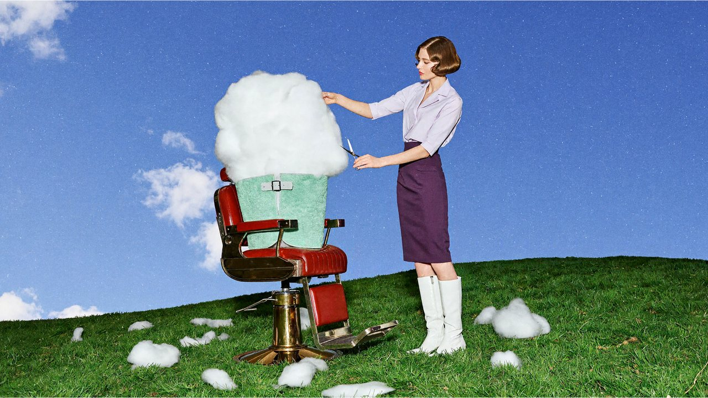
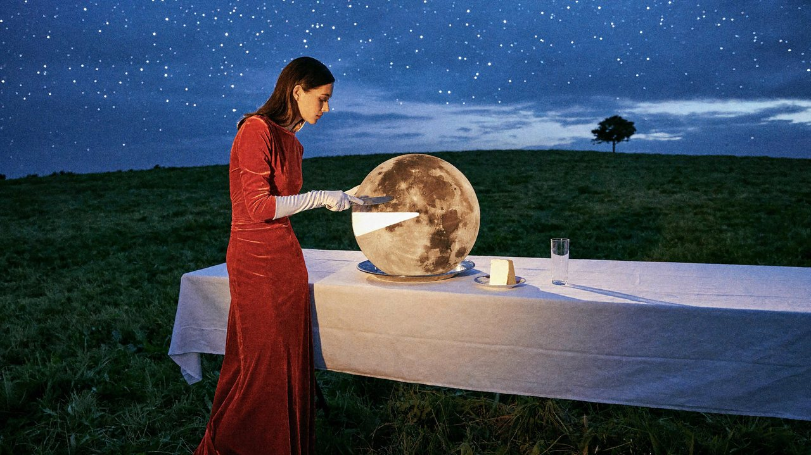
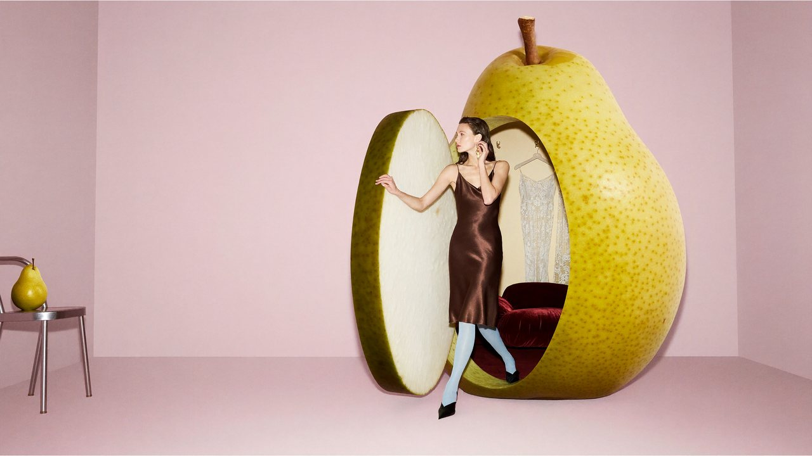
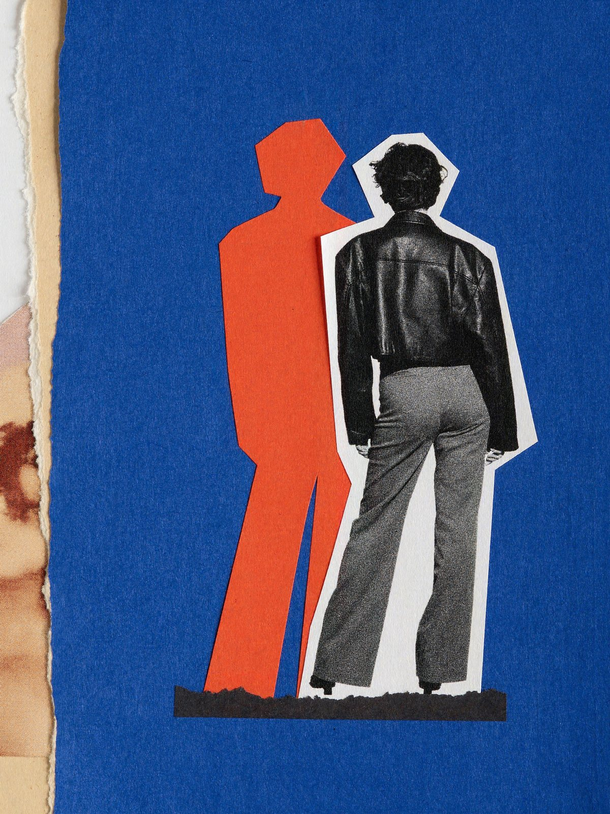
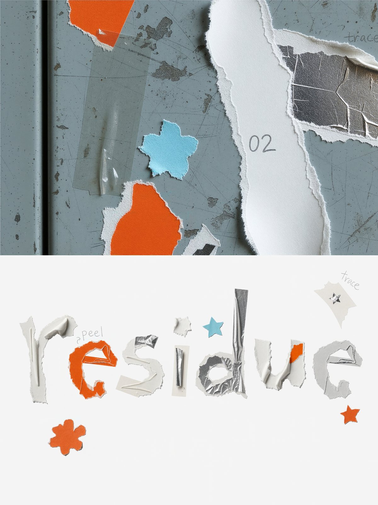
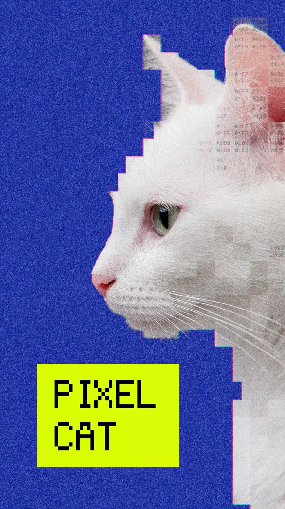

  <a href="surreal-worlds.md">English</a> |
  <a href="surreal-worlds.zh-CN.md"><strong>简体中文</strong></a> |
  <a href="surreal-worlds.ko.md">한국어</a> |
  <a href="surreal-worlds.ja.md">日本語</a>

# 超现实世界

← [现实世界](real-world.zh-CN.md) · [效果展示](README.zh-CN.md) · [艺术世界](artistic-worlds.zh-CN.md) →

## 理发椅上的云

提示词

<blockquote>一张复古、俏皮又高级的超现实时尚摄影。鲜绿色的山丘上摆着一张樱桃红色理发椅，一团巨大的白云坐在椅子里，蓬松的云体被薄荷绿色理发围布围住。一位成年女模特穿淡紫色短袖衬衫、深紫色铅笔裙和白色长靴，站在椅子旁，认真地用一把银色剪刀修剪白云，另一只手托起云朵的一角。剪下的小团云絮散落在草坪上，像刚剪落的头发。模特留利落的复古短发，神情专注。低机位广角构图，蓝天占据大半画面，布景简洁而色彩鲜明。真人时装大片质感，云朵有柔软半透明的细节与可信的体积阴影，轻微直闪补光，胶片颗粒，无卡通感。横向16:9，无文字。</blockquote>

## 切月亮

提示词

<blockquote>一张具有复古电影布景质感的超现实时尚摄影。钴蓝色暮光天空下，绿色山丘上摆着一张铺白色桌布的长餐桌。一位成年女模特穿番茄红色丝绒长裙和白色长手套，神情冷静地站在桌子一侧，用银色餐刀从餐盘里的巨大满月上切下一小块楔形月亮。满月如圆形蛋糕般立在盘中，表面保留真实的陨石坑，切口内部散发柔和的乳白色光芒，切下的月亮块稳稳落在旁边的小瓷盘上。月光照亮她的手套与下颌，桌上玻璃杯投下细长阴影。空中的天空没有第二个月亮，远处只有一棵孤独的小树。优雅、荒诞、略带冷幽默，真实人物和实体道具摄影质感，细腻胶片颗粒，横向16:9，无文字。</blockquote>

## 梨子更衣室

提示词

<blockquote>一张2000年代先锋时尚杂志的超现实摄影。浅粉色摄影棚里，一颗三米高的黄绿色梨子被改造成更衣室，梨皮上开出一道圆角小门，门板仍保留厚实的果皮与乳白色果肉切面。一位成年女模特正从梨子里迈出一只脚，穿巧克力棕色缎面连衣裙、浅蓝色连裤袜与尖头鞋，一只手扶着门边，另一只手整理耳环，表情漫不经心。梨子内部铺着酒红色丝绒软垫，挂着两件精致衣服。旁边一把小巧的银色椅子上放着普通大小的梨，形成明确的尺度对照。构图偏心，留出干净空间，柔和棚灯配合轻微正面闪光。果皮毛孔、水分充足的果肉、丝绒与缎面均有可触摸的真实质感，精心搭建的实体布景观感。横向16:9，无文字。</blockquote>

## 剪纸拼贴

提示词

<blockquote>3:4竖版抽象拼贴，融合旧时装杂志摄影、手工剪纸与街头海报印刷质感。浓郁钴蓝纸底占约三分之二，右上留白。偏右放置黑白胶片成年女性全身剪像，背对镜头、微向右倾，穿宽肩短夹克与宽松长裤，保留粗颗粒、深黑阴影及不规则细白纸边。沿人物轮廓叠加向左错位的纯橘红剪影，无五官服饰细节，脚下横置短厚炭黑纸片。左边缘窄撕纸带露出米白底纸与褪色照片碎片。真实剪口、纸纤维、油墨不匀与复印网点，平整高清扫描质感，简洁有力，无文字、标志、画框及场景展示。</blockquote>

## 贴纸残迹字体海报

提示词

<blockquote>“贴纸离开之后”实验字体海报，3:4竖版。上55%为冷灰蓝旧金属柜门微距，残留透明胶带、乳白撕纸、荧光橙标签与翻卷银膜，点缀残缺蓝花和橙星，柔和侧光突出纤维、残胶与磨损。 
下45%为纯白底，以材料自身轮廓拼出小写“residue”，宽约90%。字母融合橙色纸边、半透明胶膜与银膜，d长竖最高；高低错落、粗细各异，清晰可读，禁止标准字体填图。疏落点缀蓝银纸星、蓝胶带与半撕橙花。少量淡铅笔线配微小注记“peel”“trace”“02”、短箭头及未完成星形。真实摄影与手工拼贴质感，俏皮克制、留白充足，无厚重3D、额外文字及水印。</blockquote>

## 像素白猫海报

提示词

<blockquote>生成一张钴蓝色背景的实验性像素艺术海报。主体是一只白猫的侧脸，朝向画面左侧，耳朵竖起，眼睛半闭，神情冷淡。猫的轮廓由大小不一、边缘硬直的白色、浅灰色和淡粉色方块拼成：眼睛、鼻尖和部分胡须保留少量真实摄影细节，脸颊被中等像素块概括，后脑勺逐渐分解成更大的半透明方格。不同区域形成清楚的像素尺度变化。 
部分方格内部填有细小等宽字母与数字，呈现图像被程序分区采样和量化的效果。左下角放置一个小型荧光黄色矩形，其中排入黑色像素字体“PIXEL CAT”。构图偏置，保留大块蓝色空白；具有复古印刷颗粒、轻微套色偏移和低分辨率屏幕质感。整体是平面的数字拼贴海报，方格参与塑造猫的形体，无立体卡通角色，无水印。</blockquote>

---

← [现实世界](real-world.zh-CN.md) · [效果展示](README.zh-CN.md) · [艺术世界](artistic-worlds.zh-CN.md) →
