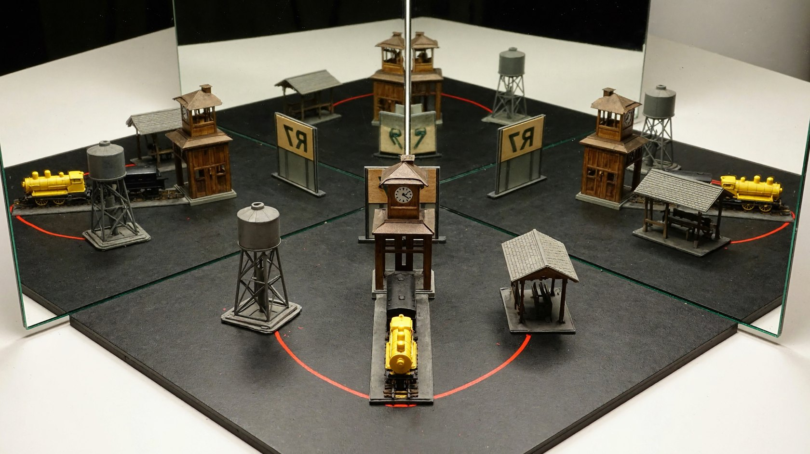
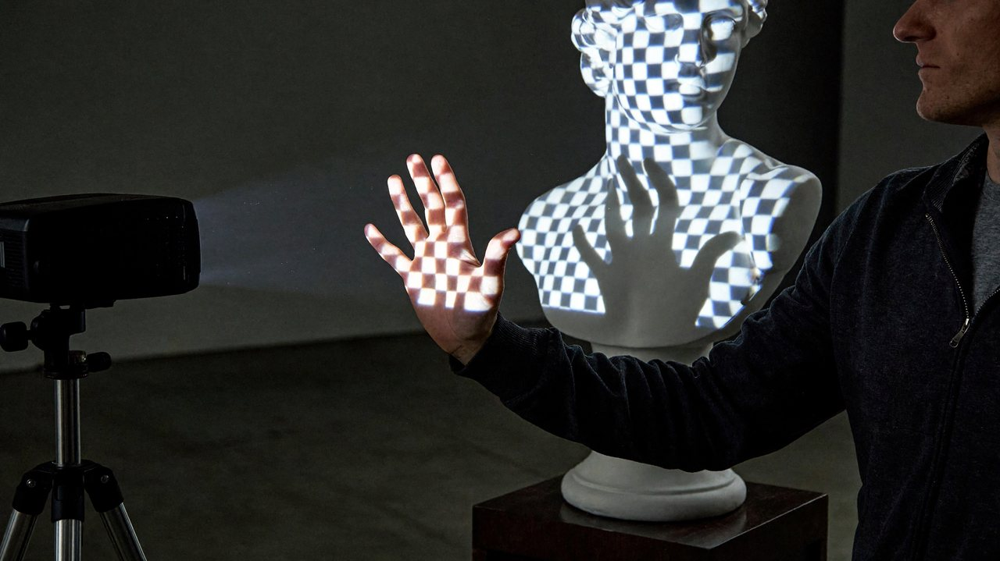
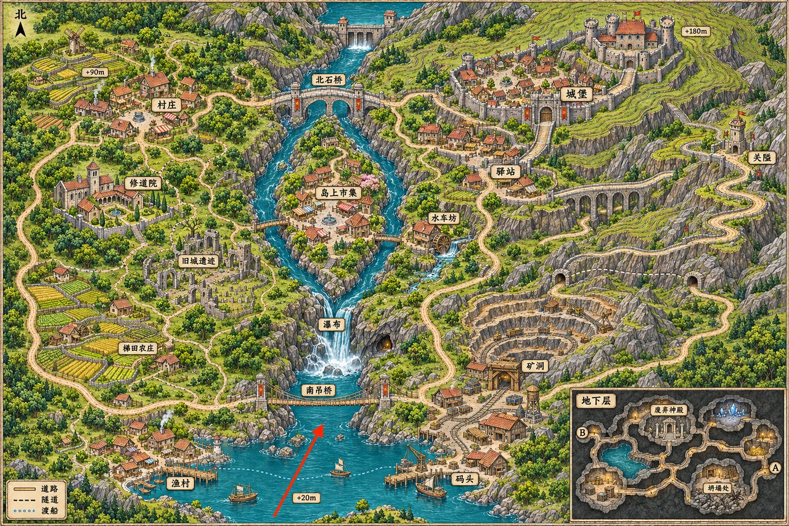
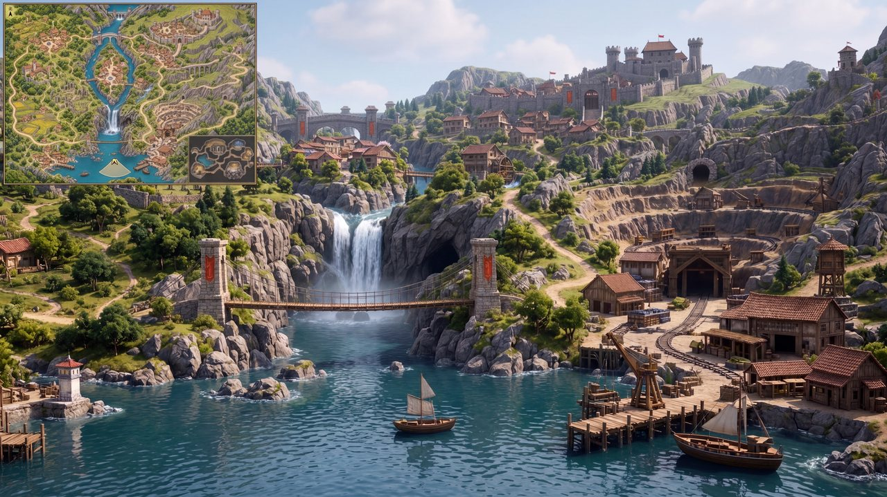
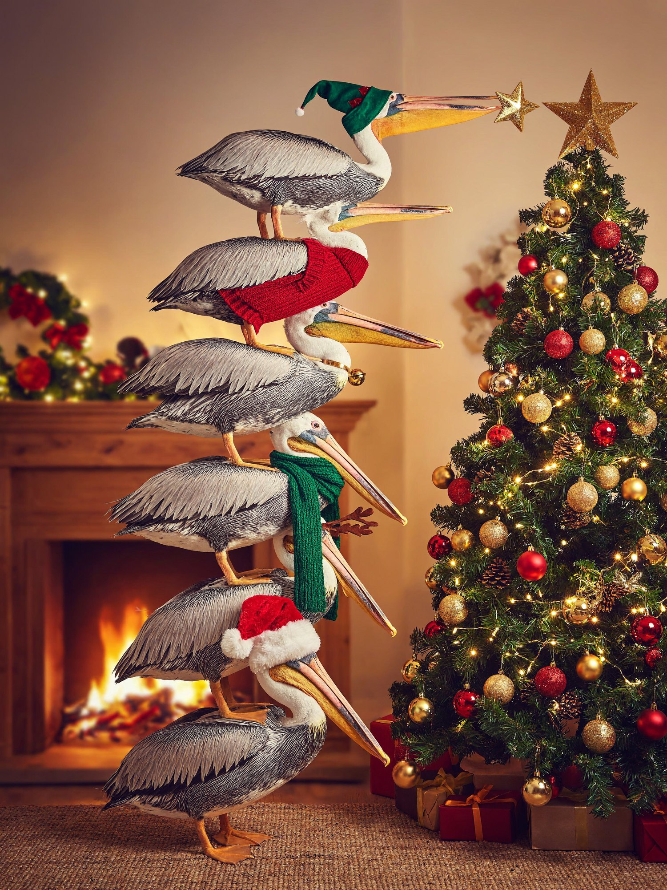
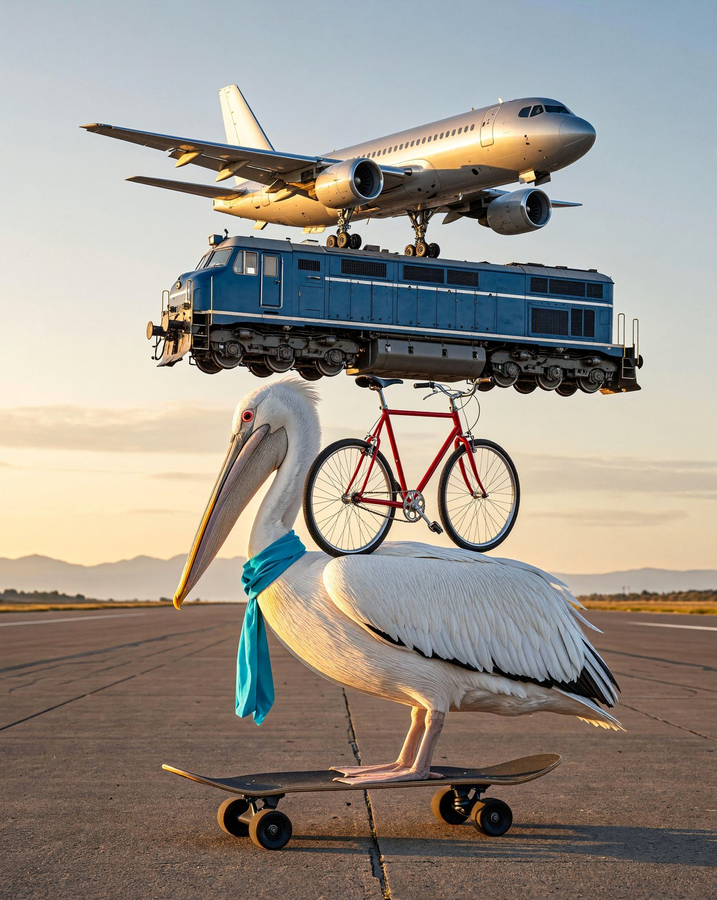

  <a href="visual-challenges.md">English</a> |
  <a href="visual-challenges.zh-CN.md">简体中文</a> |
  <a href="visual-challenges.ko.md"><strong>한국어</strong></a> |
  <a href="visual-challenges.ja.md">日本語</a>

# 복잡한 시각 과제

거울 반사, 투사와 가림, 2D 지도를 3D 장면으로 재현하기, 그리고 재미있는 펠리컨 과제 몇 가지.

← [정밀한 지시 이행과 이해](instruction-following.ko.md) · [쇼케이스](README.ko.md) · [게임 세계](game-worlds.ko.md) →

## 직각 거울

프롬프트

<blockquote>Show a tabletop optics demonstration as a realistic photograph: two upright plane mirrors meet along their vertical edges at a right angle, with their reflective surfaces facing inward. Photograph from the open side, slightly off-center, including the entire physical object in front of the mirror corner and all three corresponding sets of mirror images. The object is a small station model with a central clock tower, a tall water tower on only one side, a low waiting shelter on the other, and a small vehicle in front with a yellow front and black rear. A curved red line connects the base of the water tower to the waiting shelter. In front of the model stands a sign facing the mirror corner, bearing the text “R7”; the real camera view shows the back of the sign. Each side mirror contains one singly reflected image, and a doubly reflected image appears deep in the mirror corner. The side reflections show mirror-written text, while “R7” is readable normally in the double reflection. The water tower, waiting shelter, vehicle front, and red line all change direction together according to the reflections, preserving their spatial relationships to the clock tower. Make the mirror seam and apparatus base clearly visible, with sufficient space between reflections to identify each model image.</blockquote>

## 투사광 속의 손

프롬프트

<blockquote>A realistic on-site photograph of a projection art installation: a projector casts a blue-and-white checkerboard onto a white plaster bust, with the grid deforming over the bridge of the nose, cheeks, and curved chest. An operator stands beside the projection area and extends one hand with all five fingers spread into the beam in front of the sculpture's chest, palm facing the projector. Part of the checkerboard falls onto the palm itself, while a dark hand-shaped shadow without the checkerboard appears on the sculpture's chest behind it. Bright squares are cut off at the shadow boundary, while projected light still passes through the gaps between the fingers. Photograph from a front-side angle so that the actual hand and its shadow on the chest are offset in the composition, showing the person's upper body, the sculpture, and the operating projector at the side.</blockquote>

## 게임 지도에서 3D 게임 화면으로

<table><tr><td width="46%" valign="top"> 입력</td><td width="54%" valign="top"> 출력</td></tr></table>

프롬프트

<blockquote>Using the supplied game map as the sole spatial reference, generate a 16:9 in-game screenshot of an open-world game in a realistic 3D CG style. 
Camera Position and Direction 
Use the tail of the red arrow as the camera position and the direction of its tip as the viewing direction. The camera is approximately 1.7 meters above the lake in the southern part of the map, looking slightly east of north in first person with a field of view of about 70° and natural perspective. Do not show the player's body. 
Spatial Reconstruction 
Strictly reproduce the map's terrain elevations, building locations, river course, bridge connections, and road relationships. 
Determine the visible portions of the settlements on both banks, the mining area, the mountains, and the distant castle according to actual lines of sight. Preserve plausible occlusion and relative scale with distance. Do not move buildings, flatten the terrain, or widen the field of view merely to show every landmark. 
Visual Style 
Use high-quality, realistic game-engine rendering, with buildings and mountains at true scale, detailed rock, wood, vegetation, and water materials, natural daylight, global illumination, water reflections, and moderate atmospheric perspective. Convey the feeling of a player actually inhabiting this world. Avoid a hand-drawn map look, miniature diorama, isometric viewpoint, or bird's-eye composition. 
Upper-Left Minimap 
Add a clear game HUD minimap in the upper-left corner, approximately 15% of the image width. Use the surface map from the reference image as its thumbnail base, preserving the original proportions and north-up orientation. Retain major terrain and roads, and remove the underground inset. 
Mark the player's position with a small directional arrow at the location corresponding to the tail of the original red arrow. Its direction must exactly match the main camera view, with a pale fan-shaped area indicating the field of view. Use a simple thin border and keep the map legible. 
Output only one complete game screenshot. Do not include the original red arrow, place-name labels, elevation numbers, or map borders in the main scene. Add no interface elements other than the upper-left minimap.</blockquote>

## 펠리컨 졸업 피라미드

## 펠리컨 크리스마스트리

## 펠리컨 균형 잡기

---

← [정밀한 지시 이행과 이해](instruction-following.ko.md) · [쇼케이스](README.ko.md) · [게임 세계](game-worlds.ko.md) →
