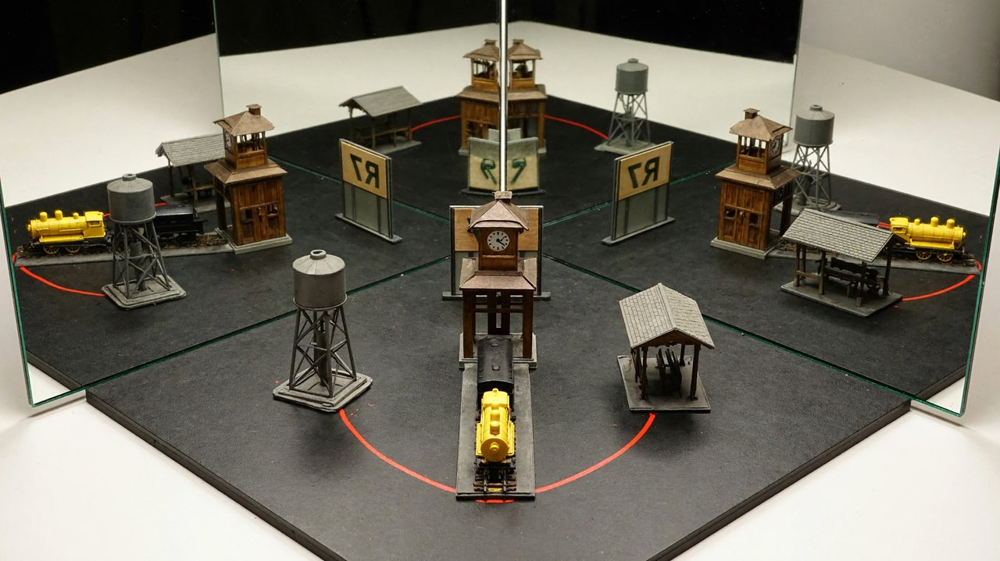
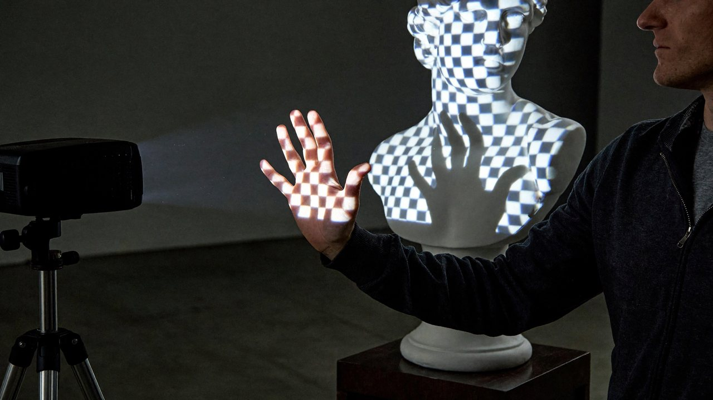
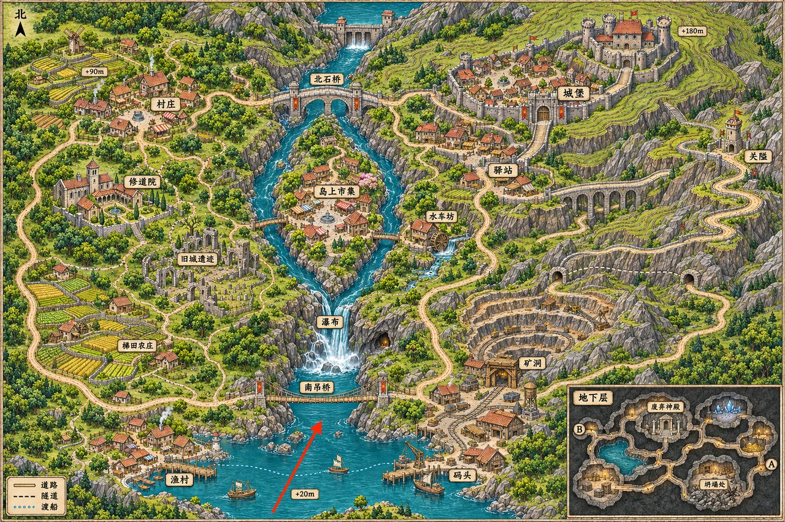
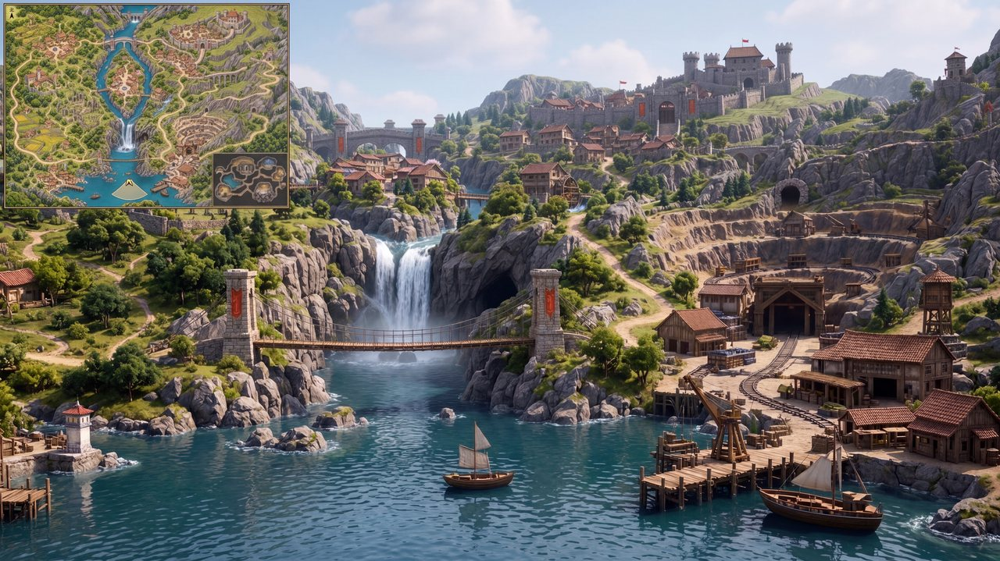

  <a href="visual-challenges.md">English</a> |
  <a href="visual-challenges.zh-CN.md"><strong>简体中文</strong></a> |
  <a href="visual-challenges.ko.md">한국어</a> |
  <a href="visual-challenges.ja.md">日本語</a>

# 复杂视觉挑战

← [机器人与具身智能](robotics.zh-CN.md) · [效果展示](README.zh-CN.md) · [游戏世界](game-worlds.zh-CN.md) →

## 直角镜面

提示词

<blockquote>真实摄影呈现一套桌面光学展示：两面竖直平面镜沿竖边相接，夹角为直角，镜面朝向夹角内部。相机从开口方向略偏一侧拍摄，完整纳入镜角前的实物和两面镜中的三组对应镜像。实物是一座小型车站模型：中央钟楼、只位于钟楼一侧的高水塔、另一侧的低候车棚，前方停着一辆带黄色车头和黑色尾部的小车；一根弯曲红线连接水塔底部与候车棚。模型前方竖着正面朝向镜角的标牌，文字为“R7”，实拍可见标牌背面。两侧各有一组经过一次反射的模型像，镜角深处还有一组经过两次反射的模型像；两侧标牌文字呈镜写，双次反射中的“R7”可以正常阅读。水塔、候车棚、车头和红线在三组镜像中随反射共同改变方向，保留各自与钟楼的位置关系。镜面接缝和装置底座清楚可辨，倒影之间留出足够空间识别每组模型。</blockquote>

## 伸进投影的手

提示词

<blockquote>一张真实的投影艺术装置现场照片：投影机把蓝白棋盘格投到白色石膏半身像上，格线随鼻梁、面颊和胸部曲面改变形状。操作者站在投射范围旁，将一只五指分开的手伸到雕像胸前的光路中，掌面朝向投影机。手掌本身接到一部分棋盘图案，后方雕像胸前则出现不含棋盘纹样的暗手影；亮格在影边被截断，指缝对应的位置仍有投射光通过。从侧前方取景，让实际手掌与胸前手影在画面中错开，能同时看到人物上半身、雕像和侧缘开启的投影机。</blockquote>

## 游戏地图变 3D 游戏画面

<table><tr><td width="46%" valign="top"> 输入</td><td width="54%" valign="top"> 输出</td></tr></table>

提示词

<blockquote>以提供的游戏地图为唯一空间依据，生成一张 16:9、写实 3D CG 风格的开放世界游戏实机画面。 
相机位置与朝向 
将红色箭头的尾端作为相机位置，箭头尖端所指方向作为镜头朝向。相机位于地图南部湖面上方约 1.7 米，以第一人称视角向北偏东看去，视野约 70°，保持自然透视。画面不出现玩家身体。 
空间还原 
严格按照地图还原地形高差、建筑位置、河流走向、桥梁连接和道路关系。 
根据真实视线决定两岸聚落、矿区、山体和远处城堡的可见范围。保留合理遮挡与远近比例，不要为了展示所有地标而移动建筑、拉平地形或扩大视野。 
画面风格 
高品质写实游戏引擎渲染，真实尺度的建筑与山体，细致的岩石、木材、植被和水面材质，自然日光、全局光照、水面反射与适度空气透视。呈现玩家真正置身于这个世界中的感觉。避免手绘地图质感、微缩沙盘、等距视角和鸟瞰构图。 
左上角小地图 
在画面左上角加入清晰的游戏 HUD 小地图，宽度约占画面的 15%。使用参考图的地表地图作为缩略底图，保持原始比例与北向朝上，保留主要地形和道路，去掉地下层插图。 
小地图上以一个小型方向箭头标出玩家位置，位置对应原图红色箭头的尾端，朝向与主画面镜头完全一致，并用淡色扇形表示视野范围。采用简洁细边框，保持地图清楚可读。 
最终只输出一张完整游戏画面。主场景中不要出现原图的红色箭头、地名标签、海拔数字或地图边框；除左上角小地图外，不添加其他界面元素。</blockquote>

## 鹈鹕毕业叠罗汉

## 鹈鹕圣诞树

## 鹈鹕平衡挑战

---

← [机器人与具身智能](robotics.zh-CN.md) · [效果展示](README.zh-CN.md) · [游戏世界](game-worlds.zh-CN.md) →
